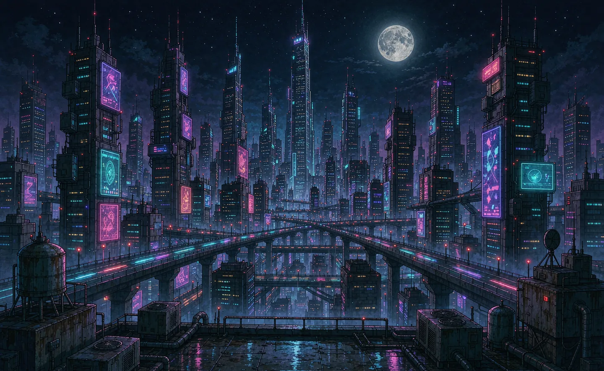

# 🌃 CAIUS. · 赛博朋克技术博客

> *一个会自己「盖起来」的 Hexo 博客 —— 一群模拟的 AI agent 光标把首页逐块拆掉，再一块块拼回来。*

[](https://xiaokaizhenshaui.github.io/)
[](LICENSE)
[](https://hexo.io/)
[](https://xiaokaizhenshaui.github.io/)
[](https://github.com/xiaokaizhenshaui/xiaokaizhenshaui.github.io/actions/workflows/deploy.yml)
[](https://github.com/xiaokaizhenshaui/xiaokaizhenshaui.github.io/stargazers)

点上方 **「在线演示」** 按钮，或者直接在已部署站点首页按 <kbd>Ctrl</kbd>/<kbd>⌘</kbd> + <kbd>Shift</kbd> + <kbd>B</kbd>，看一群 agent 如何把页面重建一遍。


## 一览 · At a glance

| | |
|---|---|
| 站点 | [`xiaokaizhenshaui.github.io`](https://xiaokaizhenshaui.github.io/) · 由 GitHub Pages 自动构建发布 |
| 框架 | Hexo 7.3（EJS 模板 + 自研主题 `cyber-otaku`） |
| 重建特效 | 来自 [`@magnoscg/agent-build`](https://github.com/magnoscg/agent-build)（自托管 + 中文本地化），MIT |
| 视觉资产 | 《赛博朋克 边缘行者》第一季风格原创同人图：白毛紫瞳少女 · 带霓虹耳机的少年技术宅 |
| 视觉层 | 夜之城背景 · 霓虹粒子数据流 · 鼠标光晕 · glitch 文字 · 卡片 3D 倾斜 · 看板娘 · FX 控制台 |
| 内容 | 41 篇中文技术博客（Java / TypeScript / GraphQL / AI 工具 / 大模型 / 月度复盘） |
| 部署 | `push main` → 构建 → `actions/deploy-pages`，全自动 |
| 无障碍 | 尊重 `prefers-reduced-motion`；重建特效始终明示「这是一场 SIMULATION」 |

## 目录

- [特效展示（展示跳转）](#特效展示展示跳转)
- [特性](#特性)
- [快速开始](#快速开始)
- [写一篇新文章](#写一篇新文章)
- [目录结构](#目录结构)
- [自定义特效](#自定义特效)
- [视觉资产与版权](#视觉资产与版权)
- [致谢](#致谢)
- [许可证](#许可证)

## 特效展示（展示跳转）

线上站点：[**https://xiaokaizhenshaui.github.io/**](https://xiaokaizhenshaui.github.io/)

重建动画有三种触发方式，全部经过本地化与无障碍处理：

| 触发方式 | 说明 |
|---|---|
| 首页 `$ rebuild --agents` 按钮 | 藏在 hero 区，agent-build 脚本就绪后才显示 |
| <kbd>Ctrl</kbd>/<kbd>⌘</kbd> + <kbd>Shift</kbd> + <kbd>B</kbd> | 快捷键彩蛋 |
| Konami 序列 | `↑ ↑ ↓ ↓ ← → ← → B A` |
| 看板娘点击 | 随机台词，与重建无关，纯整活 |

重建过程中：页面被拆成带尺寸标签的选框、agent 光标带着角色名飞出中枢、标尺与参考线浮现，右上角 HUD 实时汇报「第 N 层 / 共 M 层」「运行耗时」。结束即恢复，全程标注 **SIMULATION**，绝不伪装成真在加载。

## 特性

- **🌆 夜之城视觉**：深空蓝底 + 霓虹青/品红/紫描边，全站 CSS 变量可换肤。
- **🤖 agent-build 重建特效**：自托管两文件（`vendor/agent-build.min.js` + `.css`），注入 `zh-CN` 文案，`<button hidden>` 默认隐藏、脚本就绪才显示。
- **✨ 霓虹粒子数据流**：Canvas 粒子随光标轻微扰动，移动端自动减半。
- **💡 鼠标光晕**：跟随指针的霓虹辉光，覆盖层用 `pointer-events:none` 不挡操作。
- **📡 glitch 文字**：标题随机抖动故障效果，定时 + 悬停双触发。
- **🪧 卡片 3D 倾斜**：文章卡随鼠标视角微倾，离开即复位。
- **👧 看板娘**：白毛少女头像 + 耳机少年立绘，点击蹦台词。
- **🎛️ FX 控制台**：右下角可逐项开关粒子/背景/光晕/故障/看板娘，状态存 `localStorage`。
- **📝 41 篇博客**：含 AI 编码工具横评、RAG/embedding 检索、GraphQL/OTel 可观测性、Kafka 幂等等真实踩坑。
- **🔍 站内搜索**：生成 `search.json`，纯前端检索。

## 快速开始

### 本地预览

```sh
# 1. 安装依赖（已带 package-lock.json，可复现）
npm ci --no-audit --no-fund

# 2. 生成静态站点
npx hexo clean
npx hexo generate

# 3. 起本地服务看效果
npx hexo server            # http://localhost:4000
# 或者直接用静态产物：
python3 -m http.server 4000 --directory public
```

> 想直接看线上已构建版本？打开 [https://xiaokaizhenshaui.github.io/](https://xiaokaizhenshaui.github.io/)。

### 质量门禁（CI 同款）

```sh
python3 tools/check_assets.py   # 检查禁用词、外链图片、代码块语言标注
```

## 写一篇新文章

```sh
npx hexo new "我的新文章"
```

或直接新建 `source/_posts/YYYY-MM-DD-slug.md`，front-matter 必填：`title` / `date` / `categories` / `tags` / `lead`。图片统一放 `source/images/`，文章中用相对路径引用。

推送即发版：

```sh
git push origin main        # 触发 .github/workflows/deploy.yml 自动构建部署
```

## 目录结构

```
.
├── _config.yml                 # Hexo 站点配置
├── source/
│   ├── _posts/                 # 41 篇博客（.md）
│   └── images/                 # 视觉资产（webp/svg）
├── themes/cyber-otaku/         # 自研赛博朋克主题
│   ├── layout/                 # EJS 模板
│   └── source/
│       ├── assets/css/         # style.css + effects.css
│       ├── assets/js/          # main.js + effects.js
│       └── vendor/             # 自托管的 agent-build（min.js/min.css）
├── tools/                      # check_assets.py 等校验脚本
├── .github/workflows/deploy.yml# 自动部署
└── demo/watch-demo.svg         # README 里的「在线演示」跳转按钮
```

## 自定义特效

### agent-build 重建动画

在 `themes/cyber-otaku/layout/index.ejs` 的按钮上改 `data-agent-*`：

```html
<button class="fx-build-btn" data-agent-build
        data-agent-pace="0.9"     <!-- 节奏倍率，越大越慢 -->
        data-agent-count="18"     <!-- agent 数量 1–40 -->
        data-agent-accent="#45e0f5" <!-- 霓虹主色 -->
        data-agent-hub="/images/hub.svg"></button> <!-- 飞出的中枢图标 -->
```

中文本地化在 `themes/cyber-otaku/source/assets/js/effects.js` 的 `AB.addLocale('zh-CN', …)`，库强制要求文案以 `SIMULATION` 开头并明示模拟，改文案时别动这条规则。

### FX 控制台开关

`effects.js` 顶部 `defaults` 控制默认开关，`fx-*` 系列 body class 控制单项：

```js
var defaults = { particles: true, city: true, scan: true, glow: true, waifu: true };
```

看板娘台词、粒子配色（`palette`）、触发快捷键都在同一文件里，按需改即可。

## 视觉资产与版权

- 头像（白毛紫瞳少女）、立绘（带霓虹耳机的少年技术宅）、夜之城背景均为**原创同人风格插画**，灵感来自《赛博朋克 边缘行者》第一季，仅作个人博客非商用展示。
- 站内图标 `hub.svg`、横幅 `hero-city.webp` 为项目自制。

## 致谢

- 页面重建特效来自 [@magnoscg/agent-build](https://github.com/magnoscg/agent-build) —— 纯原生 JS/CSS、零运行时依赖、尊重 CSP 与 reduced-motion。本项目自托管其 `1.0.6` 并加了中文本地化。
- 角色与场景风格致敬《赛博朋克 边缘行者》（Cyberpunk: Edgerunners）第一季。

## 许可证

- 本仓库代码（主题、特效层、构建与部署配置）以 **MIT** 许可证发布，见 [`LICENSE`](LICENSE)。
- 自托管的 `agent-build` 库遵循其自身的 **MIT** 许可证，见 [`themes/cyber-otaku/source/vendor/LICENSE.agent-build.txt`](themes/cyber-otaku/source/vendor/LICENSE.agent-build.txt)。
- 视觉资产为个人非商用同人创作，请勿挪作商业用途。
