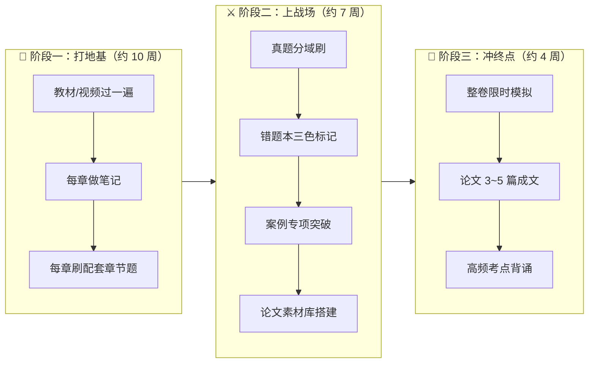
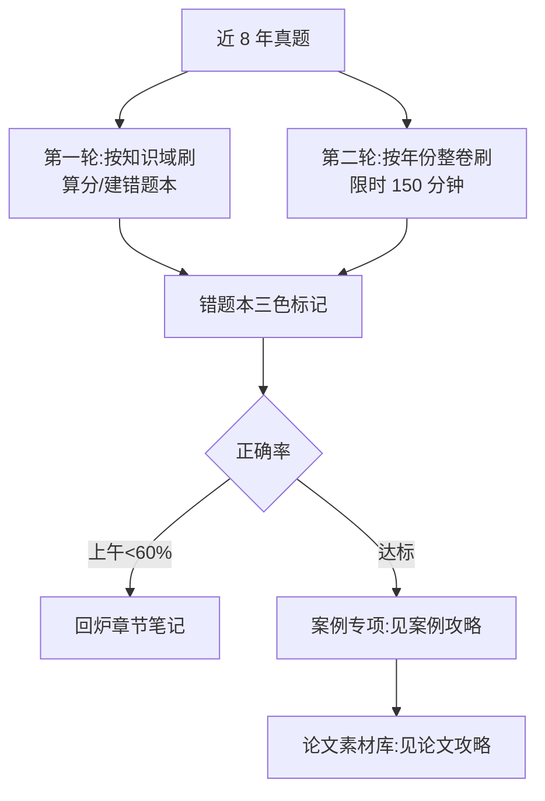

> **摘要**：
> 每天 **1.5~2 小时**学习时间的在职考生。全职备考可压缩到 2~3 个月。

## 总览：三阶段火箭模型

## 阶段一：打地基（把书读厚）

| 周次 | 架构师任务 | 项管师任务 |
|---|---|---|
| 1 | [考试全貌与报名](考试全貌与报名/) + 摸底一套真题（不计分感受题型） | 同左 |
| 2-3 | [01-计算机系统基础](../01-系统架构设计师/架构-章节笔记/01-计算机系统基础/) [02-操作系统与嵌入式基础](../01-系统架构设计师/架构-章节笔记/02-操作系统与嵌入式基础/) [03-数据库系统](../01-系统架构设计师/架构-章节笔记/03-数据库系统/) | [01-信息化与信息系统](../02-信息系统项目管理师/项管-章节笔记/01-信息化与信息系统/) [02-信息技术发展前沿](../02-信息系统项目管理师/项管-章节笔记/02-信息技术发展前沿/) [03-信息系统治理与标准](../02-信息系统项目管理师/项管-章节笔记/03-信息系统治理与标准/) |
| 4-5 | [04-数据结构与算法](../01-系统架构设计师/架构-章节笔记/04-数据结构与算法/) [05-程序设计语言与编译](../01-系统架构设计师/架构-章节笔记/05-程序设计语言与编译/) [06-网络基础与信息安全](../01-系统架构设计师/架构-章节笔记/06-网络基础与信息安全/) | [04-项目管理概论](../02-信息系统项目管理师/项管-章节笔记/04-项目管理概论/) [05-项目整合管理](../02-信息系统项目管理师/项管-章节笔记/05-项目整合管理/) [06-项目范围管理](../02-信息系统项目管理师/项管-章节笔记/06-项目范围管理/) |
| 6-7 | [07-多媒体基础](../01-系统架构设计师/架构-章节笔记/07-多媒体基础/) [08-软件工程基础](../01-系统架构设计师/架构-章节笔记/08-软件工程基础/) [09-面向对象方法](../01-系统架构设计师/架构-章节笔记/09-面向对象方法/) | [07-项目进度管理](../02-信息系统项目管理师/项管-章节笔记/07-项目进度管理/) [08-项目成本管理](../02-信息系统项目管理师/项管-章节笔记/08-项目成本管理/) [09-项目质量管理](../02-信息系统项目管理师/项管-章节笔记/09-项目质量管理/) |
| 8-9 | [10-设计模式](../01-系统架构设计师/架构-章节笔记/10-设计模式/) [11-软件架构设计](../01-系统架构设计师/架构-章节笔记/11-软件架构设计/) [12-架构风格与架构评估](../01-系统架构设计师/架构-章节笔记/12-架构风格与架构评估/) | [10-项目资源管理](../02-信息系统项目管理师/项管-章节笔记/10-项目资源管理/) [11-项目沟通与干系人管理](../02-信息系统项目管理师/项管-章节笔记/11-项目沟通与干系人管理/) [12-项目风险管理](../02-信息系统项目管理师/项管-章节笔记/12-项目风险管理/) |
| 10 | [13-Web架构与中间件](../01-系统架构设计师/架构-章节笔记/13-Web架构与中间件/) [14-云原生与大数据架构](../01-系统架构设计师/架构-章节笔记/14-云原生与大数据架构/) [15-系统可靠性与性能](../01-系统架构设计师/架构-章节笔记/15-系统可靠性与性能/) [16-嵌入式与实时系统架构](../01-系统架构设计师/架构-章节笔记/16-嵌入式与实时系统架构/) | [13-项目采购管理](../02-信息系统项目管理师/项管-章节笔记/13-项目采购管理/) [14-绩效域与价值交付](../02-信息系统项目管理师/项管-章节笔记/14-绩效域与价值交付/) [15-配置与变更管理](../02-信息系统项目管理师/项管-章节笔记/15-配置与变更管理/) [16-法规标准与职业道德](../02-信息系统项目管理师/项管-章节笔记/16-法规标准与职业道德/) [17-项目管理科学基础](../02-信息系统项目管理师/项管-章节笔记/17-项目管理科学基础/) |

**每章动作固定五步**（对应每章笔记的结构）：

1. 看本库笔记的「知识地图」，建立骨架
2. 配合 B 站视频（每章笔记已附链接）过一遍难点
3. 精读「掰碎讲解」，把类比在脑子里讲给自己听（费曼法）
4. 背「章节重点」表格（用 Anki 做成卡片）
5. 做「反复练习题」，错题标记进错题本

## 阶段二：上战场（把书读薄）

- **真题来源**：[qicoder真题索引](../99-真题资源/qicoder真题索引/)（全部免费带解析）
- **错题三色法**：🔴 知识空白（重学）→ 🟡 概念混淆（对比记忆）→ 🟢 粗心失误（只提醒）
- 案例题开始动笔写，不要只看答案——机考打字，练的就是快速组织文字

## 阶段三：冲终点（考前 1 个月）

1. **整卷模拟** ≥ 4 套（严格 150/90/120 分钟限时，用真题最近年份）
2. **论文成文** 3~5 篇不同领域（架构师：质量/架构风格/数据库/嵌入式；项管：十大领域任选高频的 5 个）
3. **背诵清单**：本库每章「⭐ 章节重点」全部过第 3 遍
4. 考前一天：只看错题本和论文提纲，不学新东西

## ⏱️ 每日时间模板（在职版）

| 时段 | 时长 | 内容 |
|---|---|---|
| 通勤/午休 | 30 min | Anki 刷卡（重点表格/口诀） |
| 晚上 | 60-90 min | 当前进度：视频+笔记+章节题 |
| 周末各半天 | 3-4 h | 真题整卷 / 案例论文专项 |
| 睡前 5 min | 5 min | 回想今天学了什么（主动回忆） |

> **完成**：
> 不是学得最久的人，而是 **真题刷得最透 + 论文准备最早** 的人。论文别拖到考前一周，阶段二就要开始攒素材。
