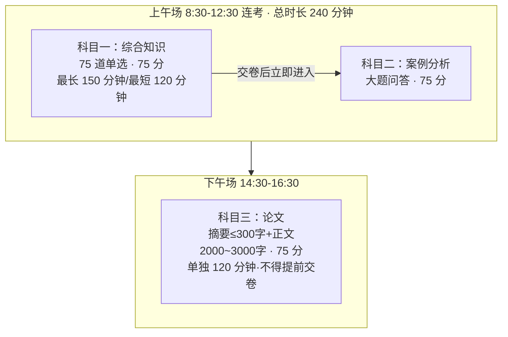
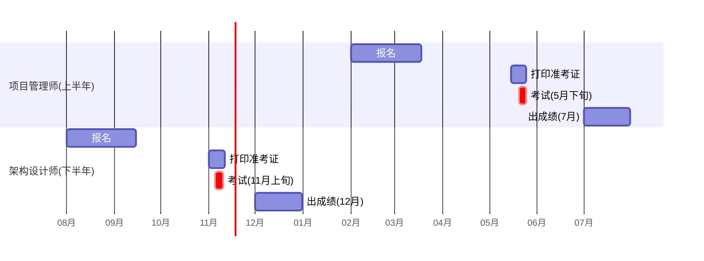

## 🎯 软考是什么（给纯小白）

**软考**全称「计算机技术与软件专业技术资格（水平）考试」，由**工信部 + 人社部**联合组织，全国统考。它最大的特点是：

> **重点**：
> 1. **职称**：高级证书 = 以考代评「高级工程师」职称（副高），国企/事业单位/投标直接用
> 2. **落户/积分**：北上广深等多数城市积分落户加分项（如上海居住证积分 100 分档）
> 3. **补贴**：个税继续教育专项抵扣 3600 元/年，部分城市有数千元人才补贴

高级资格共 5 个，本库聚焦最热门的两个：

| | 系统架构设计师 🏛️ | 信息系统项目管理师 📋 |
|---|---|---|
| 适合人群 | 技术岗（开发/运维/测试想进阶架构） | 管理岗（项目经理/产品/非技术转管理） |
| 考试频次 | **每年 1 次，下半年 11 月** | **每年 1 次，上半年 5 月** |
| 技术要求 | 高（要真懂技术） | 中（管理为主，技术考概念） |
| 通过率 | 约 10%~15% | 约 15%~20% |

## 📝 考试科目结构（机考现行规则·三科全过才算过）

> **注意**：
> **三科各自 ≥ 45 分**（满分 75）才算通过，**任何一科不过 = 全部重来，成绩不保留**。很多人倒在「过了两科」心态上，务必三科均衡。
>
> 注意：连考模式下上午连续作战 3.5~4 小时，**平时模拟就要练"综合知识+案例连着做"**的体力与节奏。改革细节详见 [考纲改革速览(2024-2026)](考纲改革速览(2024-2026)/)。

## 🖥️ 机考时代的重要变化（2023 下半年起）

软考已全面改为**计算机化考试**（上机答题），带来这些变化：

1. **报名**：全程网上，中国计算机技术职业资格网 → www.ruankao.org.cn
2. **考试形式**：论文也是**电脑打字**，对手写差的人是重大利好；支持输入法仅限系统自带几种，平时练打字速度（3000 字/2 小时 ≈ 25 字/分钟）
3. **抽题**：同一考场多套试卷随机抽取，押题命中率下降 → **真题覆盖面必须拉满**
4. **工具**：综合知识有计算器（系统调用），案例分析可用文字编辑器画表

### 报名时间线（以 2026-2027 为例，每年节奏相似）

> **笔记**：

## 💡 怎么选科目（30 秒决策）

- 写过代码、看得懂数据库表和 UML → **架构师**（上午题技术占比 70%+）
- 没技术背景 / 管理岗 / 只想拿职称最快 → **项管师**（上午题技术仅 30% 左右，其余全是管理理论）
- 两个都想考 → 顺序建议：先项管（5 月）再架构（11 月），管理理论复用率高

## ➡️ 下一步

选好科目后，去 [小白备考路线图](小白备考路线图/) 定计划，再进入对应科目的 [架构-考试分析](../01-系统架构设计师/架构-考试分析/) 或 [项管-考试分析](../02-信息系统项目管理师/项管-考试分析/)。
