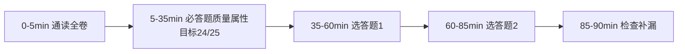

> **摘要**：
> 90 分钟,通常 1 道必答(质量属性与架构评估)+ 4 选 2。每题 25 分,小问 5-10 分。**答题公式:结论先行 → 分点展开 → 引用题干细节**。

## 必考题型一：质量属性 + 架构评估(每年必考,先拿满这 25 分)

### 1. 质量属性识别(送分小问)

题干给一段系统描述,问"体现了哪些质量属性"。六大属性判断口诀:

| 属性 | 题干信号词 |
|---|---|
| 性能 | "用户操作 3 秒内响应""高峰 1000 并发" |
| 可用性 | "7×24""故障后 5 分钟恢复""双机热备" |
| 安全性 | "防 SQL 注入""权限控制""数据加密" |
| 可修改性 | "未来要支持新业务""替换数据库厂商" |
| 可测试性 | "便于自动化测试""可模拟外部接口" |
| 易用性 | "新手无需培训""界面友好" |

### 2. 质量属性场景六要素(填空送分)

> **刺激源 → 刺激 → 制品(环境中的系统部分)→ 环境 → 响应 → 响应度量**
> 例:"运维人员(源)向系统部署新版本(刺激),部署服务(制品),在夜间低峰期(环境),系统在 10 分钟内完成灰度发布(响应),停机时间不超过 1 分钟(响应度量)"。——记住"源刺制环响响"。

### 3. 质量属性战术(问答必背)

| 属性 | 常用战术(写 3-4 个就够) |
|---|---|
| 可用性 | 心跳检测、Ping/Echo、冗余(主备/集群)、故障转移、回滚 |
| 性能 | 缓存、负载均衡、并发处理、资源调度、减少计算开销 |
| 安全性 | 身份认证、授权、审计日志、加密、限制访问 |
| 可修改性 | 信息隐藏、抽象接口、模块化、关注点分离 |
| 可测试性 | 依赖注入、日志记录、可观测接口、内置自检 |

### 4. 敏感点 / 权衡点 / 风险点 / 非风险点(判断题模板)

- **敏感点**:一个决策只影响一个质量属性 → 句式:"XX 的实现方式对【性能】这一属性有重要影响,是敏感点"
- **权衡点**:一个决策同时影响多个质量属性(通常是拉扯关系)→ 句式:"采用 XX 同时影响【性能】和【安全性】,二者此消彼长,是权衡点"
- **风险点**:架构师判断"这样下去可能出问题"→ 有隐患描述
- **非风险点**:分析后确认"这样没问题"→ 无隐患描述

> **注意**：
> 题干说"加密会导致性能下降"——这是**权衡点**(安全↑性能↓两个属性),不是敏感点!"缓存机制直接决定响应时间"——单一属性,敏感点。

### 5. ATAM/SAAM(小问常客)

- **SAAM**:特定场景分析,步骤=场景开发→场景分类→场景交互→评估
- **ATAM**:架构权衡分析,在 SAAM 基础上引入质量属性场景效用树、敏感点权衡点分析,步骤=ATAM 表述→调查分析→测试→报告
- 区别一句话:SAAM 只看场景,ATAM 多了"权衡"和"效用树"

## 选考题型二：架构风格选型(论述题)

答题模板(以"给某电商系统选择架构风格"为例):

> 1. **需求分析**:从题干提取关键约束(高并发/快速迭代/团队规模…)
> 2. **候选风格对比**:给 2-3 个候选(如分层 vs 微服务 vs 事件驱动),各写"优点 + 缺点"各 2 条
> 3. **选择结论**:明确选谁
> 4. **理由结合题干**:每条理由必须出现题干里的词("题干指出系统需要频繁迭代,事件驱动风格通过消息解耦,恰好支持独立迭代…")
> 5. **落地方案**:画出/描述落地架构(用文字描述分层或服务划分)

五大类风格速查见 [12-架构风格与架构评估](架构-章节笔记/12-架构风格与架构评估/)。

## 选考题型三：数据库改造(高频)

典型题干:"单库单表撑不住了/查询慢了/要支持多业态",答题要点:

1. **先分析瓶颈**:读写混合单库 → 读写瓶颈;单表过大 → 数据量瓶颈;多业务耦合 → 架构瓶颈
2. **改造方案分层给**:
	- 缓存层:引入 Redis 缓存热点数据,减少 DB 压力(注意缓存穿透/击穿/雪崩及对策)
	- 读写分离:主库写、从库读,主从复制
	- 分库分表:垂直拆(按业务)/水平拆(按行,分片键选择要说明)
	- 非关系型补充:日志类→文档型 MongoDB;关系复杂强一致→保留 MySQL
3. **代价与权衡**:一致性(CAP)、跨库 join、事务复杂度上升——写出来是加分项

## 选考题型四：Web 架构 / 微服务

- 负载均衡算法选择(轮询/加权/最少连接/一致性哈希,结合题干服务器配置说明理由)
- 无状态设计 + Session 集中化(Redis 存储)或改 JWT
- 单体 → 微服务改造步骤:识别服务边界(按业务能力)→ 数据库拆分 → 引入注册中心/网关 → 灰度迁移 → 服务治理(熔断/限流/监控)
- 细节库:[13-Web架构与中间件](架构-章节笔记/13-Web架构与中间件/)

## 选考题型五：面向对象(类图补全 / 设计模式应用)

- 补类图:先看"谁持有谁的引用"定关联,看"整体-部分且同生命周期"定组合,再看泛化
- 设计模式题:场景 → 写模式名 + 意图 + 类图关键变化。高频:策略/观察者/状态/职责链/工厂族
- 细节库:[09-面向对象方法](架构-章节笔记/09-面向对象方法/) [10-设计模式](架构-章节笔记/10-设计模式/)

## 时间与作答策略

> **提示**：
> 1. **分点编号作答**:阅卷按点给分,"①②③"比大段落多得分
> 2. **术语出现在句首**:把"敏感点""权衡点""读写分离"这些词放在每句开头,扫卷时一眼可见
> 3. **不确定也写**:案例题不倒扣,写满相关术语有机会踩中得分点;但每点要完整一句,不写半句
