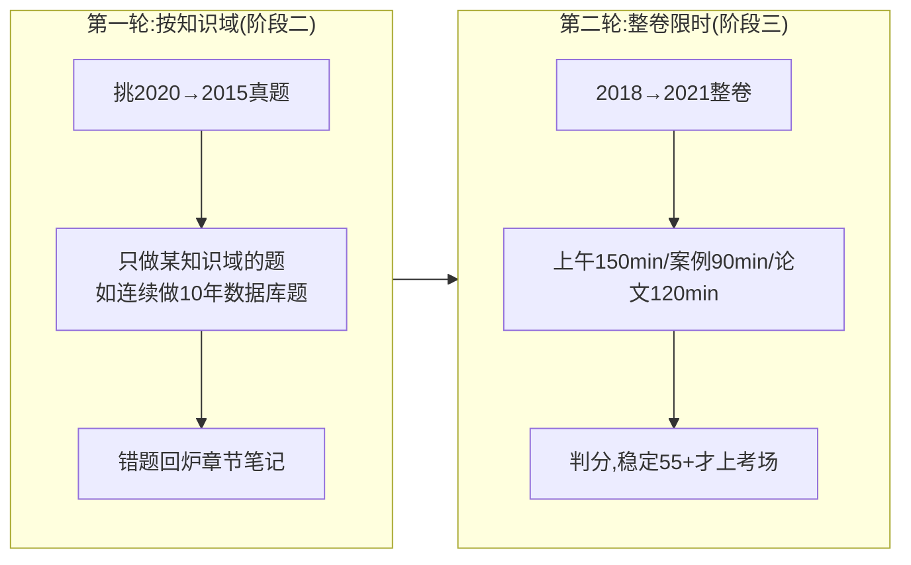

> **摘要**：
> 真题是最好的教材。架构师真题的重复率极高——不是原题重复，而是**考法重复**：同一个知识点换数字、换场景再考。

## 一、三科命题特点

### 上午综合知识(75 题)

| 特点 | 说明 | 对策 |
|---|---|---|
| 考法固定 | 前趋图/位示图/流水线/海明码/子网划分/遍历/关键路径/McCabe 这些"计算套路题"每年轮着出 | 把每章练习题的计算模板练熟,见 [架构-高频错题集](架构-高频错题集/) |
| 原文复现 | 质量属性战术、架构评估术语、UML 关系、设计模式意图,基本是教材原文挖空 | 背 [12-架构风格与架构评估](架构-章节笔记/12-架构风格与架构评估/) 和 [10-设计模式](架构-章节笔记/10-设计模式/) 的重点表 |
| 英语固定 | 最后 5 道英语题,题材就是"软件开发过程/架构描述" | 攒高频词(architecture/maintainability/coupling…),考前突击 |
| 新技术点缀 | 每年 2-4 道云原生/大数据/AI 题 | 看 [14-云原生与大数据架构](架构-章节笔记/14-云原生与大数据架构/) |

### 下午案例分析(3 题)

近十年必考 1 道**质量属性+架构评估**,选答里常出现 Web 架构、数据库改造、面向对象建模。答题有强烈模板性,详见 [架构-案例分析攻略](架构-案例分析攻略/)。

### 下午论文(四选一)

高频主题池很小:架构风格、质量属性、数据库、Web/中间件、微服务/云原生。**提前准备好项目背景+4 篇提纲**就足够,详见 [架构-论文攻略](架构-论文攻略/)。

## 二、刷题两轮法(配合 [qicoder真题索引](../99-真题资源/qicoder真题索引/))

> **提示**：
> qicoder 收录到 2020/2021 为止。机考后(2023 起)官方不再公布完整真题,只有考生回忆版——去 B 站搜「架构师 真题回忆」或各机构模考卷,回忆版虽不全,但**案例必考的质量属性题和论文题每年都被完整回忆出来**,价值依然极高。

## 三、机考后的新趋势(2023–2026 实锤)

1. **上午题**风格没大变,计算题依然年年有;**AI/云原生/大数据题明显加量**(新考纲上调前沿技术权重)
2. **案例题**更贴近工程实践,2025 下半年回忆版实锤:必答题仍是质量属性与架构评估;选答出现 **DDD 限界上下文、Petri 网建模、智能操作系统与 AI 融合、嵌入式**——技术前沿概念必须按 [13-Web架构与中间件](架构-章节笔记/13-Web架构与中间件/) [14-云原生与大数据架构](架构-章节笔记/14-云原生与大数据架构/) [09-面向对象方法](架构-章节笔记/09-面向对象方法/) 补齐
3. **论文**2025 下半年考了《软件性能测试技术及其应用》——高频主题池扩大到"性能/测试"方向,[15-系统可靠性与性能](架构-章节笔记/15-系统可靠性与性能/) 的性能测试类型是现成提纲素材;机考打字后字数不是压力,但**查重感更强**,纯套模板难得高分,要有自己项目的细节
4. 考试形式:综合知识+案例**连考**(上午,总 240 分钟),论文单独下午 120 分钟;架构师每年 11 月一次,详见 [考纲改革速览(2024-2026)](../00-备考指南/考纲改革速览(2024-2026)/)

## 四、考前 30 天清单

- [ ] 近 3 年整卷各刷 1 遍,错题全部消化
- [ ] [12-架构风格与架构评估](架构-章节笔记/12-架构风格与架构评估/) 的术语表背到"条件反射"
- [ ] [10-设计模式](架构-章节笔记/10-设计模式/) 的 23 种模式意图全部过 3 遍
- [ ] 论文 4 篇提纲默写 1 遍,完整成文 1 篇
- [ ] 英语题词汇表过 2 遍
- [ ] 机考系统操作(如何在电脑上画图/写表)提前看官方模拟系统
