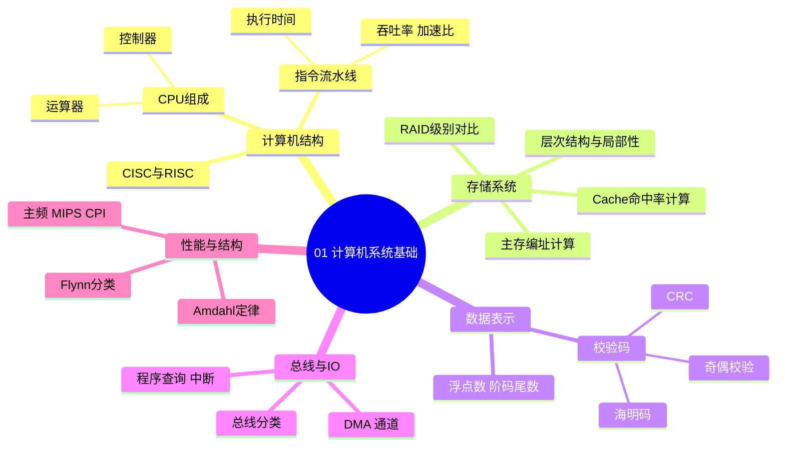
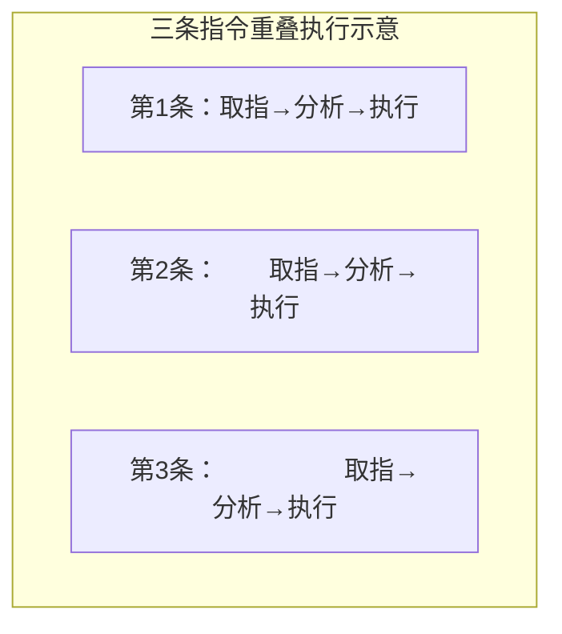
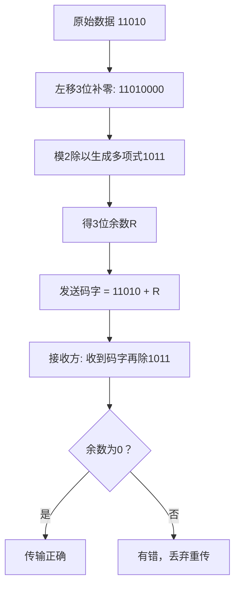

> **摘要**：
> 这章讲"计算机这台机器怎么运转"：CPU 怎么算、数据怎么存、内存怎么编址、数据传丢了怎么发现。上午题稳定考 4~6 分，几乎全是计算题（流水线、Cache、主存编址、海明码、RAID），属于"练会就是送分"的章节；案例题一般不直接考本章，但 RAID、可靠性与 [15-系统可靠性与性能](15-系统可靠性与性能/) 联动。建议投入 6~8 小时，每个公式亲手算三遍。

## 🗺️ 知识地图

## 📖 掰碎讲解

### 1.1 CPU 组成：一台精密的"小工厂"

**是什么**：CPU 由运算器（ALU）、控制器（CU）、寄存器组和内部总线组成。运算器负责算术/逻辑运算，控制器负责取指令、分析指令、发号施令。

**大白话**：把 CPU 想成一家小工厂——运算器是车间里的加工机器，控制器是厂长（只指挥不动手），寄存器是工人手边的小储物柜（快但小），程序计数器 PC 是厂长手里的"下一件活"备忘录。

**部件归属（必背，反复考）**：

| 部件 | 包含的寄存器/部件 |
|---|---|
| 运算器 | ALU、累加器 ACC、状态寄存器 PSW、通用寄存器组 |
| 控制器 | 程序计数器 PC、指令寄存器 IR、指令译码器 ID、时序部件 |

**怎么考**：选择题问"程序计数器/指令译码器属于哪个部件"。陷阱：ACC、PSW 容易被误归入控制器，它们属于运算器；PC 记的是"下一条指令地址"，不是"当前指令"（当前指令在 IR 里）。

### 1.2 指令流水线：洗衣店的并行智慧

**是什么**：把一条指令拆成"取指→分析（译码）→执行"等阶段，多条指令的不同阶段重叠并行执行。

**大白话**：洗一桶衣服 = 洗 30 分钟 + 烘 30 分钟 + 叠 10 分钟。笨办法是等一桶全做完再做下一桶；流水线是第一桶进烘干时第二桶立刻进洗衣机——每台机器都不闲着。注意流水线周期取决于**最慢**的那一步（烘干 30 分钟）。

**公式（必背，上午题高频）**：
- 流水线执行时间 = (k + n − 1) × Δt，k 为流水线段数，n 为指令条数，Δt 为流水线周期（各段时间不等时取**最长段**）
- 吞吐率 TP = n / 执行时间；n→∞ 时极限吞吐率 = 1/Δt
- 加速比 S = 不使用流水线时间 / 使用流水线时间；各段等长时 S = kn/(k+n−1)

**怎么考**：给段数、各段时间、指令条数，算执行时间/吞吐率/加速比。陷阱：①Δt 要用最长段时间；②别漏首条指令走完全程；③加速比上限趋近于段数 k。

### 1.3 CISC 与 RISC：百货商店 vs 便利店

| 维度 | CISC 复杂指令集 | RISC 精简指令集 |
|---|---|---|
| 指令数量/寻址方式 | 多 | 少 |
| 指令长度 | 可变 | 固定 |
| 指令执行 | 多数需多周期 | 多数单周期 |
| 控制器实现 | 微程序控制为主 | 组合逻辑（硬布线） |
| 流水线 | 难以优化 | 非常适合流水线 |
| 寄存器 | 较少 | 大量寄存器，寄存器-寄存器操作 |
| 典型代表 | x86 | ARM、PowerPC、SPARC |

**大白话**：CISC 像百货商店，啥都有但货架乱、找货慢；RISC 像便利店只卖爆款，出货飞快。

**怎么考**：选"RISC 的特点"。错误选项常见"指令长度可变/采用微程序控制/指令功能复杂"——那些全是 CISC 的特征。

### 1.4 存储层次结构与虚拟存储

**是什么**：按速度排成金字塔——寄存器 → Cache → 主存 → 外存（磁盘/光盘/磁带）。越往上越快、越小、越贵。

**大白话**：手边（寄存器）→ 桌上文件（Cache）→ 书架（主存）→ 图书馆（外存）。越近拿得越快，但放不下多少。

**为什么有效**：程序访问的**局部性原理**——时间局部性（刚用过的很快再用，如循环体）、空间局部性（用了这块，附近的马上也会用，如数组顺序访问）。

**虚拟存储**：主存 + 外存由操作系统统一管理，给程序员"远大于物理内存"的编程空间，具体机制见 [02-操作系统与嵌入式基础](02-操作系统与嵌入式基础/) 的页式存储。

**怎么考**：选"Cache 与虚拟存储得以实现的依据"（局部性原理）；考"速度/容量/价格三者的层次排序"。

### 1.5 Cache：命中率与平均访问时间

**是什么**：Cache 是 CPU 与主存之间的高速小容量存储，依据局部性存放"最近、最常"用到的数据。

**公式（必背）**：
- 命中率 h = 命中次数 / 总访问次数
- **同时访问**（Cache 与主存同时启动）：Ta = h×Tc + (1−h)×Tm
- **先访问 Cache，未命中再访问主存**：Ta = h×Tc + (1−h)×(Tc+Tm)

**映像方式三种**：直接映像（主存块只能进固定 Cache 行，硬件简单、冲突率高）、全相联（任意放，最灵活、成本最高）、组相联（折中：组间直接、组内全相联）。命中率与灵活性：全相联 > 组相联 > 直接映像。

**怎么考**：直接套公式。题干给"同时访问"还是"未命中才访问主存"决定用哪个公式；反着出题："平均访问时间要求 ≤ x ns，命中率至少多少"——列不等式解 h。

### 1.6 主存编址：数格子游戏

**是什么**：已知地址范围和芯片规格，求容量或芯片片数。

**核心方法**：
- 单元个数 = 末地址 − 首地址 **+ 1**（十六进制运算最易漏 +1）
- 总容量（位）= 单元个数 × 每单元位数（注意"按字节编址"=每单元 8 位）
- 芯片数 = 总容量 / 单片容量

**例**：按字节编址，地址 4000H~9FFFH：9FFFH − 4000H + 1 = 6000H = 24576 = 24KB。用 8K×4bit 芯片拼：24K×8bit ÷ (8K×4bit) = **6 片**。

**怎么考**："按字编址/按字节编址"是常设的坑；芯片规格 K×bit 的 K 是单元数、bit 是每单元位数，别乘反。

### 1.7 浮点数：阶码管范围，尾数管精度

**是什么**：浮点数 N = 尾数 M × 基数^阶码 E。

**大白话**：3.14×10⁵ 里 3.14 是尾数、5 是阶码。总位数固定时，阶码加长表示的数更"大"，尾数加长表示得更"精细"——鱼和熊掌不可兼得。

**要点**：
- 阶码位数决定**表示范围**，尾数位数决定**精度**
- 规格化：尾数最高位必须有效（1/2 ≤ |M| < 1），尾数每左移一位阶码减一
- 对阶：**小阶向大阶对齐**（大向小对会丢失高位）
- 运算顺序：对阶 → 尾数运算 → 规格化 → 舍入 → 溢出判断

**怎么考**："扩大表示范围应加长什么/提高精度应加长什么"；判断"对阶时大阶向小阶看齐"是错误说法。

### 1.8 校验码：奇偶、海明、CRC 三兄弟

| 校验码 | 原理 | 检错 | 纠错 | 大白话 |
|---|---|---|---|---|
| 奇偶校验 | 加 1 位使 1 的个数为奇/偶 | 查奇数个位错 | 不能 | 出门数一遍钱包，只能发现"丢了单数张" |
| 海明码 | 数据位间插入 k 位校验，分组多重奇偶 | 2 位 | **纠 1 位** | 多个检查员分区交叉核对，能定位坏在哪一位 |
| CRC 循环冗余 | 数据左移 r 位后模 2 除以生成多项式，余数作校验 | 强 | 不能纠（软考口径） | 用特殊算式给数据算"指纹"，对不上就重传 |

**海明码公式（必背）**：2^k ≥ n + k + 1（n 数据位，k 校验位）。
例：64 位数据 → 试 k=6：64 ≥ 71 不成立；k=7：128 ≥ 72 成立，取 **k=7**。

**CRC 套路（必考）**：生成多项式 x³+x+1 → 二进制 **1011**（幂次从高到低写系数）→ 信息位左移 3 位（补 3 个 0）→ 模 2 除法（不借位的异或）→ 3 位余数拼在信息位后面。

**怎么考**：海明码给 n 求 k；CRC 给多项式和数据现场求余数（模 2 除法一定要亲手练）。

### 1.9 总线与输入输出控制

**总线三类**：数据总线（**双向**）、地址总线（**单向**，CPU 发出）、控制总线。总线带宽 = 工作频率 × 每次传输的字节数。

**I/O 控制方式四兄弟（必考对比）**：

| 方式 | CPU 干预程度 | 数据通路 | 适用 |
|---|---|---|---|
| 程序查询 | 全程轮询等待 | 经 CPU | 最简单，CPU 利用率最低 |
| 中断 | 每传一次中断一次 | 经 CPU 寄存器 | 低速设备，CPU 与外设并行 |
| DMA | 仅初始化与结束时 | **不经 CPU** 直接访问主存 | 磁盘等块设备 |
| 通道 | 启动/结束时 | 通道执行通道程序 | 大型机，"独立的小处理器" |

**大白话**：查询 = 老板盯着机器等它干完；中断 = 机器干完喊一声"好了！"老板才来取；DMA = 机器自己把货直接搬进仓库，老板只在开始和结束签字；通道 = 雇了个专职车间主任管全部搬运。

**中断易混点**：中断向量表存的是**中断服务程序的入口地址**；保存现场、开/关中断等操作在中断服务程序内完成；高优先级中断可打断低优先级（可嵌套）。

### 1.10 RAID 级别对比：冗余的艺术

| 级别 | 技术 | 容量利用率 | 性能 | 容错能力 |
|---|---|---|---|---|
| RAID0 | 条带化 | 100% | 读写都提升 | 无，坏一块全完 |
| RAID1 | 镜像 | 50% | 读提升 | 每组镜像可坏 1 块 |
| RAID5 | 条带 + 分布式校验 | (n−1)/n | 读写均衡 | 任意 **1** 块可坏 |
| RAID6 | 双重分布式校验 | (n−2)/n | 写开销大 | 任意 **2** 块可坏 |
| RAID10 | 先镜像再条带 | 50% | 读写俱佳 | 不同镜像组可各坏 1 块 |

**大白话**：RAID0 = 十人搬货最快但谁丢都抓瞎；RAID1 = 凡事留备份；RAID5 = "备忘账本"拆开放到每块盘上；RAID6 = 账本抄两份；RAID10 = 先两两互为备份、再组队条带搬货。

**怎么考**："允许任意两块盘同时损坏"→RAID6；"6 块 2TB 做 RAID5 可用容量"→(6−1)×2=10TB；数据库联机系统读写兼顾→RAID5/RAID10。

### 1.11 Flynn 分类、Amdahl 定律与性能指标

**Flynn 分类（指令流 × 数据流，必背）**：

| 类型 | 含义 | 代表机器 |
|---|---|---|
| SISD | 单指令单数据流 | 单处理器系统 |
| SIMD | 单指令多数据流 | 阵列处理机、GPU |
| MISD | 多指令单数据流 | 理论类型，罕见 |
| MIMD | 多指令多数据流 | 多处理机、集群 |

**Amdahl 定律**：整体加速比 S = 1 / ((1−f) + f/s)，f 为可加速部分占比，s 为该部分加速倍数。
例：60% 部分加速 10 倍 → S = 1/(0.4+0.06) ≈ 2.17。启示：优化要盯着"大头"，木桶效应，永远有 1−f 的天花板。

**性能指标**：主频 f、CPU 时钟周期 = 1/f、CPI（每条指令平均时钟周期数）、MIPS = 指令条数 / (执行时间 × 10⁶)。

**怎么考**：SIMD 对应阵列机/GPU；MIMD 对应多处理机/集群；Amdahl 现场代入；MIPS 算术题。

## 🎬 推荐视频

| 视频 | 讲什么 | 什么时候看 |
|---|---|---|
| [希赛《系统架构设计师》精讲合集 154 集](https://www.bilibili.com/video/BV1Ba4y1u7EC) | 全章逐点精讲，流水线/存储/校验码推导细 | 第一遍跟学 |
| [软考小管家全套 198 集](https://www.bilibili.com/video/BV1xepMzrEjD) | 零基础全流程，节奏慢、例子多 | 某个点听不懂时来补课 |
| [希赛 2026 版通关精讲 98 集](https://www.bilibili.com/video/BV1PrwvzFESU) | 最新录制，紧贴新大纲 | 二轮快速过一遍 |

## ⭐ 章节重点（考前必背）

| 知识点 | 必背内容 | 考频 |
|---|---|---|
| 流水线 | 时间=(k+n−1)Δt；S=kn/(k+n−1)；TP=n/时间 | 上午题高频 |
| Cache | 同时访问 hTc+(1−h)Tm；先Cache后主存 hTc+(1−h)(Tc+Tm) | 上午题高频 |
| 海明码 | 2^k ≥ n+k+1，可纠 1 位错 | 上午题高频 |
| CRC | 左移 r 位 → 模 2 除 → 余数拼接 | 近十年高频 |
| RAID | RAID6 容 2 块错；RAID5 容 1 块；RAID1/10 利用率 50% | 上午题高频 |
| I/O 方式 | 磁盘→DMA；通道=独立处理器；中断数据仍经 CPU | 上午题高频 |
| CPU 部件 | PC/IR/ID→控制器；ACC/PSW→运算器 | 近十年高频 |
| Flynn | SIMD=阵列机/GPU；MIMD=多处理机/集群 | 近十年高频 |
| Amdahl | S=1/((1−f)+f/s) | 近十年高频 |
| 浮点数 | 阶码→范围，尾数→精度；小阶向大阶对齐 | 近十年高频 |

## 🧠 高频考法与陷阱

> **注意**：
> 1. **流水线漏算首条指令**：错误认知：100 条 × 5 段 = 500Δt；正确：(5+100−1)Δt，首条指令必须走完全程。
> 2. **平均访问时间公式用错**：题干说"同时访问"却用了"先 Cache 后主存"公式（多加了 Tc）。看关键词：有"同时"用 hTc+(1−h)Tm；有"未命中才去访问主存"才加 Tc。
> 3. **海明码公式写反**：是 2^k ≥ n+k+1，不是 n ≥ 2^k+k+1，方向一错答案必错，考前再默写一遍。
> 4. **RAID10 容错想当然**：不是"随便坏两块都行"，必须是**不同镜像组**各坏一块；RAID5 一次只能容忍坏一块。
> 5. **总线方向记反**：地址总线永远单向（CPU → 外），数据总线双向；对阶是**小阶向大阶**看齐。

## ✍️ 反复练习题

### 第 1 题
某指令流水线由 5 段组成，各段所需时间依次为 2ns、2ns、3ns、2ns、2ns。连续输入 100 条指令，流水线执行时间约为（ ）。
A. 200ns　B. 300ns　C. 312ns　D. 500ns

> **示例**：
> **答案：C**
> 解析：流水线周期取最长段 3ns（对应 1.2 节公式）。执行时间 = (5+100−1)×3 = 104×3 = **312ns**。A 是只算执行段的时间，D 是完全不流水线的串行思路（100×5 段），B 忘了首条指令要走完全程。

### 第 2 题
接第 1 题，该流水线的加速比约为（ ）。
A. 3.5　B. 4.0　C. 5.0　D. 2.5

> **示例**：
> **答案：A**
> 解析：不使用流水线时间 = 100 × (2+2+3+2+2) = 1100ns；使用流水线 = 312ns；加速比 = 1100/312 ≈ **3.5**。注意各段不等长时不能直接用 kn/(k+n−1)，要用"每条指令总时间×n"做分子。加速比的理论上限趋近段数 5，但永远达不到（对应 1.2 节）。

### 第 3 题
某 CPU 访问存储器，Cache 存取周期 20ns，主存 200ns，命中率 90%，采用 Cache 与主存**同时访问**的方式，平均访问时间为（ ）。
A. 38ns　B. 40ns　C. 56ns　D. 20ns

> **示例**：
> **答案：A**
> 解析：同时访问公式（1.5 节）：Ta = 0.9×20 + 0.1×200 = 18+20 = **38ns**。选 C 的同学用了"先 Cache 后主存"公式 hTc+(1−h)(Tc+Tm)=0.9×20+0.1×220=40，可惜题干是"同时访问"不叠加 Tc；实际 40 是另一公式下的结果，别混。

### 第 4 题
按字节编址的存储器，地址范围为 A0000H ~ BFFFFH，用 16K×8bit 的 SRAM 芯片构成，共需（ ）片。
A. 4　B. 8　C. 16　D. 32

> **示例**：
> **答案：B**
> 解析：单元数 = BFFFFH − A0000H + 1 = 20000H = 131072 = 128K 个单元；按字节编址即总容量 128K×8bit。每片 16K×8bit → 128K/16K = **8 片**。别忘"+1"：若不加只有 127K 个单元，答案就错了（对应 1.6 节）。

### 第 5 题
对 64 位数据采用海明校验，至少需要（ ）位校验码。
A. 6　B. 7　C. 8　D. 16

> **示例**：
> **答案：B**
> 解析：海明码不等式 2^k ≥ n+k+1（1.8 节）。k=6 时 64 ≥ 64+6+1=71 不成立；k=7 时 128 ≥ 72 成立 → 至少 **7 位**。海明码可检测 2 位错、纠正 1 位错。

### 第 6 题
采用 CRC 校验，生成多项式 G(x)=x³+x+1，信息位为 11010，则校验码为（ ）。
A. 010　B. 101　C. 110　D. 001

> **示例**：
> **答案：A**
> 解析：G(x) 系数为 1011，r=3。信息位左移 3 位得 11010000，模 2 除以 1011（逐位异或、不借位）：11010000 ÷ 1011 余 **010**。发送码字 = 11010 010。验证：接收方把 11010010 再除 1011 余 0，说明拼对了余数（对应 1.8 节流程图）。

### 第 7 题
某系统用 6 块 2TB 硬盘组建 RAID6，可用容量及最大可同时损坏盘数为（ ）。
A. 10TB，1 块　B. 12TB，2 块　C. 8TB，2 块　D. 8TB，1 块

> **示例**：
> **答案：C**
> 解析：RAID6 采用双重校验，容量利用率 (n−2)/n → (6−2)×2TB = **8TB**；最大可同时损坏 **2 块**（1.10 节表格）。选 A 混成了 RAID5（(n−1)×2=10TB、容 1 块）；选 B 忘了校验盘要占容量。

### 第 8 题（案例大题风格）
某系统对其中耗时占比 75% 的核心模块进行优化升级，该模块执行速度提升 4 倍。请：
(1) 写出 Amdahl 定律公式并求整体加速比；
(2) 若该模块速度可无限提升，整体加速比上限是多少？
(3) 说明该定律对性能优化的指导意义。

> **示例**：
> **答案要点：**
> (1) S = 1 / ((1−f) + f/s) = 1 / (0.25 + 0.75/4) = 1/0.4375 ≈ **2.29**。
> (2) s→∞ 时 f/s→0，S → 1/(1−f) = 1/0.25 = **4**。
> (3) 整体性能受"不可优化部分"封顶；优化应优先投入占比大（f 高）的部分，木桶效应；对占比小的模块过度优化收益极低（对应 1.11 节）。此类"写公式+代入+讨论上限"三段式就是上午计算题改造成案例题的典型模样。

## 🔗 相关章节

- [02-操作系统与嵌入式基础](02-操作系统与嵌入式基础/)：虚拟存储、页式管理在操作系统里的完整展开
- [15-系统可靠性与性能](15-系统可靠性与性能/)：可靠性计算、性能评价与本章性能指标连着考
- [16-嵌入式与实时系统架构](16-嵌入式与实时系统架构/)：CPU/IO 知识在嵌入式场景的落地
- [架构-考试分析](../架构-考试分析/)：先看分值分布再决定投入多少小时
- [学习方法与记忆术](../../00-备考指南/学习方法与记忆术/)：公式太多记不住？这里有口诀套路
