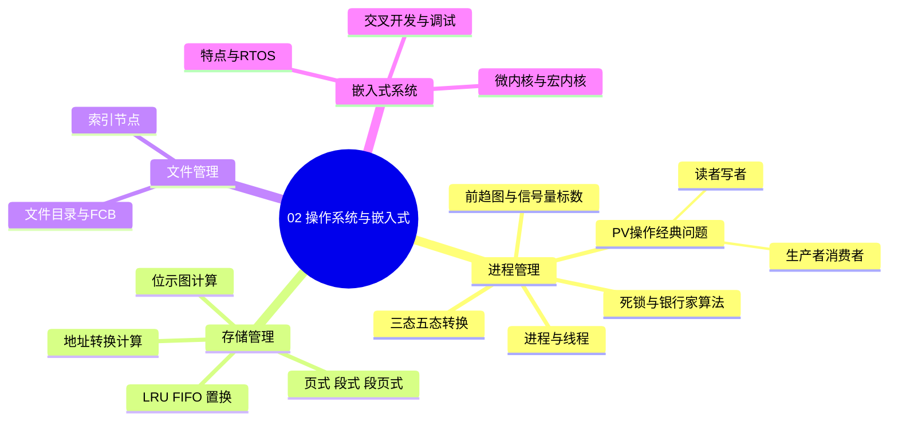
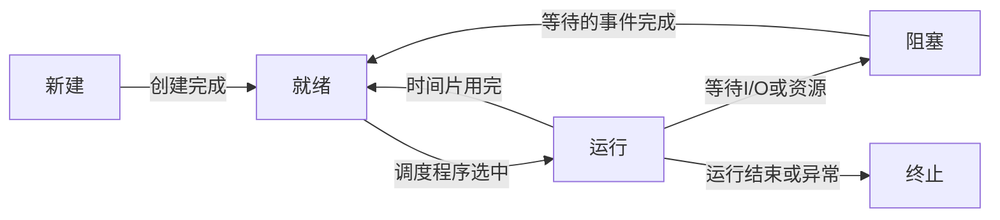
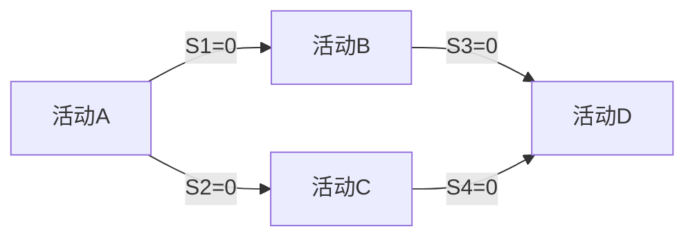

> **摘要**：
> 这章讲"计算机的大管家"：进程怎么排队干活（PV 操作是全卷最经典套路题）、内存怎么分配（页式地址转换、位示图）、文件怎么组织（索引节点），最后带一段嵌入式系统。上午题稳定考 4~6 分，PV 操作、页式存储、死锁资源数是三大送分点；案例题几乎年年涉及 PV 操作或嵌入式架构（与 [16-嵌入式与实时系统架构](16-嵌入式与实时系统架构/) 联动）。建议投入 8~10 小时，PV 操作必须练到能默写。

## 🗺️ 知识地图



## 📖 掰碎讲解

### 2.1 进程与线程：一个 vs 多只手

**是什么**：进程是资源分配的基本单位，是程序的一次动态执行；线程是处理机调度的基本单位，是进程内的一条执行路径。

**大白话**：进程像一家餐厅（独立门面、独立厨房），线程像店里同时干活的服务员们——他们共享餐厅的桌椅厨房（共享资源），但每人有自己的工作手册（栈、寄存器）。

**共享 vs 独享（必背表格）**：

| 线程共享 | 线程独享 |
|---|---|
| 进程的内存地址空间、堆、全局变量 | 栈、寄存器组 |
| 代码段、打开的文件描述符 | 程序计数器、栈指针 |

**怎么考**：选"哪些是线程共享的/独享的"；"线程切换开销比进程小"的原因（不用切换地址空间）。

### 2.2 进程三态与五态转换：排队做核酸的哲学

**是什么**：三态 = 就绪、运行、阻塞（等待）；五态再加新建、终止。

**大白话**：排队做核酸——轮到你 做；排到你了但医生喊你去取个号（等待事件），你退到另一条队——回到排队队伍；不能直接从"取号中"跳到"做"（阻塞态**不能**直接进运行态）。



**怎么考**：给一个事件问进程状态怎么变。铁律：阻塞 → 就绪（等事件完成）→ 运行，阻塞**永远不能直接**转运行；运行 → 阻塞是"主动"行为（等待），就绪 → 运行是"被动"被调度。

### 2.3 前趋图与信号量标数：必考套路题

**是什么**：前趋图描述活动间的先后依赖；用信号量实现同步时，**每条有向边对应一个信号量，初值为 0**。

**大白话**：每条边就是一句约定——"我先干完才轮到你"。我在出发前 P（等消息），干完后 V（发消息）。口诀：**入边 P、出边 V，一条边一个信号量，初值统统是 0**。



上图的完整标法：A 结束时 V(S1)、V(S2)；B 开始前 P(S1)、结束时 V(S3)；C 开始前 P(S2)、结束时 V(S4)；D 开始前 P(S3)、P(S4)。

**怎么考**："为保证前趋图所示依赖，信号量个数/初值"（几个**顶点**几个信号量？不，是几条**边**几个）；给代码段挖空填 P(Sx)/V(Sx)。

### 2.4 PV 操作两大经典：生产者消费者与读者写者

**生产者-消费者（必须能默写）**：

```text
semaphore mutex = 1;   // 互斥访问缓冲区
semaphore empty = n;   // 空闲缓冲区数量
semaphore full  = 0;   // 产品数量

生产者进程：              消费者进程：
while(true) {            while(true) {
  生产一个产品;             P(full);
  P(empty);                P(mutex);
  P(mutex);                从缓冲区取产品;
  放入产品;                 V(mutex);
  V(mutex);                V(empty);
  V(full);                 消费产品;
}                        }
```

> **提示**：
> P(empty)/P(full) 是"资源信号量"，必须在 P(mutex) **之前**！如果先 P(mutex) 再 P(empty)，缓冲区满时生产者抱着锁等空位，消费者想取货却进不来（锁被生产者握着）→ **死锁**。口诀：**先资源后互斥**。

**读者写者（读者优先版）**：用计数器 count + rmutex 保护计数器，第一个读者负责 P(wmutex) 挡住写者，最后一个读者 V(wmutex) 放行。

**怎么考**：上午题给挖空的代码填 PV；案例题直接让你"写出生产者/消费者的同步与互斥过程"，这是案例第一大套路。

### 2.5 死锁：四个条件与银行家算法

**是什么**：多个进程互相等待对方持有的资源，谁也无法推进。

**四个必要条件（必背）**：互斥、请求保持（占有并等待）、不可剥夺、环路等待。**破坏任意一个**即可预防死锁。

**大白话**：四人打麻将只差一张牌，四个人都在等别人打出来——都攥着牌不撒手（不可剥夺）、还要再摸牌（请求保持），这就是死锁。

**数量公式（必考计算）**：n 个进程，每个最多需要 m 个同类资源，系统至少有 **n×(m−1)+1** 个资源才能保证不死锁。

**银行家算法**（避免死锁）：每次分配前计算"试探分配后能否找到一个安全序列"，找得到才借。思路像银行放贷：保证每家企业总能等到回款还贷。

**怎么考**：公式题（6 进程、每个最多要 3 个 → 6×2+1 = **13**）；判断"破坏环路等待可用资源有序分配法"；银行家算法找安全序列。

### 2.6 存储管理：页式、段式、段页式

| 方式 | 划分 | 地址结构 | 碎片 | 特点 |
|---|---|---|---|---|
| 页式 | 固定大小页 | 一维：页号+页内偏移 | 有内碎片、无外碎片 | 便于管理，不便于共享保护 |
| 段式 | 逻辑意义分段 | 二维：段号+段内偏移 | 有外碎片 | 便于共享保护，需连续分配 |
| 段页式 | 先分段、段内再分页 | 段号+页号+偏移 | 有内碎片 | 兼得两者优点，开销最大 |

**页式地址转换（必考计算）**：物理地址 = 块号 × 页大小 + 页内偏移。
技巧：页大小是 2 的幂（如 4KB=2¹²）时，逻辑地址的**低 12 位就是页内偏移**，高位是页号；查页表把页号换成块号，直接拼。

**例**：页大小 4KB，逻辑地址 2A3FH，页 2 对应物理块 8 → 偏移 A3FH，物理地址 = 8×1000H + A3FH = **8A3FH**。

**页面置换三算法**：OPT（最佳，淘汰以后不再用的，理论天花板）、FIFO（先来先走，存在 **Belady 异常**：页框增多缺页反而变多）、LRU（淘汰最近最久未用的，靠计数器/栈，开销大）。

**位示图计算（必考）**：字长 w 位，盘块号 b 从 0 开始编号 → 字号 i = ⌊b/w⌋，位号 j = b mod w。
例：字长 32 位，盘块 3000 → 3000/32 = 93 余 24 → 第 **93 字第 24 位**。

**怎么考**：地址转换拼十六进制；给访问序列数缺页次数（FIFO 三页框 9 次、四页框 10 次的经典序列）；位示图定字号位号。

### 2.7 文件系统：索引节点算大盘子

**是什么**：UNIX 类文件系统用索引节点（inode）存文件元数据，节点里放若干直接地址块 + 一级/二级/三级间接地址块。

**大白话**：inode 是一张"块清单"。直接地址是手边小抄（记 10 个块）；不够了翻"目录页"（一级间接，一个块里全是地址）；再不够翻"目录的目录"（二级间接）。地址项 4B、块 1KB 时，一个间接块能记 256 个地址。

**例（必背套路）**：块大小 1KB，每块存 256 个地址，inode 有 10 个直接块、1 个一级间接、1 个二级间接：
最大文件 = (10 + 256 + 256²) × 1KB = **65802KB**。

**怎么考**：给块大小、地址项大小、直接/间接块数，求最大文件或"访问某字节要几次访盘"；文件目录 FCB（文件控制块）包含哪些信息。

### 2.8 嵌入式系统：专用的、抠门的、守时的

**是什么**：嵌入到对象体系中、为特定应用设计的专用计算机系统。

**特点（口诀：专受实可低裁）**：专用性、资源受限（内存小功耗低）、实时性、可靠性高、软硬件可裁剪（配置可伸缩）、代码固化在存储器中。

**微内核 vs 宏内核（必考对比）**：

| 对比 | 宏内核 | 微内核 |
|---|---|---|
| 内核里放什么 | 文件、网络、驱动全塞进内核态 | 只留最基本：调度、IPC、基本内存管理，其余服务放用户态 |
| 性能 | 快（函数调用） | 略慢（消息传递、频繁上下文切换） |
| 可靠性/扩展性 | 一处崩溃全系统完蛋 | 模块隔离，崩溃不影响内核，易扩展移植 |
| 代表 | Linux | Minix、QNX、L4 |

**实时操作系统（RTOS）特征**：可抢占调度、高优先级优先、确定性（响应时间有上界）、中断延迟小。硬实时（错过时限就是事故，如飞控、汽车 ABS）vs 软实时（偶尔超时无伤大雅，如视频播放）。

**交叉开发与调试**：在**宿主机**（资源丰富）上编码编译，在**目标机**（资源受限）上运行调试。调试方式：Monitor ROM（驻留监控程序）、在线仿真器 ICE、片上调试 OCD（JTAG/BDM）。

**怎么考**：选"不属于嵌入式特点的"；微内核优缺点判断；"宿主机-目标机"概念辨析。案例题考嵌入式软件架构设计时与 [16-嵌入式与实时系统架构](16-嵌入式与实时系统架构/) 联动。

## 🎬 推荐视频

| 视频 | 讲什么 | 什么时候看 |
|---|---|---|
| [希赛《系统架构设计师》精讲合集 154 集](https://www.bilibili.com/video/BV1Ba4y1u7EC) | PV 操作逐行讲透、页式/位示图手算演示 | 第一遍跟学 |
| [软考小管家全套 198 集](https://www.bilibili.com/video/BV1xepMzrEjD) | 零基础视角拆 PV、银行家算法 | 希赛讲快了就来看它 |

## ⭐ 章节重点（考前必背）

| 知识点 | 必背内容 | 考频 |
|---|---|---|
| 状态转换 | 阻塞→就绪→运行；阻塞不能直接→运行 | 近十年高频 |
| 前趋图 | 一条边一个信号量，初值 0，入边 P 出边 V | 上午题高频 |
| PV 铁律 | 先 P(资源) 再 P(互斥)，顺序反了死锁 | 上午题高频 |
| 死锁 | 四条件；资源下限 n×(m−1)+1；银行家=避免 | 上午题高频 |
| 线程 | 共享：地址空间/全局变量/打开文件；独享：栈/寄存器/PC | 近十年高频 |
| 页式地址 | 物理地址 = 块号×页大小+偏移；低 log2(页大小) 位是偏移 | 上午题高频 |
| 置换 | FIFO 有 Belady 异常；LRU 淘汰最近最久未用 | 近十年高频 |
| 索引节点 | (直接数 + 256 + 256²)×块大小（1KB 块、4B 地址） | 近十年高频 |
| 微内核 | 性能略慢但可靠易扩展；服务放用户态 | 近十年高频 |
| RTOS | 可抢占、确定性；硬实时错过时限=事故 | 近十年高频 |

## 🧠 高频考法与陷阱

> **注意**：
> 1. **PV 顺序写反**：错误认知：先 P(mutex) 锁住缓冲区再 P(empty) 等空位；正确：先资源后互斥，否则死锁。案例题专挖这个坑。
> 2. **阻塞直接转运行**：错误认知："I/O 完成后进程直接运行"；正确：先回就绪队列排队，等调度程序选中。
> 3. **死锁资源数公式用错**：n 个进程每个最多要 m 个 → 至少 n×(m−1)+1，不是 n×m，也不是 n×(m−1)。
> 4. **页大小与偏移位数搞混**：4KB 页 → 偏移 12 位；别把页号当偏移。十六进制拼地址时先对齐再换块号。
> 5. **Belady 异常张冠李戴**：页框增多缺页反增是 **FIFO** 的锅，LRU 和 OPT 没有这种异常。
> 6. **宏内核微内核反着记**：微内核是"性能略差但可靠易扩展"，别把"效率高"安到微内核头上。

## ✍️ 反复练习题

### 第 1 题
某进程正在等待打印机完成打印，此时打印机完成打印产生中断，该进程的状态变化是（ ）。
A. 运行→阻塞　B. 阻塞→运行　C. 阻塞→就绪　D. 就绪→运行

> **示例**：
> **答案：C**
> 解析：等待的事件完成后，进程从阻塞转**就绪**，还要经调度程序选中才能运行（2.2 节铁律）。B 直接从阻塞跳运行是经典错误选项。

### 第 2 题
前趋图中有 4 个活动、5 条有向边，用信号量实现同步，至少需要（ ）个信号量。
A. 4　B. 5　C. 9　D. 1

> **示例**：
> **答案：B**
> 解析：一条边一个信号量，初值均为 0（2.3 节）。信号量按**边**数而非顶点数建，5 条边 → 5 个。每个活动开头对所有入边 P、结尾对所有出边 V。

### 第 3 题
生产者-消费者问题中，若生产者把 P(mutex) 写在 P(empty) 之前，当缓冲区满时会发生（ ）。
A. 没有任何影响　B. 数据覆盖　C. 可能死锁　D. 产品丢失

> **示例**：
> **答案：C**
> 解析：缓冲区满时，生产者先拿到锁（mutex=0），再等 empty 信号；消费者想取货腾空位却因锁被生产者持有而无法进入 → 互相等待，死锁（2.4 节铁律：先资源后互斥）。

### 第 4 题
6 个进程，每个进程最多需要 3 个同类资源，系统至少配置（ ）个该资源才不会发生死锁。
A. 15　B. 16　C. 13　D. 18

> **示例**：
> **答案：C**
> 解析：公式 n×(m−1)+1 = 6×2+1 = **13**（2.5 节）。最坏情形：每个进程都拿到 m−1=2 个还差 1 个，共 12 个被占用，只要有第 13 个就能让某进程凑齐并释放。选 B 的同学忘了"至少保证不死锁"要 +1。

### 第 5 题
页式存储，页大小 4KB，页表：页 0→块 5，页 1→块 10，页 2→块 8。逻辑地址 1A3FH 对应的物理地址是（ ）。
A. AA3FH　B. 5A3FH　C. 8A3FH　D. 10A3FH

> **示例**：
> **答案：A**
> 解析：4KB=2¹²，低 12 位 A3FH 是页内偏移，高位 1 是页号；查页表页 1→块 10，物理地址 = 块号 10(H) × 1000H + A3FH = **AA3FH**（2.6 节）。选 B 用了页号当块号，选 C 是页 2 的块，选 D 忘了块号是十六进制下的拼接。

### 第 6 题
页面访问序列 1,2,3,4,1,2,5,1,2,3,4,5，分配 3 个页框采用 FIFO 置换，缺页次数为（ ）。
A. 7　B. 9　C. 10　D. 12

> **示例**：
> **答案：B**
> 解析：逐次模拟：前 3 次装 1,2,3 缺页 3 次；访问 4 淘汰 1、访问 1 淘汰 2、访问 2 淘汰 3、访问 5 淘汰 4，均缺页（共 7 次）；访问 1、2 命中；访问 3、4 缺页（共 9 次）；访问 5 命中。合计 **9 次**。同一序列用 4 个页框反而缺页 10 次——这就是 FIFO 的 **Belady 异常**（2.6 节）。

### 第 7 题
UNIX 文件系统，磁盘块 1KB，每个地址项 4B，索引节点含 10 个直接地址块、1 个一级间接块、1 个二级间接块，单个文件最大为（ ）。
A. 66KB　B. 65802KB　C. 65536KB　D. 262144KB

> **示例**：
> **答案：B**
> 解析：每个块可存 1KB/4B = 256 个地址。最大文件 = (10 + 256 + 256²) × 1KB = (10+256+65536) × 1KB = **65802KB**（2.7 节）。选 C 只算了间接块，D 把 256² 错当 256³。变式：访问文件偏移 300KB 处需几次访盘？300KB > 10+256=266 块 → 落在二级间接区，不含缓存最多 4 次（读二级间接块、数据块等）。

### 第 8 题（案例大题风格）
某票务系统有一个售票缓冲区（容量 10）与多个售票员进程、多个取票机进程。要求：
(1) 设置信号量并写出售票员（生产者）与取票机（消费者）的 PV 操作过程；
(2) 指出哪个 P 操作顺序颠倒会引发死锁并说明原因。

> **示例**：
> **答案要点：**
> (1) 设 mutex=1（缓冲区互斥）、empty=10（空位）、full=0（票数）。
> 售票员：P(empty) → P(mutex) → 放票 → V(mutex) → V(full)；
> 取票机：P(full) → P(mutex) → 取票 → V(mutex) → V(empty)。
> (2) 若把 P(mutex) 提到 P(empty)/P(full) 之前：缓冲区满时售票员握锁等空位，取票机因锁被占无法取票 → 循环等待，死锁（对应 2.4 节）。案例题阅卷时，信号量含义、初值、P/V 位置三样缺一不可。


## 🎨 漫画图解


*生产者-消费者与 PV 操作*-仓库满了生产者睡觉,空了消费者等待——信号量就是那块红绿灯*

## 🔗 相关章节

- [01-计算机系统基础](01-计算机系统基础/)：存储层次与本章虚拟存储呼应
- [03-数据库系统](03-数据库系统/)：数据库并发控制同样用"锁"，思想同源
- [16-嵌入式与实时系统架构](16-嵌入式与实时系统架构/)：嵌入式案例题的主战场
- [架构-案例分析攻略](../架构-案例分析攻略/)：PV 大题的答题模板在这里
- [学习方法与记忆术](../../00-备考指南/学习方法与记忆术/)：PV 口诀与记忆技巧汇总
