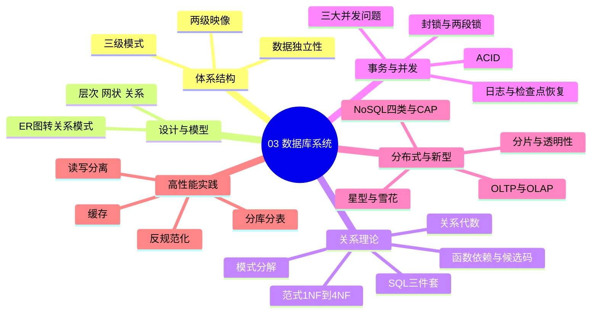
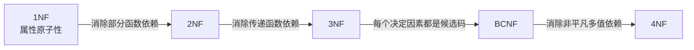
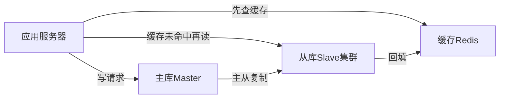

> **摘要**：
> 这章讲"数据的大仓库怎么设计、怎么用、怎么不被搞乱"：三级模式、ER 图、SQL、范式判定（必考！）、事务并发、分布式数据库与缓存。上午题稳定考 6~8 分，是上午题的"粮仓"；案例题更是常客——反规范化、缓存、读写分离几乎是企业应用案例的标配（与 [13-Web架构与中间件](13-Web架构与中间件/)、[14-云原生与大数据架构](14-云原生与大数据架构/) 联动）。建议投入 10~12 小时，范式判定必须练到条件反射。

## 🗺️ 知识地图



## 📖 掰碎讲解

### 3.1 三级模式两级映像：装修不变的道理

**是什么**：外模式（用户视图）→ 概念模式（全局逻辑结构）→ 内模式（物理存储结构）。外模式/模式映像、模式/内模式映像构成两级映像。

**大白话**：像酒店——外模式是每个房客看到的房间（各不相同），概念模式是整栋楼的建筑图纸，内模式是水电管线怎么埋。房客想换窗帘（改外模式）不影响图纸（逻辑独立性）；管线改造（改内模式）不动图纸（物理独立性）。

| 映像 | 保证的独立性 | 谁变谁不变 |
|---|---|---|
| 外模式/模式映像 | **逻辑**独立性 | 概念模式变，改此映像，应用程序不变 |
| 模式/内模式映像 | **物理**独立性 | 存储结构变，改此映像，模式不变 |

**怎么考**："要保证逻辑独立性需修改哪个映像"→外模式/模式映像；"视图属于哪级模式"→外模式。

### 3.2 数据模型与 ER 图转关系模式

**是什么**：经典数据模型三兄弟——层次模型（树）、网状模型（图）、关系模型（二维表，当前主流）。

**ER 图三要素**：实体（矩形）、属性（椭圆）、联系（菱形，1:1 / 1:n / m:n）。

**ER 转关系模式（必考规则）**：
- 实体 → 一个关系模式
- **1:1 联系**：并入任一端，加对方主键作外键
- **1:n 联系**：并入 n 端
- **m:n 联系**：必须**单独建一个关系模式**，主键 = 两端主键的组合

**大白话**：学生和课程是多对多，谁也"吞不下"谁，只好单独开一张选课表记录"谁选了哪门、考了多少分"。

**怎么考**：给 ER 图问"至少转换成几个关系模式"（数实体数 + m:n 联系数）；案例题让你补全 ER 图或写关系模式的主外键。

### 3.3 关系代数：五种运算符够用

**是什么**：对关系（表）做运算的数学语言。

| 符号 | 名称 | 大白话 |
|---|---|---|
| σ (sigma) | 选择 | 挑**行**（where 条件） |
| π (pi) | 投影 | 挑**列**（select 字段） |
| ⋈ | 连接 | 两表按条件拼起来（join） |
| × | 笛卡尔积 | 全排列组合，行数相乘 |
| ÷ | 除 | 查询"**全部**都…"的场景 |

**除法独门场景（必考）**："查询选修了**全部**课程的学生" → π学号,课程号(选课) ÷ π课程号(课程)。

**怎么考**：给查询需求选对应的关系代数表达式；见到"全部/所有"就想到除法。

### 3.4 SQL：DDL/DML/DCL 三件套

**DDL**（建表改表）：CREATE / ALTER / DROP。**DML**（操作数据）：INSERT / UPDATE / DELETE / SELECT。**DCL**（权限）：GRANT / REVOKE。

**权限语句模板（必背）**：
```sql
GRANT SELECT ON TABLE 学生 TO user1 WITH GRANT OPTION;
-- WITH GRANT OPTION 表示 user1 可以把该权限再转授给别人
REVOKE SELECT ON TABLE 学生 FROM user1;
```

**视图**：虚表，只存定义不存数据，属于外模式；作用是简化查询 + 提供安全隔离。

**怎么考**：考 WITH GRANT OPTION 的转授权；GROUP BY 与 HAVING 的搭配（HAVING 过滤分组、WHERE 过滤行）；视图能否更新（含聚合/多表的一般不可更新）。

### 3.5 函数依赖与候选码求解：属性闭包算法

**是什么**：函数依赖 X→Y 表示"知道 X 就能唯一确定 Y"。候选码 = 能推出全部属性的最小属性集。

**求候选码四步法（必考）**：
1. 只出现在**左部**的属性 → 必在候选码中
2. 只出现在**右部**的属性 → 必不在候选码中
3. 左右都出现的 → 待定，需验证
4. 函数依赖里**没出现**的 → 必在候选码中

再用**属性闭包**验证：把候选码能推出来的属性不断并入，看能否覆盖全部属性。

**例**：R(A,B,C,D)，F={A→B, B→C, D→B}。只在左部：A、D → 试 (AD)⁺ = {A,D,B,C} 全覆盖 → 候选码 **AD**。

**大白话**：候选码像"万能钥匙"——只靠它就能打开全部属性的大门，而且一个齿都不能少（最小性）。

**怎么考**：给函数依赖集求候选码个数/具体候选码；区分主属性（在候选码里的属性）与非主属性。

### 3.6 范式 1NF~4NF：层层升级的洁癖

| 范式 | 消除什么 | 一句话判定 |
|---|---|---|
| 1NF | 属性不可再分 | 每格只有一个值 |
| 2NF | **部分**函数依赖 | 非主属性不能只依赖候选码的"一半" |
| 3NF | **传递**函数依赖 | 非主属性不能"隔山打牛"依赖码 |
| BCNF | 主属性对码的依赖 | **每个决定因素都必须是候选码** |
| 4NF | 非平凡**多值**依赖 | 表里不能藏着两组独立的一对多 |



**经典判定例**：R(学号, 姓名, 系名, 系主任)，学号→姓名、学号→系名、系名→系主任。系主任"通过系名"传递依赖学号 → 只满足 2NF，不满足 3NF，应拆为 (学号,姓名,系名) 和 (系名,系主任)。

**模式分解**：拆表要"无损连接"（拆开还能用连接还原，不失信息），最好"保持函数依赖"。分解到 3NF 可同时满足两者；BCNF 能保证无损但不一定保持依赖。

**怎么考**：上午题年年考"该模式最高满足第几范式"；案例题让你分析依赖、求候选码、判断范式并给出分解方案——数据库案例的半壁江山。

### 3.7 事务 ACID 与并发控制

**ACID（必背）**：原子性（Atomicity，全做或全不做）、一致性（Consistency，从一个正确状态到另一个）、隔离性（Isolation，事务间互不干扰）、持久性（Durability，提交即永久）。

**三大并发问题（必考辨析）**：

| 问题 | 场景 | 大白话 |
|---|---|---|
| 丢失更新 | 两事务都读 x，各改各的写回，后写的覆盖先写的 | 两人同时改同一份文档，一人白改 |
| 不可重复读 | T1 两次读 x，中间 T2 改了 x 并**提交** | 买票前看 100 元，回头再看变 150 |
| 读脏数据 | T1 读到 T2 修改后**未提交**的值，T2 又回滚了 | 拿到一张后来作废的报价单 |

**封锁协议**：S 锁（共享，读锁，可多户共存）、X 锁（排他，写锁，独占）。三级封锁协议逐级加码：1 级加 X 锁防丢失更新；2 级加 S 锁（读完就放）再防读脏；3 级 S 锁持到事务结束再防不可重复读。

**两段锁协议（2PL）**：事务分两阶段——先只加锁、后只解锁，两阶段间**不能交叉**。遵守 2PL → 调度**可串行化**；但**不能避免死锁**（常考陷阱！）。

**死锁处理**：预防（一次性申请全部/有序申请）、检测+解除（等图找环，选牺牲者回滚）、超时法。

### 3.8 数据库恢复：日志、检查点与 undo/redo

**是什么**：靠日志（先写日志原则 WAL：日志先于数据落盘）+ 检查点（定期把缓冲区刷盘、记下时间点）做故障恢复。

**大白话**：日志像流水账，检查点像游戏的"存档点"。重启后从最近的存档点开始对账：**已完成的事务 redo（重做）**，**未完成的事务 undo（撤销）**。

**怎么考**："检查点的作用是缩小恢复扫描范围"；"先写日志还是先写数据"→先写日志。

### 3.9 分布式数据库：分片与透明性

**分片方式**：水平分片（按**行**切）、垂直分片（按**列**切）、导出分片、混合分片。

**分布透明性（从高到低）**：**分片透明性 > 位置透明性 > 局部映像透明性 > 局部数据模型透明性**（部分教材讲三级，核心记：分片透明性级别最高，用户完全不用管数据怎么切）。

**大白话**：透明性 = "你完全不用操心"的程度。分片透明：随便查，系统自己找数据；位置透明：你知道分了几片但不用管数据在哪座机房。

**怎么考**："分片透明性是最高级别的透明性"判断题；"按性别水平分片"属于哪种分片。

### 3.10 反规范化：故意制造冗余（案例高频）

**是什么**：为减少连接运算、提高查询性能，在已规范化的模式里**故意加回冗余**。

**四种手段（必背）**：增加冗余列、增加派生列、重新组表、分割表（水平分割/垂直分割）。

**代价**：数据冗余 → 可能不一致，需要触发器/应用逻辑/批处理同步维护。

**大白话**：范式是"家里东西各归各位"；反规范化是"常用东西在客厅再放一份"——拿起来快了，但要记得两处同步，否则就会出现"账对不上"。

### 3.11 OLTP vs OLAP 与数据仓库

| 对比 | OLTP 联机事务处理 | OLAP 联机分析处理 |
|---|---|---|
| 面向 | 业务操作人员 | 决策分析人员 |
| 数据 | 当前、详细 | 历史、汇总 |
| 操作 | 增删改查频繁 | 复杂查询、多维分析 |
| 库 | 高度规范化 | 数据仓库（常反规范化） |

**数据仓库四特征**：面向主题、集成的、相对稳定（基本不更新）、反映历史变化。

**星型 vs 雪花**：星型——维度表直接连事实表（简单、查询快、有冗余）；雪花——维度表再拆分成子维度表（更规范、连接多、查询慢）。事实表放"度量值"，维度表放"分析角度"。

### 3.12 NoSQL 四类与 CAP/BASE

| 类型 | 代表 | 大白话 |
|---|---|---|
| 键值型 | Redis | 超大号字典，key 一查 value 就出 |
| 列族型 | HBase | 按列存的表格，海量写入强 |
| 文档型 | MongoDB | 存 JSON 文档，结构灵活 |
| 图型 | Neo4j | 专治"关系网"：社交、推荐 |

**CAP 定理**：一致性 C、可用性 A、分区容错 P，三者**最多同时满足两个**，分布式系统 P 必选，通常在 C 与 A 之间取舍。**BASE 理论**：基本可用、软状态、最终一致性——放弃强一致换高可用。

**怎么考**：四类 NoSQL 的场景匹配；"AP 还是 CP"的取舍分析。

### 3.13 大型系统三板斧：读写分离、分库分表、缓存（案例高频）



- **读写分离**：主库扛写、从库扛读，靠主从复制同步；问题是复制延迟。
- **分库分表**：垂直分库（按业务拆）、水平分表（按行拆，如按用户 ID 哈希）；带来跨库 join、分布式事务难题。
- **缓存三灾**：穿透（查不存在的数据，缓存永远不命中 → 布隆过滤器/空值缓存）；击穿（热点 key 过期瞬间海量打到库 → 互斥锁/不过期）；雪崩（大量 key 同时过期 → 过期时间加随机值）。

**怎么考**：案例题问"如何提升数据库读性能"——标准答案套路 = 读写分离 + 缓存 + 分库分表，再结合场景展开。

## 🎬 推荐视频

| 视频 | 讲什么 | 什么时候看 |
|---|---|---|
| [希赛《系统架构设计师》精讲合集 154 集](https://www.bilibili.com/video/BV1Ba4y1u7EC) | 范式判定与并发控制全程推导 | 第一遍跟学 |
| [芝士架构凯恩重难点专题](https://www.bilibili.com/video/BV1XM8izmE5g) | 数据库重难点专攻、计算套路总结 | 二轮攻克薄弱点 |
| [秋意浓案例真题精讲 37 集](https://www.bilibili.com/video/BV1LHxkzbEDL) | 数据库缓存等案例真题逐题精讲 | 进入案例冲刺阶段 |

## ⭐ 章节重点（考前必背）

| 知识点 | 必背内容 | 考频 |
|---|---|---|
| 两级映像 | 外模式/模式映像→逻辑独立性；模式/内模式→物理独立性 | 上午题高频 |
| ER 转模式 | m:n 联系单独成表，主键为两端主键组合 | 上午题高频 |
| 关系代数 | "全部/所有"用除法 ÷ | 近十年高频 |
| 范式 | 2NF 消部分依赖、3NF 消传递依赖、BCNF 决定因素都是码 | 上午题高频 |
| 候选码 | 只在左部必入选、只在右部必不入、闭包验证 | 上午题高频 |
| 并发问题 | 不可重复读=读到已提交的改；脏读=读到未提交的改 | 上午题高频 |
| 2PL | 可串行化，但**不防死锁** | 近十年高频 |
| 恢复 | 先写日志；检查点后 redo 已提交、undo 未完成 | 近十年高频 |
| 反规范化 | 增加冗余列/派生列、重组表、分割表 | 案例高频 |
| 缓存三灾 | 穿透、击穿、雪崩及对策 | 案例高频 |
| NoSQL | Redis 键值、HBase 列族、MongoDB 文档、Neo4j 图 | 近十年高频 |

## 🧠 高频考法与陷阱

> **注意**：
> 1. **脏读 vs 不可重复读混淆**：错误认知：都是"读了两次不一样"；正确：读到**未提交**又回滚的是脏读；两次读到**已提交**的不同值是不可重复读。
> 2. **2PL 万能论**：错误认知：遵守两段锁协议就不会死锁；正确：2PL 只保证可串行化，死锁照样可能发生。
> 3. **范式判定只看非主属性**：BCNF 的判定对象包括**主属性**——只要存在"决定因素不是候选码"就不算 BCNF。
> 4. **m:n 联系并表**：错误认知：把 m:n 联系的属性并到某一端；正确：必须单独建表，否则出现大量冗余。
> 5. **雪花比星型"高级就快"**：正相反——雪花更规范化但连接更多、查询更慢，分析性能上星型常更优。
> 6. **CAP 三选二选错**：P（分区容错）在分布式环境下不是可选项，实际是在 CP 与 AP 之间取舍。

## ✍️ 反复练习题

### 第 1 题
要使数据库的概念模式发生变化时，外模式和应用程序不必修改，需要调整的是（ ）。
A. 模式/内模式映像　B. 外模式/模式映像　C. 数据字典　D. 存储结构

> **示例**：
> **答案：B**
> 解析：概念模式变了、外模式不变，靠调整**外模式/模式映像**兜底，这保证的是**逻辑独立性**（3.1 节）。概念模式与内模式之间靠模式/内模式映像保证物理独立性，别混。

### 第 2 题
设 R(A,B,C,D)，函数依赖集 F={A→B, B→C, D→B}，则 R 的候选码是（ ）。
A. A　B. AD　C. ABD　D. CD

> **示例**：
> **答案：B**
> 解析：只在左部出现的 A、D 必在候选码中；B、C 只在右部必不在。(AD)⁺ = {A,D} ∪ {B} ∪ {C} = ABCD 全覆盖 → 候选码 **AD**，且已最小（3.5 节四步法）。A 的闭包 {A,B,C} 缺 D；C 含不必要的 B 不满足最小性。

### 第 3 题
关系模式 R(学号, 姓名, 系名, 系主任)，学号→姓名，学号→系名，系名→系主任，则 R 最高满足（ ）。
A. 1NF　B. 2NF　C. 3NF　D. BCNF

> **示例**：
> **答案：B**
> 解析：候选码学号（单属性）→ 不存在部分依赖，满足 2NF；但系主任传递依赖学号（学号→系名→系主任），不满足 3NF（3.6 节）。分解为 (学号,姓名,系名) 与 (系名,系主任) 后达到 3NF。

### 第 4 题
"查询选修了全部课程的学生学号"，正确的关系代数是（ ）。
A. π学号(选课) ÷ π课程号(课程)
B. π学号,课程号(选课) ÷ π课程号(课程)
C. σ课程号=全部(选课)
D. π学号(选课) ⋈ π课程号(课程)

> **示例**：
> **答案：B**
> 解析：除法要求被除关系**保留学号并列出课程号**，才能除出"选修了课程表中每一门课的学生"（3.3 节）。A 少投影了课程号，除不出结果；C 的"全部"不是属性值；D 是连接不是"全部"语义。

### 第 5 题
事务 T1 读取数据 x 后，事务 T2 将 x 修改为 200 并提交；T1 再次读取 x 发现值变了。该现象是（ ）。
A. 丢失更新　B. 读脏数据　C. 不可重复读　D. 死锁

> **示例**：
> **答案：C**
> 解析：两次读取之间数据被**已提交**的事务修改 → 不可重复读（3.7 节）。若 T2 修改后**未提交又回滚**，T1 读到的是脏数据；若 T2 的修改被 T1 的写覆盖，才是丢失更新。三种问题的分界线就在"提交没提交、读还是写"。

### 第 6 题
关于两段锁协议（2PL），下列说法正确的是（ ）。
A. 遵守 2PL 的事务调度一定不会发生死锁
B. 遵守 2PL 的事务调度一定是可串行化的
C. 2PL 要求事务一次性申请所有锁
D. 2PL 保证事务之间完全并行

> **示例**：
> **答案：B**
> 解析：2PL（先加锁阶段、后解锁阶段）保证**可串行化**，但**不防死锁**（3.7 节陷阱）。"一次性申请所有锁"是死锁预防的手段（破坏请求保持条件），不是 2PL 的内容。

### 第 7 题
关于数据库恢复，正确的是（ ）。
A. 故障恢复时，未完成事务用 redo，已提交事务用 undo
B. 先将数据写入磁盘，再写日志
C. 检查点可缩短故障恢复的扫描范围
D. 日志只记录查询语句

> **示例**：
> **答案：C**
> 解析：检查点之前的日志不再重扫，恢复从最近检查点开始 → 缩短恢复时间（3.8 节）。A 反了：已提交 redo、未完成 undo；B 违反先写日志原则；D 的查询不改变数据，无需记入重做日志。

### 第 8 题（案例大题风格）
某电商订单库已规范化至 3NF，但订单列表页查询需连接订单、用户、商品、库存 4 张表，响应缓慢。请回答：
(1) 可采用哪些反规范化手段优化？
(2) 读写分离架构中主从复制可能带来什么问题？
(3) 缓存引入后，说明缓存穿透与缓存雪崩的区别及各自对策。

> **示例**：
> **答案要点：**
> (1) 在订单表中**增加冗余列**（如用户名、商品名）、**增加派生列**（订单总额）、**重新组表**（订单汇总表）、对历史订单**水平分割**；代价是数据冗余，需触发器/定时任务保持一致（3.10 节）。
> (2) 主从复制存在**复制延迟**，刚写入的订单立刻去从库读可能读不到——可用"写后读走主库/强制路由主库"缓解。
> (3) **穿透**：查询根本不存在的数据，缓存与库都没有，请求全打到库 → 布隆过滤器拦截、空结果也短暂缓存；**雪崩**：大量缓存同时到期，库瞬时被击垮 → 过期时间加随机值、集群高可用、限流降级（3.13 节）。答题结构："定义区别 + 具体对策"各占一半分。

## 🔗 相关章节

- [02-操作系统与嵌入式基础](02-操作系统与嵌入式基础/)：锁与并发思想同源
- [13-Web架构与中间件](13-Web架构与中间件/)：读写分离、缓存在 Web 架构中的位置
- [14-云原生与大数据架构](14-云原生与大数据架构/)：NoSQL、CAP、数据仓库的延伸
- [架构-案例分析攻略](../架构-案例分析攻略/)：数据库案例答题模板
- [qicoder真题索引](../../99-真题资源/qicoder真题索引/)：按知识点刷历年数据库真题
