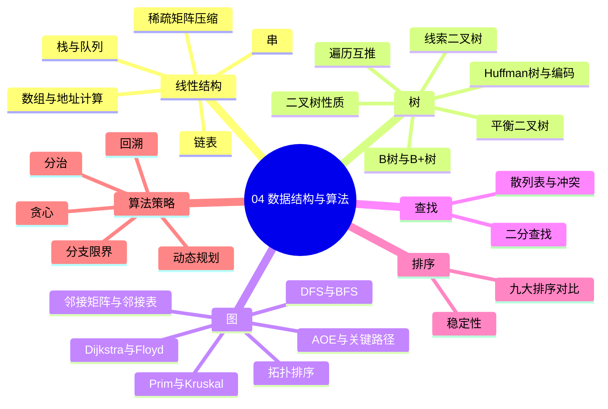
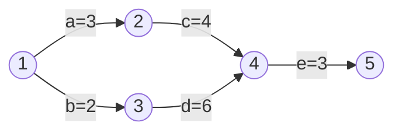
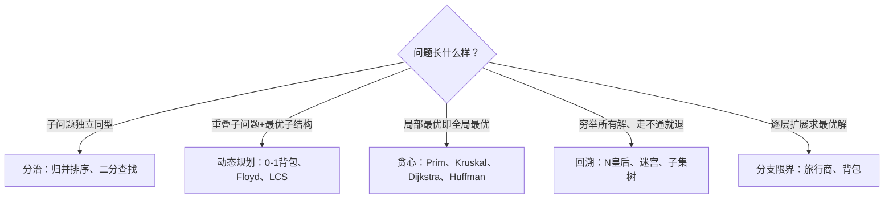

> **摘要**：
> 这章讲"怎么把数据摆好、怎么高效算出来"：线性表/树/图的存储与操作、九大排序、查找、五大算法策略。上午题稳定考 4~6 分，二叉树遍历互推、关键路径、排序复杂度是三大钉子户；案例题爱考算法策略分析和关键路径/动态规划计算。建议投入 10~12 小时，图的部分（尤其是 AOE 网关键路径）必须动手画图算。

## 🗺️ 知识地图

## 📖 掰碎讲解

### 4.1 线性结构：数组、链表、栈、队列怎么选

| 结构 | 查找 | 插入/删除 | 适用场景 |
|---|---|---|---|
| 数组（顺序表） | O(1) 随机访问 | O(n) 要搬元素 | 读多写少、按位访问 |
| 链表 | O(n) 顺序找 | O(1) 改指针 | 频繁增删、长度不定 |
| 栈 | 只动栈顶 | 后进先出 LIFO | 括号匹配、表达式求值、递归、函数调用 |
| 队列 | 只动队头队尾 | 先进先出 FIFO | 打印队列、消息队列、BFS、缓冲区 |

**循环队列判满（必背）**：牺牲一个单元，队满条件 (rear+1) mod N = front；元素个数 = (rear − front + N) mod N。

**大白话**：数组是剧院固定座位（按号入座快，中间加座难）；链表是排队人群（插队容易，找人要从头问）；栈是摞盘子；队列是排队买奶茶。

**稀疏矩阵压缩**：三元组表 (行,列,值) 或十字链表；对称矩阵只存下三角，元素 a[i][j]（i≥j，从 0 编号）在一维数组中的下标 k = i×(i+1)/2 + j。

**怎么考**：场景匹配（括号匹配→栈；任务排队→队列）；对称矩阵下标计算。

### 4.2 二叉树：性质与遍历互推（年年必考）

**核心性质（必背）**：
- 第 i 层最多 2^(i−1) 个节点；h 层二叉树最多 2^h − 1 个节点
- **n0 = n2 + 1**（叶子数 = 度为 2 的节点数 + 1）
- n 个节点完全二叉树高度 ⌈log2(n+1)⌉

**遍历三兄弟**：先序（根左右）、中序（左根右）、后序（左右根）。

**互推铁律**：**必须有中序** + 另一种序，才能唯一确定二叉树；只有先序+后序不行（无法区分独子是左是右）。

**大白话**：中序给出"左边是谁右边是谁"的账本，先序/后序告诉你"谁是根"，两者合璧就能一笔一画还原整棵树。

**线索二叉树**：n 个节点的二叉树有 n+1 个空指针，把它们改成指向前驱/后继的线索，不用递归也能遍历。

**怎么考**：给先序+中序求后序（手算：先序第一个是根，回中序切左右子树，递归）；n0/n2 计算题。

### 4.3 Huffman 树与编码：贪心的胜利

**是什么**：带权路径长度（WPL）最小的二叉树。每次从集合中取**两个最小**权值合并，重复直到剩一棵树。

**WPL = Σ 权值 × 路径长度（到根的边数）**。

**特性（必背）**：n 个叶子的 Huffman 树共 **2n−1** 个节点，**没有度为 1 的节点**；Huffman 编码是前缀码（任何编码不是另一个的前缀），解码唯一。

**大白话**：出现频率高的字符给短编码（如电报里 e 只发一个点），频率低的给长编码，整体报文最省。

**怎么考**：给权值集合建树算 WPL；问"Huffman 树节点总数/有无度为 1 节点"；给编码序列判断是否唯一可译。

### 4.4 平衡二叉树与 B 树/B+ 树

**平衡二叉树（AVL）**：任意节点左右子树高度差 ≤1。插入失衡后旋转：LL→右旋、RR→左旋、LR→先左后右、RL→先右后左。

**B 树 vs B+ 树（必考对比）**：

| 对比 | B 树 | B+ 树 |
|---|---|---|
| 数据存放 | 所有节点都存关键字和记录 | **只存叶子**，非叶节点只作索引 |
| 叶子节点 | 独立 | 串成**链表**，支持范围查询 |
| 适用 | 文件系统 | **数据库索引**（MySQL InnoDB） |

**大白话**：B 树像办公楼每层都放档案；B+ 树像图书馆——楼上只有索引卡片，书全在一楼按顺序排，还能顺着书架一排排抄（范围查询）。

### 4.5 图：从存储到关键路径

**存储**：邻接矩阵（n² 空间，适合稠密图，判断边 O(1)）；邻接表（n+e 空间，适合稀疏图，找邻接点快）。

**遍历**：DFS 深度优先用**栈**（一条道走到黑）；BFS 广度优先用**队列**（一圈圈扩散），BFS 可求无权图最短路径。

**最小生成树**：Prim 从**点**出发逐步加点（稠密图友好）；Kruskal 把**边**排序逐条挑选不成环（稀疏图友好）。

**最短路径**：Dijkstra——单源、贪心、**不能有负权边**；Floyd——多源、动态规划、O(n³)、可处理负权边（不能有负权回路）。

**拓扑排序**：AOV 网（顶点=活动）中反复删除入度为 0 的顶点；若删不完 → 有环。

**AOE 网与关键路径（必考计算，案例常客）**：

- 事件最早时间：从前往后**取最大**（入边都完成才能开始），如 V4 = max(3+4, 2+6) = 8
- 事件最迟时间：从后往前**取最小**（不能拖累后继）
- 活动最早开始 = 弧尾事件最早时间；活动最迟开始 = 弧头事件最迟时间 − 活动工期
- **总时差 = 最迟 − 最早 = 0 的活动是关键活动**；关键路径 = 从源点到汇点的**最长路径**，决定最短工期
- 要缩短工期必须压缩关键路径上的活动，且关键路径可能"让位"变成非关键

**大白话**：整个工程被最慢的一条链拖着走——这条链就是关键路径。想让毕业照早点拍完，得催的是化妆、领礼服、集合这三步中"最长的链条"，催错环节白费劲。

**怎么考**：给 AOE 网求工期、关键路径、某活动最早/最迟开始时间；给有向图做拓扑排序选合法序列。

### 4.6 查找：二分与散列

**二分查找**：要求**有序 + 顺序存储**。n 个元素最多比较 ⌊log2 n⌋+1 次；判定树是平衡的，等概率成功平均查找长度约 log2(n+1)−1。

**散列表**：hash(key)=key mod p（p 常取不大于表长的最大素数）。冲突处理：线性探测（简单但**堆积**严重）、二次探测、链地址法（无堆积、删方便）。

**装填因子 α = 表中元素数 / 表长**。α 越大冲突越多；散列表的平均查找长度**与表长无关，只与装填因子和处理方法有关**（常考陷阱！）。

### 4.7 排序九种：一张大表打天下

| 排序 | 平均时间 | 最坏 | 空间 | 稳定 | 特点 |
|---|---|---|---|---|---|
| 直接插入 | O(n²) | O(n²) | O(1) | ✔ | **基本有序时 O(n)**，最快 |
| 冒泡 | O(n²) | O(n²) | O(1) | ✔ | 有序时一趟即停 |
| 简单选择 | O(n²) | O(n²) | O(1) | ✘ | 交换次数最少 |
| 希尔 | O(n^1.3) | O(n²) | O(1) | ✘ | 分组插入 |
| 快排 | O(nlogn) | **O(n²)（基本有序时最坏）** | O(logn) | ✘ | 平均最快；基准选好是关键 |
| 堆排 | O(nlogn) | O(nlogn) | O(1) | ✘ | 建 O(n)+n 次 O(logn) 调整 |
| 归并 | O(nlogn) | O(nlogn) | O(n) | ✔ | 稳定的 nlogn，要额外空间 |
| 基数 | O(d(n+r)) | O(d(n+r)) | O(n+r) | ✔ | 按位分配收集，d 是位数 |

> **提示**：
> 稳定：**插冒归基**（直接插入、冒泡、归并、基数）；不稳定：**希快堆选**（希尔、快排、堆排、简单选择）。记"心情不稳定的人：希望快一点，堆里挑"。

**怎么考**：背表选择；"序列基本有序选什么排序"→直接插入；"只求最坏也快"→堆排；"要求稳定且快"→归并；给一趟结果反推算法名。

### 4.8 算法设计策略五件套

| 策略 | 核心特征 | 典型例子 | 大白话 |
|---|---|---|---|
| 分治 | 子问题**独立**、同型、合并解 | 归并/快排、大整数乘法 | 分组做题再对答案 |
| 动态规划 | **重叠子问题** + 最优子结构，填表 | 0-1 背包、Floyd、最长公共子序列 | 小题结果存表，大题查表拼装 |
| 贪心 | 每步局部最优且**不可回头** | Huffman、Prim/Kruskal、Dijkstra | 能拿先拿，绝不反悔 |
| 回溯 | DFS 穷举 + **剪枝** | N 皇后、0-1 背包 | 走错就掉头换条路 |
| 分支限界 | BFS/优先队列扩展界 | 旅行商问题 | 一层一层筛，砍掉没希望的分支 |

**动规 vs 贪心（易混）**：动规保存所有子问题解、可反悔，保证最优；贪心只走一条路、不回头，问题必须具备"贪心选择性质"才保证最优。

**怎么考**：给问题描述选策略——看到"每一步局部最优"选贪心，"子问题重叠+最优子结构"选动规，"所有解/无解判断/N 皇后"选回溯，"分支节点有上界/下界逐层扩展"选分支限界。

### 4.9 时间复杂度：增长快慢排队

常见复杂度从低到高：O(1) < O(logn) < O(n) < O(nlogn) < O(n²) < O(n³) < O(2ⁿ) < O(n!)。

**推导口诀**：单层循环 n 次 → O(n)；双层嵌套各 n → O(n²)；每次规模减半 → logn（二分、堆调整）；递归式 T(n)=2T(n/2)+O(n) → O(nlogn)（归并）。

## 🎬 推荐视频

| 视频 | 讲什么 | 什么时候看 |
|---|---|---|
| [希赛《系统架构设计师》精讲合集 154 集](https://www.bilibili.com/video/BV1Ba4y1u7EC) | 树/图/排序逐个过，配套例题 | 第一遍跟学 |
| [芝士架构凯恩重难点专题](https://www.bilibili.com/video/BV1XM8izmE5g) | 数学与计算类专题，含算法题套路 | 二轮专攻计算短板 |

## ⭐ 章节重点（考前必背）

| 知识点 | 必背内容 | 考频 |
|---|---|---|
| 遍历互推 | 中序+先序（或后序）才能唯一还原二叉树 | 上午题高频 |
| 二叉树性质 | n0 = n2 + 1；Huffman 树 2n−1 个节点 | 上午题高频 |
| 关键路径 | 事件最早取 max、最迟取 min；时差 0 为关键活动 | 上午题高频 |
| 最短路径 | Dijkstra 单源不可负权；Floyd 多源 O(n³) 可负权 | 近十年高频 |
| 排序稳定性 | 稳定"插冒归基"；快排基本有序时最坏 O(n²) | 上午题高频 |
| 散列表 | ASL 与装填因子有关、与表长无关 | 近十年高频 |
| B+ 树 | 数据全在叶子、叶子成链表，适合数据库索引 | 近十年高频 |
| 算法策略 | 动规=重叠子问题；贪心=不回头；回溯=DFS+剪枝 | 上午题高频 |
| 循环队列 | 队满 (rear+1) mod N = front | 近十年高频 |

## 🧠 高频考法与陷阱

> **注意**：
> 1. **先序+后序还原树**：错误认知：任意两种序都能还原；正确：必须有中序，否则独子左右分不清，二叉树不唯一。
> 2. **关键路径=最短路径**：错误认知：关键路径是工程中"最短"的那条；正确：是**最长**路径，它决定工期，短的那条要先等着。
> 3. **Dijkstra 撞上负权边**：错误认知：Dijkstra 万能；正确：负权边会破坏它的贪心前提，负权请用 Floyd（或 Bellman-Ford）。
> 4. **快排"永远最快"**：错误认知：快排任何情况都 O(nlogn)；正确：序列基本有序且取首元素为基准时退化为 O(n²)，此时直接插入反而 O(n)。
> 5. **动规贪心不分家**：错误认知：能贪心就等于能动规；正确：贪心要求"贪心选择性质"，0-1 背包只能动规，凑不凑得整没法反悔。
> 6. **Huffman 度数想当然**：Huffman 树没有度为 1 的节点，节点总数 2n−1，别按满二叉树算。

## ✍️ 反复练习题

### 第 1 题
某二叉树先序遍历为 ABDEC，中序遍历为 DBEAC，则后序遍历为（ ）。
A. DEBCA　B. DEBAC　C. DBECA　D. CEDBA

> **示例**：
> **答案：A**
> 解析：先序首字母 A 是根；中序中 A 左边 DBE 为左子树、右边 C 为右子树。左子树先序 BDE → 根 B，中序 DBE → D 在左、E 在右。树 = A(B(D,E),C)。后序 = 左右根 = D E B C A（4.2 节）。没有中序时此题无解，这就是"中序必备"铁律。

### 第 2 题
某二叉树有 25 个叶子节点、10 个度为 1 的节点，则节点总数为（ ）。
A. 55　B. 59　C. 60　D. 61

> **示例**：
> **答案：B**
> 解析：n0 = n2 + 1 → n2 = 24；总数 = 25 + 10 + 24 = **59**（4.2 节）。该性质对任意二叉树成立，与是否完全无关。

### 第 3 题
权值集合 {2,3,4,5} 构造 Huffman 树，其带权路径长度 WPL 为（ ）。
A. 26　B. 28　C. 30　D. 32

> **示例**：
> **答案：B**
> 解析：每次合并两个最小：2+3=5；5+4=9；9+5=14。2、3 在第 3 层，4 在第 2 层，5 在第 1 层 → WPL = 2×3+3×3+4×2+5×1 = **28**（4.3 节）。节点总数 = 2×4−1 = 7，可顺手验证。

### 第 4 题
如 4.5 节 AOE 网图（a=3,b=2,c=4,d=6,e=3），该工程的最短工期与关键路径为（ ）。
A. 10，a-c-e　B. 11，b-d-e　C. 11，a-c-e　D. 12，a-c-e

> **示例**：
> **答案：B**
> 解析：路径 a-c-e = 3+4+3 = 10；b-d-e = 2+6+3 = **11**。关键路径是**最长**路径 b-d-e，工期 11（4.5 节）。事件 4 的最早时间 = max(3+4, 2+6) = 8。若压缩 a，路径 b-d-e 仍是 11，工期纹丝不动——压缩必须压在关键活动上。

### 第 5 题
待排序列基本有序（接近升序）时，下列排序方法中效率最高的是（ ）。
A. 快速排序　B. 直接插入排序　C. 堆排序　D. 简单选择排序

> **示例**：
> **答案：B**
> 解析：基本有序时直接插入只需少量比较和移动，接近 **O(n)**（4.7 节）；快排此时反而最坏 O(n²)；堆排固定 O(nlogn) 不受有序影响但常数大；简单选择仍 O(n²)。

### 第 6 题
在长度为 15 的有序顺序表上做二分查找，查找成功最多需要比较（ ）次。
A. 3　B. 4　C. 5　D. 15

> **示例**：
> **答案：B**
> 解析：最多比较 ⌊log2 15⌋+1 = 3+1 = **4** 次（4.6 节）。二分查找要求有序且顺序存储，判定树高度即最多比较次数。

### 第 7 题
散列表长 11，散列函数 H(key)=key mod 11，用线性探测法依次插入 22、41、53、46、30，则 30 存放的地址是（ ）。
A. 8　B. 9　C. 10　D. 3

> **示例**：
> **答案：C**
> 解析：22→0；41→8；53→9；46 mod 11 = 2 → 地址 2；30 mod 11 = 8，8、9 已被占，线性探测到 **10** 放入（4.6 节）。这就是线性探测的"堆积"现象：非同义词也可能抢位置。

### 第 8 题（案例大题风格）
背包容量 5，物品：①重 2 价 3；②重 3 价 4；③重 4 价 5；④重 5 价 6。
(1) 指出该问题适合的算法策略及理由；
(2) 写出状态转移方程；
(3) 求最大价值及所选物品，并说明为什么不能用贪心。

> **示例**：
> **答案要点：**
> (1) **动态规划**：0-1 背包具有最优子结构，且子问题（更小容量、更少物品）大量重叠，需填表避免重复计算。
> (2) f(i, w) = max{ f(i−1, w), f(i−1, w−wi) + vi }（不选第 i 件 / 选第 i 件，容量够时）。
> (3) 填表得最大价值 **7**（选①+②：重 2+3=5、价 3+4=7）。贪心（按单位价值排序会先选③或④）拿不到最优——贪心一旦装入无法回退，而背包问题不具备贪心选择性质，所以必须动规（4.8 节）。案例题按"策略+理由、方程、结果"三段给分。

## 🔗 相关章节

- [01-计算机系统基础](01-计算机系统基础/)：Amdahl 定律与算法效率同理——优化大头
- [05-程序设计语言与编译](05-程序设计语言与编译/)：递归与栈的运行时机制
- [12-架构风格与架构评估](12-架构风格与架构评估/)：算法复杂度影响架构性能评估
- [架构-案例分析攻略](../架构-案例分析攻略/)：算法策略类案例的答题套路
- [学习方法与记忆术](../../00-备考指南/学习方法与记忆术/)：排序大表口诀记忆法
