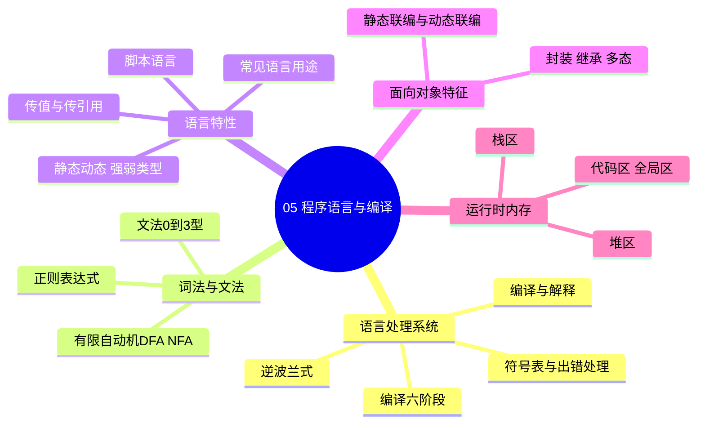
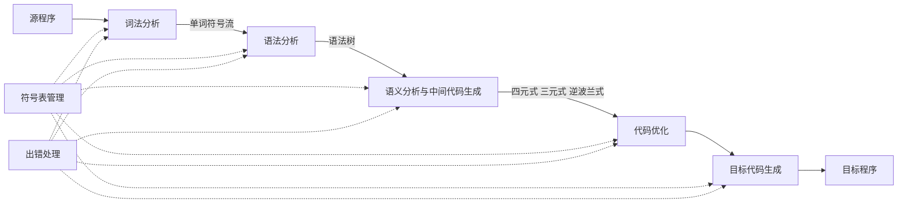

> **摘要**：
> 这章讲"代码是怎么变成计算机动作的"：编译与解释的区别、编译六阶段流水线、正则与文法、参数传递、语言类型系统、内存分区。上午题稳定考 3~5 分，"错误发生在哪个阶段""逆波兰式""传值传引用"是三大钉子户；案例题基本不直接考，但内存分配知识对读懂代码类案例有底子作用（与 [09-面向对象方法](09-面向对象方法/) 的多态联编呼应）。本章是典型"背多分"，建议投入 5~6 小时。

## 🗺️ 知识地图



## 📖 掰碎讲解

### 5.1 编译 vs 解释：全文翻译 vs 同声传译

**是什么**：编译型把源程序**整体**翻译成目标程序再执行；解释型**逐句**读、逐句执行，不生成目标程序。

**大白话**：编译 = 把整本英文书翻译成中文书再给你看（翻译慢但读得快）；解释 = 同声传译员边听边译（马上能懂，但每次读都要现场译一遍）。Java 特殊：先编译成字节码，再由 JVM 解释/JIT 执行，属于"编译 + 解释"混合模式。

| 对比 | 编译 | 解释 |
|---|---|---|
| 目标程序 | 生成 | 不生成 |
| 执行速度 | 快 | 慢 |
| 跨平台 | 差（目标码依赖平台） | 好（解释器一装处处能跑） |
| 报错时机 | 编译期集中报 | 运行到哪报哪 |

**怎么考**：判断某语言属于哪类（C/C++ 编译；Python/JS/Shell 解释；Java 混合）；"解释方式不生成目标程序"是常考判断。

### 5.2 编译六阶段：一条流水线（必背）



| 阶段 | 干什么 | 产出 | 典型错误举例 |
|---|---|---|---|
| 词法分析 | 切单词、查非法字符 | 单词符号流（记号） | 出现非法字符 `#￥` |
| 语法分析 | 检查结构是否合法 | 语法树 | 缺分号、括号不配对 |
| 语义分析 | 检查类型与含义 | 标注类型后的语法树 | **类型不匹配**、变量未声明 |
| 中间代码生成 | 转成中间形式 | 四元式、三元式、逆波兰式 | — |
| 代码优化 | 提速省空间 | 优化的中间码 | — |
| 目标代码生成 | 生成机器相关代码 | 汇编/机器码 | — |

**符号表管理与出错处理贯穿全过程**（图中的虚线），这是常考判断点。

**逆波兰式（后缀表达式，必考计算）**：运算符写在操作数后面，无括号。转换口诀：**先按优先级加括号，再把运算符挪到右括号后面**。
例：`(a+b)×c−d` → `((a+b)×c)−d` → `ab+c×d−`。

**大白话**：词法分析是"认字"，语法分析是"看句子通不通"，语义分析是"这句话合不合逻辑"（你不能"把苹果加到星期三上"），中间代码是"通用草稿"，优化是"润色"，目标代码是"抄成对方母语"。

**怎么考**：给错误现象问发生在哪个阶段（认字问题→词法；结构问题→语法；类型问题→语义）；给中缀式求后缀式。

### 5.3 正则表达式与有限自动机

**是什么**：正则表达式描述字符串模式；有限自动机（FA）是识别正则语言的机器。DFA 每个状态对每个输入**只有一个**确定转移；NFA 允许**多个**转移和 ε 空转移，NFA 可确定性化成等价 DFA。

**大白话**：自动机像地铁线路图，字符串是乘客的行走路线——走到终点站（接受态）就是"匹配成功"。

**怎么考**：给状态图选对应的正则式；给正则式判断哪些字符串能被识别（如 `a(ab)*b` 能识别什么）。

### 5.4 文法四型：Chomsky 家谱

| 型 | 名称 | 限制 | 对应自动机 | 用途 |
|---|---|---|---|---|
| 0 型 | 短语结构文法 | 无限制 | 图灵机 | 理论 |
| 1 型 | 上下文有关文法 | 产生式左部长度 ≤ 右部 | 线性有界自动机 | — |
| 2 型 | **上下文无关文法** | 左部是单个非终结符 | 下推自动机 | **语法分析** |
| 3 型 | 正规文法 | 右部只有 `aA` 或 `a` 形式 | 有限自动机 | **词法分析** |

**包含关系**：3 型 ⊂ 2 型 ⊂ 1 型 ⊂ 0 型，限制越少能力越强。

**大白话**：0 型"想怎么写怎么写"；1 型"上下文要匹配"；2 型"一句话只看开头是谁说了算"（S→aSb）；3 型"最规矩"，右部只能一个终结符打头。

**怎么考**：给产生式判断文法类型——右部是单个非终结符开头的 → 2 型；右部只有"终结符+可选一个非终结符" → 3 型。

### 5.5 传值调用 vs 传引用调用：改没改到原件

**是什么**：传值把实参**拷贝一份**给形参，函数内怎么改都不影响外面；传引用把实参的**地址**递进去，函数内改形参 = 改原件。

**大白话**：传值 = 把简历复印一份给 HR，HR 涂改的是复印件；传引用 = 把简历原件递过去，HR 一改你的原件也变了。

**必考代码题**：

```text
void f(int x, int y) {   // C++ 传值版本
    x = x * 2;
    y = x + y;
}
main() {
    int a = 3, b = 4;
    f(a, b);
    print(a, b);
}
```

- 传值：a、b 是复印件 → 输出 **3 4**
- 传引用（如 `f(int &x, int &y)`）：x=6，y=6+4=10 → 输出 **6 10**

**怎么考**：给代码算输出，让你区分两种方式；注意混合传参（一个传值一个传引用）的题要分开算。

### 5.6 静态/动态、强/弱类型：两个独立的开关

**是什么**：静态/动态看**类型检查时机**（编译期 vs 运行期）；强/弱看**类型转换是否严格**（不许偷偷转 vs 随便转）。两组是独立维度，共四象限。

| | 强类型 | 弱类型 |
|---|---|---|
| 静态 | Java、C# | C |
| 动态 | Python、Ruby | JavaScript、PHP |

**大白话**：静态 = 出门前检查行李（编译期查类型）；动态 = 边走边查。强 = 宁死不做"1+\"1\""这种混搭；弱 = 自动帮你转型，"1"+"1" 可能等于 "11"。

**怎么考**：给语言归类四象限；判断"动态语言都是弱类型"（错，Python 就是动态强类型）。

### 5.7 脚本语言与常见语言用途

**脚本语言特点**：解释执行、动态类型、语法灵活、常作"胶水"粘合系统、开发快执行慢。代表：Python、JavaScript、PHP、Perl、Shell、Lua。

**用途速配（选择题常客）**：

| 语言 | 常见用途 |
|---|---|
| C/C++ | 操作系统、嵌入式、高性能系统 |
| Java | 企业级应用、Android |
| Python | 脚本、数据分析、人工智能 |
| Lisp/Prolog | 函数式/逻辑式，人工智能 |
| SQL | 数据库查询 |

### 5.8 面向对象语言三特征与联编

**封装**：数据与操作捆绑、隐藏内部细节；**继承**：is-a 复用；**多态**：同一消息不同响应。

**联编（必考）**：重载（同名不同参）在**编译期**绑定 → 静态联编；重写（子类覆盖父类方法）在**运行期**绑定 → 动态联编，是运行时多态的基础。细节见 [09-面向对象方法](09-面向对象方法/)。

### 5.9 运行时内存分配：代码住哪、变量住哪

**是什么**：程序运行时内存典型分为四个区。

| 区域 | 放什么 | 管理方式 |
|---|---|---|
| 代码区 | 程序指令 | 只读 |
| 全局/静态区 | 全局变量、静态变量 | 程序启动分配、结束释放 |
| **栈区** | 局部变量、函数参数、返回地址 | 自动分配释放，函数调用入栈 |
| **堆区** | new/malloc 动态申请 | 程序员手动管理，忘记释放→内存泄漏 |

**大白话**：栈像食堂餐盘摞——用完自动收（函数返回即销毁），摞太高会"栈溢出"（递归太深！）；堆像自选仓库——要自己登记（new）自己退租（delete），忘了退就白白占着（内存泄漏）。

**怎么考**："递归过深导致崩溃"→栈溢出；"new 出的对象存放在"→堆；"函数形参存放在"→栈。

## 🎬 推荐视频

| 视频 | 讲什么 | 什么时候看 |
|---|---|---|
| [希赛《系统架构设计师》精讲合集 154 集](https://www.bilibili.com/video/BV1Ba4y1u7EC) | 六阶段、文法、传参逐个精讲 | 第一遍跟学 |
| [软考小管家全套 198 集](https://www.bilibili.com/video/BV1xepMzrEjD) | 零基础拆解编译流程与类型系统 | 概念模糊时补课 |

## ⭐ 章节重点（考前必背）

| 知识点 | 必背内容 | 考频 |
|---|---|---|
| 六阶段归属 | 非法字符→词法；缺括号→语法；类型不匹配→语义 | 上午题高频 |
| 逆波兰式 | 按优先级加括号、运算符挪到右括号后 | 近十年高频 |
| 文法类型 | 2 型上下文无关配语法分析；3 型正规文法配词法 | 上午题高频 |
| 传参 | 传值不改实参；传引用改实参 | 上午题高频 |
| 四象限 | Java 静态强；C 静态弱；Python 动态强；JS 动态弱 | 近十年高频 |
| 解释 vs 编译 | 解释不生成目标程序、跨平台好 | 近十年高频 |
| 内存分区 | 递归深→栈溢出；new→堆；全局→静态区 | 近十年高频 |
| 联编 | 重载=静态联编；重写=动态联编 | 近十年高频 |

## 🧠 高频考法与陷阱

> **注意**：
> 1. **"缺分号"当成语义错误**：错误认知：写错符号就是语义问题；正确：缺分号、括号不配对是**结构**问题→语法分析；类型不匹配、除零检查才是语义分析。判断口诀：认字→词法，结构→语法，逻辑→语义。
> 2. **Python 当成弱类型**：错误认知：动态类型=弱类型；正确：Python 是**动态强类型**（不会偷偷把 "1" 当数字加），JS 才是动态弱类型。
> 3. **传值传引用混算**：混合传参题里一半参数传值、一半传引用，要逐个判断，别一锅端。
> 4. **Java 说成纯解释型**：错误认知：Java 跨平台所以纯解释；正确：Java 先编译为字节码、再由 JVM 解释/JIT 执行，是"编译+解释"混合。
> 5. **堆栈张冠李戴**：函数调用与递归用**栈**；malloc/new 用**堆**；栈溢出不是堆满，别写反。

## ✍️ 反复练习题

### 第 1 题
编译过程中，发现"变量在未声明的情况下被使用"，这一检查通常发生在（ ）阶段。
A. 词法分析　B. 语法分析　C. 语义分析　D. 目标代码生成

> **示例**：
> **答案：C**
> 解析：变量是否声明、类型是否匹配属于"含义是否合法"，归语义分析（5.2 节）。词法只管认字（非法字符），语法只管结构（括号、分号）。

### 第 2 题
表达式 `(a+b)×c−d` 对应的逆波兰式（后缀式）是（ ）。
A. ab+c×d−　B. abc+×d−　C. ab+cd×−　D. dabc+×−

> **示例**：
> **答案：A**
> 解析：先按优先级加括号 ((a+b)×c)−d；把运算符挪到对应右括号后：(a+b)→ab+，(ab+×c)→ab+c×，整体减 d → ab+c×d−（5.2 节口诀）。B 把 + 挪错了位置，等价于 a+(b×c)。

### 第 3 题
文法 G：S→aSb | ab，该文法属于（ ）。
A. 0 型　B. 1 型　C. 2 型　D. 3 型

> **示例**：
> **答案：C**
> 解析：产生式左部都是单个非终结符 S → 上下文无关文法（2 型）（5.4 节）。它生成的语言是 aⁿbⁿ，3 型正规文法表达不了"前后配对计数"，这正是 2 型与 3 型的能力分界。

### 第 4 题
执行以下代码后输出的 a、b 值为（ ）。

```text
void f(int x, int &y) {   // x 传值，y 传引用
    x = x + 1;
    y = x + y;
}
main() {
    int a = 2, b = 3;
    f(a, b);
    print(a, b);
}
```

A. 2 3　B. 3 3　C. 2 6　D. 3 6

> **示例**：
> **答案：C**
> 解析：x 是 a 的**复印件**，改动不影响 a，a 仍为 2；y 是 b 的**引用**，x+1=3 后 y = 3+3 = 6，b 变为 6（5.5 节）。混合传参必须逐个判断，答案是 2 6。

### 第 5 题
下列语言中属于"动态强类型"的是（ ）。
A. Java　B. C　C. Python　D. JavaScript

> **示例**：
> **答案：C**
> 解析：Python 类型在运行期确定（动态），且不做隐式类型混算（强）（5.6 节四象限）。Java 是静态强、C 是静态弱、JS 是动态弱。

### 第 6 题
关于编译方式与解释方式，正确的是（ ）。
A. 解释方式会生成可长期使用的目标程序
B. 编译方式跨平台性通常优于解释方式
C. 解释方式逐句执行、不生成目标程序
D. 编译方式运行时速度通常慢于解释方式

> **示例**：
> **答案：C**
> 解析：解释逐句翻译执行、不生成目标程序，跨平台好但慢（5.1 节）。A、D 都说反了；B 中编译出的目标码绑定平台，跨平台差，要重编译。

### 第 7 题
程序运行中，函数调用的局部变量与 new 申请的对象分别存放在（ ）。
A. 堆；栈　B. 栈；堆　C. 都在栈　D. 都在堆

> **示例**：
> **答案：B**
> 解析：局部变量随函数调用进**栈**、返回即释放；new/malloc 的对象在**堆**、需手动释放否则内存泄漏（5.9 节）。递归过深时栈被压穿 → 栈溢出。

### 第 8 题（案例大题风格）
某递归函数计算阶乘：fact(n) = n×fact(n−1)，fact(0)=1。系统调用栈每层栈帧占 64B，线程栈上限 8KB。
(1) 每次递归调用会在内存哪个区域发生什么？
(2) 递归深度最大约为多少层？超过会怎样？
(3) 说明如何改造避免该问题。

> **示例**：
> **答案要点：**
> (1) 每次调用在**栈区**压入一个栈帧（局部变量 n、返回地址、参数），返回时弹栈（5.9 节）。
> (2) 8KB/64B = **128 层**；超过 128 层栈空间耗尽 → **栈溢出**，程序崩溃。
> (3) 改为**迭代**（循环累乘）把 O(n) 栈深降为 O(1)；或改用尾递归并依赖编译器优化；或增大线程栈（治标）。案例题给分点：内存区域、栈帧内容、上限计算、改造方案。

## 🔗 相关章节

- [04-数据结构与算法](04-数据结构与算法/)：递归与栈、复杂度分析配合理解
- [09-面向对象方法](09-面向对象方法/)：多态与动态联编的完整展开
- [02-操作系统与嵌入式基础](02-操作系统与嵌入式基础/)：内存管理在系统层的对应机制
- [架构-真题战略](../架构-真题战略/)：上午题取舍策略
- [学习方法与记忆术](../../00-备考指南/学习方法与记忆术/)：四象限与阶段归属的口诀
