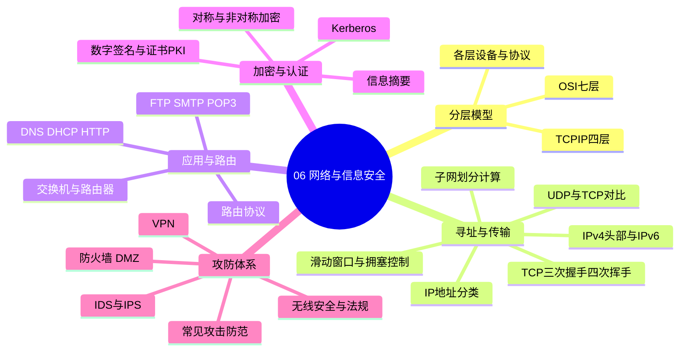
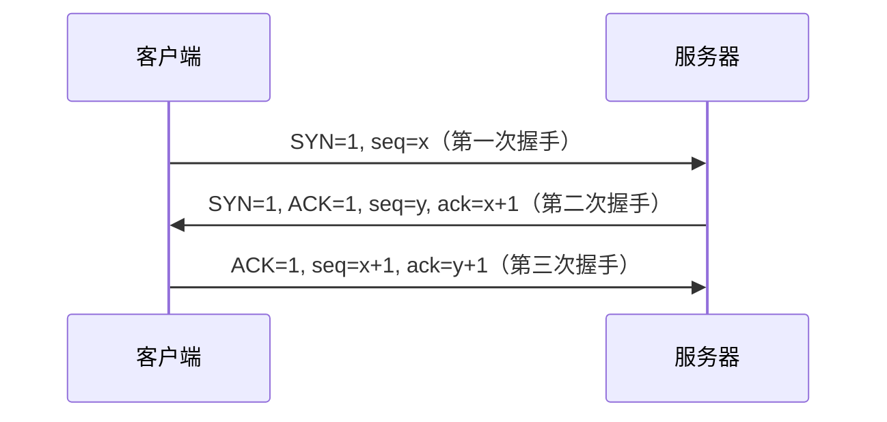
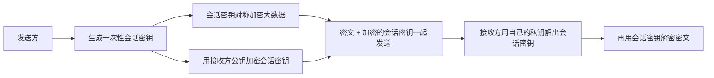
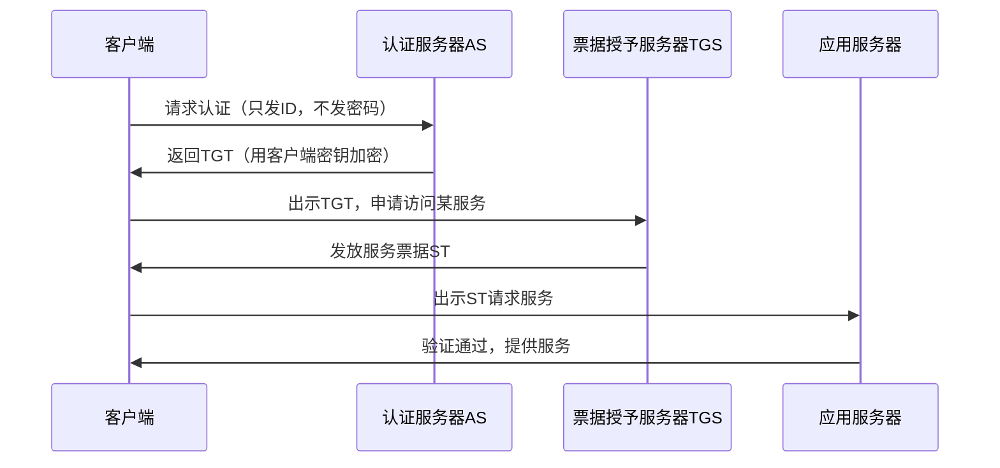

> **摘要**：
> 这章是两块拼盘：网络基础（分层模型、IP 子网、TCP/UDP、应用协议）+ 信息安全（加密、签名、证书、Kerberos、攻防）。上午题稳定考 6~8 分，是分值大户；子网划分、加密体系、Kerberos 是三大送分点。案例题偶尔出安全方案设计（防火墙/DMZ/VPN），论文也常写安全。与 [13-Web架构与中间件](13-Web架构与中间件/) 联动紧密。建议投入 10~12 小时，大表必须背熟。

## 🗺️ 知识地图

## 📖 掰碎讲解

### 6.1 OSI 七层与 TCP/IP 四层：快递公司的分工

**是什么**：OSI 七层从下到上：物理、数据链路、网络、传输、会话、表示、应用；TCP/IP 四层：网络接口、网际、传输、应用。

**大白话**：寄快递——物理层管"卡车跑什么路"，链路层管"同一段路上两站交接"，网络层管"全国怎么中转寻址"，传输层管"收件人确认签收、丢了补发"，应用层管"你到底寄什么、怎么填单"。

**对应关系与各层要点（全卷最常考大表）**：

| OSI 层 | 设备 | 代表协议 | 记忆点 |
|---|---|---|---|
| 应用 | 网关 | HTTP、FTP、SMTP、DNS、DHCP | 直接服务用户 |
| 表示 | — | JPEG、加密压缩（编码转换） | "翻译官" |
| 会话 | — | 建立/管理会话 | "谈判主持" |
| 传输 | — | **TCP、UDP** | 端到端 |
| 网络 | **路由器** | **IP、ICMP、ARP、IGMP** | 选路 |
| 数据链路 | 网桥、**交换机** | PPP、HDLC | 相邻节点 |
| 物理 | 中继器、集线器 | RS232、RJ45 | 比特流 |

口诀：物联网淑惠试用（物数网传会表应）。

**怎么考**："交换机工作在第几层"（二层）；"路由器隔离广播域、交换机隔离冲突域"；ICMP/ARP 属于网络层。

### 6.2 IP 地址与子网划分：必考计算题

**地址分类（必背）**：A 类 1~126（/8）；B 类 128~191（/16）；C 类 192~223（/24）；D 组播；E 保留。127 是环回。

**子网划分三连算**：
- 掩码 /26 = 255.255.255.192，主机位 h = 32−26 = 6
- 每子网地址数 = 2^h = 64，**可用主机 = 2^h − 2**（去掉网络地址和广播地址）
- 判断 IP 属于哪个子网：把 IP 与掩码**按位与**

**例**：192.168.1.100/26 → 100 = 01100100，前 2 位是子网位 → 子网 192.168.1.64，广播地址 192.168.1.127，可用主机 62。

**CIDR 聚合**：取各网段的**公共前缀**。例：192.168.0.0/24 与 192.168.1.0/24 可聚合为 192.168.0.0/23。

**IPv6**：128 位、冒号十六进制、`::` 只能压缩一次连续的 0；IPv4 头部关键字段：TTL（防环路，每过一个路由器减 1）、协议号（标识上层）。

**怎么考**：求可用主机数、子网地址、广播地址、聚合后的掩码；"哪个地址能分配给主机"（主机位全 0/全 1 的不行）。

### 6.3 TCP 三次握手与拥塞控制

**为什么三次**：确认双方的收发能力都正常，并防止早已失效的连接请求突然到达服务器造成资源浪费（两次握手做不到）。

**四次挥手**：FIN → ACK → FIN → ACK；主动方最后进入 **TIME_WAIT（等待 2MSL）**，保证最后一个 ACK 能重传、旧报文消亡。

**流量控制与拥塞控制**：滑动窗口 = 接收方告诉发送方"我还能收多少"（流量控制）；拥塞控制四招：慢启动（指数增）→ 拥塞避免（线性增）→ 快重传（3 个重复 ACK 立即重发）→ 快恢复。

**UDP vs TCP**：UDP 无连接、不可靠、开销小、快，适合视频直播、DNS、DHCP；TCP 面向连接、可靠有序、全双工、面向字节流，适合网页、文件传输。

**怎么考**：握手次数与报文标志位；TIME_WAIT 在哪一方；"视频传输选 UDP 的理由"。

### 6.4 应用层协议与端口速配

| 协议 | 端口 | 作用 | 记忆点 |
|---|---|---|---|
| HTTP / HTTPS | 80 / **443** | 网页 / HTTP+SSL 加密 | HTTPS = 安全的 HTTP |
| FTP | **21 控制 / 20 数据** | 文件传输 | 双端口是考点 |
| SMTP | 25 | **发**邮件 | "推"信 |
| POP3 | 110 | **收**邮件 | "拉"信 |
| DNS | 53 | 域名→IP | 递归+迭代查询 |
| DHCP | 67/68 | 自动分配 IP | Discover→Offer→Request→ACK 四步，可跨网段用中继代理 |
| Telnet / SSH | 23 / 22 | 远程登录 / 加密远程登录 | SSH 是加密版 |

**DHCP 四步必背**：Discover（广播找服务器）→ Offer（服务器给地址）→ Request（客户确认要）→ ACK（服务器正式发放）。

### 6.5 路由与交换

- 路由协议：RIP（距离向量、跳数、**最多 15 跳**、小网络）、OSPF（链路状态、分区域、大网络）、BGP（自治域之间）。
- 交换机：二层设备，按 MAC 地址表转发，**每个端口独立冲突域**；VLAN 在交换机上隔离广播域。
- 路由器：三层设备，按 IP 选路，**隔离广播域**；网关 = 跨网段的"出口大门"。

**大白话**：交换机是小区内的"门牌管家"，路由器是城市间的"高速导航"。

### 6.6 加密体系：对称 vs 非对称（大表必背）

| 对比 | 对称加密 | 非对称加密 |
|---|---|---|
| 密钥 | 加解密同一把 | 公钥加密、私钥解开（成对） |
| 速度 | **快**，适合大数据 | 慢，适合小数据 |
| 密钥管理 | 难（n 人两两通信要 n(n−1)/2 把） | 易（公钥随便发） |
| 代表 | DES（56 位）、3DES、AES（128/192/256）、IDEA、RC4 | RSA（大整数分解）、ECC（椭圆曲线）、DSA（签名）、ElGamal |

**混合加密（数字信封，必考流程）**：

**大白话**：贵重物品放保险箱（对称加密快），保险箱钥匙装进一个只有收件人能打开的信封（非对称加密管钥匙）。

### 6.7 信息摘要、数字签名与数字证书

**信息摘要**：MD5（128 位）、SHA-1（160 位）、SHA-256。特点：单向（不可逆）、任意长度输入定长输出、雪崩效应。摘要**不加密、不保密**，只防篡改。

**数字签名（必考方向题）**：
- **签名**：发送方用自己的**私钥**加密摘要 → 证明"确实是我发的 + 没被改"（不可抵赖、完整性）
- **验证**：接收方用发送方的**公钥**解密对比
- **保密传输**则是反方向：发方用**收方的公钥**加密数据，只有收方私钥能解

**一句话记忆：签名用"自己的私钥"，加密用"别人的公钥"。**

**数字证书与 PKI**：CA（证书权威）把"你的身份 + 你的公钥"绑在一起签发证书（X.509），解决"公钥是谁的"问题。PKI 组件：CA 签发、RA 审核、证书库查询。收到证书要验证 CA 签名和有效期。

### 6.8 Kerberos 认证：三方发票制（必考流程）

**核心考点**：AS 发"入场券 TGS 票据"，TGS 发"具体服务门票"；**时间戳**用来**防重放攻击**；密码从不在网络上明文传输。

**大白话**：游乐园——AS 是售票处（验证身份给通票），TGS 是各项目检票口（用通票换项目票），时间是票上的有效期，过期重放无效。

### 6.9 防火墙、IDS/IPS 与 VPN

- **防火墙分类**：包过滤（查 IP/端口，快、粗）、状态检测（跟踪连接状态）、应用代理/网关（协议级检查，细、慢）。DMZ 非军事区：放对外服务器（Web/邮件），内外网之间加一道缓冲。
- **IDS vs IPS**：IDS 入侵**检测**，**旁路**挂接、只报警不拦截；IPS 入侵**防御**，**串联**在线、实时阻断。一句话：IDS 是监控摄像头，IPS 是电动闸门。
- **VPN**：隧道技术；L2TP/PPTP（二层）、IPSec（**网络层**，最通用）、SSL VPN（传输层，浏览器即用）。
- **攻击与防范**：DDoS（海量请求打瘫服务 → 流量清洗/CDN）、SQL 注入（拼接恶意 SQL → 预编译参数化查询）、XSS（注入脚本偷 Cookie → 输出转义/CSP）、ARP 欺骗（伪造 MAC 映射劫持流量 → 静态绑定/交换机端口安全）、钓鱼、木马/蠕虫/病毒。

**怎么考**：IDS/IPS 区别；DMZ 里放什么；"防 SQL 注入最有效手段"→参数化查询。

### 6.10 无线安全与网络安全法

**WLAN 演进**：WEP（早已破解）→ WPA（TKIP，过渡）→ **WPA2（AES-CCMP，主流）** → WPA3（SAE，防离线字典攻击）。

**《网络安全法》要点**：网络运营者需落实安全保护义务；实行**网络安全等级保护制度**（五级，三级以上每年测评/定期测评）；关键信息基础设施特殊保护；个人信息保护（收集需告知同意）。

**区块链**（偶考概念）：去中心化、不可篡改（哈希链+共识）、可追溯；联盟链/公有链/私有链。

## 🎬 推荐视频

| 视频 | 讲什么 | 什么时候看 |
|---|---|---|
| [希赛《系统架构设计师》精讲合集 154 集](https://www.bilibili.com/video/BV1Ba4y1u7EC) | 分层模型、子网划分、加密认证全程精讲 | 第一遍跟学 |
| [软考小管家全套 198 集](https://www.bilibili.com/video/BV1xepMzrEjD) | 零基础讲透 TCP 握手与 Kerberos 流程 | 概念绕不过来时看 |

## ⭐ 章节重点（考前必背）

| 知识点 | 必背内容 | 考频 |
|---|---|---|
| 分层设备 | 交换机二层、路由器三层、网关高层协议转换 | 上午题高频 |
| 子网计算 | 可用主机 2^h−2；IP 与掩码按位与定网段 | 上午题高频 |
| TCP | 三次握手防失效请求；TIME_WAIT 2MSL | 上午题高频 |
| 端口 | HTTPS 443、FTP 21/20、SMTP 25、POP3 110、DNS 53 | 近十年高频 |
| 加密 | 对称快（DES/AES）、非对称慢（RSA/ECC）；数字信封混合 | 上午题高频 |
| 签名 | 签名=自己的私钥；加密=对方的公钥 | 上午题高频 |
| Kerberos | AS+TGS 两级票据；时间戳防重放 | 上午题高频 |
| IDS/IPS | IDS 旁路报警、IPS 串联阻断 | 近十年高频 |
| DHCP | Discover→Offer→Request→ACK；UDP 67/68 | 近十年高频 |
| 无线 | WPA2 用 AES；WEP 早已不安全 | 近十年高频 |

## 🧠 高频考法与陷阱

> **注意**：
> 1. **签名与加密的密钥用反**：错误认知：签名用对方公钥；正确：签名用**自己的私钥**（否则无法证明身份），加密才用**对方的公钥**。
> 2. **可用主机数忘减 2**：/26 每子网 64 个地址，可用 **62**——网络地址和广播地址不能分给主机，年年有人栽。
> 3. **交换机当三层设备**：普通交换机工作在**数据链路层**；三层交换机才有路由功能，题目没说"三层"就按二层答。
> 4. **IDS 当闸门**：IDS 只检测报警（旁路），IPS 才能在线阻断；防火墙挡"外面的"，管不了"内鬼"流量。
> 5. **HTTPS 端口写 80**：HTTP 是 80、HTTPS 是 **443**；FTP 是 21 控制、20 数据，别只记一个。
> 6. **IPv6 压缩超限**：`::` 在一个地址里**只能出现一次**，出现两次无法还原。

## ✍️ 反复练习题

### 第 1 题
IP 地址 192.168.1.100/26 所在子网的网络地址与可用主机数分别为（ ）。
A. 192.168.1.64，62　B. 192.168.1.0，62　C. 192.168.1.64，64　D. 192.168.1.96，30

> **示例**：
> **答案：A**
> 解析：/26 主机位 6 位；100 = 01100100，前 2 位（子网位）为 01 → 子网块 64，网络地址 192.168.1.64；可用主机 2⁶−2 = **62**（6.2 节）。C 忘了减 2；B 忘了子网位；D 算错子网块大小。

### 第 2 题
TCP 连接建立采用三次握手，其主要目的不包括（ ）。
A. 确认双方收发能力正常
B. 防止失效的连接请求到达服务器造成资源浪费
C. 协商初始序列号
D. 保证数据传输过程中不丢包

> **示例**：
> **答案：D**
> 解析：三次握手解决"连接建立可信"，D 的可靠传输靠确认重传机制在数据传输阶段保证，与握手目的无关（6.3 节）。A、B、C 都是握手的经典作用。

### 第 3 题
发送方对消息摘要进行加密形成数字签名，应使用的密钥是（ ）。
A. 发送方私钥　B. 发送方公钥　C. 接收方私钥　D. 接收方公钥

> **示例**：
> **答案：A**
> 解析：签名 = 用**自己的私钥**加密摘要，任何人可用发送方公钥验证，从而不可抵赖（6.7 节）。若用 B 加密则人人可伪造；用 D 是保密传输的用法，方向完全不同。

### 第 4 题
Kerberos 系统中，票据中包含时间戳的主要目的是（ ）。
A. 加密用户密码　B. 防止重放攻击　C. 提高传输速度　D. 压缩票据大小

> **示例**：
> **答案：B**
> 解析：攻击者截获旧票据重发（重放攻击），时间戳/有效期让过期票据作废（6.8 节）。Kerberos 中用户密码从不直接在网上传输。

### 第 5 题
某企业要把对外提供 Web 服务的服务器与内网隔开，该服务器应部署在（ ）。
A. 内网核心区　B. DMZ 区　C. 办公区　D. 数据备份区

> **示例**：
> **答案：B**
> 解析：DMZ（非军事区）专门放对外服务器，即使被攻破也不直接威胁内网（6.9 节）。典型策略：外网→DMZ 允许、DMZ→内网受限、内网→外网经防火墙。

### 第 6 题
下列协议组合中，全部属于网络层的是（ ）。
A. IP、ICMP、ARP　B. TCP、UDP　C. HTTP、FTP　D. PPP、HDLC

> **示例**：
> **答案：A**
> 解析：IP/ICMP/ARP 都是网际层协议（6.1 节）。B 是传输层；C 是应用层；D 是数据链路层。注意 ARP 虽"帮 IP 找 MAC"，软考归网络层。

### 第 7 题
关于对称加密与非对称加密，正确的是（ ）。
A. AES 是非对称加密算法
B. RSA 加密速度通常快于 DES
C. 混合加密用非对称算法传送对称会话密钥
D. 对称加密的密钥分发比非对称更方便

> **示例**：
> **答案：C**
> 解析：数字信封方案——大数据用对称（快），会话密钥用对方公钥加密传递（好分发）（6.6 节）。A 错，AES 是对称；B 错，RSA 慢得多；D 错，对称加密密钥管理是难题。

### 第 8 题（案例大题风格）
某企业网络拓扑：外网—边界防火墙—DMZ（Web、邮件服务器）—内防火墙—内网（办公区、核心数据库）。
(1) 说明 DMZ 的作用与访问控制策略；
(2) 员工出差接入内网应采用什么方案，基于哪一层协议？
(3) 针对 Web 服务，分别说明 SQL 注入与 XSS 的原理及防范措施。

> **示例**：
> **答案要点：**
> (1) DMZ 缓冲隔离区：外网可访问 DMZ 中的服务，但 DMZ 不能主动访问内网；内网访问外网受控；即使 DMZ 失陷，内防火墙仍保护内网（6.9 节）。
> (2) 采用 **VPN**：可选用 IPSec VPN（**网络层**）站点到站点，或 SSL VPN（传输层）远程接入、免装客户端。
> (3) **SQL 注入**：用户输入被拼进 SQL 语句改变语义（如 `' or 1=1 --`）→ 防范：预编译/参数化查询、输入过滤校验、最小权限数据库账号；**XSS**：恶意脚本注入页面在他人浏览器执行、窃取 Cookie → 防范：输出 HTML 转义、CSP 内容安全策略、HttpOnly Cookie。案例题按"原理一句话 + 对策两三条"给分。

## 🔗 相关章节

- [13-Web架构与中间件](13-Web架构与中间件/)：HTTPS、负载均衡与 Web 架构连着考
- [08-软件工程基础](08-软件工程基础/)：安全需求属于非功能需求
- [14-云原生与大数据架构](14-云原生与大数据架构/)：容器网络与云安全延伸
- [架构-案例分析攻略](../架构-案例分析攻略/)：安全方案类案例的答题框架
- [qicoder真题索引](../../99-真题资源/qicoder真题索引/)：历年网络与安全真题索引
