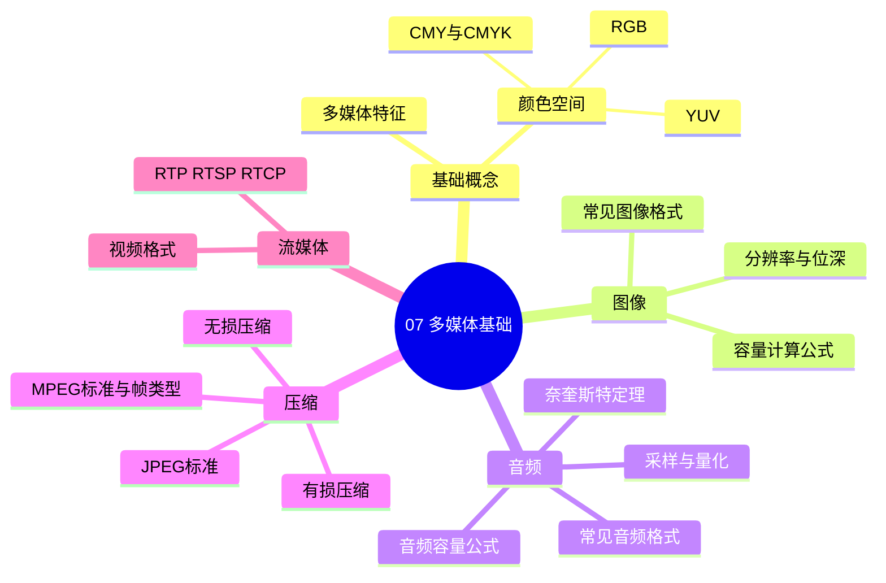
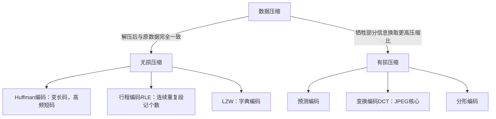

> **摘要**：
> 这章讲"声音和图像在计算机里怎么表示、多大体积、怎么压缩"：颜色空间、图像/音频容量计算（两道必背公式）、奈奎斯特采样定理、压缩分类、JPEG/MPEG 标准。上午题稳定考 2~4 分，纯送分——就两三个公式加几组标准名词；案例题不直接考，但容量计算思路会在音视频系统案例里顺手用到（与 [13-Web架构与中间件](13-Web架构与中间件/) 的流媒体呼应）。全章建议投入 3~4 小时，是性价比最高的章节。

## 🗺️ 知识地图

## 📖 掰碎讲解

### 7.1 多媒体特征：五个关键词

**是什么**：多媒体是两种以上媒体（文、图、声、像）的**集成**，且具备**交互性**。

**五大特征**：多样性（信息载体多维化）、集成性（多种媒体+设备一体化）、**交互性**（用户能主动控制，与电视最大的区别）、实时性（音视频要跟上节奏）、同步性（声画对齐）。

**大白话**：电视画面再精美也只能"看"，你能点、能拖、能选剧情——那才叫多媒体。交互性是多媒体的身份证。

**怎么考**："下列不属于多媒体特征的是"→常见干扰项"单一性/独占性"。

### 7.2 颜色空间：RGB、CMY、YUV 各管一摊

| 颜色空间 | 原理 | 应用 | 大白话 |
|---|---|---|---|
| RGB | 三原色**相加**混色（发光） | 显示器、摄像机 | 三盏彩灯叠出万紫千红 |
| CMY / CMYK | 青品黄**相减**混色（吸收），K 黑版 | 打印、印刷 | 颜料越混越黑 |
| YUV / YIQ | 亮度 Y + 色差 UV 分离 | 电视广播 | 亮度通道兼容黑白电视，色度可压缩 |
| HSV | 色调/饱和度/明度 | 调色板 | 贴合人眼感知 |

**互补色**：RGB 与 CMY 一一互补（红-青、绿-品、蓝-黄）；RGB 全加=白，CMY 全加=黑。

**怎么考**："打印机用哪种颜色空间"→CMYK；"兼容黑白电视"→YUV；"相加混色三原色"→RGB。

### 7.3 图像属性与容量计算（公式一，必背）

**三兄弟概念**：
- **显示分辨率**：屏幕能显示的像素点数（屏幕的"格子数"）
- **图像分辨率**：图像本身的像素数（图里存了多少格子）
- **位深/像素深度**：每个像素用多少位表示颜色（24 位真彩 = RGB 各 8 位）

> **提示**：
> **图像容量(B) = 水平像素 × 垂直像素 × 位深 / 8**
>
> 例：1024×768、24 位真彩、不压缩：
> 1024×768×24/8 = 1024×768×3 = 2,359,296 B ≈ **2.25MB**（2359296/1024² = 2.25）

**大白话**：每个格子涂色要占"位深"个比特，格子数 × 每格开销 ÷ 8 换成字节。真彩 24 位就是"每像素 3 字节"，最好记。

**陷阱**：超过**显示深度**（显示缓存能表达的位数）的颜色信息会失真；显示器只有 16 位显示深度时，24 位图照样按 16 位显示。

**怎么考**：公式直接套，注意单位换算（1024 进制）；"位深超过显示深度会怎样"。

### 7.4 音频数字化与容量计算（公式二，必背）

**三步数字化**：采样（时间上取点）→ 量化（幅度上取整）→ 编码。

**奈奎斯特采样定理（必背）**：采样频率 ≥ 信号最高频率的 **2 倍**，才能无失真还原。
例：语音最高 3.4kHz → 至少采 6.8kHz（实际电话用 8kHz）；CD 音质 44.1kHz。

> **提示**：
> **音频容量(B) = 采样频率 × 量化位数 × 声道数 × 时间(秒) / 8**
>
> 例：CD 一分钟：44100 × 16 × 2 × 60 / 8 = 10,584,000 B ≈ **10.09MB**

**大白话**：每秒拍 44100 张"快照"（采样），每张用 16 位记音量（量化），左右耳各一份（声道），乘上时间除以 8 变字节。

**怎么考**：套公式算容量/算时长；"人耳听觉范围 20Hz~20kHz，采样至少多少"→40kHz；区分"采样频率"与"量化位数"各自影响什么（前者时间精度、后者幅度精度）。

### 7.5 压缩分类：无损 vs 有损

**大白话**：无损像"把 AAAABBB 写成 4A3B"，原样可复原（文本、程序必须用它）；有损像"把照片缩略再存"，人眼看不出差别但细节没了（图像音视频靠它）。

**怎么考**：给算法归类——Huffman/行程/LZW 无损；DCT/预测/分形有损；"文本文件压缩选哪种"→无损。

### 7.6 JPEG 与 MPEG：静态与动态的两大标准

**JPEG**：静态图像压缩标准，核心 = **DCT 变换 + 量化 + Huffman 编码**，有损为主（也定义了无损模式），压缩比可调。GIF（LZW 无损、256 色、支持动画）、PNG（无损）、BMP（不压缩位图）。

**MPEG 家族（标准与用途必背）**：

| 标准 | 用途 | 记忆点 |
|---|---|---|
| MPEG-1 | VCD、MP3 | MP3 是 MPEG-1 Audio Layer 3 |
| MPEG-2 | DVD、数字电视 | 广播级 |
| MPEG-4 | 网络流媒体、交互多媒体 | 面向对象编码 |
| MPEG-7 | **多媒体内容描述接口** | 检索用，"描述"内容 |
| MPEG-21 | 多媒体框架 | 标准的标准化 |

**I/P/B 帧（必考对比）**：

- **I 帧**：帧内编码（用 JPEG 思想，DCT），数据量最大、是解码起点
- **P 帧**：参考前面的 I/P 帧，只存"变化的部分"
- **B 帧**：前后双向参考，压缩比**最高**
- 视频压缩 = 帧内压缩（空间冗余）+ 帧间压缩（时间冗余，运动补偿）

**大白话**：I 帧是"完整截图"，P 帧是"和上一张比哪里动了"，B 帧是"和前后两张比哪里动了"——比较对象越多，要存的信息越少。

**怎么考**："压缩比最高的帧"→B 帧；"随机访问/换台从哪开始解码"→I 帧；MPEG-7 的用途→内容描述与检索。

### 7.7 流媒体与文件格式速查

**流媒体**：边下载边播放，不必等整个文件。协议三件套：RTP（实时传输数据）、RTCP（传输质量反馈）、RTSP（流控制，像"遥控器"：暂停/快进）。

**常见格式速查表**：

| 类型 | 格式 | 特点 |
|---|---|---|
| 图像 | BMP | 位图、不压缩 |
| 图像 | JPEG | 有损、真彩照片 |
| 图像 | GIF | 无损 LZW、256 色、动画 |
| 图像 | PNG | 无损、支持透明 |
| 音频 | WAV | 不压缩波形 |
| 音频 | MP3 | 有损、1:10 左右压缩 |
| 音频 | MIDI | **合成音乐**（乐谱不是录音），体积极小 |
| 视频 | AVI / MP4 / MOV / RMVB | 容器格式 |

**怎么考**：MIDI 的本质（合成指令，不是采样声音）；GIF 颜色上限 256；流媒体协议分工。

## 🎬 推荐视频

| 视频 | 讲什么 | 什么时候看 |
|---|---|---|
| [希赛《系统架构设计师》精讲合集 154 集](https://www.bilibili.com/video/BV1Ba4y1u7EC) | 容量公式推导与 MPEG 标准梳理 | 第一遍跟学 |
| [芝士架构凯恩重难点专题](https://www.bilibili.com/video/BV1XM8izmE5g) | 计算类专题，含多媒体容量计算套路 | 考前突击计算题 |

## ⭐ 章节重点（考前必背）

| 知识点 | 必背内容 | 考频 |
|---|---|---|
| 图像容量 | 水平×垂直×位深/8（B），真彩=每像素 3 字节 | 上午题高频 |
| 音频容量 | 采样率×量化位数×声道×时间/8（B） | 上午题高频 |
| 奈奎斯特 | 采样频率 ≥ 2×最高频率 | 上午题高频 |
| 颜色空间 | 显示 RGB、印刷 CMYK、电视 YUV | 近十年高频 |
| 压缩分类 | Huffman/行程/LZW 无损；DCT/预测/分形有损 | 近十年高频 |
| 帧类型 | I 帧最大、B 帧压缩比最高、I 帧是解码起点 | 上午题高频 |
| MPEG | MPEG-7=内容描述；MP3 属 MPEG-1 | 近十年高频 |
| MIDI | 合成乐谱而非录音 | 近十年高频 |
| 流媒体 | RTP 传数据、RTCP 反馈质量、RTSP 遥控 | 近十年高频 |

## 🧠 高频考法与陷阱

> **注意**：
> 1. **公式漏声道或忘除 8**：错误认知：44100×16×60 就是容量；正确：双声道要 ×2，算字节要 /8。两个公式都先写全再代入。
> 2. **采样定理用反**：是采样频率 ≥ **2 倍最高信号频率**，不是"最高频率的一半"；语音 3.4kHz 至少 6.8kHz。
> 3. **JPEG 当成无损**：JPEG 主体是**有损**（DCT+量化）；PNG/GIF 才是无损，别混。
> 4. **帧类型压缩比排错**：压缩比 B > P > I（B 最高、I 最低数据量最大），方向别记反。
> 5. **RGB 当印刷色**：RGB 是发光相加（屏幕），CMYK 是颜料相减（打印），"打印机用 RGB"必错。

## ✍️ 反复练习题

### 第 1 题
信号最高频率为 4kHz，按奈奎斯特采样定理，最低采样频率为（ ）。
A. 2kHz　B. 4kHz　C. 8kHz　D. 16kHz

> **示例**：
> **答案：C**
> 解析：采样频率 ≥ 2×最高频率 = 2×4 = **8kHz**（7.4 节）。A、B 都不满足"两倍"要求，低于它会产生混叠失真。

### 第 2 题
一幅 1024×768 的 24 位真彩色图像，不压缩时数据量约为（ ）。
A. 786KB　B. 2.25MB　C. 18MB　D. 9MB

> **示例**：
> **答案：B**
> 解析：1024×768×24/8 = 1024×768×3 = 2,359,296 B ≈ **2.25MB**（7.3 节）。A 只算了 1 字节/像素（8 位）；C/D 是换算或位数出错。

### 第 3 题
CD 音质（44.1kHz 采样、16 位量化、双声道）存储 1 分钟立体声音乐约需（ ）。
A. 5.05MB　B. 10.09MB　C. 20.2MB　D. 84.7MB

> **示例**：
> **答案：B**
> 解析：44100×16×2×60/8 = 10,584,000 B ≈ **10.09MB**（7.4 节）。A 忘了双声道，C 多算了一倍，D 是把每秒 176400B 误乘 60×8。

### 第 4 题
MPEG 视频中，压缩比最高、解码时需要前后帧参考的是（ ）。
A. I 帧　B. P 帧　C. B 帧　D. D 帧

> **示例**：
> **答案：C**
> 解析：B 帧双向预测，参考前后帧，冗余去得最干净、压缩比最高（7.6 节）。I 帧帧内编码数据量最大；P 帧只参考前面。

### 第 5 题
下列压缩算法中，属于无损压缩的是（ ）。
A. DCT 变换编码　B. 预测编码　C. LZW 字典编码　D. 分形编码

> **示例**：
> **答案：C**
> 解析：LZW 与 Huffman、行程编码同属无损（7.5 节）；DCT、预测、分形都是有损方法。GIF 用的正是 LZW。

### 第 6 题
用于多媒体内容描述与检索的标准是（ ）。
A. MPEG-1　B. MPEG-4　C. MPEG-7　D. MPEG-21

> **示例**：
> **答案：C**
> 解析：MPEG-7 叫"多媒体内容描述接口"，专管描述与检索（7.6 节）。MPEG-4 面向网络交互多媒体；MPEG-21 是框架；MPEG-1 对应 VCD/MP3。

### 第 7 题
与黑白电视兼容、并将亮度和色度分离以便压缩的颜色空间是（ ）。
A. RGB　B. CMYK　C. YUV　D. HSV

> **示例**：
> **答案：C**
> 解析：YUV 把亮度 Y 独立出来——黑白电视只用 Y，彩色信息 UV 可降采样压缩（7.2 节）。A 是显示器发光混色，B 是印刷减色。

### 第 8 题（案例大题风格）
某安防系统摄像机输出 640×480、16 位色视频，帧率 25fps，存储采用 100:1 压缩。
(1) 计算每帧、每秒的未压缩数据量；
(2) 计算压缩后存储 1 小时视频所需空间；
(3) 若要求实时网络传输，未压缩与压缩后的带宽各约为多少？

> **示例**：
> **答案要点：**
> (1) 每帧 = 640×480×16/8 = 614,400 B（600KB）；每秒 = ×25 = 15,360,000 B/s ≈ **15MB/s**（7.3 节公式 + 帧率）。
> (2) 每小时未压缩 = 15,360,000×3600 ≈ 55.3GB；÷100 ≈ **553MB（约 0.55GB）**。
> (3) 未压缩带宽 = 15,360,000×8 ≈ **122.9Mbps**；压缩后 ≈ **1.23Mbps**。案例给分点：图像公式套用、单位换算（B↔b）、压缩比除法、"每秒数据量×8 转带宽"三步。

## 🔗 相关章节

- [13-Web架构与中间件](13-Web架构与中间件/)：流媒体在 Web 架构中的位置
- [01-计算机系统基础](01-计算机系统基础/)：数据表示与存储容量换算同源
- [06-网络基础与信息安全](06-网络基础与信息安全/)：带宽计算与传输协议配合
- [架构-真题战略](../架构-真题战略/)：多媒体题的取舍策略
- [学习方法与记忆术](../../00-备考指南/学习方法与记忆术/)：两个容量公式的口诀
