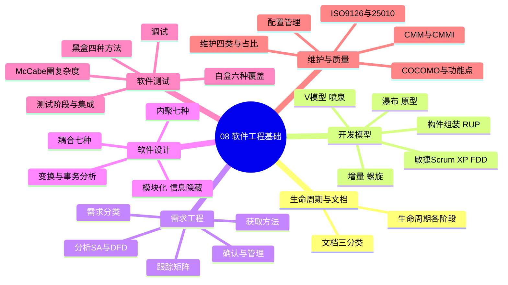
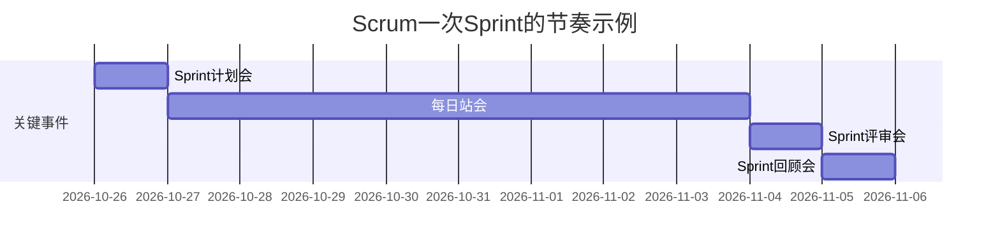

> **摘要**：
> 这章讲"软件是怎么被有组织地造出来的"：开发模型、需求工程、设计原则（内聚耦合）、测试（白盒黑盒）、维护与质量管理。上午题稳定考 6~8 分，是最大粮仓之一；开发模型场景匹配、内聚耦合判断、白盒覆盖、McCabe 计算是四大钉子户。案例题常考测试用例设计、McCabe 计算；本章更是架构师的"母语"——与 [11-软件架构设计](11-软件架构设计/)、[12-架构风格与架构评估](12-架构风格与架构评估/) 一脉相承。建议投入 12~15 小时。

## 🗺️ 知识地图

## 📖 掰碎讲解

### 8.1 软件生命周期与文档

**是什么**：软件从生到死：问题定义 → 可行性分析 → 需求分析 → 概要设计 → 详细设计 → 编码 → 测试 → 运行维护。

**文档三类（必背）**：开发文档（需求规格、设计说明、测试报告）、产品文档（用户手册、操作指南）、管理文档（计划、进度、报告）。

**大白话**：开发文档是"施工图"，产品文档是"家电说明书"，管理文档是"工地值班日志"。

### 8.2 开发模型大表：必考中的必考

| 模型 | 核心特征 | 适用场景 | 一句话坑点 |
|---|---|---|---|
| 瀑布 | 线性顺序、文档驱动、阶段评审 | 需求**明确且稳定** | 缺乏灵活性，返工代价大 |
| 原型 | 快速造个"样品"确认需求 | 需求**不明确**/难以事先定义 | 抛弃型/演化型，别当产品交付 |
| 增量 | 分批构建交付，**核心构件先行** | 需求基本明确、可分批 | 各增量集成风险 |
| 螺旋 | **风险驱动**，迭代加风险分析 | 大型复杂、高风险项目 | Boehm 提出，风险分析是灵魂 |
| V 模型 | 开发与测试一一对应 | 强调测试的项目 | 仍是瀑布式线性思维 |
| 喷泉 | **面向对象**、迭代、无间隙 | OO 开发 | 各阶段无明显界限 |
| 构件组装 | 基于构件库复用 | CBSD、领域成熟 | 与 [10-设计模式](10-设计模式/)、架构复用相关 |
| RUP | 用例驱动、以**架构为中心**、迭代增量 | 大中型 OO 项目 | 四阶段+九工作流 |

**RUP 四阶段（必背）**：初始（先启）→ 精化（细化需求、定架构、**消除高风险**）→ 构建（开发构件）→ 产品化（移交部署）。

**怎么考**：场景匹配题年年考——"需求不明确"→原型；"风险驱动"→螺旋；"面向对象迭代"→喷泉；"消除风险定架构"→RUP 精化阶段。

### 8.3 敏捷开发：宣言、Scrum 与 XP

**敏捷宣言四句（必背）**：个体与交互 **高于** 流程和工具；可工作的软件 **高于** 详尽的文档；客户合作 **高于** 合同谈判；响应变化 **高于** 遵循计划。（右项也有价值，但左项更重要）

**Scrum 三件套**：
- 3 角色：**产品负责人 PO**（定优先级）、**Scrum Master**（清除障碍、保流程）、开发团队
- 3 工件：产品 Backlog、Sprint Backlog、增量（可交付的产品部分）
- 5 事件：Sprint（固定 2~4 周的迭代）、Sprint 计划会、每日站会（15 分钟）、Sprint 评审、回顾

**XP 极限编程**：结对编程、测试驱动开发 TDD、持续集成、重构、小版本发布、计划游戏、现场客户。
**FDD 特征驱动开发**：按"特征"组织开发，设首席程序员。

**大白话**：Scrum 是"两周一个节拍的车间例会制度"；XP 是"程序员自我修养守则"；PO 管"做什么"，Scrum Master 管"怎么顺畅地做"，团队管"做"。

**怎么考**：角色/事件职责匹配；"每日站会不是汇报会，是同步与排查障碍"这类概念辨析。

### 8.4 需求工程全过程

**四步走**：需求获取 → 需求分析 → 需求确认（评审）→ 需求管理（变更控制+跟踪）。

**需求分类（必背）**：业务需求（为什么做）→ 用户需求（用户要能干什么）→ **功能需求**（系统必须做什么）→ **非功能需求**（性能、安全、可靠性等约束）。

**获取方法**：访谈、问卷调查、观察（现场作业）、原型法、联合需求计划 JAD、头脑风暴。

**结构化分析（SA）工具**：数据流图 DFD（加工、数据流、外部实体、数据存储）+ 数据字典 DD + ER 图。分层 DFD 要保持**父图与子图平衡**（父图某加工的输入输出流与子图一致）。

**需求确认四特性**：正确性、一致性、完整性、可测试性。

**需求管理**：变更控制委员会 CCB 评估变更；**需求跟踪矩阵**建立"需求 ↔ 设计 ↔ 代码 ↔ 测试用例"的双向追溯，防需求丢失、评估变更影响。

**怎么考**：DFD 补全（找缺失数据流/加工命名）；"需求跟踪矩阵的作用"；需求分类辨析（"系统响应时间≤2 秒"是非功能需求）。

### 8.5 软件设计原则与内聚耦合（必考）

**四大原则**：模块化（分而治之）、抽象、信息隐藏、**高内聚低耦合**。

**内聚七种（从低到高，功能内聚最好）**：
**偶然 → 逻辑 → 时间 → 过程 → 通信 → 顺序 → 功能**

| 类型 | 判断特征 | 大白话 |
|---|---|---|
| 偶然 | 毫无关系的代码凑一起 | 垃圾抽屉 |
| 逻辑 | 功能相似、靠参数决定执行哪个 | 一个盒子装"所有打印类操作" |
| 时间 | 同一时间执行（如初始化模块） | 早起闹钟响啥都干 |
| 过程 | 按固定流程顺序执行 | 流水线上相邻的工序 |
| 通信 | 各活动用**同一输入数据**或产生同一输出 | 同一份数据多种加工 |
| 顺序 | 前一个的输出就是后一个的输入 | 蛋糕糊→烘烤→装盘 |
| 功能 | 只做一件完整的事 | 专职岗位，最佳 |

**耦合七种（从低到高，越低越好）**：
**无直接（非直接）→ 数据 → 标记 → 控制 → 外部 → 公共 → 内容**

| 类型 | 判断特征 | 大白话 |
|---|---|---|
| 数据 | 传简单数据值 | 递纸条写个数 |
| 标记 | 传**整个数据结构**，只用一部分 | 递整个档案袋只为要一页 |
| 控制 | 传**开关量/标志**控制对方怎么走 | 遥控器指挥对方分支 |
| 外部 | 受环境/外部约束绑定 | 格式、协议绑死 |
| 公共 | **共享全局数据区** | 大家属院共用水表，谁都能动 |
| 内容 | 直接访问对方内部代码/数据 | 翻墙进别人家 |

**怎么考**：给描述判断类型——见到"整个结构当参数"选标记，"标志量控制"选控制，"全局变量共享"选公共，"直接进对方内部"选内容；内聚同理对号入座。

### 8.6 结构化设计：变换分析与事务分析

**是什么**：把 DFD 映射成结构图（SC）的两种套路——数据流呈"输入→变换→输出"三段用**变换分析**（以变换中心为顶层）；数据流呈"一源流入、多路分派"用**事务分析**（事务中心分派给各事务处理模块）。

**大白话**：变换分析像"自来水厂"（进来原水、中央净化、出去净水）；事务分析像"114 查号台"（一个来电进来，根据要查的分派给不同坐席）。

### 8.7 白盒测试：六种覆盖强弱（必考）

**强度从弱到强**：
**语句 < 判定（分支）< 条件 < 判定/条件 < 条件组合 < 路径**

| 覆盖 | 含义 | 备注 |
|---|---|---|
| 语句 | 每条语句至少执行一次 | 最弱 |
| 判定 | 每个判定的真/假分支各走一次 | 不等于每个条件都取真假 |
| 条件 | 每个条件的真/假各取一次 | 整个判定可能仍只走一个分支 |
| 判定/条件 | 判定真假的分支 + 各条件真假都要 | 弥补前两者漏洞 |
| 条件组合 | 每个判定内**所有条件取值组合**都覆盖 | 强，用例数 = Σ2^n |
| 路径 | 所有可行路径都覆盖 | 最强，组合爆炸 |

**必考推论**：满足条件组合覆盖 → 必然满足判定/条件、条件、判定、语句覆盖。

### 8.8 黑盒测试与测试阶段

**黑盒四法**：等价类划分（有效+无效各选代表）、边界值（在等价类边界取值，"错误藏在边界"）、错误推测（凭经验猜）、因果图（多条件组合约束，转判定表）。

**测试阶段（必背顺序）**：单元测试 → 集成测试 → 确认测试 → 系统测试 → 验收测试。

- **单元测试**：测单个模块，需要**驱动模块**（模拟上级调用）与**桩模块**（模拟被调用的下级）
- **集成测试**：自顶向下（需**桩模块**，早测主控逻辑）、自底向上（需**驱动模块**，早测底层）、三明治/混合
- **确认测试**：α 测试（用户在**开发方现场**）、β 测试（用户在**自己现场**）
- **系统测试**：恢复、安全、强度/压力、性能、可靠性测试
- **回归测试**：修改代码后重跑相关用例，防止"按下葫芦浮起瓢"

### 8.9 McCabe 环路复杂度：一个公式走天下

> **提示**：
> **V(G) = E − N + 2**（E 边数、N 节点数）＝ **判定节点数 + 1**（P 图中的菱形个数）

**大白话**：圈复杂度数的是"这段代码有多少条独立的走法"，值越大越难测、越易藏 bug，一般建议 **V(G) ≤ 10**。

**怎么考**：给流程图数边和节点，或数判定节点；复合条件（如 `if(a && b)`）要拆成两个判定节点。

### 8.10 调试与软件维护四类

**调试方法**：蛮力法（打印日志硬找）、回溯法（从错误点往回追）、原因排除法（归纳、演绎、二分查找定位）。

**维护四类（占比必背）**：

| 类型 | 含义 | 占比 |
|---|---|---|
| 改正性 | 修运行中暴露的 bug | 约 17~21% |
| 适应性 | 适应环境变化（换 OS、升级） | 约 18~25% |
| **完善性** | 加功能、改善性能与可维护性 | **约 50%上下，占比最大** |
| 预防性 | 为未来维护打基础（重构） | 约 4~5% |

**大白话**：绝大多数维护不是"修 bug"，而是"客户又想要新花样"——完善性维护。

### 8.11 质量特性、CMM/CMMI 与度量

**ISO 9126 六特性**：功能性、可靠性、易用性、效率、维护性、可移植性；ISO 25010 在此基础上新增**兼容性**与**信息安全（保密安全性）**，共八特性。

**CMM 五级（背顺序）**：初始 → 可重复 → 已定义 → 已管理 → 优化；CMMI 是其升级版（阶段式/连续式两种表示）。

**估算两把刀**：
- **COCOMO（代码行驱动）**：工作量 E = a×(KLOC)^b；按项目复杂度分有机型（简单，如 2.4、1.05）、半分离型、嵌入型（复杂）三档
- **功能点 FP**：不依赖代码行，从"外部输入/输出/查询/内部逻辑文件/外部接口文件"五个信息域计数，乘技术复杂度因子 TCF——适合**需求阶段**估算

**配置管理**：配置项（要管的"物件"）、**基线**（评审通过后冻结的版本）、版本控制、变更控制（走 CCB 流程）。目的是保证"改了什么、谁改的、改成什么"全程可追溯。

## 🎬 推荐视频

| 视频 | 讲什么 | 什么时候看 |
|---|---|---|
| [希赛《系统架构设计师》精讲合集 154 集](https://www.bilibili.com/video/BV1Ba4y1u7EC) | 开发模型、测试覆盖逐个精讲 | 第一遍跟学 |
| [芝士架构凯恩重难点专题](https://www.bilibili.com/video/BV1XM8izmE5g) | 软工重难点与计算题套路 | 二轮专攻 |
| [软考小管家全套 198 集](https://www.bilibili.com/video/BV1xepMzrEjD) | 零基础梳理敏捷与需求工程 | 概念混乱时看 |

## ⭐ 章节重点（考前必背）

| 知识点 | 必背内容 | 考频 |
|---|---|---|
| 模型匹配 | 需求不明→原型；风险驱动→螺旋；OO→喷泉；架构为中心→RUP | 上午题高频 |
| Scrum | PO 定优先级；Sprint 2~4 周；每日站会 15 分钟 | 上午题高频 |
| 内聚排序 | 偶然<逻辑<时间<过程<通信<顺序<功能 | 上午题高频 |
| 耦合排序 | 无直接<数据<标记<控制<外部<公共<内容 | 上午题高频 |
| 覆盖强弱 | 语句<判定<条件<判定/条件<条件组合<路径 | 上午题高频 |
| McCabe | V(G)=E−N+2=判定节点数+1，建议 ≤10 | 上午题高频 |
| 集成策略 | 自顶向下要桩、自底向上要驱动 | 近十年高频 |
| α/β 测试 | α 在开发方现场、β 在用户现场 | 近十年高频 |
| 维护占比 | 完善性维护占比最大（约 50%） | 上午题高频 |
| CMM | 初始→可重复→已定义→已管理→优化 | 近十年高频 |
| 跟踪矩阵 | 需求与设计/代码/用例双向追溯 | 近十年高频 |

## 🧠 高频考法与陷阱

> **注意**：
> 1. **条件覆盖 ≠ 判定覆盖**：错误认知：每个条件取过真假就等于每个分支走过；正确：`if(a&&b)` 中 a 真 b 假与 a 假 b 真，条件各取过真假，但判定整体可能从没取过真——所以要"判定/条件"或"条件组合"覆盖。
> 2. **桩与驱动张冠李戴**：自顶向下集成缺底层 → 用**桩模块**替身；自底向上缺顶层调用 → 用**驱动模块**。口诀："顶替（桩）下，底驱（动）上"。
> 3. **完善性维护当成占比最大之外**：错误认知："维护主要是修 bug"；正确：修 bug 是改正性，占比最大的是**完善性**（加功能）。
> 4. **耦合内聚方向记反**：内聚越高越好、耦合越低越好；"功能内聚"是最强内聚，"内容耦合"是最坏耦合。
> 5. **螺旋模型漏了风险**：螺旋=迭代+**风险分析**，选项里没提风险的多半是错的；原型模型确认完需求可能被抛弃，别当产品交付。
> 6. **McCabe 公式记成 E−N−2**：是 **E−N+2**；复合条件要按拆开的判定数算。

## ✍️ 反复练习题

### 第 1 题
某项目需求清晰、文档要求严格、团队经验丰富，且不允许需求随意变更，最适合采用（ ）。
A. 原型模型　B. 瀑布模型　C. 螺旋模型　D. 喷泉模型

> **示例**：
> **答案：B**
> 解析：需求明确稳定 + 强文档 + 线性推进是瀑布模型的招牌场景（8.2 节）。原型适合需求不明，螺旋适合高风险大项目，喷泉面向对象。

### 第 2 题
模块 A 将一个包含 20 个字段的结构体传给模块 B，B 只使用其中 1 个字段。A 与 B 之间的耦合类型是（ ）。
A. 数据耦合　B. 标记耦合　C. 控制耦合　D. 公共耦合

> **示例**：
> **答案：B**
> 解析：传递**整个数据结构**但只用部分字段 → 标记耦合（8.5 节）。若只传那 1 个字段就是数据耦合（更好）；传标志量控制分支才是控制耦合。

### 第 3 题
白盒测试中，覆盖强度从弱到强排列正确的是（ ）。
A. 语句 < 判定 < 条件组合 < 路径
B. 语句 < 条件 < 判定 < 路径
C. 判定 < 语句 < 条件组合 < 路径
D. 条件组合 < 判定/条件 < 路径 < 语句

> **示例**：
> **答案：A**
> 解析：强度链 语句 < 判定 < 条件 < 判定/条件 < 条件组合 < 路径（8.7 节）。B 把条件排在判定前面，错了——条件覆盖可能漏分支；D 把最强的路径排在最前。

### 第 4 题
某程序控制流程图有 12 条边、9 个节点，其 McCabe 环路复杂度 V(G) 为（ ）。
A. 3　B. 4　C. 5　D. 21

> **示例**：
> **答案：C**
> 解析：V(G) = E − N + 2 = 12 − 9 + 2 = **5**（8.9 节）。等价于"判定节点数 + 1"：4 个判定节点 + 1。V(G) 越大路径越多，测试越难，经验上不超过 10。

### 第 5 题
采用自底向上集成测试时，由于底层模块先集成，缺少调用它们的上级模块，需要编写（ ）。
A. 桩模块　B. 驱动模块　C. 主控模块　D. 测试存根

> **示例**：
> **答案：B**
> 解析：自底向上缺"上级"→ 写**驱动模块**模拟上级调用（8.8 节）。自顶向下才需要桩模块模拟"下级"。A/D 是同一事物的干扰写法，属于自顶向下的需要。

### 第 6 题
软件维护中工作量占比最大的是（ ）。
A. 改正性维护　B. 适应性维护　C. 完善性维护　D. 预防性维护

> **示例**：
> **答案：C**
> 解析：完善性维护（扩充功能、改善性能）约占一半，是绝对大头（8.10 节）。改正性修 bug、适应性跟环境、预防性重构预防，占比都远小于完善性。

### 第 7 题
关于敏捷开发，正确的是（ ）。
A. Scrum 中由 Scrum Master 决定产品 Backlog 的优先级
B. XP 提倡结对编程与测试驱动开发
C. 敏捷宣言认为详尽的文档高于可工作的软件
D. Sprint 期间允许随意的需求变更插入

> **示例**：
> **答案：B**
> 解析：XP 核心实践包括结对编程、TDD、持续集成、重构（8.3 节）。A 错，Backlog 优先级由**产品负责人 PO** 决定；C 错，宣言是"可工作的软件**高于**详尽的文档"；D 错，Sprint 内需求应保持稳定，新需求进下个 Sprint。

### 第 8 题（案例大题风格）
某"试卷评分系统"对成绩 score（0~100 整数）评级：<60 不及格，60~84 及格，85~100 优秀。
(1) 用等价类划分与边界值法设计测试输入（列出具体取值）；
(2) 对代码 `if (score<60) ... else if (score<85) ... else ...`，回答至少需要几组用例才能达到判定覆盖，并算出该段代码的 McCabe 复杂度；
(3) 说明回归测试在此场景下的作用。

> **示例**：
> **答案要点：**
> (1) 无效等价类：−1（或 -5）、101、"abc"（非数字）；有效等价类代表：50、70、90；边界值：**−1、0、1、59、60、61、84、85、86、99、100、101**（8.8 节：错误常发生在边界）。
> (2) 判定覆盖要求每个 if 的真/假分支各走一次：两个判定，**2 组**用例即可（如 score=50 走"真、未到"、score=90 走"假、假"分支之外还需覆盖第二判定真——如 70）；严谨列法：{50}、{70}、{90} 三组覆盖全部分支。McCabe：两个判定节点 → V(G) = 2+1 = **3**。
> (3) 修改评级规则后重跑已有用例，确认未破坏原有正确评级逻辑，防止回归缺陷（8.8 节）。案例给分点：边界值取全、判定覆盖的分支枚举、V(G) 计算过程。

## 🔗 相关章节

- [09-面向对象方法](09-面向对象方法/)：结构化之外的另一条主线
- [11-软件架构设计](11-软件架构设计/)：需求与设计向架构演进的桥梁
- [12-架构风格与架构评估](12-架构风格与架构评估/)：设计质量在架构层的延续
- [架构-案例分析攻略](../架构-案例分析攻略/)：测试与 McCabe 案例模板
- [架构-论文攻略](../架构-论文攻略/)：开发模型与质量保证的论文素材
