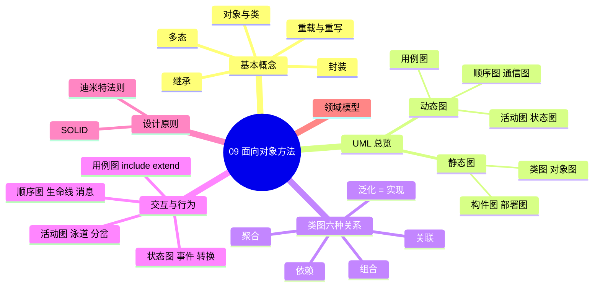
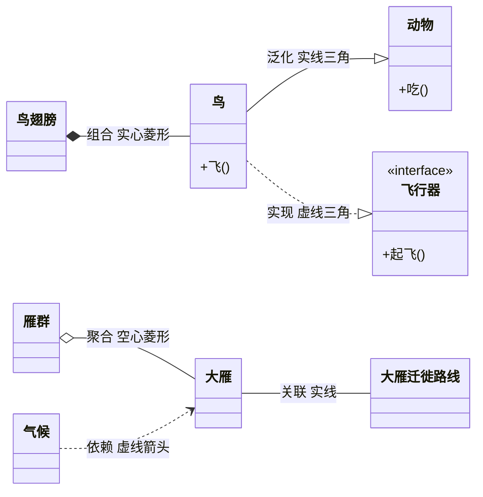
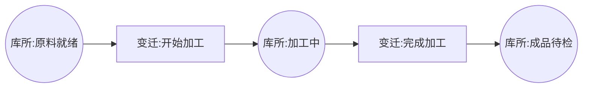

> **摘要**：
> 这一章讲"怎么用面向对象的思想去认识世界、表达设计"——对象/类/封装/继承/多态这五大基本概念，加上画设计图纸用的 UML 十几种图，以及写好代码的 SOLID 原则。上午题稳定出 5~7 分（OO 概念 2~3 分 + UML 图辨析 2~3 分 + 设计原则 1 分），案例题偶尔出"补全 UML 图、写类图关系"，还常与 [10-设计模式](10-设计模式/) 联动出题；论文可写"面向对象/UML 在项目中的应用"。建议投入 8~10 小时，其中类图关系和用例图是性价比最高的两块。

## 🗺️ 知识地图



## 📖 掰碎讲解

### 9.1 对象与类：万物皆对象

**是什么**：对象（Object）是系统中用来描述客观事物的一个实体，由一组属性（数据）和一组操作（行为）构成。类（Class）是具有相同属性、相同操作、相同语义的一组对象的抽象模板。
**大白话**：类是"月饼模具"，对象是"压出来的月饼"。模具定义了形状和花纹（属性与方法），月饼是一个个具体存在的东西，各有各的馅（属性值）。对象之间靠"消息"通信——你不用管蛋糕店内部怎么做，喊一声"来两斤"就行。
**怎么考**：上午题问"对象三要素"——对象名、属性、操作（方法）；"类与实例的关系"——类是抽象、对象是实例；偶尔考"封装的作用"。

### 9.2 封装、继承、多态：三大特性

**是什么**：
- **封装（Encapsulation）**：把属性和操作捆在一起，对外隐藏内部实现细节，只暴露接口。
- **继承（Inheritance）**：子类自动拥有父类的属性和方法，并可扩展；表达"is-a"（是一种）关系。
- **多态（Polymorphism）**：同一消息发给不同对象，各自有不同的响应；同一接口、多种实现。

**大白话**：封装 = 药胶囊，药粉（内部实现）包在壳里，你只管吞；继承 = 儿子继承父亲的房产还能自己装修；多态 = 你对"动物"喊"叫一声"，狗汪汪、猫喵喵——同一个指令，不同的结果。
**怎么考**：多态是高频词，常考"多态的好处"（增强灵活性、可替换性、开闭原则的基础）；"继承的缺点"（父类改动波及所有子类、耦合强，现代设计提倡"组合优于继承"）。

**重载 vs 重写（必考易混）**：

| 对比项 | 重载 Overload | 重写 Override |
|---|---|---|
| 发生位置 | 同一个类中 | 父子类之间 |
| 方法名 | 相同 | 相同 |
| 参数列表 | **必须不同**（类型/个数/顺序） | **必须相同** |
| 返回值 | 可以不同 | 要求相同（或兼容） |
| 绑定时机 | 编译期（静态绑定/静态多态） | 运行期（动态绑定/动态多态） |
| 口诀 | 重载看参数，重写看爹儿子 | |

> **提示**：
> "重载"是同一个类里"扛多副担子"（参数不同）；"重写"是儿子把父亲的方法"推翻重写"。考试爱问"重写时参数必须与父类一致，重载时参数必须不同"。

### 9.3 UML 总览：一张设计界的"普通话"

**是什么**：UML（统一建模语言）是面向对象软件开发的标准**可视化建模语言**，注意：它是"语言/ notation"，**不是方法、不是过程**（这是经典陷阱题！）。UML 2.x 共 14 种图。
**大白话**：建筑图纸有平面图、电路图、结构图，UML 就是软件界的"图纸规范"，全世界工程师都看得懂。
**怎么考**："下列哪项属于 UML 静态图？"——每年必考级别的送分题。

**静态图 vs 动态图（必背）**：

| 分类 | 图 | 记忆 |
|---|---|---|
| 静态（结构）图 | 类图、对象图、构件图、部署图、包图、组合结构图 | "类对构部"——静态的东西摆在那里 |
| 动态（行为）图 | 用例图、顺序图、通信图、状态图、活动图 | "用顺通状活"——要动起来才有故事 |

> **注意**：
> 用例图描述的是"功能"，看起来静态，但软考教材把它归入**动态（行为）图**一族；而"部署图"画的是硬件拓扑，容易被误以为动态，实际是**静态图**。另外：UML ≠ 面向对象方法，UML 只是建模语言。

### 9.4 类图六种关系：强弱排序是命根子

**是什么**：类图中六种关系的耦合强度排序：

**泛化（Generalization）= 实现（Realization）＞ 组合（Composition）＞ 聚合（Aggregation）＞ 关联（Association）＞ 依赖（Dependency）**



| 关系 | 语义 | UML 符号 | 代码表现 | 例子 |
|---|---|---|---|---|
| 泛化 | is-a，继承 | 实线 + 空心三角箭头指向父类 | `extends` | 鸟 → 动物 |
| 实现 | 契约落地 | 虚线 + 空心三角箭头指向接口 | `implements` | 鸟实现"会飞"接口 |
| 组合 | 整体-部分，**同生共死** | 实线 + **实心菱形**指向整体 | 成员变量，整体负责创建销毁 | 鸟 - 翅膀 |
| 聚合 | 整体-部分，**可独立存在** | 实线 + **空心菱形**指向整体 | 成员变量，从外部传入 | 雁群 - 大雁 |
| 关联 | "知道对方"，长期联系 | 实线（可带箭头/多重性） | 成员变量 | 学生 - 课程 |
| 依赖 | "用到对方"，临时使用 | 虚线 + 箭头 | 方法参数、局部变量、返回值 | 农民"看天气"种地 |

**大白话**：泛化和实现是"你是我的儿子/你是我的合同工"，绑定最深；组合是"心脏与人，人死心也废"；聚合是"车队与车，车可以换队"；关联是"老朋友，长期记得你"；依赖最浅，"今天用了你一下，明天就忘"。
**怎么考**：上午题给一句描述选关系类型（高频：部门与员工=聚合、人与心脏=组合）；给代码片段问类图关系（方法参数=依赖，成员变量=关联/聚合/组合，看生命周期）；案例题让你在类图上补箭头。

> **提示**：
> **菱形画在"整体"那头**。空心=聚合（散伙没事），实心=组合（一荣俱荣一损俱损）。可以记："**空松实紧**"——空心菱形关系松，实心菱形关系紧。

### 9.5 用例图：需求阶段的"全景照"

**是什么**：描述系统功能需求的图，三要素：**参与者（Actor，小人）**、**用例（Use Case，椭圆）**、**关系**。参与者可以是用户，也可以是外部系统、时间（定时任务）。
**大白话**：用例图就是"这家餐厅能提供什么服务"的菜单：顾客（参与者）可以点菜、结账（用例），不关心后厨怎么做。

**三种关系（真题最爱辨析）**：

| 关系 | 方向 | 含义 | 判断关键词 | 例子 |
|---|---|---|---|---|
| 包含 include | **基用例 → 被包含用例** | 基用例执行时**必然**执行包含用例 | "每次都……""必须先……" | "登录"包含"输入账号密码" |
| 扩展 extend | **扩展用例 → 基用例** | 在特定条件下**可选**地扩展基用例 | "可选""有时""如果……则" | "登录"可被"验证码校验"扩展 |
| 泛化 | 子 → 父 | 用例/参与者的特殊化 | "一种特殊的……" | "电话订餐"泛化自"订餐" |

```mermaid
flowchart LR
    A["基用例:登录"] -.include.-> B["被包含:身份验证"]
    C["扩展用例:短信通知"] -.extend.-> A
    D["父用例:认证"] <..|> A
```

**怎么考**：给场景问"应该用 include 还是 extend"；箭头方向故意画反让你判断；"参与者可以是人/外部系统/时间"这种冷知识。**记忆术：include 必选抽公共（箭头从主人指向仆人），extend 可选来加戏（箭头从配角指向主角）**。

### 9.6 顺序图与通信图：动态交互的两种拍法

**是什么**：
- **顺序图（时序图）**：按**时间顺序**展示对象间消息传递。要素：对象（顶部横排）、**生命线**（向下的虚线）、**激活条/控制焦点**（生命线上的窄矩形）、消息（箭头）。
- **通信图（协作图）**：强调对象间的**组织结构/链接**，用消息编号（1、1.1、2……）表达顺序。两者语义等价，可以互转。

**消息类型**：同步消息（实线实心箭头，等回复）、异步消息（实线普通箭头，不等）、返回消息（虚线箭头）、创建/销毁消息。

**大白话**：顺序图像"聊天记录"，从上往下谁先谁后一清二楚；通信图像"微信好友关系图"，谁和谁有来往，用编号标注聊天次序。
**怎么考**：上午题认图（生命线是哪条？激活条是什么？）；"强调时间顺序用顺序图，强调对象间组织结构用通信图"是标准答案句。

### 9.7 活动图与状态图：流程与生命周期

**是什么**：
- **活动图**：描述业务流程/工作流，类似流程图。特有元素：**分岔（fork）/汇合（join）**（粗横线，表示并发分支）、**泳道**（按职责纵向分区）、决策节点、对象流。
- **状态图**：描述**单个对象**在生命周期内的状态变迁。要素：状态（圆角矩形）、初态（实心圆）、终态（牛眼）、**转换（箭头，由事件触发）**、动作。

**大白话**：活动图是"外卖订单从下单到送达的全公司流程"（多个角色协作）；状态图是"一份订单自己的简历"——已下单→已接单→配送中→已完成，每个转变都需要一个"事件"推动。

| 对比 | 活动图 | 状态图 |
|---|---|---|
| 描述对象 | 跨多对象的业务流程 | 单个对象的生命周期 |
| 核心视角 | 动作/活动 | 状态 + 事件触发 |
| 独有元素 | 泳道、分岔汇合 | 状态、事件、自转换 |

**怎么考**："活动图中粗横线表示并发（分岔/汇合）"；"泳道用于划分职责"；"状态图中不带事件/动作的转换表示自动完成"。案例题可能给场景让你补状态图的转换条件。

### 9.8 构件图与部署图：从代码到机房

**是什么**：
- **构件图**：描述系统的**物理代码组织**——构件（组件）及构件间依赖，展示接口（提供接口棒棒糖、需求接口插座）。
- **部署图**：描述**硬件拓扑**——节点（立方体）及节点间通信，构件部署在哪个节点上。
**大白话**：构件图是"行李箱里装了哪些箱子、箱子之间怎么套"；部署图是"这些行李分别放在哪几辆车、车与车怎么连接"。
**怎么考**：静态图辨析常拿这两个凑选项；"部署图展示系统硬件的物理拓扑结构及在此结构上执行的软件"是原文级考点。

### 9.9 UML 在开发四阶段的应用

| 阶段 | 常用图 | 干什么 |
|---|---|---|
| 需求分析 | 用例图、活动图、领域模型（概念类图） | 捕捉功能需求 |
| 系统设计 | 类图、顺序图、状态图 | 细化静态结构与交互 |
| 实现 | 构件图 | 组织代码构件 |
| 测试与部署 | 部署图；用例图对应验收测试 | 验证与交付 |

**怎么考**：上午题"在需求分析阶段最适用的 UML 图是？"→ 用例图；"验收测试依据"→ 用例图。

### 9.10 SOLID 五大原则 + 迪米特法则

**是什么**：面向对象设计的五条"健身守则"，外加一条"少八卦"法则。

| 原则 | 一句话 | 大白话 | 典型反例 |
|---|---|---|---|
| 单一职责 SRP | 一个类只有一个引起它变化的原因 | 一个员工只干一份工作 | 一个 God 类又管登录又管报表 |
| 开闭原则 OCP | 对扩展开放，对修改关闭 | 加功能靠"加类"，别动老代码 | 每新增一种支付方式就改 if-else |
| 里氏替换 LSP | 子类必须能替换父类且程序行为不变 | 儿子必须能顶父亲的班 | 正方形继承长方形后破坏语义 |
| 接口隔离 ISP | 不强迫客户依赖用不到的方法 | 别让实习生背 CEO 的 KPI | 一个巨型接口谁实现谁写空方法 |
| 依赖倒置 DIP | 依赖抽象（接口），不依赖具体实现 | 插座定标准，电器随便换 | 业务逻辑里直接 new 具体数据库类 |
| 迪米特法则（最少知识） | 只和直接朋友通信，不和"朋友的朋友"说话 | 快递只找驿站，不去骚扰每家住户 | A 调 B 的方法里再调 C 再调 D 链式深入 |

**怎么考**：上午题给一段场景选"违反了哪个原则"（高频：if-else 堆砌→违反开闭；子类无法替换父类→违反里氏替换；"高耦合长链调用"→违反迪米特）。设计原则也是 [10-设计模式](10-设计模式/) 的理论基础，模式就是原则的落地。

### 9.11 领域模型

**是什么**：需求分析阶段建立的**概念类图**——只画业务领域里有意义的类（名词）及其关系，不含属性细节和技术类。
**大白话**：读需求文档时圈名词——"订单、客户、商品"，连上线——"客户下订单、订单包含商品"，这张草图就是领域模型。
**怎么考**："领域模型在分析阶段建立""领域模型中类之间的关系不含操作/方法"偶考。

## 🎬 推荐视频

| 视频 | 讲什么 | 什么时候看 |
|---|---|---|
| [希赛《系统架构设计师》精讲合集 154 集](https://www.bilibili.com/video/BV1Ba4y1u7EC) | 面向对象 + UML 全流程讲解，紧扣真题 | 第一轮精学，边看边画图 |
| [软考小管家全套 198 集](https://www.bilibili.com/video/BV1xepMzrEjD) | OO 概念通俗版，适合零基础补概念 | 看不懂希赛时换它"回锅" |
| [希赛 2026 版通关精讲 98 集](https://www.bilibili.com/video/BV1PrwvzFESU) | 精华快讲，适合二轮串记 | 考前一个月提速复习 |

## ⭐ 章节重点(考前必背)

| 考点 | 关键结论 | 标注 |
|---|---|---|
| 类图关系排序 | 泛化=实现＞组合＞聚合＞关联＞依赖 | **上午必考** |
| 菱形方向 | 空心=聚合、实心=组合，菱形指向整体 | **上午必考** |
| include/extend | include 必然（基→子），extend 可选（子→基） | **上午高频** |
| 静态/动态图 | "类对构部"静态，"用顺通状活"动态 | **上午必考** |
| UML 定位 | UML 是建模语言，不是方法/过程 | 易错题 |
| 重载 vs 重写 | 重载参数必须不同（编译期），重写参数相同（运行期） | 高频 |
| SOLID | 场景↔原则配对 | 上午 1 分 + 案例基础 |
| 状态图/活动图 | 状态图=单对象生命周期；活动图=跨对象流程+泳道 | 中频 |
| 四阶段用图 | 需求=用例图；设计=类图/顺序图；实现=构件图；部署=部署图 | 中频，**论文素材** |

## 🧠 高频考法与陷阱

> **注意**：
> 1. **错**：UML 是一种面向对象的软件开发方法 → **对**：UML 只是标准建模**语言**，不含开发过程。
> 2. **错**：聚合与组合只看有无"整体-部分" → **对**：关键看**生命周期**——组合同生共死（实心菱形），部分可独立存活的是聚合（空心菱形）。
> 3. **错**：include 和 extend 箭头随便画 → **对**：include 从**基用例**指向被包含用例；extend 从**扩展用例**指向基用例，方向正好相反。
> 4. **错**：重写（Override）可以改变参数列表 → **对**：参数列表必须与父类一致，否则就成了重载。
> 5. **错**：用例图、部署图都是静态图 → **对**：部署图是静态图，用例图按软考教材归入动态（行为）图。
> 6. **错**：继承越多越好 → **对**：继承耦合强，现代设计"组合优于继承"，这也是装饰器模式存在的理由（伏笔见 [10-设计模式](10-设计模式/)）。

## ✍️ 反复练习题

**第 1 题**：某类图中，"公司"与"部门"为聚集关系，"部门"与"员工"为聚集关系，则"公司"与"员工"之间（ ）。
A. 是组合关系　B. 是依赖关系　C. 无直接关系　D. 是泛化关系

> **示例**：
> **答案：C**。聚合关系不具有传递性：公司聚合部门、部门聚合员工，公司与员工之间没有直接的类图关系。此题考的是"关系是否可传递"的直觉陷阱——聚合、组合、关联都不能跨层自动传递。

**第 2 题**：用例图中，用例 A 描述"用户下单"，用例 B 描述"记录操作日志"。无论是否失败都要写日志，而"赠送优惠券"仅在会员下单时发生。正确建模是（ ）。
A. A 包含 B，A 扩展"赠送优惠券"　B. A 扩展 B，A 包含"赠送优惠券"　C. B 包含 A，"赠送优惠券"扩展 A　D. B 泛化 A

> **示例**：
> **答案：A**。判据：必然发生→include，箭头从基用例指向被包含用例（A→B）；可选发生→extend，箭头从扩展用例指向基用例（"赠送优惠券"→A）。B、C 把方向写反，D 关系类型不对。记住口诀：**include 必选抽公共，extend 可选来加戏**。

**第 3 题**：下列关于 UML 的说法错误的是（ ）。
A. UML 是一种标准的可视化建模语言
B. 部署图展示了系统的物理拓扑结构
C. 顺序图与通信图语义等价、可相互转换
D. UML 规定了统一的软件开发过程

> **示例**：
> **答案：D**。UML 只统一了"画图的符号"，不规定开发过程——过程由 RUP 等方法提供。A、B、C 均为教材原文表述。这道题同时复记了部署图、通信图两个知识点。

**第 4 题**：某方法签名 `double calc(int a, int b)`，同类中又定义了 `double calc(double a)` 和 `int calc(int a, int b, int c)`，这体现的是（ ），其绑定发生在（ ）。
A. 重写，运行期　B. 重载，编译期　C. 重载，运行期　D. 重写，编译期

> **示例**：
> **答案：B**。同类、方法名相同、参数列表不同→重载（Overload）；重载在编译期根据参数静态绑定。若是子类中定义与父类同名同参方法才是重写（Override），绑定在运行期（动态多态）。

**第 5 题**：某系统代码中，订单处理类的某方法参数里用到了短信发送类 `SmsSender`，订单类并未把它作为成员变量。类图上订单类与 SmsSender 之间应画（ ）。
A. 组合　B. 聚合　C. 关联　D. 依赖

> **示例**：
> **答案：D**。仅在方法参数、局部变量或静态方法调用中出现，用完即弃→依赖（虚线箭头，最弱关系）。若是成员变量：长期持有且不可替代→关联/聚合；整体创建并销毁部分→组合。代码表现对应关系是上午高频考法。

**第 6 题**（多原则综合）：某模块每逢新增一种导出格式（Excel/PDF/HTML）都要修改导出类的 switch 分支。该设计主要违反了（ ）。
A. 单一职责原则　B. 开闭原则　C. 接口隔离原则　D. 迪米特法则

> **示例**：
> **答案：B**。对扩展开放（新增格式=加新类）、对修改关闭（不改老代码）正是开闭原则 OCP；switch/if-else 堆砌新类型是它的最典型反例。改造方向：抽抽象接口 + 工厂/策略（见 [10-设计模式](10-设计模式/)），这也是案例题常让你"指出现有设计违反的原则并给出改进类图"。

**第 7 题**（案例风格）：某在线考试系统：考生可登录并参加考试（登录时都要进行身份核验）；VIP 考生在交卷后可额外查看错题分析；考试活动由"考生、监考员、阅卷教师"三类角色参与。请回答：
(1) 画出/描述该场景的用例图应包含哪些参与者和用例；
(2) 说明"身份核验"与"登录"、"错题分析"与"参加考试"应分别建模为什么关系；
(3) 若要展示"一份试卷"从"未启用→启用→归档"的变迁，应选哪种 UML 图，说明理由。

> **示例**：
> (1) 参与者：考生（VIP 考生是其泛化/特化）、监考员、阅卷教师（若阅卷系统为外部系统也可作为参与者）。用例：登录、身份核验、参加考试、查看错题分析、监考、阅卷等。
> (2) "身份核验"是登录**每次必然**执行的公共行为→**include 包含**，箭头从"登录"指向"身份核验"；"查看错题分析"是 VIP 交卷后**可选**发生的附加行为→**extend 扩展**，箭头从"错题分析"指向"参加考试"（或指向相应基用例）。
> (3) 应选**状态图**。理由：它描述的是"试卷"这一个对象在生命周期内由事件（启用操作、归档操作）触发的状态变迁；若描述"出卷→考试→阅卷"这样多角色协作的全流程，才选活动图（并用泳道区分三类角色）。"单对象生命周期用状态图，跨对象业务流程用活动图"是案例题的固定判据。

## 🆕 拓展考点：Petri 网建模（2025 案例实锤）

### 是什么
Petri 网是一种**并发系统建模工具**：圆圈「库所 Place」表示状态/条件，方框「变迁 Transition」表示事件/活动，箭头连接两者，库所里的黑点「令牌 Token」表示资源就绪。



### 大白话
像接力赛规则图：圆圈是交接棒区（状态），方框是跑的动作（事件），黑点小球是接力棒（令牌）。棒到了哪个区，哪个区就具备起跑条件；动作发生会消耗旧区的棒、在新区放棒。

### 用法与意义（案例答题点）
1. **建模并发与同步**：两条流水线同时走，汇合处自然形成"同步"（所有输入库所都有令牌，变迁才能触发）
2. **发现死锁/资源冲突**：某变迁永远无法触发=死锁，画出来一目了然
3. **分析与验证**：可达图穷举系统所有状态，验证流程正确性
4. 适用场景：工作流引擎、生产调度、通信协议、操作系统进程同步

> **注意**：
> 问"Petri 建模工具的意义与用法"：意义=直观描述**并发/异步/同步**关系，支持死锁检测与流程验证；用法=确定库所(状态)→确定变迁(活动)→连接并布令牌→运行分析。口诀"**圆库所、方变迁、点令牌**"。


## 🔗 相关章节

- 前置基础：[08-软件工程基础](08-软件工程基础/)（开发模型里 RUP 就是 OO 方法派）
- 下章铁搭档：[10-设计模式](10-设计模式/)（SOLID 的实战落地）
- 架构视角：[11-软件架构设计](11-软件架构设计/)（4+1 视图里全是 UML 图）
- 真题演练：[qicoder真题索引](../../99-真题资源/qicoder真题索引/) · [架构-真题战略](../架构-真题战略/)
- 案例方法：[架构-案例分析攻略](../架构-案例分析攻略/) · 记忆技巧：[学习方法与记忆术](../../00-备考指南/学习方法与记忆术/)
