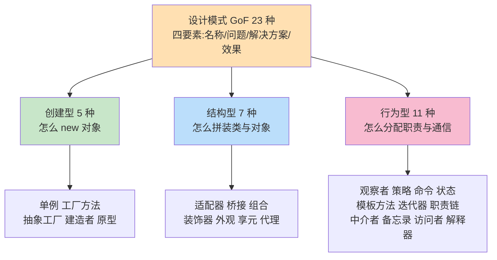
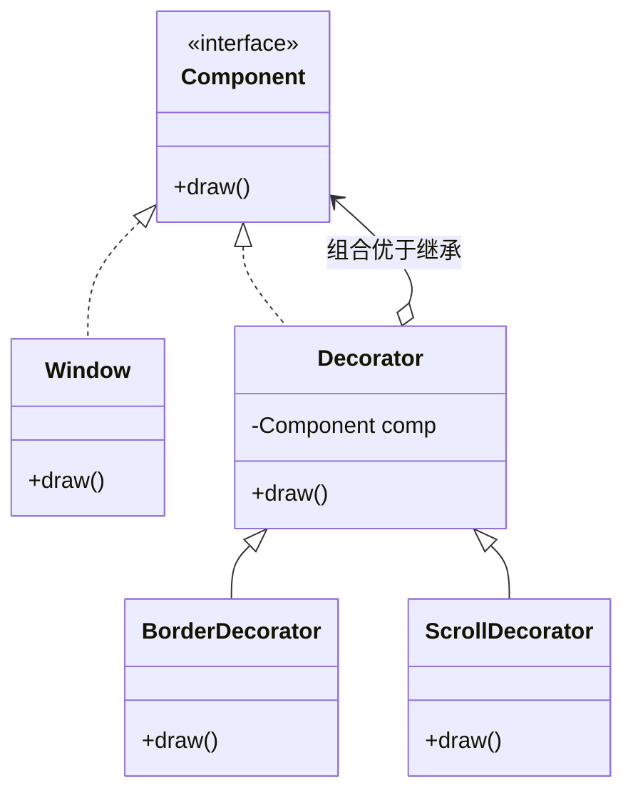
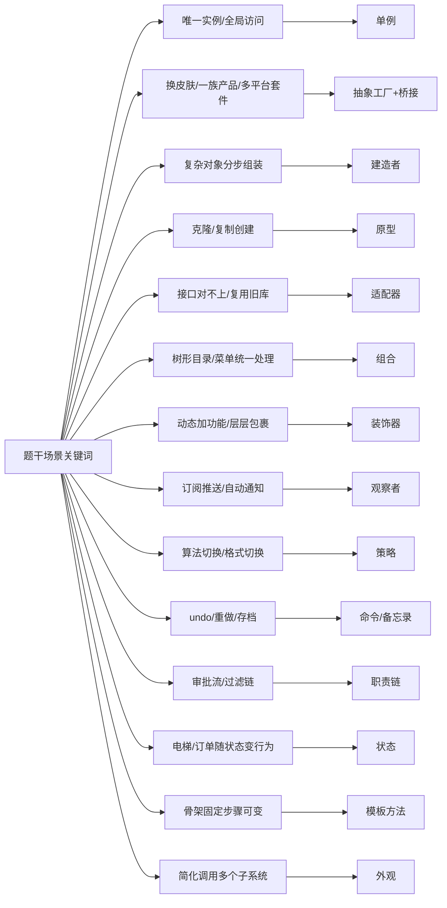

> **摘要**：
> 这一章是"对象 creation、组装、行为"的 23 套标准棋谱：创建型 5 种、结构型 7 种、行为型 11 种。上午题稳定考 2~4 分，题型 90% 是"给场景选模式"；案例题高频出"识别设计模式 + 补全新类图"，是下午场的常客；论文里设计模式可作可修改性/可复用性的论据素材。建议投入 10~12 小时：先背分类框架，再把 8 个核心模式吃透，最后用题眼场景表刷选择。

## 🗺️ 知识地图

## 📖 掰碎讲解

### 10.1 设计模式四要素

**是什么**：每个模式由四要素构成——**模式名称**（黑话代号）、**问题**（什么场景用）、**解决方案**（类与对象的组合结构）、**效果**（优缺点/权衡）。
**大白话**：像乐高说明书：这套零件解决什么造型（问题），怎么拼（方案），拼完结实不结实（效果）。
**怎么考**："设计模式的基本要素不包括____"这类题，选项里塞"测试用例/开发人员"当干扰项；还有"设计模式解决的是重复出现的**设计**问题，与算法无关（算法侧重计算正确性，模式侧重结构复用）"。

### 10.2 创建型 5 种：怎么"生"对象

> 口诀：**单原工建抽**（单例、原型、工厂方法、建造者、抽象工厂）

| 模式 | 意图一句话 | 生活类比 | 典型考法场景 |
|---|---|---|---|
| 单例 Singleton | 全局**唯一实例**+统一访问点 | 一家公司只有一个 CEO；Windows 任务管理器 | 日志对象、配置管理、连接池、打印机后台 |
| 工厂方法 Factory Method | 定义创建接口，**子类决定**实例化哪个类 | 一家工厂一条生产线，每条线只造一种车 | 新增一种导出格式只需新增一个工厂，不动老代码（开闭） |
| 抽象工厂 Abstract Factory | 创建**一族相关**产品，换整个"家族" | 换装修风格：中式家具一套 vs 欧式家具一套 | 界面**换皮肤/换主题**；多数据库套件（Oracle 一套/MySQL 一套） |
| 建造者 Builder | **分步骤**组装复杂对象，组装过程稳定 | 点套餐：汉堡+薯条+可乐逐步装配；盖房子先地基后封顶 | 复杂对象由多个部件构成、部件顺序固定；"隐藏组装过程" |
| 原型 Prototype | 通过**克隆**已有对象快速创建 | 细胞分裂；Word 文档"另存为模板再复制" | 创建成本大（要查库/网络）；"复制+微调"场景 |

**怎么考**：
- 抽象工厂 vs 工厂方法：工厂方法管**一个**产品，抽象工厂管**一族**产品——"支持多种主题的按钮+菜单+滚动条整体切换"选抽象工厂。
- 建造者题眼：**"将一个复杂对象的构建与其表示分离""分步骤""同样的构建过程可创建不同的表示"**——原文级标志句。
- 原型题眼："通过**复制/克隆**避免重复创建的开销""深拷贝浅拷贝"。

### 10.3 结构型 7 种：怎么"拼"结构

> 口诀：**适桥组装外享代**（适配器、桥接、组合、装饰器、外观、享元、代理）

| 模式 | 意图一句话 | 生活类比 | 典型考法场景 |
|---|---|---|---|
| 适配器 Adapter | 把旧接口**转换**成客户期望的新接口 | 港版插头转换器；Type-C 转 3.5mm | 复用第三方库/老系统，接口对不上 |
| 桥接 Bridge | 抽象与实现**两个维度**独立变化，用组合连接 | 遥控器（品牌维度）× 电视（型号维度）； paint 笔×颜色 | "两个（多个）变化维度""避免类爆炸"，如跨平台消息+多种通知渠道 |
| 组合 Composite | 树形结构统一处理**部分-整体** | 文件夹里套文件夹和文件；公司组织树 | 树形菜单、目录树、"以相同方式处理个别对象与组合对象" |
| 装饰器 Decorator | **不改原类**动态叠加职责，比继承灵活 | 咖啡加奶、加糖、加冰，一层包一层 | 给对象动态加功能（加边框、加滚动条、加日志） |
| 外观 Facade | 给子系统提供**统一高层入口** | 一键启动按钮：发动机/油路/电路全帮你搞定 | 客户端要简化调用多个子系统；"封装底层" |
| 享元 Flyweight | **共享**大量细粒度对象，分内部/外部状态 | 围棋只有黑白两颗"母棋子"，摆哪是外部状态 | 大量重复对象（棋子、字符、图标）、字符串常量池 |
| 代理 Proxy | 控制对目标对象的**访问** | 房产中介替房东带看；明星经纪人 | 远程代理（RPC 桩）、虚拟代理（图片懒加载）、保护代理（权限） |

**三大易混辨析（必考）**：

| 对比 | 适配器 | 装饰器 | 代理 |
|---|---|---|---|
| 目的 | **接口不同**→转换 | 接口相同→**加功能** | 接口相同→**控制访问** |
| 与被包装者关系 | 改变了接口 | 增强行为 | 控制何时/谁能用 |
| 场景 | 对接遗留系统 | 动态加职责 | 延迟加载、鉴权、远程 |

装饰器的精髓：Decorator 自己也是 Component（所以能层层包），内部持有 Component 引用——"既实现接口又组合接口"是它的代码指纹。

**外观 vs 中介者**：外观是"单向简化"——客户端通过门面找子系统，子系统不知道门面存在；中介者是"双向枢纽"——各同事对象互不认识、全走中介。考试辨析："对外简化接口"选外观，"网状通信变星型、解耦多对象交互"选中介者。

### 10.4 行为型 11 种：怎么"分活"与"传话"

> 口诀：**观状模命迭，职中备访解**（观察者、状态、模板方法、命令、迭代器、职责链、中介者、备忘录、访问者、解释器；策略单独挂帅）

| 模式 | 意图一句话 | 生活类比 | 典型考法场景 |
|---|---|---|---|
| 观察者 Observer | 一对多依赖，状态变了**自动通知**所有订阅者 | 公众号推文，粉丝全收到 | 消息订阅推送、事件监听、GUI 回调 |
| 策略 Strategy | 封装一族**可互换的算法**，运行时切换 | 出门方式：开车/地铁/骑车随你选 | **日志/加密/排序/折扣算法切换**、支付方式 |
| 命令 Command | 把请求封装成对象，可排队、记录、**撤销** | 服务员下单的小票：可传、可撤、可记账 | **undo/redo**、宏命令、任务队列 |
| 状态 State | 行为随内部**状态**改变，像换了个类 | 电梯：上行/下行/停止时按钮行为不同 | 订单状态流转、**电梯**、TCP 连接状态、审批中/已驳回 |
| 模板方法 Template Method | 父类定**骨架**，子类填空 | 泡饮料流程固定：烧水→冲泡→倒杯→加料，加料随品种 | 框架钩子、算法骨架固定步骤可变 |
| 迭代器 Iterator | 不暴露内部结构也能**顺序遍历** | 遥控器换台，不用懂电视内部 | 遍历容器，Java/Python 的 iterator 本尊 |
| 职责链 Chain of Responsibility | 请求沿链传递，**谁处理谁接**，动态组合 | 公司报销：组长→经理→总监，额度逐级升 | **审批流**、过滤器链、异常处理链、中间件管道 |
| 中介者 Mediator | 把多对象网状交互收拢到一个**枢纽** | 机场塔台：所有飞机只跟塔台说话 | 聊天室服务器、MVC 中 Controller 兼任中介者 |
| 备忘录 Memento | 不破坏封装地**存快照**，便于回退 | 游戏存档；编辑器自动保存 | 撤销功能、事务回滚、草稿箱 |
| 访问者 Visitor | 数据结构稳定，**操作**可以随意新增 | 财务/税务/审计三拨人参观同一批账本 | 编译器 AST 多种处理、报表统计（结构固定操作多变） |
| 解释器 Interpreter | 给定语言，定义**文法+解释器** | 翻译官按语法逐句翻译 | 正则表达式引擎、SQL/规则表达式解析（低频） |

**核心五虎的深挖（案例常考）**：

- **观察者**：Subject 持有 Observer 列表，状态变化时遍历通知。变体：推模型（把数据推给观察者）/拉模型（观察者自己来取）。题眼："**一对多**""**自动更新**"。
- **策略与状态的对偶**：策略是"客户端主动换算法"，状态是"对象自己随内部状态换行为"。场景"审批流按节点走"更像状态；"不同会员等级折扣算法"是策略。
- **模板方法**：父类 `process(){ step1(); hook(); step2(); }`，其中 `hook()` 是子类重写的钩子。题眼："**定义算法骨架**，某些步骤延迟到子类"。
- **命令 vs 备忘录**：都能撤销——命令模式撤销靠"记录执行过的操作再逆操作"（面向行为），备忘录靠"存储状态快照直接还原"（面向状态）。undo 高频题两个都是备选答案，看题干强调"操作可排队可重做"选命令，强调"保存/恢复状态"选备忘录。
- **职责链**：链上对象都实现同一 handle 接口，持有下一个节点引用；处理者可动态增删。题眼："**请求的处理者不确定/多个对象都有机会处理**"。

### 10.5 23 种模式速查大表（考前过一遍）

| # | 创建型 | # | 结构型 | # | 行为型 |
|---|---|---|---|---|---|
| 1 | 单例——全局唯一 | 6 | 适配器——接口转换 | 13 | 观察者——订阅通知 |
| 2 | 工厂方法——子类决定造啥 | 7 | 桥接——两维解耦 | 14 | 策略——算法可换 |
| 3 | 抽象工厂——一族产品 | 8 | 组合——树形部分整体 | 15 | 命令——请求变对象 |
| 4 | 建造者——分步组装 | 9 | 装饰器——动态加料 | 16 | 状态——行为随状态变 |
| 5 | 原型——克隆复制 | 10 | 外观——统一入口 | 17 | 模板方法——骨架填空 |
| | | 11 | 享元——共享复用 | 18 | 迭代器——顺序访问 |
| | | 12 | 代理——控制访问 | 19 | 职责链——接力处理 |
| | | | | 20 | 中介者——枢纽转接 |
| | | | | 21 | 备忘录——快照回退 |
| | | | | 22 | 访问者——操作外挂 |
| | | | | 23 | 解释器——文法解释 |

### 10.6 "给场景选模式"高频题眼速配

> **提示**：
> 界面换主题/皮肤 → **抽象工厂**；手柄不同品牌按钮映射统一 → **适配器**或**桥接**（看题干是否强调两个独立变化维度）；日志输出格式可切换 → **策略**；文档编辑 undo → **备忘录/命令**；消息订阅推送 → **观察者**；多级审批报销 → **职责链**；电梯调度按钮随楼层状态 → **状态**；打印任务全局唯一队列 → **单例**；图像懒加载占位 → **代理（虚拟代理）**；报表对固定账目做多种统计 → **访问者**。

### 10.7 案例题"识别模式+画新类图"套路

1. **认意图**：从题干找关键词（见 10.6 速配图），先定模式。
2. **定角色**：背下该模式的 4~5 个标准角色名（如观察者：Subject/ConcreteSubject/Observer/ConcreteObserver；策略：Context/Strategy/ConcreteStrategy）。
3. **补图**：案例常给"缺一角的类图"，按角色关系补线——抽象指向用**实现（虚线三角）**，持有引用用**聚合/关联（实线）**，继承用**泛化（实线三角）**。
4. **说效果**：加一段"该模式带来的好处"（对应开闭原则、单一职责等，见 [09-面向对象方法](09-面向对象方法/)），分数就齐了。

## 🎬 推荐视频

| 视频 | 讲什么 | 什么时候看 |
|---|---|---|
| [希赛《系统架构设计师》精讲合集 154 集](https://www.bilibili.com/video/BV1Ba4y1u7EC) | 23 种模式逐个过 + 真题演算 | 第一轮，每学 3 个模式刷 3 道题 |
| [软考小管家全套 198 集](https://www.bilibili.com/video/BV1xepMzrEjD) | 模式生活化类比讲解 | 零基础第一次接触时的入门班 |
| [芝士架构凯恩设计模式专题](https://www.bilibili.com/video/BV1XM8izmE5g) | 高频模式场景题速配 + 案例套路 | 二轮冲刺，专门突破"选模式"题感 |

## ⭐ 章节重点(考前必背)

| 考点 | 关键结论 | 标注 |
|---|---|---|
| 三大分类数量 | 创建 5 / 结构 7 / 行为 11 | 上午送分 |
| 抽象工厂 vs 工厂方法 | 一族产品 vs 单个产品 | **上午高频** |
| 装饰/代理/适配器 | 加功能 / 控制访问 / 转换接口 | **上午必考辨析** |
| 策略 vs 状态 | 客户端换算法 vs 对象随状态换行为 | 案例高频 |
| 命令 vs 备忘录 | 记操作逆操作 vs 存状态快照 | 高频 |
| 外观 vs 中介者 | 单向简化入口 vs 双向交互枢纽 | 高频 |
| 观察者角色 | Subject 持有 Observer 列表自动通知 | **案例必考画图** |
| 职责链 | 请求沿链传递、处理者动态组合 | **案例必考** |
| 建造者题眼句 | "构建与表示分离""分步骤组装" | 上午原文题 |
| 单例要点 | 私有构造 + 静态唯一实例 + 全局访问点 | 偶考代码题 |

## 🧠 高频考法与陷阱

> **注意**：
> 1. **错**："换主题界面"选桥接 → **对**：若强调"一族界面控件（按钮+菜单+窗口）整体切换"是**抽象工厂**；只有当题干明确"抽象部分与实现部分两个维度独立变化"才是桥接。两模式常互相当干扰项。
> 2. **错**：装饰器和代理结构几乎一样，随便选 → **对**：结构相似但**意图**不同——装饰器为了加功能，代理为了控制访问；考"意图"不考"长相"。
> 3. **错**：状态模式里"状态切换由客户端完成" → **对**：状态模式强调**对象内部**自行切换状态，客户端无感；客户端主动指定算法的才是策略。
> 4. **错**：设计模式能提升性能 → **对**：模式主要提升**复用性、扩展性、可维护性**，很多模式（多层包装、间接调用）甚至轻微牺牲性能——考"效果"题别选性能类选项（享元的"节省内存"是例外）。
> 5. **错**：单例=静态类/全局变量 → **对**：单例支持延迟实例化、可继承/接口化、可控制实例化时机，静态类做不到这些，考过"单例优于全局变量的理由"。
> 6. **错**：组合模式=优先使用组合而非继承 → **对**：同名不同义！组合**模式**（Composite）是树形部分-整体结构；"组合优于继承"是设计**原则**，别混。

## ✍️ 反复练习题

**第 1 题**：某绘图系统需支持多种图形（圆/方/线）与多种颜色（红/绿/蓝）自由搭配，且后续会新增图形与颜色。最适合采用（ ）模式。
A. 装饰器　B. 桥接　C. 组合　D. 抽象工厂

> **示例**：
> **答案：B**。"两个独立变化维度（图形 × 颜色）"是桥接模式的教科书场景：抽象层（图形）持有实现层（颜色）引用，避免 3×3 全组合的类爆炸。装饰器是动态叠加职责；组合是树形结构；抽象工厂是一族产品的创建。题干出现"两个维度独立变化"就直接锁定桥接。

**第 2 题**：某文字处理软件要在不改文档类代码的前提下，运行时为段落动态添加"边框、背景、滚动条"中的任意组合。应采用（ ）。
A. 桥接　B. 外观　C. 装饰器　D. 享元

> **示例**：
> **答案：C**。"运行时""动态""任意组合""不改原类"四个关键词都是装饰器的标志：每个装饰器实现组件接口并持有组件引用，可以层层包裹。桥接是两维度拆分；享元是共享大量细粒度对象省内存。

**第 3 题**：ERP 系统的请假审批：3 天以内组长审批，7 天以内经理审批，超过 7 天总监审批，未来还要插入 HR 复核节点。最适合（ ）。
A. 状态模式　B. 职责链模式　C. 中介者模式　D. 命令模式

> **示例**：
> **答案：B**。同一请求（请假单）沿着处理者链传递，每个节点判断"我能不能处理"，且要求**动态插入节点**——职责链的处理者可自由增删重组。状态模式强调对象自身状态变化；中介者强调多对象交互集中；命令强调请求对象化可撤销。

**第 4 题**：某编辑器需要：① 打开文档时先显示占位图标、双击才真正加载大图；② 系统中日志记录器全局只允许一个实例。①和②分别采用（ ）。
A. 装饰器、单例　B. 虚拟代理、单例　C. 适配器、原型　D. 外观、工厂方法

> **示例**：
> **答案：B**。"先占位、按需才创建真实对象"是代理模式中的**虚拟代理**（控制访问：控制创建时机）；"全局唯一实例"是单例。①容易误选装饰器——装饰器是给已有对象加职责，而占位图阶段真实对象还没创建，属于"控制对对象的访问"。

**第 5 题**：一个数学计算库支持"精确计算、快速估算、分布式并行计算"三种方式，用户在运行界面随时下拉切换。最适合（ ）模式；该模式下客户端（ ）。
A. 状态；无需感知算法切换　B. 策略；主动选择并注入算法　C. 策略；算法由库内部自动切换　D. 模板方法；继承基类重写算法

> **示例**：
> **答案：B**。"算法族可互换 + 用户主动选择"是策略模式：Context 持有 Strategy 引用，由客户端注入具体策略。C 错在"库内部自动切换"——那是状态模式的行为；状态强调"对象随内部状态改变行为"，本题切换权在用户手里。

**第 6 题**：关于设计模式，下列说法正确的是（ ）。
A. 设计模式主要目标是提升程序运行性能
B. 单例、原型、备忘录属于创建型模式
C. 桥接模式将抽象部分与它的实现部分分离，使它们可以独立变化
D. 组合模式要求优先使用对象组合而不是继承

> **示例**：
> **答案：C**。这是桥接模式的原文定义。A 错——模式提升的是复用与扩展性；B 错——备忘录是行为型；D 把"组合优于继承"的设计原则与组合模式（Composite，树形结构）混淆。这题覆盖了本章三个高频陷阱。

**第 7 题**（案例风格）：某电商平台促销系统：
- 订单创建后经历"待支付→已支付→已发货→已完成"流转，每个阶段允许的操作不同；
- 结算时按"普通会员九折、VIP 八折、SVIP 七折"计算价格，未来可能新增折扣方式；
- 大促期间系统要把订单状态变化实时通知给库存、物流、短信三个子系统。

(1) 指出三处场景分别适用什么设计模式并说明理由；
(2) 画出"会员折扣"场景的类图（文字描述类与关系即可）；
(3) 通知场景若新增"积分"子系统，说明该设计为何符合开闭原则。

> **示例**：
> (1) 订单流转：**状态模式**——同一订单对象在不同状态下暴露不同行为（可支付/可发货/可确认），状态由对象内部随事件切换；折扣计算：**策略模式**——三种折扣是一族可互换算法，由结算上下文在运行时选择注入；状态变化通知：**观察者模式**——订单（Subject）持有多个订阅者（Observer），状态变化时自动逐个通知。
> (2) 类图：抽象类 `DiscountStrategy`（声明 `calcPrice()`）← 派生 `NormalDiscount / VipDiscount / SvipDiscount`（实现关系）；`OrderContext`（结算上下文）聚合（持有引用）一个 `DiscountStrategy`，`setStrategy()` 支持替换。关系记法：策略类与抽象策略是**实现**（虚线三角），上下文对策略是**聚合/关联**（实线）。
> (3) 新增"积分"子系统只需新增一个观察者类并注册到订单的观察者列表，**订单主体代码零修改**——"对扩展开放（加观察者类）、对修改关闭（不改被观察者）"，正是开闭原则的落地，这也是观察者模式的标准效果描述。

## 🔗 相关章节

- 理论地基：[09-面向对象方法](09-面向对象方法/)（类图关系、SOLID 原则直接复用）
- 架构落地：[11-软件架构设计](11-软件架构设计/)（模式是构件设计的局部方案）
- 题感训练：[qicoder真题索引](../../99-真题资源/qicoder真题索引/) · [架构-真题战略](../架构-真题战略/)
- 案例套路：[架构-案例分析攻略](../架构-案例分析攻略/) · 论文素材：[架构-论文攻略](../架构-论文攻略/)
- 记忆方法：[学习方法与记忆术](../../00-备考指南/学习方法与记忆术/)
