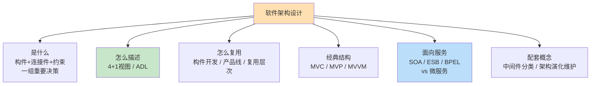
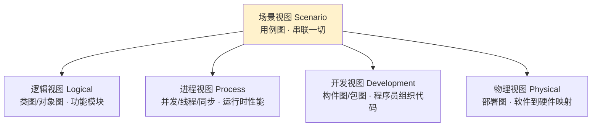
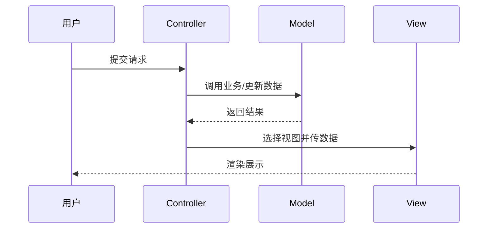
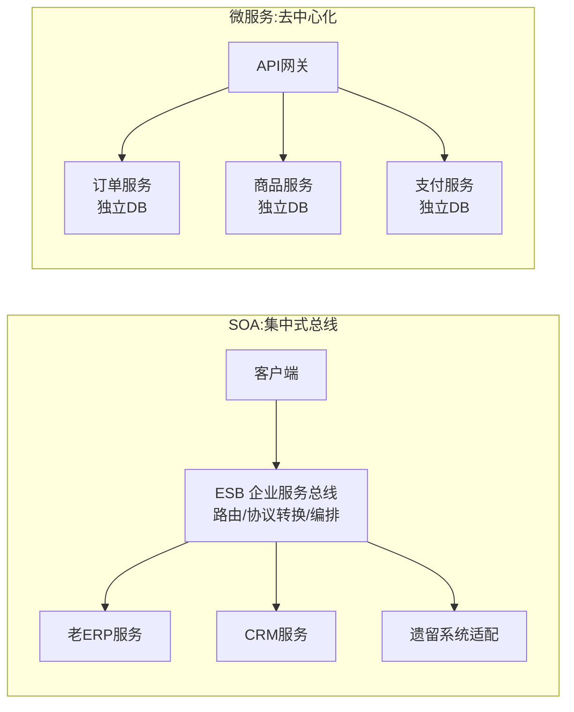

> **摘要**：
> 这一章是架构师考试的"身份认同章"：软件架构到底是什么、怎么描述（4+1 视图、ADL）、怎么复用（构件、产品线）、经典分层 MVC 长什么样，以及新旧两代总线架构 SOA 与微服务的对决。上午题稳定考 3~5 分（4+1 视图、构件标准、MVC/MVP/MVVM、SOA 概念），案例题爱考"SOA/微服务选型论证"，论文"论 SOA/微服务/面向服务架构"是近十年高频命题。建议投入 8~10 小时，4+1 视图和 SOA vs 微服务对比表必须滚瓜烂熟。

## 🗺️ 知识地图

## 📖 掰碎讲解

### 11.1 软件架构的定义与地位

**是什么**：软件架构是指系统的一个或多个**结构**，包括软件**构件**（构件本身及对外可见属性）、它们之间的**连接件**（交互方式）与**约束**（拓扑与规则）；并且架构是"**一系列重要决策**的集合"——选什么构件、怎么连、为什么这么连。
**大白话**：盖楼先有建筑结构图：哪里是承重墙（构件）、水电怎么走线（连接件）、消防规范（约束）。架构师就是软件世界的"总工程师"，图纸定了，后面的施工（编码）就顺着走。
**怎么考**：判断题"软件架构 = 软件需求"（错！架构关注结构与非功能需求）；"架构设计的主要目标之一是**满足质量属性**"——功能谁都能实现，好坏看架构。架构在开发中的地位：**承上启下**——上承需求分析，下启详细设计，是风险最高的阶段（改架构比改代码贵百倍）。

### 11.2 4+1 视图模型（Kruchten）：必考中的必考

**是什么**：用 5 个视角描述架构——**场景视图 + 逻辑视图 + 开发视图 + 进程（过程）视图 + 物理视图**，"4+1"就是 4 个主视图由 1 个场景视图串联。

| 视图 | 面向谁 | 回答什么问题 | 对应 UML 图 |
|---|---|---|---|
| 场景视图 | 最终用户、需求方 | 系统干什么（用例） | 用例图 |
| 逻辑视图 | 系统分析/设计者 | 功能如何划分模块 | 类图、对象图 |
| 进程视图 | 系统集成者 | 并发、同步、性能 | 进程/线程相关图（活动图等） |
| 开发视图 | 程序员 | 代码怎么组织、打包 | 构件图、包图 |
| 物理视图 | 运维/系统集成者 | 软件装到哪台机器 | 部署图 |

**大白话**：同一栋楼，销售拿效果图（场景）、设计师看平面图（逻辑）、施工队看施工图（开发）、物业看水电风管图（进程）、搬家公司看楼层分布（物理）——同一栋楼五种讲法。
**怎么考**：给"面向用户/面向程序员/面向系统集成者"配视图；"哪个视图贯穿其他视图"→场景视图；"构件图属于开发视图、部署图属于物理视图"是标准配对。注意与 [09-面向对象方法](09-面向对象方法/) 的 UML 图分类联动记忆。

### 11.3 架构描述语言 ADL

**是什么**：ADL（Architecture Description Language）是形式化描述架构的语言，三要素：**构件（Component）**、**连接件（Connector）**、**架构配置（Configuration）**。
**大白话**：乐高说明书里"有哪些积木块（构件）、用什么卡扣连（连接件）、最终拼成什么造型（配置）"。
**怎么考**："ADL 的三个基本元素"是高频选择，干扰项常见"需求/测试用例/平台"；代表语言 Wright、Rapide、UniCon 偶尔考名字。

### 11.4 基于构件的开发（CBSD）

**是什么**：构件（Component）是系统中**独立部署**的软件单元，接口封装、可第三方组装、对外不可见内部状态。CBSD 强调"不重造轮子"：**获取→评估→适配→组装**。
**构件获取方式**：从现有构件库/市场获取、改造旧构件、新开发。
**构件组装方式**（三兄弟，考过原文）：

| 组装方式 | 含义 | 类比 |
|---|---|---|
| 顺序组装 | 前一个的输出是后一个的输入，按序调用 | 流水线工人接力 |
| 层次组装 | 上层调用下层，逐层封装 | 塔式汉堡叠罗汉 |
| 叠加组装 | 两个构件功能合并成一个复合构件 | 两张透明胶片叠出一张图 |

**怎么考**："构件的特征"（独立部署、第三方组装、无外部可见状态）；三种组装方式的辨析配对。

### 11.5 主流构件标准三大流派

| 对比 | CORBA（含 CCM） | EJB（Java 阵营） | COM+（微软） |
|---|---|---|---|
| 定制方 | OMG 对象管理组织 | Sun/Java | Microsoft |
| 核心机制 | **ORB**（对象请求代理） | **EJB 容器** + RMI | **COM/DCOM** 基础 + MTS 事务 |
| 跨平台 | 跨语言跨平台（语言中立，IIOP 协议） | 绑定 Java，跨平台 | 绑定 Windows |
| 类比 | 联合国翻译官，谁的话都翻 | 说 Java 一门话，走遍各平台 | 微软家族内部总线 |
| 考眼 | "ORB 负责对象间通信定位" | "EJB 部署在容器中" | "DCOM 远程、MTS 事务→COM+" |

**怎么考**：给机制选标准（"ORB 是____ 的核心"→CORBA）；"最早/最完整的构件互操作标准"常指 CORBA。

### 11.6 中间件分类

**是什么**：中间件是**介于操作系统与应用之间**的软件，屏蔽底层差异，让上层专注业务。
**大白话**：国际会议的同声传译，两边（OS 和应用）谁也不用学对方语言。

| 分类 | 作用 | 例子 |
|---|---|---|
| 数据库中间件 | 统一访问异构数据库 | JDBC/ODBC |
| 消息中间件 | 异步消息传递、解耦削峰 | MQ 系列（详见 [13-Web架构与中间件](13-Web架构与中间件/)） |
| 事务中间件 | 分布式事务监控（TP Monitor） | Tuxedo |
| 远程过程调用 RPC | 像调本地函数一样调远程 | gRPC |
| 对象请求代理 ORB | 分布式对象互访 | CORBA 的 ORB |

**怎么考**：给描述分类别（"屏蔽不同 DB 差异提供统一 API"→数据库中间件）；"中间件位于____ 之间"→操作系统与应用软件。

### 11.7 软件产品线与 DSSA

**是什么**：软件产品线（Software Product Line）= 一组**公共核心资源**（架构+构件+文档）支撑的一批相似产品。两条工程线：
- **领域工程**：造"模具"——领域分析→领域设计（核心架构）→领域实现（核心资产库）；
- **应用工程**：用"模具"生产具体产品——需求分析→产品定制→集成测试。
**大白话**：汽车厂先造平台（底盘+发动机布局），再在平台上拉出轿车、SUV、MPV——一套核心资产，多款产品收割。
**怎么考**："核心资源库""领域工程 vs 应用工程谁先谁后"；DSSA（特定领域软件架构）三层次（领域开发环境→领域特定应用开发环境→应用执行环境）与四活动（领域分析→领域设计→领域实现，加'领域验证'）偶考名词。

### 11.8 MVC 及其变体 MVP / MVVM（必考对比）

**是什么**：
- **Model 模型**：管数据与业务逻辑；**View 视图**：管显示；**Controller 控制器**：接收请求→调模型→选视图渲染。
- **MVP**：Presenter 出场，View 与 Model **完全隔离**，View 变被动，一切交互经 Presenter 中转。
- **MVVM**：ViewModel + **双向数据绑定**，View 变了数据自动变，数据变了视图自动刷。

| 对比 | MVC | MVP | MVVM |
|---|---|---|---|
| 中间角色 | Controller | Presenter | ViewModel |
| View 与 Model 关系 | 可有少量联系 | **完全解耦** | 通过绑定解耦 |
| 核心机制 | 事件驱动分发 | 手动同步接口 | **双向绑定**自动同步 |
| 典型代表 | Spring MVC、早期 Web | WinForms/Android | WPF、Vue |
| 考眼 | 经典三层职责 | "View 被动化、P 中转" | "双向绑定""数据驱动" |

**怎么考**：给特性选架构变体——"双向数据绑定"→MVVM，"View 和 Model 完全独立、通过 Presenter 交互"→MVP；"MVC 中____ 负责接收请求并选择视图"→Controller。案例/论文写 Web 系统几乎必提 MVC。

### 11.9 架构演化与维护

**是什么**：系统上线后需求变更推动架构**演化**——评估变更影响→修改架构→更新视图，小步迭代而非推倒重来；架构维护则关注架构文档与实现的一致性。
**怎么考**："架构演化是由需求变更驱动的渐进过程"偶考选择题；论文里可用于"架构演进"论述段。

### 11.10 软件复用层次

**是什么**：复用粒度从低到高：**代码级 → 模块/函数级 → 对象/类级 → 构件级 → 架构级（子系统/框架）→ 服务级**，粒度越高，复用带来的收益（效率、质量）越大、实施难度也越大。
**大白话**：抄一行代码 < 抄一个函数 < 拿来一个零件 < 整栋楼的图纸复用——越往上越像"连锁加盟"，一套标准开遍全国。
**怎么考**："**架构复用的收益最大**"是常考结论；产品线/构件/SOA 都是不同粒度的复用手段——三者内在联系是案例加分点。

### 11.11 SOA 与微服务（案例论文双料考点）

**是什么**：
- **SOA（面向服务架构）**：把系统拆成**松耦合、标准化契约**的服务，通过 **ESB（企业服务总线）** 统一接入、路由、协议转换；服务编排用 **BPEL**。服务特性：松耦合、位置透明、标准化接口（WSDL）、粗粒度可复用。
- **微服务**：SOA 思想的"轻量化再出发"——拆得更细、去中心化（去掉 ESB 换轻量通信）、每个服务独立数据库、独立部署。

**SOA vs 微服务对比大表（背！）**：

| 维度 | SOA | 微服务 |
|---|---|---|
| 服务粒度 | 粗粒度 | 细粒度（单一职责） |
| 通信方式 | ESB 总线，重（SOAP/ESB 协议转换） | 轻量（REST/gRPC/消息），去中心化 |
| 数据管理 | 通常共享数据库 | **每个服务独立数据库** |
| 治理 | 集中式治理 | 去中心化治理、团队自治 |
| 部署 | 相对整体 | 独立部署、按服务伸缩 |
| 适用 | 整合异构遗留系统（大企业集成） | 互联网快速迭代、弹性伸缩 |
| 技术底座 | ESB、WSDL、BPEL | 容器、注册中心、CI/CD（见 [14-云原生与大数据架构](14-云原生与大数据架构/)） |

**怎么考**：上午题考"ESB 的作用/服务的特性"；案例题给"大型企业要整合多个异构老系统"选 SOA，给"互联网业务快速迭代、需要弹性扩容"选微服务；论文《论面向服务的架构设计》是近十年高频，对比表每一条都是论述素材。数据一致性等微服务痛点详见 [13-Web架构与中间件](13-Web架构与中间件/)。

## 🎬 推荐视频

| 视频 | 讲什么 | 什么时候看 |
|---|---|---|
| [希赛《系统架构设计师》精讲合集 154 集](https://www.bilibili.com/video/BV1Ba4y1u7EC) | 4+1 视图、构件标准、SOA 逐考点精讲 | 第一轮精学，配本笔记表格做笔记 |
| [软考小管家全套 198 集](https://www.bilibili.com/video/BV1xepMzrEjD) | 架构概念零基础版+真题带练 | 概念听不懂时换口味 |
| [希赛 2026 版通关精讲 98 集](https://www.bilibili.com/video/BV1PrwvzFESU) | 高考点快速串讲 | 二轮冲刺查漏 |

## ⭐ 章节重点(考前必背)

| 考点 | 关键结论 | 标注 |
|---|---|---|
| 4+1 视图 | 场景（用例图）串联逻辑/进程/开发/物理；各视图面向谁+对应 UML | **上午必考** |
| ADL 三要素 | 构件、连接件、架构配置 | 高频选择 |
| 构件组装 | 顺序/层次/叠加三种方式 | 偶考原文 |
| 构件标准 | CORBA→ORB，EJB→容器，COM+→DCOM+MTS | 高频配对 |
| 中间件位置 | 操作系统与应用之间 | 送分 |
| MVC 职责 | C 接请求调模型选视图；M 管业务；V 管显示 | **案例论文通用** |
| MVVM 标志 | 双向数据绑定；MVP 标志：View 与 Model 完全隔离 | **上午必考** |
| 复用结论 | 架构级复用收益最大 | 高频 |
| SOA 三件套 | 松耦合服务 + ESB + BPEL 编排 | **上午高频** |
| 微服务四特征 | 细粒度/去中心化/独立数据库/独立部署 | **案例必考**·**论文素材** |

## 🧠 高频考法与陷阱

> **注意**：
> 1. **错**：逻辑视图面向最终用户 → **对**：面向**系统分析与设计者**；面向用户的是**场景视图**（用例），面向运维的是物理视图。
> 2. **错**："4+1"是 4 个用例视图 + 1 个逻辑视图 → **对**：是 4 个主视图（逻辑/进程/开发/物理）+ 1 个**场景视图**作粘合剂。
> 3. **错**：微服务就是更细的 SOA，全盘取代 → **对**：二者适用场景不同——**整合异构遗留系统**仍是 SOA 强项；微服务适合快速迭代、弹性伸缩的互联网业务。案例题选型要"看菜吃饭"。
> 4. **错**：构件=类/函数的另一种叫法 → **对**：构件是**独立部署单元**、以接口对外服务、可第三方组装，粒度和独立性远超类。
> 5. **错**：MVC 中 View 直接操作 Model 完成数据获取 → **对**：标准 MVC 由 Controller 协调、Model 通知 View 更新；在 MVP 中 View 与 Model 更是被**强制隔离**——变体考题就爱考"谁和谁还有没有联系"。
> 6. **错**：ESB 是微服务的标配 → **对**：ESB 是 SOA 的标志；微服务恰恰要**去中心化**，用轻量网关+直连/消息替代总线。

## ✍️ 反复练习题

**第 1 题**：Kruchten 的 4+1 视图中，（ ）描述软件到硬件的映射，（ ）面向程序员组织代码结构。
A. 物理视图、开发视图　B. 部署视图、逻辑视图　C. 进程视图、开发视图　D. 物理视图、进程视图

> **示例**：
> **答案：A**。物理视图=部署图=软件装到哪台机器（面向系统集成/运维）；开发视图=构件图/包图=代码组织（面向程序员）。联想记忆：物理→"机房"，开发→"程序员的文件夹"。

**第 2 题**：ADL 的三个基本组成元素是（ ）。
A. 构件、连接件、架构配置　B. 需求、设计、实现　C. 类、对象、消息　D. 视图、场景、约束

> **示例**：
> **答案：A**。ADL 用形式化语言描述架构：构件（计算单元）、连接件（交互机制）、架构配置（整体拓扑与规则）。B/C/D 都是干扰项，其中 C 是面向对象概念、D 混入了 4+1 视图词汇。

**第 3 题**：某 WPF 应用中，界面输入框内容变化时数据自动同步到业务对象，业务对象变化时界面也自动刷新，开发者几乎不写同步代码。该应用采用的架构模式是（ ）。
A. MVC　B. MVP　C. MVVM　D. 管道-过滤器

> **示例**：
> **答案：C**。"双向数据绑定、不写同步代码"是 MVVM（ViewModel）的独家标志；WPF/Vue 是它的典型宿主。MVP 中 Presenter 要手动同步；MVC 中控制流由 Controller 主导。管道-过滤器是 [12-架构风格与架构评估](12-架构风格与架构评估/) 里的架构风格，不是表现层模式。

**第 4 题**：关于构件标准，下列对应错误的是（ ）。
A. CORBA——ORB 对象请求代理　B. EJB——Java 容器　C. COM+——COM/DCOM + MTS　D. EJB——语言中立、跨语言互操作

> **示例**：
> **答案：D**。跨语言互操作是 CORBA 的特点（IIOP 协议、语言中立）；EJB 绑定 Java 语言但跨操作系统平台。A/B/C 对应关系正确。三大流派对比是上午高频，抓住"谁家孩子会什么"即可：OMG=翻译官，Java=平台无关语言，微软=自家生态。

**第 5 题**：某银行要把分散在全国的 20 年前各分行的老系统（大型机 COBOL、Java 系统、.NET 系统）整合到统一服务平台，要求稳定优先、改动最小。应优先采用（ ）。
A. 微服务架构　B. SOA + ESB　C. 单体分层架构　D. 事件驱动架构

> **示例**：
> **答案：B**。SOA 的看家本领就是**整合异构遗留系统**：ESB 做协议转换与路由，各老系统封装成服务接入，改动小、稳。微服务更适合新建的互联网业务（细粒度、快速迭代、独立库），对 COBOL 大型机做微服务改造反而成本巨大。这是案例"架构选型论证"的典型判据：**存量异构集成→SOA，增量快速迭代→微服务**。

**第 6 题**：关于软件复用，说法正确的是（ ）。
A. 复用粒度越细收益越大
B. 软件产品线的核心是先建设核心资源库（领域工程），再派生产品（应用工程）
C. 构件组装中"层次组装"指两个构件功能合并为一个
D. MVC 是一种数据库设计模式

> **示例**：
> **答案：B**。产品线两条线：领域工程造核心资产（架构+构件库），应用工程基于它定制产品，B 正确。A 错——粒度越**高**（架构级）收益越大；C 错——功能合并是**叠加组装**，层次组装是上下层调用；D 错——MVC 是表现层架构模式。

**第 7 题**（案例风格）：某电商计划把单体系统改造为服务化架构。方案 A：SOA，引入 ESB 统一编排；方案 B：微服务，按业务域拆分 30 个服务。
(1) 从通信方式、数据管理、部署方式三个维度比较两方案；
(2) 说明该企业在什么条件下应选方案 B；
(3) 改造后"订单服务"调用"库存服务"失败导致数据不一致的概率上升，指出该问题属于哪类架构挑战，并给出一种缓解思路。

> **示例**：
> (1) 通信：A 经 ESB 集中路由、协议重（SOAP），B 轻量 REST/gRPC/消息直连、去中心化；数据：A 通常共享数据库，B **每个服务独立数据库**；部署：A 服务相对整体、统一发布，B 独立部署、按服务弹性伸缩（配合容器，见 [14-云原生与大数据架构](14-云原生与大数据架构/)）。
> (2) 满足以下条件选 B：业务迭代快、需要高频独立发布；团队规模大需要按服务划分团队自治；流量波动大需要针对单服务弹性扩容；有容器化/自动化运维（CI/CD）能力兜底。
> (3) 属于**分布式数据一致性**挑战（微服务拆分后本地事务失效）。缓解思路：采用**最终一致性**方案——如基于消息的可靠投递+对账补偿，或 TCC 补偿型事务，避免强一致的 2PC 带来的性能与可用性问题（细节见 [13-Web架构与中间件](13-Web架构与中间件/) 分布式事务一节）。答题时"指出问题类型+给方案+说理由"三步走是案例得分模板。

## 🔗 相关章节

- 建模语言：[09-面向对象方法](09-面向对象方法/)（4+1 各视图对应的 UML 图都在那）
- 风格与评估：[12-架构风格与架构评估](12-架构风格与架构评估/)（本章讲"描述架构"，下章讲"架构长什么样"）
- 服务化延伸：[13-Web架构与中间件](13-Web架构与中间件/) · [14-云原生与大数据架构](14-云原生与大数据架构/)
- 真题演练：[qicoder真题索引](../../99-真题资源/qicoder真题索引/) · [架构-真题战略](../架构-真题战略/)
- 论文素材：[架构-论文攻略](../架构-论文攻略/) · [架构-案例分析攻略](../架构-案例分析攻略/)
