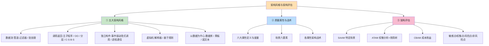
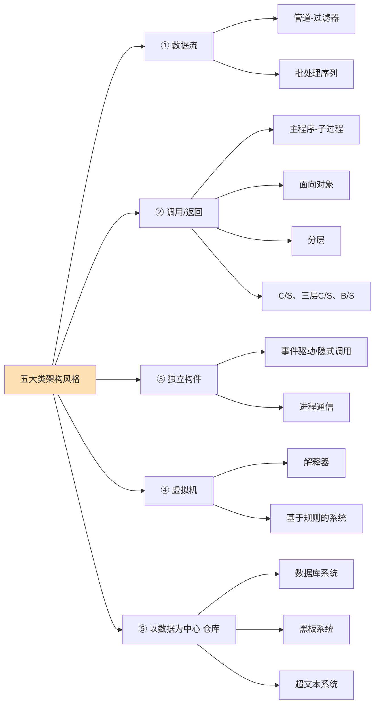
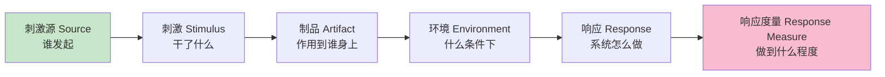
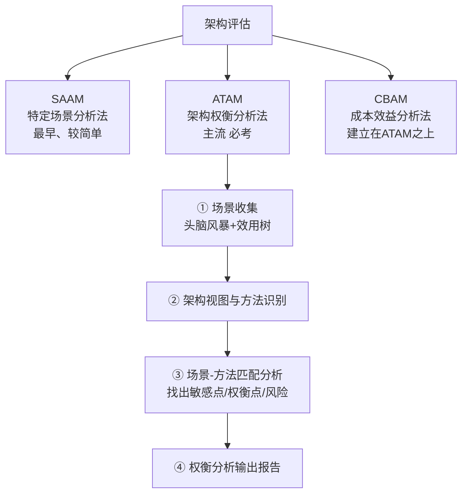
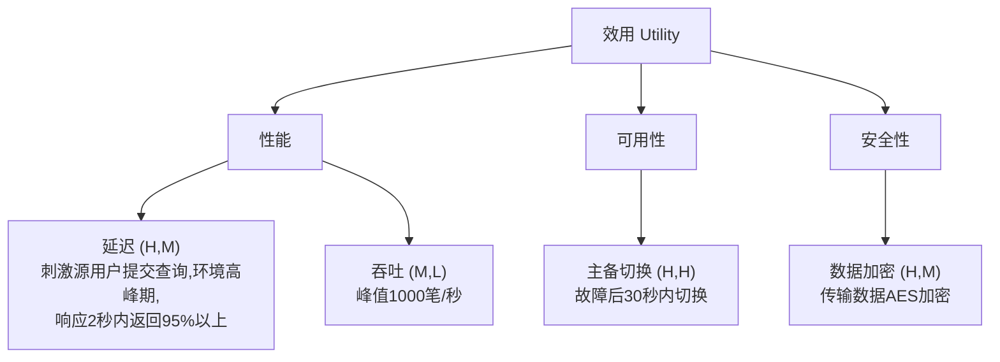

> **摘要**：
> 这是全考试**最重要的一章**，没有之一：上午题 4~6 分（风格识别 + 质量属性术语），下午案例第一题几乎固定考"质量属性场景 + 架构评估（ATAM/敏感点/权衡点）"，论文《论软件架构风格/论质量属性》是近十年最高频命题。内容分三大块：五大类架构风格（选型依据）、六大质量属性与架构战术（怎么提质量）、三大评估方法（怎么验货）。建议投入 12~15 小时，本章笔记要反复背到"给例子秒判风格、给句子秒判敏感点/权衡点"的条件反射。

## 🗺️ 知识地图

## 📖 掰碎讲解

### 12.1 架构风格：定义与价值

**是什么**：架构风格是描述某一特定应用领域中系统组织方式的**惯用模式**，定义了一组构件与连接件的类型及**拓扑约束**。教材句式："架构风格定义了系统部件（构件、连接件）的类目、它们的拓扑结构、约束条件"。
**大白话**：风格就是"装修流派"——北欧极简、中式古典，谁进门都知道规矩：构件怎么摆、消息怎么流。风格是**复用的最高形态**：复用的不是代码，而是"整套组织智慧"。
**怎么考**：价值题——"使用架构风格的好处"：促进复用、便于交流（共同词汇）、指导设计决策、利于评价与培训。上午偶考原文。

**五大类风格总览（分类图必会画）**：

### 12.2 数据流风格：数据像水一样流

**是什么**：构件读入数据、加工、输出数据流。
- **管道-过滤器**：每个过滤器**增量**处理输入流，边进边出，通过管道传给下一个。例：Unix 管道、编译器各阶段、流式 ETL。
- **批处理序列**：每步**整体**处理完毕（拿到完整输入）才输出给下一步，步与步强时间关联。例：传统编译（词法→语法→语义整体分阶段）、银行日终批量结算。

| 对比 | 管道-过滤器 | 批处理 |
|---|---|---|
| 处理方式 | **流式增量**，来一点处理一点 | **整批**处理完才交给下一步 |
| 实时性/交互 | 易并行、适合流式实时 | 适合离线批任务、交互差 |
| 典型例子 | Unix shell、实时日志清洗 | 传统编译器、工资批量核算 |
| 考眼 | "数据流驱动、过滤器独立" | "批处理前后强时间/因果关联" |

**大白话**：管道-过滤器是奶茶店流水线（一杯接一杯现做现传），批处理是食堂大锅饭（全部做好一锅才开饭）。
**怎么考**：给"编译器"问风格——老式**批处理**，流式编译器算管道；给"日志实时清洗告警"——管道-过滤器。优点：松耦合、易复用易并行；缺点：交互性差、不适合动态变更需求、数据转换开销。

### 12.3 调用/返回风格：最主流的"领导喊人干活"

- **主程序-子过程**：层级调用，单线程控制流，结构化编程时代产物（C 语言函数调用树）。
- **面向对象**：构件=对象，连接=方法调用（封装带来的优点：信息隐藏、易维护；缺点：对象间耦合靠接口，副作用是对象身份需维护）。
- **分层**：每层为上层服务、用下层服务，层间接口标准化。**优点（必背）**：关注点分离、支持抽象、可替换可复用、便于维护扩展；**缺点**：不是所有系统都能分层、性能损耗（跨层调用）、难以跨越多层直接访问、层次过多臃肿。典型：TCP/IP 协议栈、OSI、JVM、Web 三层。
- **C/S 与三层 C/S、B/S**：
  - 两层 C/S：客户端（表现+部分逻辑）+ 服务器（数据库）；胖客户端，维护难。
  - 三层 C/S：**表现层 + 功能层（应用逻辑）+ 数据层**，逻辑独立部署，瘦客户端。
  - B/S：浏览器当客户端，零安装易升级、跨平台；但服务器压力大、交互弱、个性化差。

**大白话**：分层像公司科层制——基层干活、中层管理、高层决策，一级找一级（其实一级只找下一级）；B/S 是"网页办事大厅"，不用装 App。
**怎么考**：分层优缺点是案例常客；"B/S 优点：客户端零维护、部署升级容易"vs"缺点：服务器压力大、难以复杂交互、个性化不足"配对题高频。

### 12.4 独立构件风格：谁也别拦谁

- **事件驱动（隐式调用）**：构件不直接调用彼此，而是**发布事件**，注册了该事件的其他构件被隐式触发。例：GUI 事件监听、消息队列发布订阅。
  - 优点：**松耦合**、可扩展性好（加订阅者不影响发布者）、可复用；
  - 缺点：控制流不直观、**正确性难以验证/测试**、事件响应顺序难保证。
- **进程通信**：独立进程通过消息传递（同步/异步）协同。

**大白话**：隐式调用=小区业主群：物业发一条通知（事件），订阅了的邻居各自反应，物业根本不认识每个邻居——松耦合但"谁会响应"不可控。
**怎么考**："事件驱动/隐式调用的缺点"→**难以验证正确性/控制流不可见**（这是与分层优点对比的经典陷阱题）；典型系统举例（GUI、发布订阅）配对。

### 12.5 虚拟机风格：软件里再造一台"软机器"

- **解释器**：模拟一台虚拟机器，解释执行自定义语言/脚本，构件=解释引擎+被解释程序+内存数据。例：Python 解释器、JVM、规则引擎的 DSL。优点：灵活、可移植、便于仿真；缺点：性能差。
- **基于规则的系统**：解释器特化版，构件=**规则库 + 规则解释器 + 工作内存（事实）+ 匹配引擎**。例：专家系统、风控规则、MyBatis 动态 SQL 规则。

**大白话**：解释器是"随身翻译机"（到哪国都能用就是慢）；规则系统是"制度手册 + 执行秘书"——秘书（解释器）拿着手册（规则库）对照现场情况（工作内存）办事。
**怎么考**："基于规则的系统组成"考过原文；"灵活但效率低"是虚拟机类风格的通用缺点；专家系统→基于规则的标准配对。

### 12.6 以数据为中心（仓库风格）：数据是舞台中央

- **数据库系统**：中央共享数据源 + 一批独立处理构件（传统信息系统）。
- **黑板系统**：**知识源（多个 specialist）+ 黑板（共享数据结构，状态总控）+ 控制组件（决定谁上黑板）**。适合"无确定性求解路径"问题：语音识别、信号处理、专家系统早期形态。
- **超文本系统**：节点+链接的非线性浏览（WWW、帮助文档）。

**大白话**：黑板系统像高三教室后黑板：各科课代表（知识源）都盯着黑板（共享数据），谁发现自己能解题就上去写一笔，班长（控制组件）协调顺序——答案在互相补充中浮现。
**怎么考**：**黑板系统三大组成必背**（知识源/黑板/控制）；"语音识别适合黑板系统"是标准配对；与数据库风格区别——黑板有控制组件、知识源增量协作求解。

### 12.7 层次对比大表（上午题题库本库）

| 风格 | 构件/连接件 | 优点 | 缺点 | 典型系统 |
|---|---|---|---|---|
| 管道-过滤器 | 过滤器/管道 | 松耦合、易并行复用、流式 | 交互差、不适合交互应用 | Unix 管道、编译 |
| 批处理 | 批处理程序/序列 | 流程清晰 | 强时间关联、无交互 | 传统编译、批量结算 |
| 主程序-子过程 | 子过程/调用 | 结构简单直观 | 单线程、耦合集中 | C 结构化程序 |
| 面向对象 | 对象/方法调用 | 封装隐藏、易维护 | 对象交互接口复杂 | 大多数现代应用 |
| **分层** | 层/层间调用 | 关注分离、可替换、易扩展 | 性能损耗、难跨层、不一定可分层 | TCP/IP、JVM、三层Web |
| 事件驱动隐式调用 | 构件/事件发布订阅 | 松耦合、易扩展复用 | 控制流难追溯、**正确性难验证** | GUI、消息队列 |
| 进程通信 | 进程/消息 | 并行性强 | 同步复杂 | 分布式系统 |
| 解释器 | 虚拟机/指令 | 灵活可移植仿真 | 性能低 | Python、JVM |
| 基于规则 | 规则库+解释器+工作内存 | 规则可动态更新 | 匹配开销、调试难 | 专家系统 |
| 数据库系统 | 中央数据+独立构件 | 数据一致共享 | 数据格式固定、耦合数据 | MIS 系统 |
| **黑板** | 知识源+黑板+控制 | 增量协作、适合不确定解 | 调试难、无最优保证 | 语音识别、信号处理 |
| 超文本 | 节点/链接 | 非线性、灵活浏览 | 组织混乱风险 | Web、帮助系统 |

### 12.8 专用风格：近年新宠

- **闭环控制（过程控制）**：开环（只输出不看结果）vs **闭环（传感器反馈→控制器决策→执行器动作，循环控制）**，例：空调恒温、自动驾驶巡航。构件：传感器/控制器/执行器，连接：数据反馈回路。
- **MVC**：见 [11-软件架构设计](11-软件架构设计/)，属于"交互式应用"专用风格。
- **微内核**：内核只留最小核心（调度、IPC、基本内存），其余功能全是**插件式外部服务**。优点：扩展性、可靠性（服务崩溃不拖垮内核）、可裁剪；缺点：消息传递性能开销、开发复杂。例：操作系统微内核、浏览器（Chrome 多进程）、IDE（VSCode 插件）、App 开放平台。
- **REST**：资源+统一接口+无状态，详见 [13-Web架构与中间件](13-Web架构与中间件/)。

**怎么考**：微内核"插件化、易扩展、内核稳定小"的描述近年在上午/案例都出现过；闭环控制给"恒温控制/巡航"场景识别。

### 12.9 DSSA 与架构风格选择

**DSSA（特定领域软件架构）**：以领域为中心复用架构，三层次（领域开发环境→领域特定应用开发环境→应用执行环境）、四活动（领域分析→领域设计→领域实现→领域验证），与产品线（见 [11-软件架构设计](11-软件架构设计/)）呼应。

**风格选择案例套路（关键词→风格）**：

| 题干关键词 | 选什么风格 |
|---|---|
| 实时日志流、增量处理、Unix 管道 | 管道-过滤器 |
| 分阶段整批处理、编译 | 批处理 |
| 关注分离、逐层调用、可替换 | 分层 |
| 图形界面、消息订阅、插件扩展 | 事件驱动/隐式调用 |
| 脚本解释、跨平台仿真 | 解释器 |
| 专家系统、规则库推理 | 基于规则的系统 |
| 语音识别、多专家协作求解 | 黑板系统 |
| 恒温控制、反馈调节 | 闭环控制 |
| 插件生态、内核最小化 | 微内核 |
| 浏览器访问、零安装 | B/S |

### 12.10 质量属性：六大天王（定义+度量必背）

| 质量属性 | 定义 | 常用度量 | 生活类比 |
|---|---|---|---|
| 性能 | 系统的响应/吞吐能力 | **吞吐量、响应时间、延迟、并发数** | 高速车道数 |
| 可用性 | 系统可正常提供服务的时间比例 | **MTBF、MTTR、可用性百分比**（计算见 [15-系统可靠性与性能](15-系统可靠性与性能/)） | 店铺营业率 |
| 安全性 | 抵抗非授权访问与攻击 | 保密性、完整性、不可否认性、可追踪性 | 银行金库 |
| 可修改性 | 修改的难易与成本 | 修改影响范围、变更实施时间 | 模块化装修 |
| 可测试性 | 发现缺陷的难易 | 缺陷发现率、测试覆盖率 | 车辆 OBD 接口 |
| 易用性 | 用户使用的容易程度 | 学习时间、操作效率、出错率 | 苹果手机 |

> **注意**：
> **"功能性"不是质量属性**（它是需求内容）；质量属性里性能、可用性、安全性常被称"运行时质量"，可修改性、可测试性是"非运行时质量"。考试问"下列不属于质量属性的是"——选"功能性/成本"。

### 12.11 质量属性场景六要素（案例必考，会写场景）

**是什么**：描述任何质量属性需求都要凑齐六要素：

| 要素 | 含义 | 例子（性能场景） |
|---|---|---|
| 刺激源 | 产生刺激的实体 | 用户 / 外部系统 / 内部时钟 |
| 刺激 | 到达系统的具体事件 | 提交查询请求 |
| 制品 | 被作用的系统部件 | 交易处理模块 |
| 环境 | 事件发生时系统的状态 | 高峰期 / 正常运行 / 攻击中 |
| 响应 | 系统做出的反应 | 返回查询结果 |
| 响应度量 | 可量化指标 | **2 秒内返回**、成功率 99.9% |

**大白话**：写质量需求像写一条完整的"外卖差评"：谁（源）在什么时候（环境）点了什么（刺激），平台和商家（制品）做了什么（响应），等了多久才到（响应度量）——缺一环就没法验收。
**怎么考**：案例题给一段场景描述，问"该场景缺少哪个质量属性场景要素"（最常缺**响应度量**）；或让你把"系统要快"改写成规范场景——必须补"响应时间 ≤ 2 秒"这种可量化度量。**没有数字的度量不是好度量**。

### 12.12 架构战术：每个属性怎么"下药"（案例论文素材库）

| 质量属性 | 常用战术（背清单） |
|---|---|
| 可用性 | **ping/echo（心跳探测）**、心跳、**冗余（主备/集群）**、异常检测（监视/表决）、故障恢复（**回滚**、优雅降级）、重试 |
| 性能 | **增加计算资源**、**引入缓存**、调度（负载均衡）、**并发/并行**、减少计算开销、减少等待 |
| 安全性 | **认证（身份）→ 授权（权限）→ 审计（留痕）→ 加密（数据）→ 限制访问** |
| 可修改性 | **局部化修改（高内聚低耦合）**、**信息隐藏**、**抽象**、预期变更封装 |
| 可测试性 | **内部监控（断言）**、输入输出（**记录/回放**）、专用测试接口、沙箱 |
| 易用性 | 运行时：在线帮助、**撤销/恢复**、自适应界面、用户错误处理；设计时：模型用户任务 |

**大白话**：战术=对症药方：想不宕机就"体检（ping/echo）+备胎（冗余）"；想跑得快就"加车道（资源）+近道抄（缓存）"；想防贼就"查身份证（认证）+只开你该进的门（授权）+装监控（审计）+上锁（加密）"。
**怎么考**：案例题给场景问"为提升____应采取哪些架构战术"，按清单默写+结合题干；与质量属性场景一起构成案例第一题的两大得分点。战术与质量的对应**不能串药方**（"给可修改性用加密"就是笑话）。

### 12.13 架构评估三方法：SAAM / ATAM / CBAM

| 方法 | 核心思想 | 步骤要点 | 适用 |
|---|---|---|---|
| **SAAM**（特定场景分析法） | 用**场景**检验架构 | ① 场景开发 → ② 场景分类（直接可用/需修改的间接场景）→ ③ 单场景评估 → ④ 场景交互分析 → ⑤ 总体评估 | 初步、单一质量属性、简单 |
| **ATAM**（架构权衡分析法） | 揭示质量属性间的**权衡** | 识别场景（效用树）→ 识别架构方法 → 分析权衡点/敏感点/风险点 → 输出报告 | 多质量属性权衡，**考试主角** |
| **CBAM**（成本效益分析法） | 在 ATAM 结果上算**经济账** | 评估架构策略的成本与收益（ROI），决定投入 | 资源有限做取舍 |

**效用树（ATAM 标志物，必会画）**：根节点=效用，第一层=质量属性（性能/可用性/安全性…），第二层=属性分类细目，**叶子=场景**，叶子旁标注（重要度, 难易度），如 (H, M)=高重要度中实现难度：

**怎么考**：案例题"请用 ATAM 步骤评估该架构""补充效用树叶子场景""标注 (重要度, 难易度)"；选择题"在 ATAM 之上进行成本效益分析的评估方法是"→CBAM；"最早的架构评估方法"→SAAM。

### 12.14 核心术语四兄弟辨析（每年必考一题）

| 术语 | 定义 | 判断信号词 | 例子 |
|---|---|---|---|
| **敏感点** | 一个决策，影响**单个**质量属性 | "直接影响/关系到某一个质量属性" | "查询响应时间取决于数据库索引设计"→影响性能 |
| **权衡点** | 一个决策，同时影响**多个**质量属性 | "**同时影响** A 和 B""在 A 与 B 之间权衡" | "引入加密**既提升安全性又降低性能**" |
| **风险点** | 可能引发问题的决策 | "存在隐患/可能导致____问题" | "未做冗余设计，单点故障将导致服务中断" |
| **非风险点** | 不会带来问题的正确决策 | "……是恰当的/无碍" | "采用分层设计便于后续扩展，不构成风险" |

**大白话**：敏感点是一根"只连一个警铃的线"；权衡点是一根"同时拉响两个警铃的线"（动它必顾此失彼）；风险点是"明摆着的坑"；非风险点是"安全区"。判题三板斧：**先数影响几个属性（1个=敏感，多个=权衡），再看是不是隐患（是=风险，不是=非风险）**。

## 🎬 推荐视频

| 视频 | 讲什么 | 什么时候看 |
|---|---|---|
| [希赛《系统架构设计师》精讲合集 154 集](https://www.bilibili.com/video/BV1Ba4y1u7EC) | 五大风格+质量属性+评估方法逐个精讲 | 第一轮主线课 |
| [秋意浓案例真题精讲 37 集（架构评估专题）](https://www.bilibili.com/video/BV1LHxkzbEDL) | 真题案例带练：质量属性场景、ATAM、敏感点权衡点逐题拆解 | **案例阶段必看**，看完再写本章练习题 |
| [希赛 2026 版通关精讲 98 集](https://www.bilibili.com/video/BV1PrwvzFESU) | 风格表格与术语辨析串讲 | 考前二轮快速回顾 |

## ⭐ 章节重点(考前必背)

| 考点 | 关键结论 | 标注 |
|---|---|---|
| 五大风格分类 | 数据流/调用返回/独立构件/虚拟机/以数据为中心 | **上午必考**·论文素材 |
| 黑板系统组成 | 知识源+黑板+控制组件 | 高频原文 |
| 分层优缺点 | 关注分离可扩展 vs 性能损耗难跨层 | **案例必考** |
| 隐式调用缺点 | 控制流不直观、正确性难验证 | 高频陷阱 |
| 质量属性六种 | 性能/可用性/安全性/可修改性/可测试性/易用性（功能性不算） | **案例第一题必考** |
| 场景六要素 | 刺激源/刺激/制品/环境/响应/**响应度量** | **案例必考**·论文素材 |
| 战术对药方 | 可用性=pig心跳冗余回滚；安全=认证授权审计加密限制；性能=资源缓存并发 | **案例必考** |
| 效用树 | 根=效用，叶子=场景，标注(重要度,难易度) | ATAM 标志 |
| 评估三法 | SAAM 最早、ATAM 权衡、CBAM 成本效益 | 高频选择 |
| 四兄弟辨析 | 敏感=1 属性；权衡=多属性；风险=隐患；非风险=无隐患 | **每年必考** |
| 微内核/闭环 | 插件化扩展 / 传感器反馈闭环 | 近年新宠 |

## 🧠 高频考法与陷阱

> **注意**：
> 1. **错**：权衡点和敏感点是一回事 → **对**：数属性个数——影响**一个**质量属性=敏感点；**同时影响多个**（如安全性与性能此消彼长）=权衡点。题干出现"既……又……"几乎必是权衡点。
> 2. **错**："系统要高可用、要快"就是合格的质量需求 → **对**：必须有**响应度量**（可用性 99.9%、响应 2 秒内）才算完整场景；案例题问"该场景缺少什么"几乎都答"响应度量"。
> 3. **错**：事件驱动风格没有缺点，最该用 → **对**：它的控制流不直观、**正确性难以验证**——这是和分层风格优点对比时最爱考的"另一面"。
> 4. **错**：编译器一定是管道-过滤器 → **对**：传统分阶段整批处理的是**批处理序列**；流式增量处理的（如现代流水线编译/日志清洗）才是管道-过滤器，看题干"增量/流式"关键词。
> 5. **错**：ATAM 只评估性能和可用性 → **对**：ATAM 的核心是揭示**多个质量属性之间的权衡关系**，任何属性组合都可评估；只评单一属性用 SAAM 更轻量。
> 6. **错**：质量属性战术可以混用（如用"加密"提升可修改性） → **对**：战术与属性有固定对应关系，串了药方案例题直接扣分。
> 7. **错**：CBAM 是独立于 ATAM 的另一套场景分析 → **对**：CBAM **建立在 ATAM 结果之上**，继续做成本效益（ROI）分析，两步接力不是并列关系。

## ✍️ 反复练习题

**第 1 题**：某语音识别系统由多个识别算法模块共同工作，各模块监听共享的中间结果并不断补充修正识别结论，由专门组件协调它们的执行。该系统采用的架构风格是（ ）。
A. 管道-过滤器　B. 黑板　C. 事件驱动　D. 分层

> **示例**：
> **答案：B**。"多个知识源 + 共享数据区（黑板）+ 控制组件"正是黑板系统三大组成，语音识别是其教科书应用场景。A 是顺序单向流（本题是相互修正的双向协作）；C 缺少共享数据求解语义；D 无层级调用关系。记住配对：语音识别/信号处理→黑板。

**第 2 题**：关于架构风格，说法正确的是（ ）。
A. 分层风格的最大优点是性能最优
B. 事件驱动/隐式调用风格便于扩展，但控制流不直观、正确性难以验证
C. 管道-过滤器风格交互性强，适合人机交互系统
D. 解释器风格通过减少解释开销获得高性能

> **示例**：
> **答案：B**。隐式调用优点（松耦合易扩展）与缺点（控制流不直观、难验证正确性）并列陈述是标准答案句。A 错——分层因跨层调用有**性能损耗**；C 错——数据流风格交互性**差**；D 错——解释器以牺牲性能换灵活性。

**第 3 题**："系统在用户提交查询请求后，应在高峰时段仍然于 2 秒内返回结果，且 95% 的请求达标。"按质量属性场景六要素，"高峰时段"属于（ ），"2 秒内"属于（ ）。
A. 环境、响应度量　B. 刺激、环境　C. 制品、响应　D. 环境、响应

> **示例**：
> **答案：A**。"高峰时段"描述事件发生时系统所处的条件=**环境**；"2 秒内、95% 达标"是可量化指标=**响应度量**。完整拆解：用户（刺激源）提交查询（刺激）→系统（制品）→高峰期（环境）→返回结果（响应）→2 秒内 95% 达标（响应度量）。六要素填空是案例第一题最常见小问。

**第 4 题**：某支付系统为保障交易数据安全引入端到端加密。评估时指出：该决策在提升安全性的同时增加了约 30% 的处理延迟。这一决策属于（ ）。
A. 风险点　B. 非风险点　C. 敏感点　D. 权衡点

> **示例**：
> **答案：D**。该决策**同时影响两个质量属性**（安全性↑、性能↓），存在此消彼长关系=权衡点。判别口诀：一属性=敏感点，多属性=权衡点，是隐患=风险点，无隐患=非风险点。若题干只说"该决策影响安全性"才是敏感点。

**第 5 题**：为提升系统**可用性**，下列战术中不合适的是（ ）。
A. ping/echo 心跳检测　B. 主备冗余与故障切换　C. 故障后回滚与优雅降级　D. 对传输数据进行 AES 加密

> **示例**：
> **答案：D**。加密属于**安全性**战术（认证/授权/审计/加密/限制访问之一），对可用性没有直接贡献。可用性药方：心跳（ping/echo）、冗余、异常检测、回滚、降级重试。案例题"为提升 X 给战术"必须对药方，串了就丢分。

**第 6 题**：某团队用 ATAM 评估架构，产出了一张表：根节点"效用"，下层分"性能/可用性/安全性"，叶子是若干场景并标注如"(H, M)"。叶子上的 (H, M) 表示（ ）。
A. 高成本、中等收益　B. 场景重要度高、实现/满足难度中　C. 高风险、中敏感　D. 高优先级、中等性能

> **示例**：
> **答案：B**。效用树叶子标注为（重要度, 难易度）二元组：(H,M)=重要度高、实现难度中。效用树的作用是把"泛泛的质量需求"落地成"可分析的场景"，是 ATAM 区别于 SAAM 的标志物。案例题可能让你自己补场景——记住每片叶子就是一条**六要素场景**。

**第 7 题**：某物流公司要新建运单跟踪系统：需要接入 GPS 定位设备流式上报数据做实时清洗与统计；Web 端供员工按"表现层-业务层-数据层"三层使用；未来需频繁接入新的数据源插件。
(1) 指出"流式上报数据清洗"适合的架构风格并说明理由；
(2) 指出 Web 端适合的风格及其一条优点一条缺点；
(3) "未来频繁接入新数据源插件"体现了哪种架构风格的什么特征？

> **示例**：
> (1) **管道-过滤器**：设备数据是持续流式到达，各处理节点（清洗→解析→统计）作为过滤器**增量**处理、经管道传递，松耦合、易并行，契合"实时流式"特征。若是"每晚整批结算"类需求才选批处理。
> (2) Web 端选**分层（三层 B/S）**风格。优点：关注点分离、各层可独立替换扩展、维护性好（答"便于复用/团队分工"也对）；缺点：跨层调用带来性能损耗、并非所有系统都适合分层（答一条即可，注意别把优点说成"性能最好"）。
> (3) 体现**独立构件（事件驱动/隐式调用）**风格的特征：新数据源作为独立构件**发布/注册事件**即可接入，不修改既有构件——松耦合、可扩展性好（代价是控制流不直观，可在答案中补充说明以示理解全面）。

**第 8 题**（案例大题风格）：某在线交易系统质量需求节选：① 高峰期 1000 笔/秒下单，响应不超 2 秒；② 全年可用性不低于 99.9%；③ 每月都会上线促销规则，要求改功能不伤筋动骨。
(1) 分别写出①②③对应的质量属性，并为③写出一条架构战术；
(2) 把①改写成完整的质量属性场景（六要素）；
(3) 评估时发现"为满足②采用的主备双机部署，切换期间会出现约 30 秒服务中断"。指出这属于风险点还是非风险点，并说明理由。

> **示例**：
> (1) ①性能（吞吐量 1000 笔/秒 + 响应时间 2 秒两个度量都要写全）；②可用性（99.9%）；③**可修改性**，战术答"局部化修改/信息隐藏/抽象"任一并结合语境（如"将促销规则独立为可插拔模块，隔离预期变更"）。
> (2) 场景：用户（刺激源）在双十一高峰期（环境）提交下单请求（刺激）→ 交易系统（制品）→ 处理并返回下单结果（响应）→ 响应时间不超过 2 秒、吞吐 1000 笔/秒（响应度量）。评分点在"刺激源、环境、响应度量"三处不能漏。
> (3) 属于**风险点**。理由：该决策（主备切换方案）存在可能引发问题的隐患——切换期 30 秒中断与②的可用性目标冲突，是评估中需要向架构师提出的风险项。若描述为"该决策同时影响可用性与成本"则升级为权衡点；答题时先判"是不是隐患"，再判"影响几个属性"。

## 🎨 漫画图解

*五大架构风格拟人图*-给例子秒判风格:管道流水、分层上楼、事件广播、虚拟机翻译、仓库查书*

*质量属性六战士*-六大质量属性及其在题干中的信号词*

## 🔗 相关章节

- 架构基础：[11-软件架构设计](11-软件架构设计/)（4+1 视图、SOA 先修）
- 可用性怎么算：[15-系统可靠性与性能](15-系统可靠性与性能/)（MTBF/可用性公式）
- Web 场景实战：[13-Web架构与中间件](13-Web架构与中间件/)（缓存/负载均衡都是性能战术）
- 案例第一题专攻：[架构-案例分析攻略](../架构-案例分析攻略/) · 论文主战场：[架构-论文攻略](../架构-论文攻略/)
- 真题索引：[qicoder真题索引](../../99-真题资源/qicoder真题索引/) · [架构-真题战略](../架构-真题战略/) · [架构-考试分析](../架构-考试分析/)
