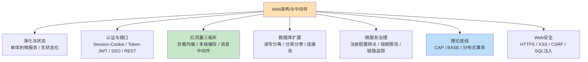
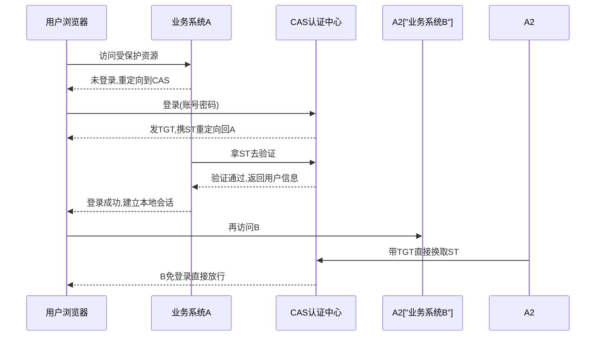
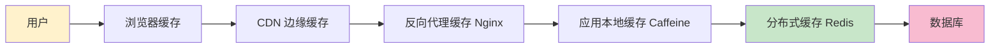
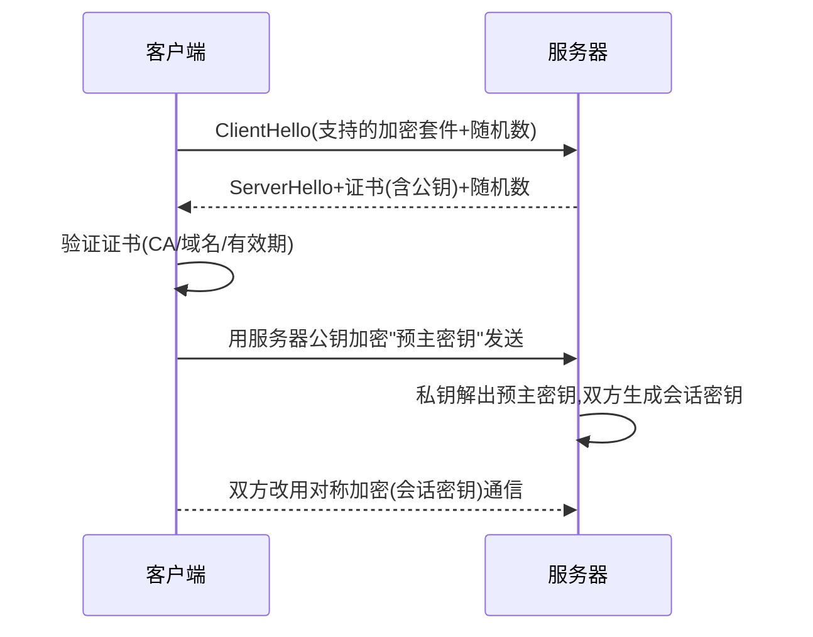

> **摘要**：
> 这一章讲"互联网大厂是怎么把系统扛住亿级流量的"：Web 架构演化、登录态管理（Session vs Token）、REST、负载均衡、多级缓存、消息中间件、微服务治理、CAP/BASE、Web 安全、分布式事务。上午题 3~5 分（CAP、HTTPS、缓存、REST），案例题高频出"高并发电商改造"（缓存三兄弟/负载均衡/读写分离是常客）；论文《论 Web 应用架构/论负载均衡/论缓存/论微服务治理》近年轮番出现。建议投入 10~12 小时，缓存三兄弟和 Session/Token 对比是最高性价比考点。

## 🗺️ 知识地图

## 📖 掰碎讲解

### 13.1 Web 系统演化：从"小卖部"到"连锁集团"

**是什么**：单体架构（一个包打天下）→ 分层架构（表现/逻辑/数据，见 [12-架构风格与架构评估](12-架构风格与架构评估/)）→ 集群分布式（多机负载均衡）→ 缓存+消息（扛高并发）→ SOA/微服务（服务化拆分，见 [11-软件架构设计](11-软件架构设计/)）→ 云原生（容器化，见 [14-云原生与大数据架构](14-云原生与大数据架构/)）。
**大白话**：小卖部一个人又收银又进货（单体）；生意好了分柜台（分层）；再开分店（集群+负载均衡）；仓库备货+统一调度（缓存+消息）；最后按业务开独立公司（微服务）。
**怎么考**：演化的**驱动因素是流量/并发增长**，案例题写"改造方案"时要先说痛点（单点/性能瓶颈/发布耦合）再给手段；"单体→微服务改造"是论文常用骨架。

### 13.2 无状态 vs 有状态

**是什么**：无状态=每个请求自带全部信息，服务端不记忆"你是谁"；有状态=服务端保存会话上下文。
**大白话**：无状态像"号码牌取餐"——每一单凭票说话，换哪个窗口都行；有状态像"去窗口报名字"——必须回到当初那个窗口，服务员才认识你。
**怎么考**：**水平扩展的前提是无状态化**（任何一台服务器都能处理任何请求）；Session 是典型状态，这是"Session vs Token"之争的根源。案例题"为什么要无状态化"的标准答案：便于负载均衡和弹性伸缩、故障转移简单。

### 13.3 Session/Cookie vs Token/JWT（必考对比）

**是什么**：
- **Cookie**：浏览器存的小饼干，每次请求自动带给服务器（也可能被禁用/被截获）。
- **Session**：服务器端存会话状态，把 SessionID 放进 Cookie 发给浏览器；集群下要 Session 共享（粘性会话/复制/Redis 集中存）。
- **Token（JWT）**：服务端签名后把令牌直接发给客户端保存，服务端**不存状态**，收到后验签即可。JWT = **Header.Payload.Signature** 三段式（Base64 前两段 + 签名第三段）。

| 对比 | Session + Cookie | Token（JWT） |
|---|---|---|
| 状态存放 | **服务端**存会话 | **客户端**存令牌，服务端无状态 |
| 水平扩展 | 需 Session 共享/粘性路由 | 天然支持，任意节点可验签 |
| 跨域/跨端 | 弱（依赖 Cookie） | 强（Header 携带，支持 App/小程序） |
| 注销/踢人 | 删除服务端 Session 即可 | **难**（令牌签发后到期前一直有效，需黑名单） |
| 安全风险 | Cookie 被劫持/XSS | 令牌泄露同样危险；Payload 仅 Base64 **不加密**可被读 |
| 类比 | 衣帽间存包拿号牌 | 盖了公章的介绍信 |

**怎么考**：上午爱考"JWT 由三部分组成、服务端无需保存会话状态""JWT 优点：无状态易扩展；缺点：无法主动失效"。**介绍信类比**帮你记住：信（Token）在你手里，验证章（签名）就行，但信丢了别人也能拿着用——这就是注销难的原因。

### 13.4 SSO 单点登录（CAS 流程）

**是什么**：一次登录，处处通行。经典 CAS 架构：认证中心（CAS Server）+ 各业务系统（Client）。
**大白话**：园区一张门禁卡刷遍所有楼，不用每栋楼各办一张卡。
**怎么考**：流程题（下图），关键词 **TGT（票据授权令牌，存认证中心/浏览器）与 ST（Service Ticket，业务票据）**——认证中心发 ST 给浏览器，业务系统拿 ST 回头向认证中心验证。SSO 也常以"统一认证"出现在论文的架构图里。

### 13.5 REST 与 RESTful 设计

**是什么**：REST 是一种架构风格（属 [12-架构风格与架构评估](12-架构风格与架构评估/) 的风格家族），核心约束：**客户-服务器、无状态、缓存、统一接口、分层系统、按需代码（可选）**。RESTful 设计规范：
- 资源用**名词 URI**：`/users/123/orders`；
- 用 **HTTP 动词**表达操作：GET 查 / POST 增 / PUT 改 / DELETE 删；
- 无状态、用状态码（200/201/404/500）表达结果。
**大白话**：把系统当"图书馆"：每本书（资源）有固定编号（URI），动作统一（借/还/续=GET/POST/PUT），馆员不记你借过什么（无状态）。
**怎么考**："REST 的核心约束"高频选择；案例题让把 `/getUser?id=1` 改造成 RESTful（`GET /users/1`）；对比题"RESTful vs SOAP/WSDL（SOA 时代）= 轻量 vs 重量"。与 [12-架构风格与架构评估](12-架构风格与架构评估/) 的"统一接口"术语联动。

### 13.6 HTTP 缓存（浏览器侧）

**是什么**：**强缓存**（Expires/Cache-Control，直接用本地副本不发请求）vs **协商缓存**（Last-Modified/If-Modified-Since、ETag/If-None-Match，问服务器资源变没变，没变回 304）。
**大白话**：强缓存是"家里还有牛奶不用去超市"；协商缓存是"打电话问超市牛奶过期没"。
**怎么考**：偶考"304 状态码对应协商缓存命中"；CDN 见下节。

### 13.7 负载均衡层与算法（一致性哈希必考）

**是什么**：把流量分到多台服务器。层次：**DNS 轮询（地理级粗分）→ 硬件 F5（贵而强）→ 软件 LVS（四层/传输层）→ Nginx（七层/应用层）→ 网关级路由**。
**算法**：轮询、加权轮询（按机器性能配比）、最少连接、源地址哈希（同 IP 固定到同机）、**一致性哈希**。

| 算法 | 特点 | 适用 |
|---|---|---|
| 轮询 | 平均分 | 机器同构 |
| 加权轮询 | 按权重分 | 机器异构 |
| 最少连接 | 谁闲给谁 | 长连接/处理耗时不均 |
| 源地址哈希 | 同源固定同机 | 需要"会话保持" |
| **一致性哈希** | 环形哈希空间 + **虚拟节点**，节点增删只影响**相邻区段**数据 | 分布式缓存（Redis 集群）、分布式存储 |

**大白话**：普通哈希是"按门牌分快递"，新开一个站点全城快递要重新分；一致性哈希是把快递员站成**一个圆圈**，包裹只归顺时针最近的那位——新来一人，只有他身后一小段包裹换主人；虚拟节点是让每人在圈上多占几个位置，避免"贫富不均"。
**怎么考**："减少节点增删时的数据迁移"→一致性哈希（**必考句**）；"四层 vs 七层"→LVS vs Nginx。

### 13.8 多级缓存体系与"缓存三兄弟"（案例高频）

**多级请求链**：

| 问题 | 定义 | 解法（背） |
|---|---|---|
| **缓存穿透** | 查询**根本不存在**的数据，缓存和 DB 都没有，请求直捣数据库 | 布隆过滤器拦截、**缓存空值**（短过期）、参数校验 |
| **缓存击穿** | 某个**热点 key 恰好过期**，瞬时海量请求同时打到 DB | **互斥锁**（只放一个请求回源）、热点数据**逻辑过期/永不过期** |
| **缓存雪崩** | **大量 key 同时过期**或缓存集群宕机，DB 被冲垮 | 过期时间**加随机值**错峰、缓存高可用（集群/多级）、限流降级兜底 |

**大白话**：穿透=查"不存在的假货"，谁家都没货，全挤到仓库；击穿=爆款单品恰好下架补货瞬间，人潮同时冲仓库；雪崩=整排货架同时清空，全场人冲仓库。
**怎么考**：三者定义与解法是案例"高并发改造"题的标配小问；判断技巧——**不存在=穿透，单个热点过期=击穿，大面积同时失效=雪崩**。

### 13.9 消息中间件：解耦、异步、削峰

**是什么**：生产者把消息发到队列，消费者按自己节奏消费。三大作用：**解耦**（生产者不认识消费者）、**异步**（下单先返回，发短信慢慢来）、**削峰**（秒杀洪峰先进队列，下游匀速处理）。
**可靠投递**：生产者确认（confirm）+ 消息持久化 + 消费者手动 ACK + **幂等消费**（防重复消费，用唯一 ID 去重）。
**选型一句话**：Kafka=超高吞吐的日志/流处理王者；RocketMQ=事务消息+电商场景全能选手；RabbitMQ=低延迟、路由灵活的管理后台良伴。

**大白话**：消息队列是"食堂取餐叫号器"——高峰期大家先拿号（削峰），厨房做好叫号（异步），你不用守着厨师（解耦）。
**怎么考**：案例题"秒杀系统如何设计"必写"MQ 削峰+限流+缓存预热"；"消息会丢在哪三处"→生产端/存储端/消费端，对应三种可靠性手段。

### 13.10 数据库扩展：读写分离与分库分表

- **读写分离**：主库写、从库读，主从复制同步；痛点=**主从延迟**（刚写完就读不到），缓解=强制读主/延迟监控。
- **分库分表**：**垂直**（按业务拆库、按字段拆表）vs **水平**（按行拆到多库多表，需分片键，带来跨库 join/分布式事务难题）。
- **连接池**：复用数据库连接（Druid/HikariCP），避免频繁建连开销。

**怎么考**：案例题问"数据库成为瓶颈怎么办"——标准答案组合：读写分离 → 缓存 → 分库分表；"水平分片后最大的代价"→跨库事务与跨库查询复杂化（联动 [03-数据库系统](03-数据库系统/) 反规范化）。

### 13.11 微服务治理全家桶

| 组件 | 干什么 | 代表 |
|---|---|---|
| 注册中心 | 服务注册与发现（谁在线、在哪） | Nacos、Eureka、Zookeeper |
| 配置中心 | 配置集中管理、动态刷新 | Nacos、Apollo |
| API 网关 | 统一入口：路由、鉴权、限流 | Spring Cloud Gateway |
| 熔断/降级/限流 | 防止故障雪崩蔓延 | Sentinel、Hystrix |
| 链路追踪 | 一次请求跨多服务的调用链还原（traceId 串联） | SkyWalking、Zipkin |
| RPC 框架 | 服务间调用 | Dubbo、gRPC、Feign |

**熔断器三态（必考思想）**：**Closed（正常放行）→ 失败率超阈值 → Open（熔断，快速失败走降级）→ 冷却后 → Half-Open（放几个探测请求试水）→ 成功回 Closed / 失败回 Open**。思想来自电路保险丝：烧了（熔断）就别再通电试。
**限流常见算法**：计数器、滑动窗口、漏桶（匀速流出）、令牌桶（按速率发令牌，允许突发）。
**大白话**：熔断=保险丝，限流=景区限流放人，降级=高铁停运改大巴，链路追踪=快递全程物流单。

### 13.12 CAP 与 BASE（必考辨析）

**是什么**：
- **CAP**：分布式系统三性——**C 一致性**（所有节点同一时刻看到相同数据）、**A 可用性**（每个请求都有响应）、**P 分区容错性**（网络分区时系统仍能工作）。**P 必选**（网络必然可能出故障），所以实际是 **CP 或 AP 二选一**。
- 例子：**Zookeeper=CP**（选举期间拒绝服务保一致）；**Eureka=AP**（先响应，允许暂时数据不一致）。
- **BASE**： Basically Available（基本可用）、Soft state（软状态）、Eventually consistent（**最终一致性**）——AP 路线的落地哲学，是 ACID（强一致）的对立面妥协。

**大白话**：CAP 像连锁奶茶店的三难：分店之间口味永远一致（C）、任何时刻都能买到（A）、分店断网还能营业（P）——断网时"要么关门对齐配方（保 C 放 A）"，要么"照常卖先卖着（保 A 放 C）"。
**怎么考**："由于分区容错不可避免，分布式系统只能在 C 与 A 之间取舍"是标准答案句；给中间件判 CP/AP；"BASE 的三要素"填空。

### 13.13 Web 安全：HTTPS 与三大注入（配 [06-网络基础与信息安全](06-网络基础与信息安全/)）

**HTTPS 握手（混合加密）**：

要点：**非对称加密交换密钥，对称加密传输数据**（非对称慢、对称快，各取所长）；证书由 CA 签发，防中间人偷换公钥。

| 攻击 | 原理 | 防范（背） |
|---|---|---|
| XSS | 恶意脚本注入页面，窃取 Cookie/挂马 | 输出转义/过滤、CSP、**Cookie 设 HttpOnly** |
| CSRF | 冒用用户已登录身份发伪造请求 | **CSRF Token**、校验 Referer、SameSite Cookie |
| SQL 注入 | 拼接 SQL 恶意语句拖库 | **预编译/参数化查询**、输入校验、最小权限账号 |

**大白话**：XSS 是"在你的公告栏贴假通知骗邻居"；CSRF 是"冒充你已盖章的工卡去刷卡进门"；SQL 注入是"在快递单地址栏里写一行炸弹代码，仓库照单执行"。
**怎么考**："HttpOnly 防 XSS 窃取 Cookie""预编译防 SQL 注入""Token 防 CSRF"三组配对题高频；HTTPS 混合加密思路偶考上午题。

### 13.14 分布式事务：2PC / TCC / 最终一致性

| 方案 | 流程 | 优缺点 |
|---|---|---|
| **2PC 两阶段提交** | 协调者先问所有参与者"能提交吗"（**准备阶段**）→ 全部同意再"提交"（**提交阶段**） | 强一致；但**同步阻塞、协调者单点、二阶段间宕机可能数据不一致** |
| **TCC** | 业务层三个动作：**Try 预留资源 → Confirm 确认 → Cancel 取消补偿** | 性能好、无长阻塞；业务侵入大、要写补偿逻辑 |
| **最终一致性** | 可靠消息（本地消息表/事务消息）+ 对账补偿 | 高性能高可用；中间态存在，接受短暂不一致（BASE 思想） |

**大白话**：2PC 是"班长逐个问全组能交作业吗，都点头才统一交"（班长手机没电全班卡住）；TCC 是"先各占一个坑（Try），都占到了就正式办（Confirm），办不成退坑（Cancel）"；最终一致性是"先发货再慢慢对账，短时不平账可以接受"。
**怎么考**：上午考 2PC 两阶段名称与缺点；案例题选型——金融强一致→2PC/TCC，电商订单→最终一致性+消息；联动 [03-数据库系统](03-数据库系统/) 事务概念。

## 🎬 推荐视频

| 视频 | 讲什么 | 什么时候看 |
|---|---|---|
| [希赛《系统架构设计师》精讲合集 154 集](https://www.bilibili.com/video/BV1Ba4y1u7EC) | Web 架构考点主线：REST/缓存/负载均衡/中间件 | 第一轮精学 |
| [秋意浓案例真题精讲 37 集（Web 应用专题）](https://www.bilibili.com/video/BV1LHxkzbEDL) | 高并发改造类真题带练（缓存/消息/负载均衡怎么答题） | 案例阶段配合本章练题 |
| [芝士架构凯恩](https://www.bilibili.com/video/BV1XM8izmE5g) | Web 与分布式高频题速记 | 二轮冲刺串记 |
| [希赛 2026 版通关精讲 98 集](https://www.bilibili.com/video/BV1PrwvzFESU) | 考前快讲过一遍考点 | 考前一个月 |

## ⭐ 章节重点(考前必背)

| 考点 | 关键结论 | 标注 |
|---|---|---|
| 无状态化 | 水平扩展/弹性伸缩的前提 | 案例答题总纲 |
| Session vs Token | 服务端存 vs 客户端存；JWT 三段式、注销难 | **上午高频** |
| REST 约束 | 无状态+统一接口+资源 URI+缓存+分层 | **上午高频**·论文素材 |
| 一致性哈希 | 环形空间+虚拟节点，增删节点仅相邻区段迁移 | **必考句** |
| 缓存三兄弟 | 穿透=不存在→布隆/空值；击穿=热点过期→互斥锁；雪崩=大面积失效→随机过期+集群 | **案例必考** |
| 消息队列 | 解耦/异步/削峰 + 可靠投递三环节 + 幂等 | **案例必考** |
| CAP | P 必选，CP（ZK）或 AP（Eureka）；BASE=基本可用+软状态+最终一致 | **上午必考辨析** |
| 熔断三态 | Closed→Open→Half-Open | 高频 |
| HTTPS | 非对称换密钥+对称传数据，CA 防中间人 | 高频 |
| 安全三招 | XSS→转义+HttpOnly；CSRF→Token/Referer；SQL 注入→预编译 | 高频配对 |
| 分布式事务 | 2PC 阻塞单点；TCC 预留-确认-取消；最终一致性+对账 | **案例论文素材** |

## 🧠 高频考法与陷阱

> **注意**：
> 1. **错**：CAP 可以三者兼得 → **对**：P（分区容错）在分布式环境下**必须保留**，真实取舍只在 C 与 A 之间；说"三选二"时别忘了 P 是那个必选项。
> 2. **错**：JWT 是加密的，别人看不到内容 → **对**：JWT 的 Header/Payload 只是 **Base64 编码**，**任何人可解码阅读**（所以不能放敏感明文）；签名只保证"没被篡改"，不保密。
> 3. **错**：缓存击穿和雪崩是一回事 → **对**：击穿=**一个热点 key** 过期的瞬间；雪崩=**大面积 key** 同时过期或缓存整体宕机。解法也不同（互斥锁 vs 随机过期+高可用）。
> 4. **错**：用了负载均衡，Session 就随便放本地 → **对**：Session 在服务端属于"状态"，轮询分发后下一次请求可能到别的机器就"不认识你"了；要么粘性会话/Session 共享，要么改 Token（无状态）。
> 5. **错**：2PC 是分布式事务的万能解 → **对**：2PC 同步阻塞+协调者单点+极端不一致，高并发互联网业务更常用 **TCC/最终一致性**；选型看"强一致刚需 vs 高性能容忍短暂不一致"。
> 6. **错**：HTTPS 传输全程用非对称加密 → **对**：非对称只用于**握手阶段交换密钥**，真正传输用**对称加密**（性能考虑）——"混合加密"是标准答案关键词。

## ✍️ 反复练习题

**第 1 题**：某电商商品服务从单库扩展为 Redis 集群缓存。新上架一台缓存节点后，为使尽量少的缓存数据发生迁移，应采用（ ）。
A. 源地址哈希　B. 一致性哈希　C. 加权轮询　D. 最少连接

> **示例**：
> **答案：B**。一致性哈希把节点与数据映射到**环形哈希空间**，数据归属顺时针最近的节点；增删节点只影响**相邻区段**的数据，配合**虚拟节点**保证均衡。A 的普通哈希在节点数变化后几乎全部重映射；C/D 是负载均衡算法，与缓存数据分布无关。"减少节点增删时的数据迁移"=一致性哈希的标志题眼。

**第 2 题**：秒杀开始瞬间，某爆款商品缓存 key 恰好到期，数十万请求同时穿透到数据库。该现象属于（ ），合适的缓解手段是（ ）。
A. 缓存穿透；布隆过滤器　B. 缓存击穿；互斥锁回源+热点逻辑过期　C. 缓存雪崩；过期时间加随机值　D. 服务雪崩；熔断降级

> **示例**：
> **答案：B**。判断口诀：**不存在=穿透（布隆过滤器/空值缓存）；单个热点 key 过期=击穿（互斥锁/逻辑过期）；大面积同时失效=雪崩（随机过期/集群/限流降级）**。本题"某爆款 key 恰好到期"是典型击穿。D 的熔断是保护服务的手段，不是对"缓存热点过期"的直接解法。

**第 3 题**：关于 CAP 理论，正确的是（ ）。
A. 分布式系统可以同时满足一致性、可用性与分区容错性
B. Zookeeper 是典型的 AP 系统
C. 由于网络分区无法避免，实际只能在一致性与可用性之间取舍
D. BASE 理论追求强一致性

> **示例**：
> **答案：C**。P 必选（网络故障不可避免），实际是 CP 或 AP。A 违反 CAP 定理；B 错——Zookeeper 选举期间不可用，是 **CP**（Eureka 才是 AP）；D 错——BASE 是**最终一致性**，与 ACID 强一致相对。这四个选项就是 CAP 全部高频陷阱。

**第 4 题**：某系统用 JWT 做登录态。下列说法正确的是（ ）。
A. JWT 的 Payload 经过加密，外人无法读取
B. JWT 服务端无需保存会话状态，便于水平扩展
C. JWT 签发后可以零成本地立即作废
D. JWT 只能用于浏览器场景

> **示例**：
> **答案：B**。JWT=Header.Payload.Signature，前两段仅 Base64 编码**不加密**（A 错，别放敏感明文）；服务端只验签、不存状态，任意节点可处理（B 对，无状态是最大优点）；正因服务端不存状态，**主动作废难**，需黑名单等补偿机制（C 错）；JWT 放 Header 传输，App/小程序通用（D 错）。

**第 5 题**：防 SQL 注入最有效的措施是（ ）。
A. 对用户输入做 HTML 转义　B. 使用预编译/参数化查询　C. 设置 Cookie 的 HttpOnly 属性　D. 部署 HTTPS

> **示例**：
> **答案：B**。预编译把 SQL 结构与参数分离，参数不再参与语法解析，从根上消除注入。A 是防 XSS 的手段；C 防 XSS 窃取 Cookie；D 是传输加密，与注入无关。三组"对症配对"（SQL 注入→预编译；XSS→转义/HttpOnly；CSRF→Token/Referer）必须背熟。

**第 6 题**：熔断器的状态迁移顺序是（ ）。
A. Open→Closed→Half-Open　B. Closed→Open→Half-Open→(Closed 或 Open)　C. Half-Open→Closed→Open→Half-Open　D. Closed→Half-Open→Open→Closed

> **示例**：
> **答案：B**。正常运行 Closed；失败率超阈值跳闸 Open（快速失败+降级）；冷却期后进 Half-Open 放少量探测请求：成功则回 Closed，失败再回 Open。记住"保险丝"类比：通电正常→烧断→试通电。

**第 7 题**（案例风格）：某票务平台大促日流量为平日 50 倍，当前单体架构问题：① 首页图片加载慢；② 下单接口超时，数据库 CPU 100%；③ 短信通知同步发送拖慢下单链路；④ 某次促销规则改动导致整个系统重新发布 2 小时。
(1) 针对①，给出多级缓存优化方案（至少三级）；
(2) 针对②，分析可能的缓存问题并给出综合方案（含数据库扩展手段）；
(3) 针对③，说明消息中间件的作用及保证消息不丢的三个环节；
(4) 针对④，说明该平台应向什么架构演化，并指出演化后需引入的治理组件（两个以上）。

> **示例**：
> (1) 浏览器缓存（强缓存+协商缓存）→ CDN 边缘缓存 → 反向代理/Nginx 缓存 → 应用本地缓存 → 分布式缓存 Redis → 数据库。答题写出"至少三级+各自作用"即可，越靠前离用户越近、越省源站带宽。
> (2) 大流量下热点商品数据易出现**缓存击穿**（热点 key 过期瞬间打到 DB）与**缓存穿透**（查询不存在商品），以及过期集中引发**缓存雪崩**。综合方案：热点预热+互斥锁回源+逻辑过期防击穿；布隆过滤器/空值缓存防穿透；过期时间加随机值+缓存集群防雪崩；同时数据库做**读写分离**（主从复制）、必要时**水平分库分表**，前置连接池。写全"三兄弟判断+解法+DB 扩展"即满分结构。
> (3) 消息中间件作用：**解耦**（下单服务不依赖短信服务）、**异步**（下单立即返回，短信后处理）、**削峰**（洪峰消息排队，消费端匀速处理）。可靠投递三环节：生产端**确认机制**（confirm/事务消息）、Broker **持久化**存储、消费端**手动 ACK** 确认成功后删除，并配**幂等消费**防重复。
> (4) 应向**微服务架构**演化（按业务域拆分：商品/订单/支付/营销等，独立部署独立数据库）。治理组件：**注册中心**（服务注册发现）、**配置中心**（动态刷新配置，正好解决规则频繁变更）、**API 网关**（路由/鉴权/限流）、**熔断限流**（Sentinel，防故障蔓延）、**链路追踪**（定位跨服务问题）——写出两个以上并各配一句作用。本大题就是"高并发电商改造"案例的通用答题骨架，建议整段背诵。

## 🎨 漫画图解

*缓存三兄弟*-穿透查无此人、击打一个热点、雪崩塌一片——对策各不同*

*CAP 三选二*-分布式系统 P 必选,CP 还是 AP 看业务取舍*

## 🆕 新考纲加餐：DDD 领域驱动设计与服务拆分（2025 真题实锤）

> **摘要**：
> 2025 下半年案例题考了「Web 系统的限界上下文」——DDD 已从"加分项"变成"应知应会"，完整改革脉络见 [考纲改革速览(2024-2026)](../../00-备考指南/考纲改革速览(2024-2026)/)。

### 是什么
DDD（领域驱动设计）是以**业务领域**为中心的软件设计方法：先吃透业务，再把系统边界按**业务划清**，而不是按技术分层划。

### 大白话
按"业务部门"划分公司（订单部只管订单），而不是按"职能部门"划分（一个技术部伺候所有业务）。每个部门有一亩三分地和一套专业话术，出了辖区同样的词意思可以不一样。

### 核心概念速查

| 概念 | 一句话 | 类比 |
|---|---|---|
| 限界上下文 Bounded Context | 一套模型/术语成立的**明确边界** | 部门辖区："订单"在订单部和营销部含义可以不同 |
| 通用语言 Ubiquitous Language | 开发与业务共用一套词汇 | 部门口头禅，开会不会错意 |
| 实体 Entity | 有唯一 ID、有生命周期 | 订单号对应的那张订单 |
| 值对象 Value Object | 无 ID、靠属性判等 | 地址、金额 |
| 聚合 Aggregate | 必须保持一致的一组对象，只通过聚合根修改 | 订单聚合=订单+订单行，改动必须走"订单"这扇门 |
| 上下文映射 Context Mapping | 画清各限界上下文之间的关系 | 部门间合作协议 |

### 怎么考
- 案例：给一段业务描述，让你**划分限界上下文**——按业务能力和术语边界切（如订单上下文/库存上下文/支付上下文），并说明依据
- 与微服务的关系：**一个限界上下文 ≈ 一个微服务的天然边界**，这正是 DDD 在服务拆分中的最大用途，呼应本章"按业务能力拆分"
> **注意**：
> 限界上下文 ≠ 数据库 ≠ 模块。判断标准是"同一套术语模型是否还成立"，不是代码放哪个目录。

## 🔗 相关章节

- 风格与评估视角：[12-架构风格与架构评估](12-架构风格与架构评估/)（REST 是风格；缓存/负载均衡是性能战术）
- 服务化基础：[11-软件架构设计](11-软件架构设计/)（SOA/微服务对比）
- 容器与云底座：[14-云原生与大数据架构](14-云原生与大数据架构/)
- 数据库根基：[03-数据库系统](03-数据库系统/) · 网络安全补强：[06-网络基础与信息安全](06-网络基础与信息安全/)
- 真题演练：[qicoder真题索引](../../99-真题资源/qicoder真题索引/) · [架构-案例分析攻略](../架构-案例分析攻略/) · [架构-论文攻略](../架构-论文攻略/)
