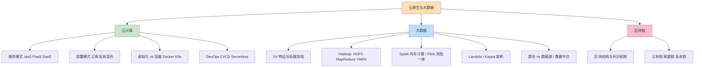
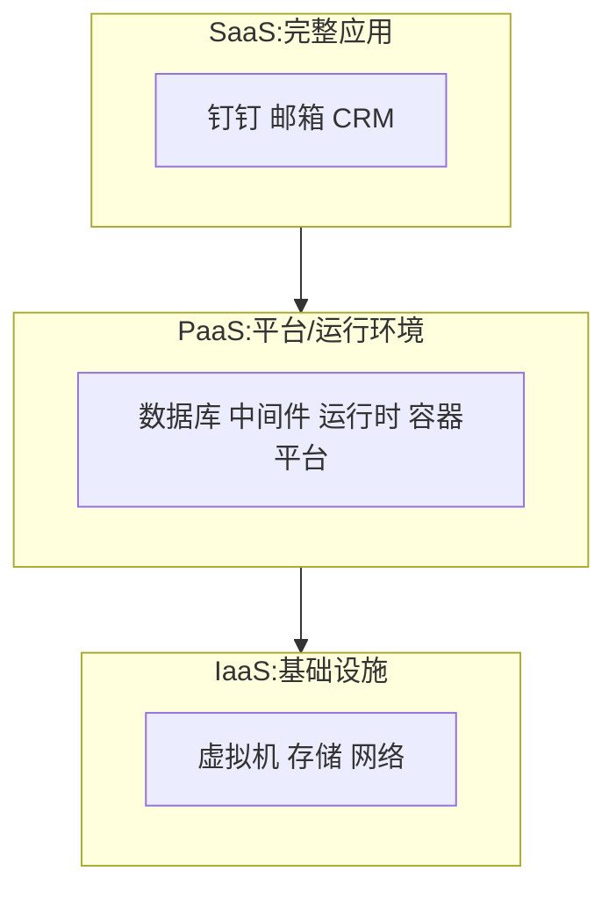
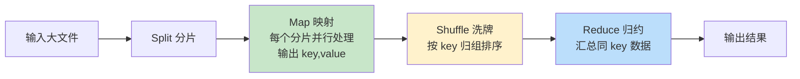
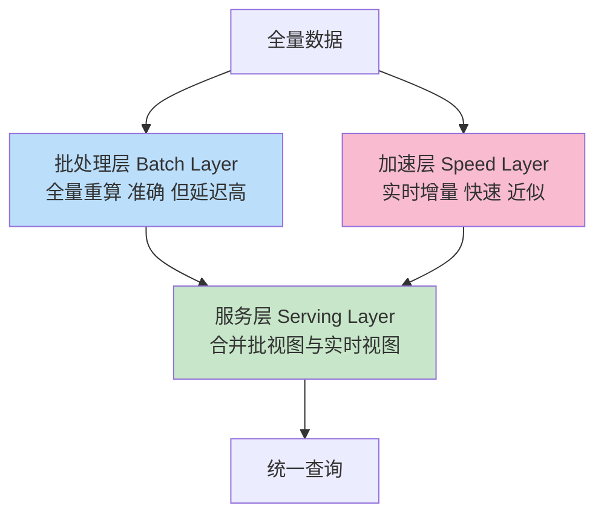

> **摘要**：
> 这一章是机考时代的"新贵"：上半场云计算（IaaS/PaaS/SaaS、虚拟化 vs 容器、K8s、DevOps、Serverless），下半场大数据（5V、Hadoop/Spark/Flink、Lambda 架构、数据湖）外加区块链。上午题 3~5 分且逐年加码（服务模式判断、容器、MapReduce、共识机制都是常客）；案例题开始出现"云原生改造/大数据平台选型"；论文新趋势主题（微服务容器化改造、大数据架构）要提前攒素材。建议投入 8~10 小时，服务模式分层和 Lambda 架构图是本章两大必拿分点。

## 🗺️ 知识地图

## 📖 掰碎讲解

### 14.1 云计算服务模式：IaaS / PaaS / SaaS（判断题必考）

**是什么**：按"租多少"分三层：
- **IaaS（基础设施即服务）**：租虚拟机、存储、网络——给毛坯房；
- **PaaS（平台即服务）**：租操作系统之上的运行环境（数据库、中间件、容器平台）——给精装房，只带行李入住；
- **SaaS（软件即服务）**：租完整应用，打开就用——拎包入住的酒店。

**责任分界（帮你秒判）**：从下往上，云商管得越多。IaaS 你要装系统管运行时；PaaS 你只管代码和数据；SaaS 你只管用。

| 场景 | 判断 |
|---|---|
| 租云服务器 ECS、云硬盘 | IaaS |
| 直接用云数据库 RDS、函数计算、容器托管 | PaaS |
| 网页版办公套件、在线会议、CRM | SaaS |

**大白话**：IaaS=租房（水电自己开），PaaS=精装公寓（家具齐全），SaaS=住酒店（连早餐都有）。
**怎么考**：上午必考级别的判断题，给产品/场景选模式；易错点：**云数据库是 PaaS 不是 IaaS**；"用户无需管理底层基础设施"的表述往往指向 PaaS/SaaS。

### 14.2 部署模式

**是什么**：**公有云**（云商运营，按量付费）、**私有云**（企业自建自用，数据可控）、**混合云**（敏感数据放私有、弹性峰谷借公有，"云爆发"）、**社区云**（同行业共建共用）。
**大白话**：公有云=共享出租车，私有云=私家车，混合云=日常开车+高峰打车，社区云=单位班车。
**怎么考**：给"金融/政务数据敏感但峰值弹性大"选混合云；安全可控是私有云关键词。

### 14.3 虚拟化 vs 容器（必考对比）

| 对比 | 虚拟机（VM） | 容器（Docker） |
|---|---|---|
| 虚拟层级 | 虚拟化**整个硬件**+完整客户操作系统 | 共享宿主 OS 内核，只打包应用+依赖 |
| 启动速度 | 分钟级 | **秒级** |
| 资源开销 | 大（GB 级、每个 VM 一套 OS） | 小（MB 级镜像） |
| 隔离性 | **强**（硬件级隔离） | 相对弱（进程级隔离） |
| 密度 | 单机几十个 | 单机成百上千 |
| 类比 | 每人一栋独栋别墅 | 一栋楼里的独立公寓（共享地基水电） |

**Docker 核心概念**：**镜像**（只读模板，**分层存储**，可叠加复用）→ **容器**（镜像的运行实例，可写层）；仓库（Registry）存放镜像。
**怎么考**："容器共享宿主机操作系统内核、启动快、开销小"是标准答案；隔离性题——**VM 隔离更强**是反向考点；镜像分层偶考。

### 14.4 Kubernetes 核心对象

| 对象 | 一句话 | 大白话 |
|---|---|---|
| **Pod** | 最小调度单元，一组共生死、共享网络/存储的容器 | 一个"合租宿舍" |
| **Service** | 一组 Pod 的**稳定访问入口**+负载均衡（Pod 会生灭，IP 漂移，Service 名字不变） | 宿舍楼的总机号码 |
| **Deployment** | 无状态应用的副本管理与**滚动升级/回滚** | 宿管阿姨：保证 5 间房始终有人住 |
| **Namespace** | 集群内资源逻辑隔离分组 | 楼栋分区：A 区/B 区 |

其他常客：ConfigMap/Secret（配置与敏感信息）、StatefulSet（有状态服务）、Ingress（七层入口）。
**怎么考**：给描述选对象——"提供稳定访问地址与负载均衡"→Service；"支持滚动更新与回滚"→Deployment；"最小部署单元"→Pod。

### 14.5 云原生四要素与 DevOps / CI/CD / Serverless

**是什么**：
- **云原生四大要素（软考常考口径）**：**容器、微服务、DevOps、持续交付**。
- **DevOps**：开发（Dev）与运维（Ops）文化+自动化工具链，让"改一次、发一次"变成日常。
- **CI/CD**：持续集成（频繁合并+自动构建测试）→ 持续交付/部署（随时可发布、自动上线）。流水线：编码→构建→**自动化测试**→制品库→部署→监控。
- **发布策略**：蓝绿发布（两套环境瞬间切换，回滚快但资源翻倍）、**灰度/金丝雀发布**（小比例流量试水逐步放量）、滚动发布（逐批替换）。
- **Serverless/FaaS**：函数即服务——**免运维、按量计费、事件驱动触发、自动弹性**；痛点=**冷启动**延迟。

**大白话**：DevOps 是"厨子兼洗碗还管收银的全流程自动化"：代码一提交，机器人自动测试、打包、上桌（上线），出了问题一键回锅。
**怎么考**："云原生四要素"填空/选择；发布策略辨析（先小流量=灰度）；Serverless 特征四连（免运维/按量/事件驱动/弹性）。

### 14.6 大数据 5V 与处理流程

**是什么**：**Volume 大体量、Variety 多样性（结构化/半结构化/非结构化）、Velocity 高速度、Value 价值密度低、Veracity 真实性**。处理流程：**采集（爬虫/日志/埋点）→ 存储（分布式 FS/NoSQL）→ 计算分析（批/流/交互式）→ 应用（可视化/报表/推荐）**。
**大白话**：5V 像描述"一座图书馆"：书多（V）、种类杂（V）、进书快（V）、每本书含金量低要淘金（V）、还常有盗版错书（V）。
**怎么考**：5V 五个词填空/匹配是送分题；"价值密度低"最易被忽略。

### 14.7 Hadoop 生态：HDFS / MapReduce / YARN

**HDFS（分布式文件系统）**：主从架构——**NameNode**（主：管元数据/目录树/数据块位置）、**DataNode**（从：存数据块，默认 3 副本容错）。大文件切块（128MB/块）分散存储。
**大白话**：NameNode 是"图书馆总索引台"（只记哪本书在哪个书架），DataNode 是"一个个书架"（真放书的）；索引台挂了全场瘫痪——所以有备用 NameNode。

**MapReduce（分而治之）**：

词频统计例：Map 把每个单词标成（词, 1），Shuffle 把相同的词聚到一起，Reduce 把 1 加总。
**YARN（资源调度）**：**ResourceManager**（全局资源老板）+ **NodeManager**（单机资源管家）+ **ApplicationMaster**（每个作业的包工头）+ Container（资源封装）。
**怎么考**：MapReduce 流程（Map→Shuffle→Reduce）与角色是案例/上午双料考点；NameNode vs DataNode 职责配对；"移动计算而非移动数据"（把计算任务发到数据所在节点）是理念考点。

### 14.8 Spark 与 Flink：快与实时

**Spark**：基于**内存**的分布式计算，核心抽象 **RDD**（弹性分布式数据集）；迭代计算中间结果放内存，不落盘。与 MapReduce 对比：MR 每一步都读写 HDFS（慢但稳），Spark 内存接力（快 10~100 倍），适合迭代算法（机器学习/图计算）。

| 对比 | MapReduce | Spark |
|---|---|---|
| 中间结果 | 落盘（磁盘 IO 大） | **内存** |
| 延迟 | 高（分钟级批） | 低（可交互式查询） |
| 模型 | 只有 Map/Reduce 两招 | 丰富算子（SQL/流/图/ML） |
| 容错 | 重跑 | RDD 血缘 lineage 重算 |

**Flink**：**流批一体**——本质是流处理引擎，把批当成"有界流"；特色：**事件时间（Event Time）+ 水位线（Watermark）处理乱序**、Checkpoint **精确一次（exactly-once）**语义。

**批处理 vs 流处理**：

| 对比 | 批处理 | 流处理 |
|---|---|---|
| 数据边界 | 有界（存量全量） | 无界（持续产生） |
| 时效 | 小时/天级 | 秒级实时 |
| 代表 | MapReduce/Spark 批 | Flink/Kafka Streams |
| 场景 | 月度报表、离线训练 | 实时风控、实时大屏 |

**怎么考**："Spark 为什么快"→**内存计算**；"乱序数据/迟到数据怎么处理"→Watermark；"流批一体"→Flink 标签。

### 14.9 Lambda 与 Kappa 架构（必考画图）

**Lambda 架构**：同一份数据走两条路——**批处理层**（全量、准确、慢：Spark/MR）、**加速层（Speed Layer）**（实时增量、快、近似：Flink/Storm），结果在**服务层**合并对外查询。

**大白话**：像记账——每晚对一次总账（批处理层，准确），白天流水随手记（加速层，快），客户问余额时"总账+今日流水"一起报（服务层合并）。
**Kappa 架构**：干脆砍掉批处理层，**一切皆流**——需要重算历史时**重放**日志（Kafka 保留全量消息）即可，一套代码两用。
**怎么考**：案例题"实时+离线报表怎么设计"→画 Lambda 三层并说明各层职责；"Lambda 缺点"→两套代码维护成本高→引出 Kappa；"重放日志解决一切"→Kappa。

### 14.10 数据仓库 vs 数据湖 vs 数据中台

| 对比 | 数据仓库 | 数据湖 |
|---|---|---|
| 存什么 | **结构化**数据为主，经清洗建模 | **全类型**原始数据（结构化/日志/音频视频）原样入湖 |
| Schema | **先建模后存**（schema-on-write） | **先存后建模**（schema-on-read） |
| 面向 | 决策分析、固定报表 | 探索分析、AI 训练、灵活取数 |
| 类比 | 精装修超市（货架分门别类） | 天然水库（什么水都先蓄着，用时再净化） |

**数据中台**：把企业的数据资产**统一汇聚、治理、加工成可复用的数据服务**，向前台业务"供数"——类似"中央厨房"，各业务线点菜即取。
**怎么考**：仓库/湖辨析（先建模 vs 先存储）；"数据中台的价值"→避免烟囱式重复建设、数据资产服务化，论文可用。

### 14.11 AI 基础设施

**是什么**：支撑 AI 的算力/数据/平台底座：**GPU 集群**（并行算力，训练主力）、高速网络与存储（喂数据不卡壳）、模型训练平台与**模型服务化**（训练好的模型封装成推理 API 对外服务）、MLOps（模型的 DevOps：版本/监控/再训练）。
**怎么考**：了解级——"训练用 GPU 并行""模型服务化=模型以 API/服务形式提供推理能力"偶考选择。

### 14.12 区块链：区块、共识与链的分类

**区块结构**：**区块头**（父区块哈希←链式相连防篡改、**Merkle 根**、时间戳、随机数 Nonce）+ **区块体**（交易列表构成 **Merkle 树**）。哈希链+共识机制=不可篡改、可追溯、去中心化。
**共识机制**：

| 机制 | 思想 | 优缺点 | 代表 |
|---|---|---|---|
| **PoW** 工作量证明 | 比算力解哈希难题（挖矿） | 安全去中心化；耗电、慢 | 比特币 |
| **PoS** 权益证明 | 比持币量/质押 | 节能；富者愈富 | 以太坊新机制 |
| **PBFT** 实用拜占庭容错 | 节点多轮投票达成多数共识 | 高效、可容 1/3 恶意节点；节点数受限 | 联盟链 |

**链的分类**：**公有链**（谁都能进，比特币）、**联盟链**（多机构共治，供应链金融）、**私有链**（单组织内部）——去中心化程度与性能大致此消彼长。

**大白话**：区块链像"全班传阅的账本，每页都盖了上一页内容的骑缝章（父哈希）"，想改一页就得重做后面所有页——共识机制决定"谁有资格写下一页"。
**怎么考**："Merkle 根/父哈希在区块头""PoW/PoS/PBFT 思想配对""联盟链适合多机构协作"高频；PBFT 的 **3f+1 容错**（容忍 f 个拜占庭节点）偶考。

## 🎬 推荐视频

| 视频 | 讲什么 | 什么时候看 |
|---|---|---|
| [希赛《系统架构设计师》精讲合集 154 集](https://www.bilibili.com/video/BV1Ba4y1u7EC) | 云计算+大数据考点主线精讲 | 第一轮精学 |
| [软考小管家全套 198 集](https://www.bilibili.com/video/BV1xepMzrEjD) | 云/大数据概念零基础讲解+真题带刷 | 概念生涩时换它 |
| [希赛 2026 版通关精讲 98 集](https://www.bilibili.com/video/BV1PrwvzFESU) | 新技术考点快讲 | 二轮冲刺 |

## ⭐ 章节重点(考前必背)

| 考点 | 关键结论 | 标注 |
|---|---|---|
| 服务模式 | IaaS 租硬件/PaaS 租平台/SaaS 租应用；云数据库=PaaS | **上午必考** |
| 虚拟化 vs 容器 | 容器共享内核、秒级启动、开销小；VM 隔离更强 | **上午高频** |
| K8s 对象 | Pod 最小单元；Service 稳定入口；Deployment 滚动更新 | 高频 |
| 云原生四要素 | 容器+微服务+DevOps+持续交付 | 高频填空 |
| 发布策略 | 蓝绿=整体切换；灰度/金丝雀=小流量试水 | 中频 |
| 5V | Volume/Variety/Velocity/Value/Veracity | 送分题 |
| HDFS | NameNode 管元数据，DataNode 存块+多副本 | 高频 |
| MapReduce | Map→Shuffle→Reduce；移动计算不移动数据 | **案例必考** |
| Spark vs MR | 内存计算 vs 磁盘落盘 | 高频 |
| Lambda 三层 | 批处理层（准）+加速层（快）+服务层（合并查询） | **案例必考画图**·论文素材 |
| 数仓 vs 数据湖 | 先建模后存 vs 先存后建模 | 高频辨析 |
| 区块链 | 区块头（父哈希/Merkle 根）；PoW/PoS/PBFT；公有/联盟/私有链 | 高频 |

## 🧠 高频考法与陷阱

> **注意**：
> 1. **错**：租云数据库属于 IaaS → **对**：云数据库/中间件/容器平台是 **PaaS**；IaaS 只给"裸"的计算存储网络。判断口诀：**毛坯=IaaS，精装=PaaS，酒店=SaaS**。
> 2. **错**：容器比虚拟机隔离性更强 → **对**：恰好相反——VM 虚拟化整套硬件+独立 OS，**隔离更强**；容器共享内核换取的是快与轻。
> 3. **错**：Lambda 架构里加速层比批处理层更准确 → **对**：**批处理层全量重算最准确**（延迟高），加速层实时但近似（可能有误差）；服务层负责合并两者。
> 4. **错**：数据湖是"更高级的数据仓库" → **对**：二者定位不同——仓库=先建模后存、面向确定性分析；湖=先存后建模、面向探索与 AI。湖不建 schema 直接写入。
> 5. **错**：PBFT 适合公链 → **对**：PBFT 需要节点互相认证、多轮投票，节点多了扛不住，适合**节点数量有限的联盟链**；公链用 PoW/PoS。
> 6. **错**：Serverless 是"没有服务器" → **对**：服务器仍在云商那里，是**开发者无感**（免运维、按量付费、事件驱动）；考点是"冷启动延迟"这一缺点。

## ✍️ 反复练习题

**第 1 题**：某企业将自研系统部署到云上：直接使用云厂商提供的数据库服务与消息队列，自己只编写和维护业务代码，不用管操作系统补丁。该模式属于（ ）。
A. IaaS　B. PaaS　C. SaaS　D. 私有云

> **示例**：
> **答案：B**。使用数据库、消息队列等**平台级能力**、只管代码与数据=PaaS。判据："不用管 OS/中间件的运维"是 PaaS 的标志；IaaS 要自己装 OS；SaaS 是"整套软件拿来用"（如钉钉），不是自研系统部署。云数据库/云 MQ 归 PaaS 是高频易错点。

**第 2 题**：关于虚拟化与容器，错误的是（ ）。
A. 容器共享宿主机操作系统内核，启动可达秒级
B. 虚拟机通过 Hypervisor 虚拟完整硬件，隔离性更强
C. 容器镜像采用分层存储，可被多个容器共享
D. 容器由于共享内核，资源开销大于虚拟机

> **示例**：
> **答案：D**。正因共享内核、不打包完整 OS，容器**资源开销远小于**虚拟机、密度更高。A/B/C 均正确表述。"快而轻但隔离弱"是容器的三个关键词，VM 则"慢而重但隔离强"。

**第 3 题**：HDFS 中负责管理文件系统命名空间（元数据）与数据块位置信息的是（ ），实际存储数据块并定期心跳汇报的是（ ）。
A. DataNode；NameNode　B. NameNode；DataNode　C. NameNode；YARN　D. ResourceManager；NodeManager

> **示例**：
> **答案：B**。NameNode=总索引台（元数据、目录树、块位置），DataNode=书架（存块、心跳汇报、副本维护）。D 的 ResourceManager/NodeManager 属于 **YARN**（资源调度），不是 HDFS 存储层——存储与调度两套角色别串。

**第 4 题**：某实时风控系统要求交易数据秒级处理，且对乱序到达的事件要按业务发生时间正确计算窗口。最合适的处理框架是（ ）。
A. MapReduce　B. Spark Core 批处理　C. Flink（事件时间+水位线）　D. HDFS

> **示例**：
> **答案：C**。秒级实时=流处理；"按事件发生时间处理乱序"=Flink 的 **Event Time + Watermark** 机制；Checkpoint 还能保证精确一次。A/B 是批处理框架（分钟级以上）；D 只是存储。关键词"乱序/迟到数据"→水位线，是 Flink 的专属考点。

**第 5 题**：某报表平台既要 T+1 的精确全量统计，又要当日的实时近似指标对外查询。合适的架构是（ ）。
A. 纯 Kappa 架构　B. Lambda 架构：批处理层+加速层+服务层　C. 纯批处理架构　D. 微内核架构

> **示例**：
> **答案：B**。"精确全量（T+1）+实时近似（当日）+合并查询"正是 Lambda 三层分工：批处理层全量重算保准确，加速层处理实时增量，服务层合并两路视图。Kappa 砍掉批层用流重放，适合愿意统一流代码的场景；D 微内核是 [12-架构风格与架构评估](12-架构风格与架构评估/) 的风格，属干扰项。

**第 6 题**：关于数据仓库与数据湖，正确的是（ ）。
A. 数据湖采用 schema-on-write，入湖前必须建模
B. 数据仓库主要存储结构化数据，面向决策分析
C. 数据湖只保存结构化数据
D. 数据中台是一种新型数据库软件

> **示例**：
> **答案：B**。数仓=结构化为主、面向 BI/决策。A 错——schema-on-write 是**数仓**特征，湖是 schema-on-read（先存后建模）；C 错——湖存**全类型**原始数据；D 错——数据中台是"汇聚治理+服务化共享"的数据资产运营体系，不是软件产品。

**第 7 题**：某供应链金融平台由 8 家银行与物流企业共建账本，仅限联盟成员读写，要求秒级确认且不能接受挖矿能耗。适合的共识机制与链类型是（ ）。
A. PoW + 公有链　B. PoS + 私有链　C. PBFT + 联盟链　D. PBFT + 公有链

> **示例**：
> **答案：C**。多机构共治=**联盟链**；节点数量有限、要求高效低耗=**PBFT**（多轮投票、可容约 1/3 恶意节点）。PoW 慢且耗电适合公链；PoS 与"银行联盟共识"场景匹配度低。记住配对：**比特币=PoW+公链；以太坊=PoS；联盟链=PBFT**。

**第 8 题**（案例风格）：某零售集团拟建统一数据平台：各门店交易日志实时上报，需做实时销售大屏；同时每月对全量历史数据做精确核算与机器学习训练；集团内多业务线重复建了多套"取数小作坊"，数据口径混乱。
(1) 设计整体架构：指出实时与离线两条链路各用什么处理方式，并画出三层结构；
(2) 存储选型：原始明细数据入什么，建模后的指标数据入什么，说明理由；
(3) 针对"口径混乱、重复建设"，说明应引入什么理念及其核心做法。

> **示例**：
> (1) 采用 **Lambda 架构**：实时链路（加速层）用 Flink 类流处理引擎消费消息队列，秒级产出近似指标供大屏；离线链路（批处理层）用 Spark/MR 对全量数据 T+1 精确核算与模型训练；结果统一写入**服务层**（合并批视图与实时视图）对外统一查询。三层：批处理层（准、慢）/加速层（快、近似）/服务层（合并供查询）。
> (2) 原始明细（日志、埋点、多格式数据）入**数据湖**——全类型、先存后建模（schema-on-read），保留原始价值供探索与训练；清洗建模后的指标入**数据仓库**——结构化、面向确定性报表与分析。
> (3) 引入**数据中台**理念：统一汇聚全域数据资产、统一数据标准与口径（治理），把公共数据加工成**可复用的数据服务**（API/指标服务）向各业务线供给，避免烟囱式重复建设。答题模板："汇聚-治理-服务化"三步+一句价值。

## 🆕 新考纲加餐：AI 与系统的融合（2025 案例实锤）

> **摘要**：
> 2025 下半年案例考「智能操作系统与轻量级内核」：**AI 给操作系统带来哪些能力、操作系统给 AI 带来哪些能力**——典型"双向赋能"题，按下面两栏框架答。

### AI 给 OS 带来的能力（让系统更聪明）
1. **智能调度**：预测任务负载，动态优化进程调度与内存分配（取代固定策略）
2. **智能功耗管理**：学习使用场景，动态调频降耗
3. **资源预取与缓存**：学习访问模式，提前加载热点数据
4. **故障预测与自愈**：异常检测提前发现隐患并自动恢复
5. **自然语言交互**：语音/意图理解成为系统新入口

### OS 给 AI 带来的支撑（让 AI 跑得动）
1. **异构算力抽象**：GPU/NPU 的驱动与统一调度
2. **内存分级管理**：支撑大参数模型加载与显存/内存分层
3. **高速数据 IO**：存储栈支撑训练数据吞吐
4. **轻量级内核适配端侧 AI**：终端算力有限，用微内核/裁剪内核腾资源跑端侧推理——这正是题干"轻量级内核"的考点
5. **安全隔离**：TEE 可信执行环境保护模型与数据

> **提示**：
> "双向关系"题永远分两栏：左栏"A 赋予 B 什么"，右栏"B 支撑 A 什么"，各 3~5 条，每条"能力名+一句机制"，最后扣回题干关键词（轻量级内核/端侧）。

## 🔗 相关章节

- 微服务前传：[11-软件架构设计](11-软件架构设计/) · 运行时治理：[13-Web架构与中间件](13-Web架构与中间件/)
- 存储根基：[03-数据库系统](03-数据库系统/) · 算法视角：[04-数据结构与算法](04-数据结构与算法/)
- 风格理论：[12-架构风格与架构评估](12-架构风格与架构评估/)（Lambda 中的分层思想）
- 论文新趋势素材：[架构-论文攻略](../架构-论文攻略/) · [架构-真题战略](../架构-真题战略/) · [qicoder真题索引](../../99-真题资源/qicoder真题索引/)
