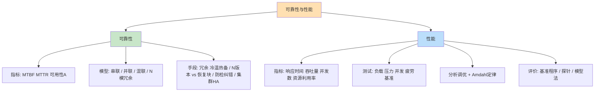
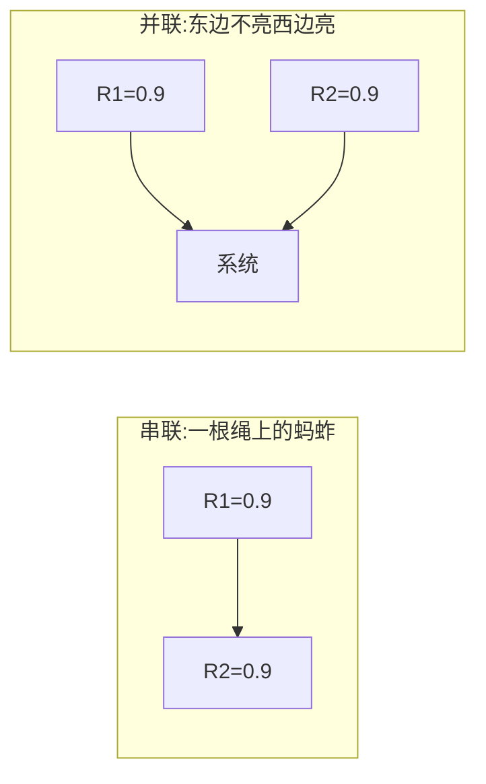
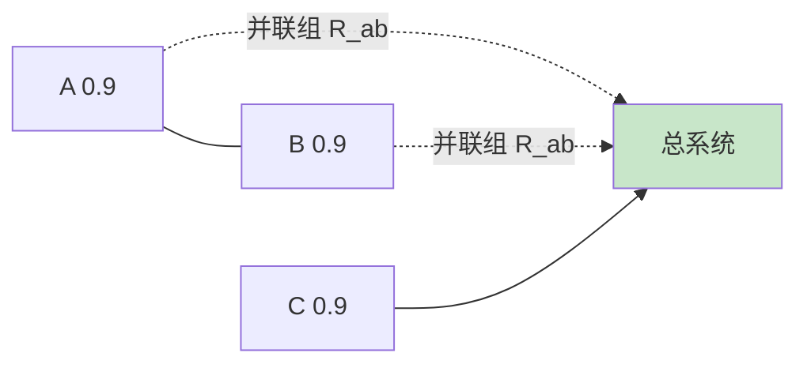

> **摘要**：
> 全章就干两件事：**算可靠性**（MTBF/可用性、串联并联混联）和**看性能**（指标、测试类型、Amdahl 定律、评价方法）。这是全考试"最像数学题"的一章——上午题稳定 2~4 分且题型高度模板化（串并联计算几乎年年出现，只是换皮），案例题常与 [16-嵌入式与实时系统架构](16-嵌入式与实时系统架构/) 或 [12-架构风格与架构评估](12-架构风格与架构评估/) 的可用性战术联动。公式不多但必须练熟"三步套路"。建议投入 6~8 小时，性价比极高：练 10 道题基本能锁定这 3 分。

## 🗺️ 知识地图

## 📖 掰碎讲解

### 15.1 可靠性与可用性指标（计算必考）

**是什么**：
- **可靠性**：系统在规定条件下、规定时间内**完成规定功能**的概率（0~1 之间）。
- **MTBF**（平均无故障时间）：两次故障之间的平均正常运行时间——"多长时间坏一次"。
- **MTTR**（平均修复时间）：从故障到恢复的平均时间——"坏多久能修好"。
- **可用性**：A = **MTBF / (MTBF + MTTR) × 100%**——"想用时它在的比例"。

**必会换算**：可用性 99.9%（三个 9）意味着一年停机多少？一年总时长 ≈ 365×24 = 8760 小时，停机 = 8760 × 0.001 ≈ **8.76 小时**。四个 9（99.99%）≈ 0.876 小时 ≈ 53 分钟。

| 等级 | 可用性 | 年停机时长 |
|---|---|---|
| 两个 9 | 99% | ≈ 87.6 小时 |
| 三个 9 | 99.9% | ≈ 8.76 小时 |
| 四个 9 | 99.99% | ≈ 52.6 分钟 |
| 五个 9 | 99.999% | ≈ 5.3 分钟 |

**大白话**：可用性像外卖店"营业率"：MTBF 是"平均撑几天才歇业"，MTTR 是"歇业后多久重新开张"。想让营业率高，要么少歇业（提高 MTBF），要么歇了快速开张（降低 MTTR）——**冗余和心跳提高 MTBF，备份切换降低 MTTR**，正好对应 [12-架构风格与架构评估](12-架构风格与架构评估/) 的可用性战术。
**怎么考**：给 MTBF/MTTR 求可用性；给可用性求年停机时长；给"系统连续运行 1000 小时出错 4 次"类描述反推指标。都是套公式，无脑但必须熟。

### 15.2 串联与并联系统（核心公式）

**是什么**：
- **串联**：所有部件都必须正常，系统才正常 → **R = R₁ × R₂ × … × Rₙ**（越串越不可靠）。
- **并联**：任一部件正常，系统就正常 → **R = 1 − (1−R₁)(1−R₂)…(1−Rₙ)**（越并越可靠，"1 减全都坏"）。

- 串联两个 0.9：R = 0.9 × 0.9 = **0.81**（更差了）。
- 并联两个 0.9：R = 1 − 0.1 × 0.1 = **0.99**（更好了）。

**大白话**：串联是"一节车厢脱轨全列车完蛋"；并联是"三条路回家，堵一条走另一条"。想可靠：**关键部件并联冗余，非必要环节少串联**。
**怎么考**：直接套公式送分；易错点是**部件不可靠度 (1−R) 与可靠度别乘反**。

### 15.3 混联系统：三步拆解套路（案例/上午套路题演示）

**套路**：**从里往外拆**——先算纯串联块、再算纯并联块，把每块折算成一个等效部件，重复直到只剩一个数。

**演示例题**：系统由"两个并联的 0.9（部件 A、B）"与"一个 0.9（部件 C）"串联而成，求系统可靠性。

> **第一步**：算并联组 R_AB = 1 − (1−0.9)(1−0.9) = 1 − 0.01 = 0.99。
> **第二步**：并联组与 C 串联：R = R_AB × R_C = 0.99 × 0.9 = **0.891**。
> **答**：系统可靠性 0.891。全程就两步，考题无非是多拆一两层。

再演示一个"先串后并"：两条并联链路，每条链路是两个 0.9 串联（R = 0.81），则系统 R = 1 − (1−0.81)(1−0.81) = 1 − 0.0361 = **0.9639**。
**怎么考**：图形化混联题，按"从里往外拆、串乘并补"八字诀做，答案必是四则运算，考场用草稿纸一分钟搞定。

### 15.4 N 模冗余与表决系统

**是什么**：N 个相同模块**同时**运算，由**表决器**取多数结果（如 3 取 2）。可掩蔽单模块的瞬时故障；前提是各模块**独立故障**。表决器本身是关键单点（表决器坏则全坏）。
**大白话**：三个评委独立打分，取多数意见——一个评委昏了头不影响结果，但"收分员"（表决器）必须是铁人。
**怎么考**："N 模冗余通过**表决**实现故障掩蔽""表决器是单点"偶考；与软件容错的 N 版本程序设计区分（见下节）。

### 15.5 冗余技术：冷备 / 温备 / 热备

| 方式 | 备机状态 | 切换速度 | 资源开销 |
|---|---|---|---|
| **冷备** | 关机/不运行，故障后人工或脚本拉起 | 最慢（分钟级） | 最低 |
| **温备** | 开机预热、应用就绪但**不同步数据** | 中等 | 中 |
| **热备** | 与主机**同步运行**，实时同步数据 | 最快（秒级自动切换） | 最高 |

**大白话**：冷备=后备胎躺在后备箱（要用才装）；温备=车打着火停在旁边；热备=并排两辆车同时跑，随时无缝换座。
**怎么考**：状态描述配对（"实时同步、自动切换"→热备）；热备成本最高是常识判断。

### 15.6 软件容错：N 版本程序设计 vs 恢复块（必考对比）

| 对比 | N 版本程序设计 | 恢复块方法 |
|---|---|---|
| 思想 | N 个**独立设计**的版本**同时**运行，**表决器**取多数（前向恢复） | 1 个主版本 + 多个备份版本，**验收测试**通过即用；不通过则换下一版本重试（**后向恢复**） |
| 多样性来源 | 不同团队/算法/语言设计（设计多样性） | 主备版本依次尝试 |
| 实时性 | 好（同时运行，结果即时表决） | 差（失败要回退重试，耗时不可控） |
| 开销 | N 倍资源 + 表决器 | 验收测试程序 + 备份切换 |
| 类比 | 三个裁缝同时做衣服，穿多数人尺寸对的 | 先穿主款，不合身换备款再试 |

**是什么（补充）**：前向恢复=出错后继续往前算出可接受结果；后向恢复=回滚到检查点重来。
**怎么考**：**"表决 vs 验收测试""同时运行 vs 依次替换""前向 vs 后向恢复"**三组关键词配对是固定考法；实时系统偏爱 N 版本（不回退）。

### 15.7 防错、检错、纠错

- **防错**：事前避免引入错误——编码规范、类型检查、评审。
- **检错**：发现错误并报告——奇偶校验、CRC、日志告警。
- **纠错**：自动定位并改正——**海明码**（ECC 内存）、自动重传。
**大白话**：防错=出门前查钥匙（别丢），检错=门上装感应器（丢了报警），纠错=备用钥匙自动弹出（自己解决）。
**怎么考**：给手段归类（"CRC 校验"→检错；"ECC 内存自动修复"→纠错）；联动 [02-操作系统与嵌入式基础](02-操作系统与嵌入式基础/) 的校验码知识。

### 15.8 集群高可用：HA 双机与 VRRP

**是什么**：**HA（High Availability）集群**通过冗余节点+故障检测+自动切换保障服务。双机热备是经典形态。**VRRP（虚拟路由冗余协议）**：多台路由器组成一个"虚拟路由器"（虚拟 IP 对外），按**优先级**选出 **Master** 转发流量，其余为 Backup；Master 挂了，Backup 秒接盘——对外完全无感。
**大白话**：VRRP 像"前台总机号码不变，接电话的人可以换"——来电者（用户）根本不知道接线员换了班。
**怎么考**："虚拟 IP + 优先级选举 + 秒级切换"是 VRRP 关键词；与负载均衡区别——HA 是"主备等位"，负载均衡是"全员同时接客"。

### 15.9 性能指标

| 指标 | 含义 | 易考点 |
|---|---|---|
| **响应时间** | 用户发出请求到收到响应的总时长 | = 传输 + 处理 + 排队等待；"用户体验的最直接体现" |
| **吞吐量** | 单位时间处理的事务/请求数（TPS/QPS） | 与并发数、响应时间联动 |
| **并发用户数** | 同一时刻与系统交互的用户数 | **在线用户数 ≠ 并发用户数 ≠ 注册用户数** |
| **资源利用率** | CPU/内存/IO/网络的占用比例 | 常用来找瓶颈 |

**大白话**：餐馆类比：响应时间=从点菜到上菜，吞吐量=一天翻多少桌，并发用户=同时在店里吃饭的人数（办过会员卡的不算，路过看一眼菜单的也不算）。
**怎么考**："系统同时在线 1 万人，同一时刻提交操作约 500 人，并发用户数按 500 算"这类辨析题。

### 15.10 性能测试五类型

| 类型 | 目的 | 做法关键词 |
|---|---|---|
| **负载测试** | 找性能拐点/最大可接受负载 | **逐步加压**，观察响应时间拐点 |
| **压力测试** | 找极限与崩溃后的表现 | **超负荷**施压，看系统何时挂、挂了怎么恢复 |
| **并发测试** | 检查并发冲突（死锁、数据错乱） | 多用户**同一时刻**做同一操作 |
| **疲劳强度测试** | 验证长期稳定性（内存泄漏） | **长时间（如 7×24h）**持续运行 |
| **基准测试** | 建立可对比的性能基线 | **单用户/标准场景**，作为后续对比参照 |

**大白话**：负载测试=慢慢加客看哪会挤爆；压力测试=故意塞爆看经理怎么救场；并发测试=一百人同时抢最后一个位子会不会出错；疲劳测试=连开 24 小时看员工会不会累趴；基准测试=先量一次"标准身高"，以后长没长有参照。
**怎么考**："逐步加压找拐点"→负载；"超负荷破坏性"→压力；"长时间运行查内存泄漏"→疲劳强度。这三组是上午固定考法。

### 15.11 性能分析与调优

**是什么**：定位瓶颈的常见顺序：**先看监控（CPU/内存/IO/网络/GC）→ 分层排查（前端/网络/应用/数据库）→ 针对性优化**。常见手段：加缓存（见 [13-Web架构与中间件](13-Web架构与中间件/)）、SQL 优化与索引、连接池、异步化与消息队列、水平扩容、读写分离。
**怎么考**：案例题"性能不达标怎么改"——按"定位→手段→预期效果"三段式答；与架构战术（性能=增加资源/缓存/并发/调度）联动。

### 15.12 Amdahl 定律（计算必考）

**是什么**：系统中可并行部分比例为 p，处理器数为 n，则加速比：

**S = 1 / ((1 − p) + p / n)**

**演示例题**：某任务 90% 可并行，4 核处理器：
- S = 1 / (0.1 + 0.9/4) = 1 / (0.1 + 0.225) = 1 / 0.325 ≈ **3.08 倍**。

**启示**：串行部分 (1−p) 是天花板——p=90% 时即使 n→∞，S 上限 = 1/0.1 = 10 倍；**加速比永远小于 1/(1−p)**。
**大白话**：做一顿饭 10% 的活是"一个人守着锅焖饭"（串行），你雇 100 个厨师也快不了太多——瓶颈永远卡在串行的那部分。
**怎么考**：直接代入公式计算（给 p 和 n 求 S）；反向题"要加速 5 倍，4 核下 p 至少多少"（略少）；理解题"增加处理器数量存在收益上限，原因是存在串行分量"。

### 15.13 性能评价方法

| 方法 | 思想 | 类比 |
|---|---|---|
| **基准程序法（Benchmark）** | 用标准测试程序（如 SPEC）在真机上跑分对比 | 统一卷子统考排名 |
| **探针法** | 在代码/硬件中插入**监测探针**采集运行数据 | 给机器装行车记录仪 |
| **模型法** | 用数学模型（**排队论** M/M/1 等）建模预测 | 用沙盘推演交通流量 |

**怎么考**："最直接真实"→基准程序；"排队论/建立数学模型"→模型法；"插入监测代码"→探针法。

## 🎬 推荐视频

| 视频 | 讲什么 | 什么时候看 |
|---|---|---|
| [希赛《系统架构设计师》精讲合集 154 集](https://www.bilibili.com/video/BV1Ba4y1u7EC) | 可靠性公式+性能指标考点精讲 | 第一轮，跟着把例题算一遍 |
| [芝士架构凯恩（可靠性计算专题）](https://www.bilibili.com/video/BV1XM8izmE5g) | 串并联混联+Amdahl 真题速算技巧 | 学完公式立即刷题巩固 |
| [希赛 2026 版通关精讲 98 集](https://www.bilibili.com/video/BV1PrwzFESU) | 考前公式与概念快串 | 考前一周过一遍 |

## ⭐ 章节重点(考前必背)

| 考点 | 关键结论 | 标注 |
|---|---|---|
| 可用性公式 | A = MTBF/(MTBF+MTTR)；99.9% ≈ 年停机 8.76h | **必考计算** |
| 串联公式 | R = R1×R2×…（越串越差） | **必考计算** |
| 并联公式 | R = 1−(1−R1)(1−R2)…（越并越好） | **必考计算** |
| 混联套路 | 从里往外拆：先串后并，等效折算 | **案例必考** |
| 冷温热备 | 同步运行秒切=热备；不运行=冷备 | 高频配对 |
| N 版本 vs 恢复块 | 表决/同时/前向 vs 验收测试/依次/后向 | **必考对比** |
| 防检纠错 | 规范评审 / CRC 检错 / 海明纠错 | 中频 |
| VRRP | 虚拟 IP+优先级选举 Master/Backup | 中频 |
| 测试五型 | 负载=逐步加压找拐点；压力=超负荷；疲劳=长时间；并发=同时操作；基准=基线 | **上午必考** |
| Amdahl | S = 1/((1−p)+p/n)，串行分量是天花板 | **必考计算** |
| 评价三法 | 基准程序/探针/模型（排队论） | 中频 |

## 🧠 高频考法与陷阱

> **注意**：
> 1. **错**：可用性 = MTBF/MTTR → **对**：A = **MTBF/(MTBF+MTTR)**，分母是"正常运行+修复"的全周期。可用性越高 → 要求 MTBF 大、MTTR 小。
> 2. **错**：并联系统 R = R1×R2 → **对**：那是串联！并联是 **1−(1−R1)(1−R2)**——先算"全坏的概率"再用 1 减。混联题 90% 的错都错在乘反。
> 3. **错**：N 版本程序设计和恢复块都靠"表决" → **对**：N 版本靠**表决器取多数**（同时运行）；恢复块靠**验收测试逐个替换**（主备依次）。实时系统选 N 版本，因为恢复块的回退重试耗时不定。
> 4. **错**：并发用户数就是注册用户数/在线用户数 → **对**：并发=**同一时刻正在交互**的用户数，注册的、挂机在线的都不算。
> 5. **错**：加处理器就能无限提速 → **对**：Amdahl 定律——串行分量 (1−p) 决定加速上限，加速比上限 = 1/(1−p)，与 n 无关。
> 6. **错**：压力测试就是负载测试换名字 → **对**：负载=**逐步加压找拐点**（合理范围内）；压力=**超负荷**把系统压垮，看极限与恢复能力。

## ✍️ 反复练习题

**第 1 题**：某系统 MTBF 为 990 小时，MTTR 为 10 小时，其可用性约为（ ）。
A. 90%　B. 99%　C. 99.9%　D. 99.99%

> **示例**：
> **答案：B**。A = MTBF/(MTBF+MTTR) = 990/(990+10) = 990/1000 = **99%**。这是公式直接代入，考试常给"运行 495 小时、故障修复 5 小时"等变体数字，方法不变。注意分母是两者之和，别只除 MTTR。

**第 2 题**：某系统要求可用性达到 99.99%（四个 9），一年（按 365 天计）允许的最长停机时间约为（ ）。
A. 8.8 小时　B. 5.3 分钟　C. 53 分钟　D. 88 分钟

> **示例**：
> **答案：C**。年总时长 = 365×24 = 8760 小时；允许停机 = 8760 × (1−0.9999) = 8760 × 0.0001 = 0.876 小时 ≈ **52.6 分钟**。背下对照表：三个 9≈8.76 小时、四个 9≈53 分钟、五个 9≈5.3 分钟，此题即送分。

**第 3 题**：某子系统由部件 X（可靠性 0.95）与"两个可靠性均为 0.9 的并联部件 Y1、Y2"串联组成。系统可靠性为（ ）。
A. 0.855　B. 0.9405　C. 0.86775　D. 0.9

> **示例**：
> **答案：C**。三步走：① 并联组 R_Y = 1−(1−0.9)×(1−0.9) = 1−0.01 = 0.99；② 串联：R = 0.95 × 0.99 = 0.9405；③ 题目如再串一个 0.92，就继续乘。本题答案 0.95×0.99 = **0.9405**……注意 B 是"少乘一步"的陷阱选项——若题干是"X 与 Y 并联组串联"，正确即 0.9405；请以题干组合为准，牢记"先算并联块，再逐个乘串联"。**（考场心法：先把图拆到只剩串联线，再连乘。）**

**第 4 题**：两条并联链路，每条由两个可靠性 0.9 的部件串联。系统可靠性为（ ）。
A. 0.81　B. 0.9639　C. 0.9　D. 0.99

> **示例**：
> **答案：B**。先串：每条链 R = 0.9×0.9 = 0.81；后并：R = 1−(1−0.81)×(1−0.81) = 1−0.19×0.19 = 1−0.0361 = **0.9639**。与第 3 题合起来正好覆盖"先并后串"与"先串后并"两种混联拓扑，两条题形都动手算一遍。

**第 5 题**：关于软件容错技术，正确的是（ ）。
A. 恢复块方法采用表决器对多版本结果取多数
B. N 版本程序设计要求各版本由不同团队独立设计，同时运行、表决输出
C. 恢复块方法属于前向恢复，实时性好
D. N 版本程序设计通过验收测试决定采用哪个版本

> **示例**：
> **答案：B**。N 版本=独立设计（设计多样性）+同时运行+表决器多数决（前向恢复），实时性好。恢复块=主版本+验收测试，不合格则回退调用备份版本（**后向恢复**）。A 把两者特征对调；C 错——恢复块是后向恢复且实时性差（回退耗时不可控）；D 的"验收测试"属于恢复块。

**第 6 题**：为验证系统在长时间运行下是否存在内存泄漏，应进行（ ）。
A. 负载测试　B. 压力测试　C. 疲劳强度测试　D. 基准测试

> **示例**：
> **答案：C**。"长时间持续运行（如 24 小时/7 天）验证稳定性与资源泄漏"=疲劳强度测试。A 逐步加压找拐点；B 超负荷看极限；D 建立标准基线。"内存泄漏/连续运行 N 天"是疲劳测试的标志词。

**第 7 题**：某程序 75% 的代码可并行化，在 4 核处理器上的加速比约为（ ）。
A. 2.28　B. 3.08　C. 4　D. 1.75

> **示例**：
> **答案：A**。S = 1/((1−p)+p/n) = 1/(0.25+0.75/4) = 1/(0.25+0.1875) = 1/0.4375 ≈ **2.28**。对照本章正文例题（p=0.9、n=4 时 S≈3.08）体会：并行占比 p 越低，加速越吃亏。再记一条结论：p=75% 时加速上限=1/0.25=4 倍（n→∞），所以本题 2.28 合理地小于 4——选项 C"等于核数"是永恒的陷阱。

**第 8 题**（案例风格）：某支付平台当前可用性数据：全年发生故障 12 次，每次平均修复 30 分钟；全年总时长 8760 小时。
(1) 计算该系统年累计停机时长与可用性（保留两位小数）；
(2) 架构师提出改造方案：核心服务双机热备（热备）、数据库主从+自动切换、关键接口增加心跳检测与自动故障转移。指出每个手段分别属于哪种容错/冗余技术，并说明主要提升的是 MTBF 还是 MTTR；
(3) 若要求可用性提升到 99.9%，请估算全年允许停机时长，并给出两条降低 MTTR 的具体措施。

> **示例**：
> (1) 年停机 = 12 × 30min = 360 分钟 = 6 小时；可用性 = (8760−6)/8760 ≈ **99.93%**。（也可用 A=MTBF/(MTBF+MTTR)：MTBF=8754/12≈729.5h，MTTR=0.5h，A≈729.5/730≈99.93%，两法一致。）
> (2) 双机热备=**热备冗余**（主机故障备机秒级接管）；主从+自动切换=**数据冗余/集群 HA**（VRRP 类故障转移思想）；心跳检测=**ping/echo 可用性战术**（异常检测）。主要作用：心跳与自动切换让"发现故障+接管"更快 → 显著降低 **MTTR**；双机热备/主从同时减少"单点故障导致的完全不可用" → 也提高 MTBF。答题要点：**冗余提 MTBF，自动切换提 MTTR**，两者相乘出可用性。
> (3) 99.9% 允许停机 = 8760 × 0.001 = **8.76 小时**。降低 MTTR 的措施（答两条以上）：①完善监控告警+故障自动检测（心跳/ping-echo），把"发现故障"时间压到秒级；②预案化自动切换与自动化运维脚本（一键回滚/一键切流）；③灰度发布降低故障影响面。与 [12-架构风格与架构评估](12-架构风格与架构评估/) 的可用性战术（ping/echo、心跳、冗余、回滚）呼应，案例答题时术语要"对表"。

## 🔗 相关章节

- 战术来源：[12-架构风格与架构评估](12-架构风格与架构评估/)（可用性战术清单）
- 嵌入式联动：[16-嵌入式与实时系统架构](16-嵌入式与实时系统架构/)（看门狗/实时系统可靠性分配）
- 分布式容错：[13-Web架构与中间件](13-Web架构与中间件/)（集群/熔断降级）
- 硬件底子：[01-计算机系统基础](01-计算机系统基础/) · [02-操作系统与嵌入式基础](02-操作系统与嵌入式基础/)（校验码）
- 真题速练：[qicoder真题索引](../../99-真题资源/qicoder真题索引/) · [架构-案例分析攻略](../架构-案例分析攻略/)
