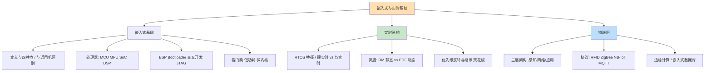
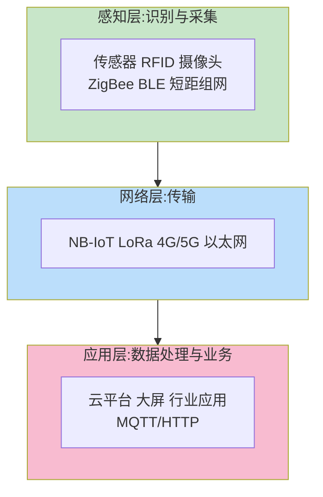

> **摘要**：
> 这一章从"冰箱里的电脑"讲到"火星车的大脑"：嵌入式系统特点、处理器与 OS 选型、实时调度算法（RM/EDF）、优先级反转、BSP 与交叉开发、看门狗，再延伸到物联网三层架构与边缘计算。上午题稳定 2~4 分（RTOS 特征、RM/EDF 辨析、优先级反转、IoT 协议配对都是熟面孔）；案例题轮换出场（低频但一旦考就是"实时系统改造+可靠性分配"综合题）；论文偶有《论嵌入式系统/实时系统设计》。建议投入 6~8 小时，概念多为"配对题"，背熟对照表就能拿分。

## 🗺️ 知识地图

## 📖 掰碎讲解

### 16.1 嵌入式系统定义与特点

**是什么**：嵌入到对象体系中、为实现特定功能而设计的专用计算机系统。四大特点：**专用性**（为特定应用定制）、**资源受限**（CPU/内存/功耗预算紧）、**实时性**（常要求限时响应）、**高可靠性**（很多场景坏了要出人命）+ 软硬件一体化。
**大白话**：通用电脑是"什么都能干的瑞士军刀"，嵌入式系统是"只会开瓶盖但永不断柄的开瓶器"——专一、省钱、反应快、不能坏。
**怎么考**："嵌入式系统四特点"多选/填空高频；"专用性"是与其他系统最大的区别。

### 16.2 与通用计算机的区别

| 对比 | 嵌入式系统 | 通用计算机 |
|---|---|---|
| 目标 | 特定功能专用 | 通用计算 |
| 资源 | 受限（小内存/低功耗） | 充裕 |
| 实时性 | 通常要求 | 一般不要求 |
| 交互 | 简单或无人交互 | 键鼠屏丰富交互 |
| 形态 | 软硬件一体，常隐藏于设备中 | 独立设备 |
| 系统升级 | 固件烧写、生命周期长 | 频繁更新 |

**怎么考**：常识级配对题，与 16.3 一起构成"送分三连"。

### 16.3 嵌入式处理器分类

| 类型 | 全称/内涵 | 特征 | 典型应用 |
|---|---|---|---|
| **MCU** 微控制器（单片机） | CPU+RAM+ROM+外设**集成在一颗芯片** | 便宜、低功耗、算力弱 | 家电、玩具、传感器节点 |
| **MPU** 微处理器 | 由通用 CPU 演化，**带 MMU**，跑完整 OS | 算力强、可跑 Linux | 路由器、工控机、手机（基带时代） |
| **SoC** 片上系统 | 整个系统（CPU+GPU+基带+NPU…）集成一块芯片 | 高度集成、性能功耗比优 | 手机芯片（骁龙/天玑） |
| **DSP** 数字信号处理器 | 专为**乘加运算**优化 | 流水线专攻信号处理 | 音视频编解码、雷达、滤波 |

**交叉开发**：**宿主机**（PC，编译调试）→ **目标机**（嵌入式板，运行），因为目标机资源跑不动编译器——"在厨房备好菜（编译），端到餐桌上吃（烧写运行）"。
**怎么考**："带 MMU 可运行 Linux"→MPU；"乘加运算数字信号"→DSP；"单片机"→MCU；"宿主机/目标机"术语配对。

### 16.4 嵌入式 OS 与 RTOS 特征

**是什么**：**RTOS（实时操作系统）** 的核心特征：**实时性（在 deadline 前完成）、确定性（同样输入同样耗时，最坏时间可预期）、可抢占调度、中断响应快、紧凑高效**。与"分时 OS 求平均吞吐"不同，RTOS 追求"**最坏情况下也不超时**"。
**大白话**：普通 OS 像流水线餐厅（平均快就行，偶尔慢一单没人管）；RTOS 像急救中心——**每一单都必须在规定时间内处理完**，最差的那单才是考核标准。

| OS | 特点 | 典型应用 |
|---|---|---|
| **VxWorks** | 商业硬实时标杆，微内核结构，可靠性极高 | 航空航天、军工（火星车用过） |
| **μC/OS-II** | 源码公开、结构小巧、**可剥夺型内核**、教学常用 | 教学、中小型设备 |
| **嵌入式 Linux** | 生态强大、开源免费；标准内核**非硬实时**（需打实时补丁） | 路由器、智能电视、工控 |
| **Android** | 基于 Linux 内核，面向消费电子，生态最大 | 手机、车机、智能终端 |

**怎么考**："RTOS 强调确定性与最坏响应时间"是标准答案句；"μC/OS-II 可剥夺内核""VxWorks 硬实时强""嵌入式 Linux 天生软实时"配对高频。

### 16.5 硬实时 vs 软实时

**是什么**：**硬实时**——错过截止期=灾难性后果（安全气囊晚开 0.1 秒、飞控指令迟到）；**软实时**——偶尔超时只是质量下降（视频偶尔卡一帧、页面慢一秒）。
**大白话**：硬实时是"降落伞必须在落地前打开"；软实时是"外卖尽量 30 分钟到，晚 5 分钟也能吃"。
**怎么考**：给场景判硬软（飞控/刹车/安全气囊=硬；视频流/网页=软）。

### 16.6 实时调度算法：RM vs EDF（必考辨析）

**是什么**：
- **RM（Rate Monotonic，速率单调）**：**静态优先级**——任务**周期越短，优先级越高**，运行前定死不变。理论可调度利用率上界 n(2^(1/n)−1)，双任务约 82.8%，随 n 增大趋近 ln2≈69.3%。
- **EDF（Earliest Deadline First，最早截止期优先）**：**动态优先级**——**谁的截止期最近谁先跑**，每次调度都可能重排。理论利用率可达 **100%**。

| 对比 | RM | EDF |
|---|---|---|
| 优先级依据 | 周期（周期短→优先级高） | 截止期（越近越高） |
| 优先级性质 | **静态**（运行前固定） | **动态**（随截止期变化） |
| 理论利用率 | < 100%（上界约 69%~83%） | 可达 **100%** |
| 开销/实现 | 简单、可预测 | 调度开销大、过载时行为恶化 |
| 类比 | 按班次固定排班表 | 谁家急事先办谁家 |

**大白话**：RM 像"地铁按固定时刻表发车"（可预测但闲时也发、忙时不够）；EDF 像"急诊分诊"（最危急的先看，效率最高但每来一个新病人要重新排）。
**怎么考**：**"静态 vs 动态""周期 vs 截止期"两组词是判定标准**；"EDF 理论上可达 100% 利用率"是高频结论；案例题选调度算法要写理由（任务周期固定且要可预测→RM；利用率要求高、可接受动态开销→EDF）。

### 16.7 优先级反转与解决方案（必考概念）

**是什么**：低优先级任务 L 持有共享资源（如互斥锁），高优先级任务 H 等待该资源被阻塞；此时**中优先级任务 M** 抢占 L 长时间运行 → 结果 H 反而被"低不拉高不就"地卡住——优先级反转。
**经典案例**：1997 年火星探路者号（Mars Pathfinder）在火星上反复重启，就是优先级反转导致看门狗复位。
**解法**：
- **优先级继承**：L 持锁期间，临时**继承**等待它的 H 的优先级（ L 升到与 H 一样高，跑完临界区立刻还）。
- **优先级天花板**：给每个资源设定一个"天花板优先级"（=可能使用它的最高优先级），任务一旦**获得该资源**就立刻把优先级提到天花板。

**大白话**：幼儿园滑梯（资源）被小班同学（L）占着，大班同学（H）在排队；这时中班同学（M）插队到小班前面玩个没完——大班被中班压住了。**优先级继承**=小班同学"借"大班的特权快点滑完；**优先级天花板**=规则直接规定"谁拿滑梯谁自动升级到全场最高待遇"。
**怎么考**：概念辨析+解法配对，"继承=临时借 H 的优先级；天花板=提前设好资源上限优先级、获得即提升"是标准句；区分点：天花板**防患于未然**（能避免更多反转与死锁），继承**就事论事**。

### 16.8 BSP、Bootloader 与硬件抽象

**是什么**：
- **BSP（板级支持包）**：介于硬件与 OS 之间的一层——上电硬件初始化、驱动加载、OS 引导支持；类似 PC 上的 BIOS+驱动合集，随板子定制。
- **HAL（硬件抽象层）**：统一硬件接口，让上层软件不感知芯片差异。
- **Bootloader**：上电后第一段跑的程序——初始化硬件 → 建立内存映射 → **加载 OS 内核**（U-Boot 最流行，两阶段：stage1 汇编初始化 CPU/内存，stage2 加载内核参数）。
**大白话**：BSP 是"新房装修队"（水电布好、家具装好，OS 这个住户才能拎包入住）；Bootloader 是"装修队队长"，开门、通电、然后把 OS 领进门。
**怎么考**："BSP 的主要功能"（硬件初始化/设备驱动/引导 OS）高频；Bootloader 与 BIOS 的角色类比偶考。

### 16.9 交叉编译、烧写与 JTAG 调试

**是什么**：**交叉编译**=在宿主机上生成目标机可执行代码；**烧写**=通过 JTAG/串口/网络把固件写入目标机 Flash；**JTAG**=边界扫描调试接口，支持**在线断点、单步、读写内存/寄存器**——嵌入式开发者的"听诊器"。
**大白话**：目标机又小又没键盘，就像"给手表装程序"——只能在电脑上编好（交叉编译），再通过一根数据线（JTAG）灌进去，还能隔着线"透视"手表内部运行到哪一步（在线调试）。
**怎么考**："交叉编译在宿主机进行，生成目标机代码"；"JTAG 用于在线仿真调试"配对题。

### 16.10 看门狗与低功耗设计

**是什么**：
- **看门狗（Watchdog）**：一个不断倒计时的定时器，程序必须**定期"喂狗"**（复位计数）；程序跑飞/死循环没喂 → 定时器溢出 → **系统自动复位**。是嵌入式可靠性的最后防线。
- **低功耗设计**：**DVFS 动态调频调压**（按负载降频降压）、时钟门控（不用的模块停时钟）、睡眠/休眠模式分级、外围设备按需上下电、编译级优化。
**大白话**：看门狗像"代驾司机盯着你"：每隔几分钟你不喊一声"我还清醒"（喂狗），他就接管方向盘（强制重启）。低功耗像手机省电模式：干重活时全速，闲时打盹。
**怎么考**："看门狗定时器溢出导致系统复位，防止程序跑飞"是原文级考点；DVFS 名词配对。

### 16.11 微内核架构在嵌入式中的应用

**是什么**：内核只保留最小核心（**调度、IPC、基本内存管理**），驱动、文件系统、网络协议栈等都作为**用户态服务进程**运行，靠消息传递通信。优点：**可靠性**（服务崩溃可重启不拖垮内核）、**可裁剪可扩展**（按硬件配置裁服务）、易验证；缺点：消息传递带来性能开销、开发复杂。
**大白话**：宏内核=什么都塞进"中央厨房"（快但一着火全烧）；微内核=小前厅+各专营外卖档口（某档口倒了换个新的，前厅照常营业，只是传菜多花几步）。
**怎么考**：与 [12-架构风格与架构评估](12-架构风格与架构评估/) 的微内核风格同一考点双落地；"QNX/VxWorks 微内核思想""插件化/可裁剪"关键词。

### 16.12 物联网三层架构与协议配对（必考）

**是什么**：

| 协议/技术 | 定位 | 特征 | 场景 |
|---|---|---|---|
| **RFID** | 感知层识别技术 | 无线射频标签，非接触识读 | 门禁、仓储盘点、ETC |
| **ZigBee** | 感知/网络层短距组网 | **低功耗、低速率、Mesh 自组网** | 智能家居、传感器网络 |
| **NB-IoT** | 网络层广域蜂窝 | **广覆盖、低功耗、大连接**（蜂窝授权频段） | 智能水表、井盖、烟感 |
| **MQTT** | 应用层消息协议 | **发布/订阅**模式、轻量、基于 TCP | 设备上云的标准姿势 |
| LoRa | 网络层广域 | 非授权频段、远距离低功耗 | 农业监测 |

**大白话**：感知层是"五官"（RFID 是会喊自己名字的工牌），网络层是"神经系统"（NB-IoT 是给每只水表办的物联卡），应用层是"大脑"（MQTT 是五官向大脑汇报用的"对讲暗语"）。
**怎么考**：给场景配协议——智能水表（NB-IoT）、智能家居组网（ZigBee）、仓储电子标签（RFID）、设备上报云平台（MQTT 发布订阅）——四连配对是近年新宠。

### 16.13 边缘计算与云边协同

**是什么**：把计算和存储下沉到**靠近数据源**的边缘节点（网关、本地服务器），云端负责全局管理与模型下发。价值：**降低时延、节省回传带宽、数据本地化更安全、断网可用**。
**大白话**：云计算是"所有问题都打电话问总部"，边缘计算是"各区设服务站就地解决"——急诊不用开到总部，5 公里内搞定。
**怎么考**："边缘计算解决时延与带宽问题""云边协同分工"概念题；与摄像头/工业现场场景配对。

### 16.14 嵌入式数据库与 SQLite

**是什么**：嵌入到应用程序内部、无需独立服务器进程的轻量级数据库。**SQLite** 是代表：**文件型、零配置、无服务器、单文件库、支持 SQL 事务**，广泛用于手机、嵌入式设备。
**大白话**：普通数据库像"中央银行"（独立服务器），SQLite 像"随身账本"（程序自带，翻开就记，不用连网）。
**怎么考**："SQLite 无需服务器、以文件形式存储、零配置"概念题；与 MySQL/Oracle（C/S 架构 DB）对比偶考，联动 [03-数据库系统](03-数据库系统/)。

### 16.15 案例题套路：实时系统改造与可靠性分配

- **实时改造题**：给"老系统响应不确定/偶发超时"的描述 → 答题三步：① 指出问题（无实时调度、优先级反转、阻塞调用）；② 给方案（换 RTOS、用 RM/EDF 调度、互斥锁配优先级继承、中断服务程序精简、看门狗兜底）；③ 补验证（最坏响应时间分析、压力测试）。
- **可靠性分配题**：给整机可用性目标（如 99.9%）→ 用 [15-系统可靠性与性能](15-系统可靠性与性能/) 的串并联公式**反推各模块指标**，并配冗余手段（关键模块双机热备）。
- **物联网选型题**：给设备规模/功耗/距离约束 → 按协议配对表选通信方案并说明理由。

## 🎬 推荐视频

| 视频 | 讲什么 | 什么时候看 |
|---|---|---|
| [希赛《系统架构设计师》精讲合集 154 集](https://www.bilibili.com/video/BV1Ba4y1u7EC) | 嵌入式+RTOS+物联网考点精讲 | 第一轮精学 |
| [软考小管家全套 198 集](https://www.bilibili.com/video/BV1xepMzrEjD) | 嵌入式概念零基础讲解+真题带练 | 概念陌生时补课 |
| [希赛 2026 版通关精讲 98 集](https://www.bilibili.com/video/BV1PrwzFESU) | 考前概念快串 | 二轮冲刺 |

## ⭐ 章节重点(考前必背)

| 考点 | 关键结论 | 标注 |
|---|---|---|
| 四特点 | 专用性/资源受限/实时性/高可靠性 | 送分 |
| 处理器配对 | MCU 单片机、MPU 带 MMU、SoC 集成系统、DSP 乘加运算 | **上午高频** |
| RTOS 特征 | 实时性+**确定性**+可抢占+中断快 | **必考** |
| 硬 vs 软实时 | 错过 deadline 灾难=硬；降质=软（气囊/飞控 vs 视频） | 高频 |
| RM vs EDF | RM 静态/周期短优先；EDF 动态/截止期近优先/理论 100% | **必考辨析** |
| 优先级反转 | 低持锁被中抢占，高被卡；解法=继承（临时借）与天花板（获得即提） | **必考概念** |
| BSP/Bootloader | 硬件初始化+驱动+引导 OS；Bootloader 加载内核 | 高频 |
| 看门狗 | 定期喂狗，溢出自动复位防跑飞 | 送分 |
| 低功耗 | DVFS/时钟门控/休眠分级 | 中频 |
| IoT 三层 | 感知/网络/应用；RFID-ZigBee-NB-IoT-MQTT 四连配对 | **近年高频** |
| 边缘计算 | 就近处理：低时延省带宽，云边协同 | 新宠 |
| SQLite | 嵌入式文件型数据库，零配置无服务器 | 中频 |

## 🧠 高频考法与陷阱

> **注意**：
> 1. **错**：RM 是动态优先级，EDF 是静态优先级 → **对**：正好相反——**RM 静态**（按周期定死，周期短优先级高），**EDF 动态**（截止期最近者随时上位）。这组反着记的词是本章第一大坑。
> 2. **错**：嵌入式 Linux 是硬实时系统 → **对**：标准 Linux 内核为吞吐优化，**非硬实时**（软实时），需要 PREEMPT_RT 实时补丁等改造；硬实时标杆是 VxWorks 这类专用 RTOS。
> 3. **错**：优先级继承=直接把低优先级任务永久提升 → **对**：继承是**临时的**——只在低任务持有资源、高任务等待期间"借"高优先级，释放资源后立刻归还。
> 4. **错**：MQTT 是网络层的传输协议 → **对**：MQTT 是**应用层**消息协议（发布/订阅、基于 TCP）；网络层的广域低功耗是 NB-IoT/LoRa。三层+协议配对别跨层。
> 5. **错**：看门狗是防死机的"多余设计"，正常程序不需要 → **对**：看门狗是可靠性最后防线——程序跑飞恰恰是"不正常"的常态风险，喂狗机制把"悄悄死机"变成"快速自愈复位"。
> 6. **错**：交叉编译是在目标机上编译目标机代码 → **对**：交叉=**宿主机编译、目标机运行**，编译器与运行环境是两种架构。

## ✍️ 反复练习题

**第 1 题**：某工控系统任务 T1 周期 10ms、T2 周期 20ms、T3 周期 40ms，采用速率单调（RM）调度，则三个任务的优先级从高到低是（ ）。
A. T1、T2、T3　B. T3、T2、T1　C. T2、T1、T3　D. 由截止期动态决定

> **示例**：
> **答案：A**。RM 的铁律：**周期越短，优先级越高（静态）**——T1(10ms) > T2(20ms) > T3(40ms)。D 是 EDF 的行为描述。做 RM/EDF 题先问自己一句："题干说的是周期还是截止期？静态还是动态？"

**第 2 题**：低优先级任务 L 持有互斥锁，高优先级任务 H 因申请该锁而阻塞；此时中优先级任务 M 抢占 L 长时间运行，导致 H 的响应远超预期。该现象称为（ ），使用（ ）可缓解。
A. 死锁；资源剥夺　B. 优先级反转；优先级继承　C. 优先级倒挂；关中断　D. 饥饿；时间片轮转

> **示例**：
> **答案：B**。这是优先级反转的经典三角色剧本（L 持锁、H 等锁、M 插队），标准解法是**优先级继承**（L 临时继承 H 的优先级尽快跑完临界区）或**优先级天花板**（获得资源即提到预设上限优先级）。火星探路者号就是现实案例。死锁是"互相等待成环"，与本题"单锁+第三方插队"机制不同。

**第 3 题**：关于实时操作系统，正确的是（ ）。
A. RTOS 追求任务的平均响应速度最快
B. RTOS 强调确定性：同样条件下最坏响应时间可预期
C. 嵌入式 Linux 标准内核是硬实时内核
D. VxWorks 主要用于消费类低功耗设备

> **示例**：
> **答案：B**。RTOS 的灵魂是**确定性**——考核"最坏情况"，不赌平均值（A 错）。C 错——标准 Linux 是软实时，需实时补丁；D 错——VxWorks 是航空航天军工级硬实时 OS，消费电子常见的是 Android/嵌入式 Linux。"最坏时间可预期"是 RTOS 概念题的标准答案句。

**第 4 题**：智能家居中，传感器节点需多跳自组网且电池供电要求极低功耗；智能水表部署在地下室，需广域覆盖且十年免换电池。两者分别适合（ ）。
A. ZigBee；NB-IoT　B. NB-IoT；ZigBee　C. RFID；MQTT　D. ZigBee；LoRa 广播

> **示例**：
> **答案：A**。室内多节点自组网+低功耗=**ZigBee**（Mesh 短距）；地下深井/广域覆盖+超长待机=**NB-IoT**（蜂窝广覆盖、大连接、低功耗）。C 中 RFID 是无源识读技术、MQTT 是上云应用协议，都答非所问。四连配对（RFID 识读/ZigBee 短距组网/NB-IoT 广域/MQTT 上云）背熟即可秒杀。

**第 5 题**：关于 BSP 与 Bootloader，错误的是（ ）。
A. BSP 位于硬件与操作系统之间，负责硬件初始化与驱动支持
B. Bootloader 在上电后初始化硬件并加载操作系统内核
C. BSP 与具体板卡无关，所有板子通用同一份 BSP
D. U-Boot 是常见的开源 Bootloader

> **示例**：
> **答案：C**。BSP 恰恰是**板级**支持包——每块板子的芯片组、外设不同，BSP 随板定制（这正是"板级"二字的含义）。A/B/D 均正确。类比记忆：BSP=按户型定制的装修方案，不是全国统一图纸。

**第 6 题**：程序偶发跑飞导致设备"假死"，恢复手段是重启设备。为使系统在无人值守时能自动恢复，应引入（ ）。
A. JTAG 调试接口　B. 看门狗定时器　C. DVFS 模块　D. 交叉编译工具链

> **示例**：
> **答案：B**。看门狗=可靠性最后防线：程序定期喂狗，跑飞后无人喂狗→定时器溢出→**自动复位**，把"假死待人工"变成"秒级自愈"。A 是开发期调试手段；C 是省电；D 是开发工具链，都与运行期自愈无关。

**第 7 题**（案例风格）：某地铁列车车载控制系统拟从"通用 Linux+手写调度"改造为规范的实时系统。现状：控制指令偶发延迟超 200ms；日志模块与控制线程共用一把互斥锁时曾出现控制线程被低优先级日志线程长期阻塞；系统故障后需人工重启。
(1) 指出"控制线程被日志线程长期阻塞"最可能的现象与根本原因，给出两种解决方案并说明区别；
(2) 调度方面建议采用哪种实时调度算法？若任务均为固定周期且系统要求高度可预测，请说明选择理由；
(3) 针对"故障后人工重启"，给出自动恢复机制设计；
(4) 若要求控制子系统可用性达到 99.99%，请给出一条架构级冗余方案，并说明其可用性计算思路（公式层面）。

> **示例**：
> (1) 现象=**优先级反转**：低优先级日志线程持有互斥锁，高优先级控制线程等待；此时中优先级任务不断抢占日志线程，控制线程实质被卡。原因：无优先级继承/天花板机制的普通互斥锁+控制与日志争用同一资源。方案一**优先级继承**：持有锁的低任务临时继承等待者的优先级，尽快退出临界区后归还；方案二**优先级天花板**：给锁预设天花板优先级（不高于系统最高使用者优先级），任务获得锁即提升。区别：继承是"等待发生时临时借"，天花板是"获得即提升、防患更彻底"。另可补充：拆锁/缩短临界区，减少争用面。
> (2) 建议 **RM（速率单调）**。理由：任务均为**固定周期**，RM 按周期长短静态分配优先级（周期短→优先级高），行为**可预测、易分析**（可做最坏响应时间验证），契合地铁控制"高度可预测"的安全要求；EDF 虽理论利用率可达 100%，但优先级动态变化、过载时行为难控，安全关键系统一般不首选。
> (3) 引入**看门狗**：关键线程周期性喂狗；任一线程跑飞/死锁导致超时未喂→看门狗溢出→自动复位或切换到备用控制单元；配合心跳检测+双机（主备）自动切换，实现故障"秒级自愈"，与 [15-系统可靠性与性能](15-系统可靠性与性能/) 的可用性战术（ping/echo、冗余、回滚）一致。
> (4) 架构级方案：**双机热备（主备冗余）**——两套控制器同步运行，心跳监控，主机故障备机自动接管。计算思路：若单机可用性 A1，热备并联后系统可用性 A = 1−(1−A1)²；要求 A≥99.99%，可反推单机可用性指标，再按串联模块逐级分解（可靠性分配），这就是案例"可靠性分配"的公式套路。

## 🔗 相关章节

- 可靠性计算：[15-系统可靠性与性能](15-系统可靠性与性能/)（串并联公式、容错技术直接复用）
- 风格与战术：[12-架构风格与架构评估](12-架构风格与架构评估/)（微内核风格、可用性战术）
- OS 基础：[02-操作系统与嵌入式基础](02-操作系统与嵌入式基础/) · 数据库选型：[03-数据库系统](03-数据库系统/)
- 网络通信：[06-网络基础与信息安全](06-网络基础与信息安全/)
- 真题演练：[qicoder真题索引](../../99-真题资源/qicoder真题索引/) · [架构-案例分析攻略](../架构-案例分析攻略/) · [架构-考试分析](../架构-考试分析/)
