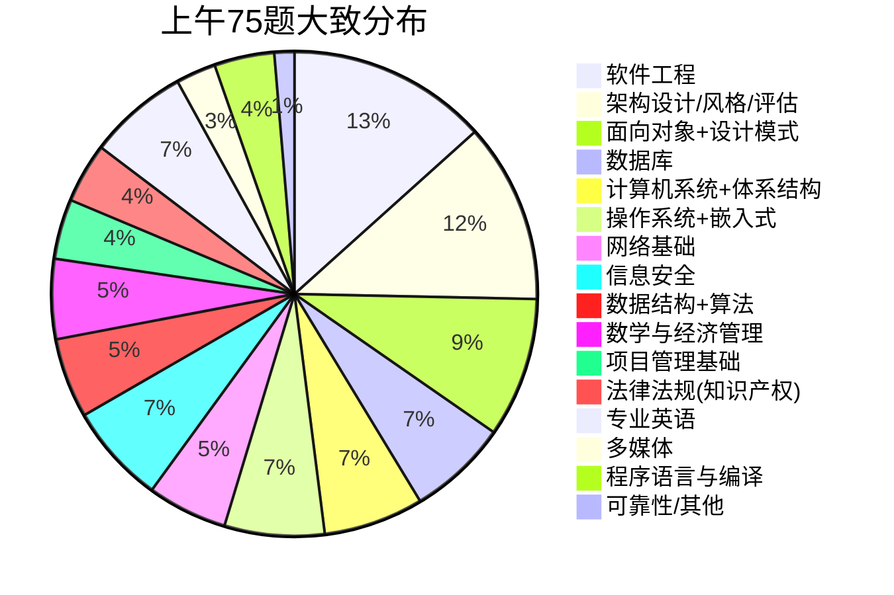
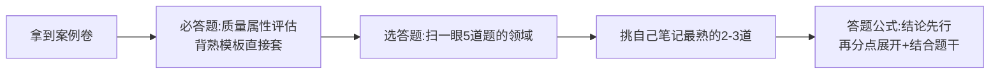
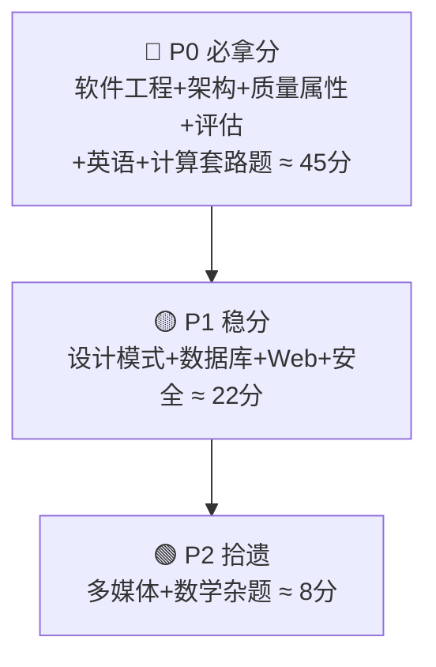

> **摘要**：
> 上午题靠「广度+背诵」，下午案例靠「套路+模板」，论文靠「提前攒素材」。三科 45 分及格，架构设计相关内容占全科 40% 权重，是绝对主战场。

## 三科结构

| 科目 | 形式 | 时长 | 题量 | 满分/及格 |
|---|---|---|---|---|
| 综合知识 | 75 道单选（机考） | 150 min | 75 题 | 75 / 45 |
| 案例分析 | 问答大题（1 必答 + 4 选 2 左右） | 90 min | 3 题 | 75 / 45 |
| 论文 | 四选一，摘要≤300 字+正文 2000~3000 字 | 120 min | 1 篇 | 75 / 45 |

## 上午题分值地图（基于 2009–2020 十余年真题统计，机考后趋势相近）

> **提示**：
> ① **软件工程+架构+面向对象 ≈ 26 分**，这三块吃透上午题就稳了一半；② 专业英语 5 分是白送的（题材固定：系统设计/开发模型，背高频词）；③ 计算 crypto 数学题（前趋图/位示图/浮点数/海明码/流水线）是「套路题」，学会模板就是送分。

## 案例题五大常考题型（按近十年频率排序）

| 题型 | 出现频率 | 对应笔记 |
|---|---|---|
| ① 质量属性 + 架构评估（ATAM/敏感点/权衡点）**必考** | 几乎每年 | [12-架构风格与架构评估](架构-章节笔记/12-架构风格与架构评估/) |
| ② 架构风格选型（分层/事件驱动/微内核/管道过滤…） | 几乎每年 | [12-架构风格与架构评估](架构-章节笔记/12-架构风格与架构评估/) |
| ③ 数据库设计（反规范化/读写分离/分库分表/NoSQL 选型） | 高频 | [03-数据库系统](架构-章节笔记/03-数据库系统/) |
| ④ Web 架构（REST/缓存/负载均衡/消息队列） | 高频 | [13-Web架构与中间件](架构-章节笔记/13-Web架构与中间件/) |
| ⑤ 面向对象（设计模式应用/uml 补全） | 中频 | [09-面向对象方法](架构-章节笔记/09-面向对象方法/) [10-设计模式](架构-章节笔记/10-设计模式/) |
| ⑥ 嵌入式/实时系统（RTOS/可靠性计算） | 低频轮换 | [16-嵌入式与实时系统架构](架构-章节笔记/16-嵌入式与实时系统架构/) |

## 论文命题规律（近十年高频主题）

- **论软件架构设计/架构风格的应用**（分层、事件驱动、微内核、微服务…轮着考）
- **论软件系统质量属性/架构评估**（可用性/可修改性/安全性/性能）
- **论数据库设计/数据持久化**（读写分离、分库分表、缓存）
- **论中间件/REST/Web 架构**
- **新趋势（机考后）**：云原生/微服务/容器化改造、大数据架构选型

> **注意**：
> 提前准备 **1 个万能项目背景**（你自己做过的工作，够真实、有数字），练熟 4 篇覆盖：架构风格、质量属性、数据库、Web/微服务。考场上四选一必有能套的。详见 [架构-论文攻略](架构-论文攻略/)。

## ⚡ 新考纲侧重（2024–2026）

官方教材仍为第 2 版，但考纲对**技术前沿内容权重大幅上调**：AI、大数据、云计算考点显著增加，云原生/微服务/区块链进入常规考查范围。2025 下半年真题"实锤"的新考法（考生回忆版）：

- 案例考了 **DDD 领域驱动设计·限界上下文** → 见 [13-Web架构与中间件](架构-章节笔记/13-Web架构与中间件/) 的"DDD 与服务拆分"
- 案例考了 **Petri 网**建模 → 见 [09-面向对象方法](架构-章节笔记/09-面向对象方法/) 拓展考点
- 案例考了 **智能操作系统与 AI 融合** → 见 [14-云原生与大数据架构](架构-章节笔记/14-云原生与大数据架构/)
- 论文考了 **《软件性能测试技术及其应用》** → 素材在 [15-系统可靠性与性能](架构-章节笔记/15-系统可靠性与性能/)

> **提示**：
> 只刷 2015 年前的旧真题会漏掉新方向；技术前沿概念以本库 13/14 章为准补齐。完整改革清单见 [考纲改革速览(2024-2026)](../00-备考指南/考纲改革速览(2024-2026)/)。

## 备考优先级建议

## ➡️ 下一步

- 制定计划：[小白备考路线图](../00-备考指南/小白备考路线图/)
- 开始第一章：[01-计算机系统基础](架构-章节笔记/01-计算机系统基础/)
- 案例专项：[架构-案例分析攻略](架构-案例分析攻略/) · 论文专项：[架构-论文攻略](架构-论文攻略/)
