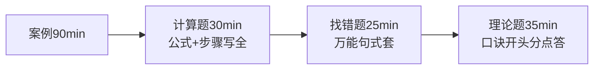

> **摘要**：
> 项管是三科里"套路感"最强的：上午题背表格、案例题套公式、论文题靠提前写。真题的价值极高——**管理理论题几乎年年重复考法**。

## 一、先认清考纲时代（避免白学）

| 时期 | 教材 | 对你的意义 |
|---|---|---|
| 2023 年 11 月起 | **第 4 版(现行)** | 主攻方向:十大领域+绩效域+新技术 |
| 2023 年 11 月前 | 第 3 版 | 2019-2023 真题里:管理理论题照刷,信息技术题(考的是云大物等老说法)过一遍即可 |

刷真题时用三色笔分类:🟢 现行考纲照刷 / 🟡 管理理论永远有效 / 🔴 旧技术细节跳过(如"电子政务三网一库"这类过时表述)。

## 二、上午题(75 题)打法

| 板块 | 约分 | 打法 |
|---|---|---|
| 十大领域理论 | ~30 | 口诀+表格背诵(见各章"⭐ 重点"),性价比最高 |
| 新技术(云大物智链 5G) | ~12 | 记"定义+特点+典型场景",不深挖原理,看 [02-信息技术发展前沿](项管-章节笔记/02-信息技术发展前沿/) |
| 信息化/治理/标准 | ~13 | 概念题,记关键词;ITSS/等保/监理"四控三管一协调"必背 |
| 计算题 | ~5 | 挣值/渠道数/三点估算/决策树/盈亏平衡,全是模板题 |
| 法规(著作权/招投标/采购) | ~5 | 数字题集中营,看 [16-法规标准与职业道德](项管-章节笔记/16-法规标准与职业道德/) |
| 绩效域/价值交付 | ~5 | 第 4 版新宠,近年必考 3-5 分 |
| 英语 | ~5 | 题材固定(项目管理过程描述),考前背高频词 |

> **提示**：
> 十大领域 30 分拿 22 + 新技术 12 分拿 7 + 计算 5 分拿 4 + 法规/治理/绩效域 18 分拿 10 + 英语 5 分拿 3 ≈ **46 分**。其余板块(信息化杂题)是保险。

## 三、案例分析(3 题打法)

近十年结构:1 道计算必考(挣值或进度网络图)+ 2 道问答(理论/找错)。详见 [项管-案例分析攻略](项管-案例分析攻略/)。

## 四、论文(二选一)打法

- 近年主题覆盖十大领域,频出:进度/成本/质量/风险/沟通/整合/资源/采购/干系人/范围
- 第 4 版后可能出**绩效域**或**敏捷/混合开发方法**相关新题
- **万能项目背景 + 5 篇高频领域提纲**提前备好,详见 [项管-论文攻略](项管-论文攻略/)

## 五、刷题两轮法(配合 [qicoder真题索引](../99-真题资源/qicoder真题索引/))

1. **第一轮(阶段二)**:2021→2017 真题,按知识域刷。比如专刷"风险管理"连续 8 年的题,你会发现考法高度重复(定性定量工具、应对策略辨析)
2. **第二轮(阶段三)**:2021→2019 整卷限时模拟,上午稳定 55+ 再上考场
3. 2017 以前的真题只刷管理理论题;2022-2025 用各机构回忆版+模考卷补充(B 站搜"高项 真题回忆")

## 六、考前 30 天清单

- [ ] 十大领域每个领域的"⭐ 重点表"背第 3 遍
- [ ] 挣值全套公式默写(CV/SV/CPI/SPI/EAC/ETC/TCPI,方向别反)
- [ ] 关键路径计算手做 3 道完整例题
- [ ] 法规数字题(招投标/著作权期限/合同类型)过 2 遍
- [ ] 论文成文 3 篇(高频领域各 1),每篇计时 120 分钟
- [ ] 八大绩效域的"预期目标+检查方法"表过 2 遍
