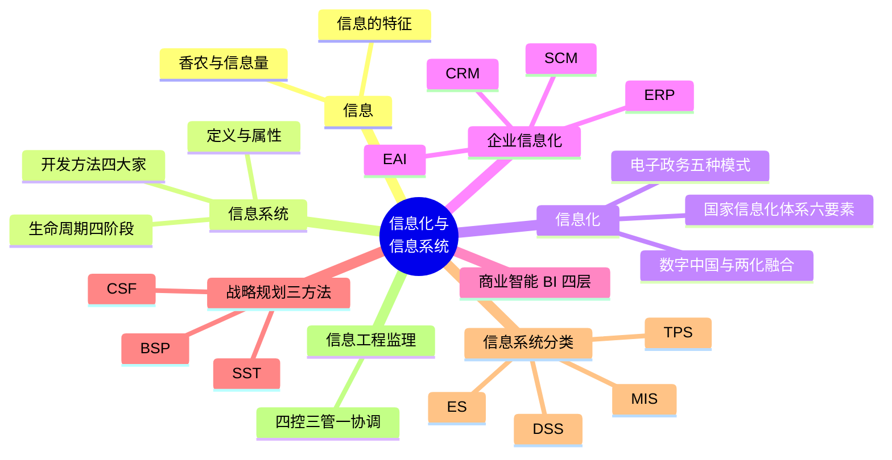
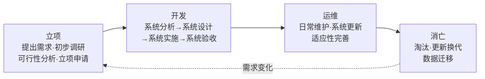
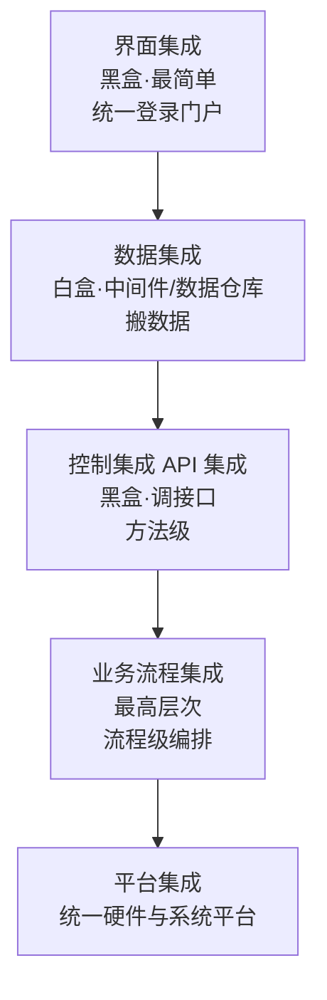
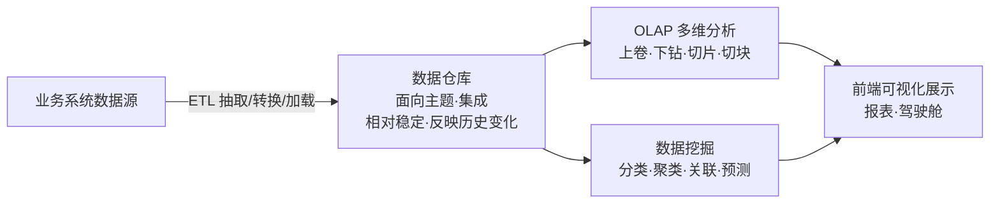

> **摘要**：
> 本章是全书的"地基":讲清楚**信息、信息系统、信息化**三大主角,以及生命周期、开发方法、电子政务、企业信息化、商业智能 BI、战略规划方法、信息工程监理等经典考点。**上午题每年必出、近年高频**,案例题常拿信息化项目当背景,论文开篇也爱写"某单位数字化转型"。零基础学弟先把这章啃下来,后面才不慌。建议投入 6~8 小时。

## 🗺️ 知识地图

## 📖 掰碎讲解

### 1.1 信息与信息量(香农)

**是什么**:香农(信息论之父)认为:**信息是不确定性的减少**,是"用来消除不确定性的东西"。信息量的大小用比特(bit)度量,公式为 **I = -log₂(p)**,p 是事件发生的概率。

**大白话**:把信息当"开盲盒"。别人告诉你"明天太阳从东边升起",这事概率几乎 100%,你的不确定性一点没减少,信息量≈0;但如果告诉你"你中了大奖",概率极小,信息一出来不确定性瞬间清零——信息量巨大。**结论:概率越小的事,信息量越大**(I 与 p 成反比,取负对数)。

**怎么考**:
- 考"信息是不确定性的减少"这一经典定义(判断/选择)。
- 考信息量与概率的关系:概率越小 → 信息量越大。

信息的特征(历年反复考判断题):

| 特征 | 一句话理解 | 易错点 |
| --- | --- | --- |
| 真伪性 | 有真有假,需甄别 | 谣言也是"信息",只是伪信息 |
| 层次性 | 低层信息概括后成为高层信息;高层信息可渗透指导低层 | "管理层越高,信息越概括" |
| 传递性 | 可跨越时空传递 | — |
| 共享性 | 一方使用,另一方照样可用,**不会减少**(不守恒) | "一方得到,另一方就失去"是错的 |
| 可识别 / 可处理 | 能被感知、加工 | — |
| 可存储 / 可压缩 | 能保存、能压缩后再还原 | — |
| 可增值性 | 加工利用后产生新价值 | 数据 → 信息 → 知识 → 智慧 |

### 1.2 信息系统:定义与属性

**是什么**:信息系统是由**硬件、软件、数据、用户、流程**等要素组成,完成信息的**采集、传输、存储、加工、维护和使用**的人机系统。基本模型:输入 → 处理 → 输出 → 反馈。

**大白话**:食堂打饭系统——输入你的饭卡(采集),后台扣款结账(处理),屏幕显示余额(输出),月底对账发现问题(反馈)。

**怎么考**:考信息系统**十大属性**的辨析,重点记:

| 属性 | 口头理解 |
| --- | --- |
| 整体性 | 系统是一个整体,拆开就不是它了 |
| 层次性 | 大系统套子系统,层层嵌套 |
| 目的性 | 为目标而生 |
| 稳定性 | 受扰动仍能保持结构功能 |
| 突变性 | 质变,系统可能升级或崩溃 |
| 自组织性 | 能自我调节演化 |
| 相似性 | 系统之间有共同的规律,"互为镜像" |
| 开放性 | 与外界交换物质能量信息 |
| 脆弱性 | **容易被攻击、怕破坏** |
| 健壮性 | **抗打击能力,出了问题还能撑住** |

> **提示**：
> 脆弱性 = 豆腐做的;健壮性 = 打不死的小强。两个词成对出现,考题常互换混淆。

### 1.3 信息系统生命周期(必考排序)

**是什么**:信息系统从生到死分四个阶段:**立项 → 开发 → 运维 → 消亡**。

**大白话**:像盖房子——立项是"想不想盖、能不能盖"(可研);开发是"画图纸(分析)+出施工图(设计)+施工(实施)+竣工验收(验收)";运维是住进去后的日常维修;消亡是危房拆迁重建。

**怎么考**:
1. 阶段**排序题**:立项 → 开发 → 运维 → 消亡,别把"验收"放在"运维"后面。
2. **任务匹配题**:"系统分析"= 搞清需求(逻辑模型);"系统设计"= 定方案(物理模型);"系统实施"= 编码测试上线。分析在前、设计在后,反了就是坑。
3. 注意"开发阶段内部四步":**分析 → 设计 → 实施 → 验收**。

### 1.4 信息系统开发方法(场景匹配必考)

| 方法 | 核心思想 | 适用场景 | 缺点 |
| --- | --- | --- | --- |
| 结构化方法 | 自顶向下、逐步求精,严格按生命周期阶段走,面向数据流 | 需求明确、大中型系统 | 周期长、文档多、难适应变更 |
| 原型法 | 先快速做个"毛坯样板"给用户看,边用边改需求 | **需求不明确**、用户说不清要什么 | 不适合大型复杂系统 |
| 面向对象方法 | 万物皆对象,封装/继承/多态,OOA→OOD→OOP,复用性好 | 需求多变、强调复用 | 需要 OO 功底,大型项目需与结构化配合 |
| 敏捷方法 | 小步快跑、迭代交付、拥抱变化、强调人与沟通 | 需求高度不确定、互联网产品 | 对团队自律性要求高 |

**大白话**:结构化是"先画完整图纸再盖房";原型法是"先搭个样板间让你住住看,再改";面向对象是"乐高积木,块块复用";敏捷是"每两周交付一次能用的,边用边调"。

**怎么考**:给场景选方法——用户"说不清想要啥"→原型法;银行核心系统需求明确 → 结构化;"面向数据流、自顶向下"关键词 → 结构化;"封装继承多态" → 面向对象;"迭代、拥抱变化" → 敏捷。

### 1.5 信息化内涵与国家信息化体系六要素(配对必考)

**是什么**:国家信息化体系六要素及其定位(口诀配对):

| 要素 | 定位 | 口诀 |
| --- | --- | --- |
| 信息资源 | **核心任务** | 料是核心 |
| 信息网络 | 基础设施 | 路是血管 |
| 信息技术应用 | **龙头** | 用是龙头 |
| 信息产业 | 基础 | 产业是地基 |
| 信息化人才 | **关键 / 成功之本** | 人是关键 |
| 信息化政策法规和标准规范 | 保障 / 动力 | 规矩是保障 |

**大白话**:把信息化当开饭店——信息资源是食材(核心),信息网络是送菜的路,应用是招牌菜(龙头),信息产业是后厨设备(基础),人才是厨师长(关键),政策法规是食品安全法(保障)。

**怎么考**:定位配对。最常挖坑的三个:**应用是龙头、人才是关键、资源是核心任务**。另注意"信息技术应用"是六要素中的龙头,别选成"信息产业"。

信息化延伸考点:
- **两化融合**:信息化与工业化深度融合(先"信息化带动工业化",现强调深度融合)。
- **数字中国**:数字经济、数字政府、数字社会、数字生态——论文里描述"数字化转型背景"的现成素材。

### 1.6 电子政务五种模式(判断题收割机)

**是什么 + 怎么考**:看"谁发给谁"就完事:

| 模式 | 全称 | 典型场景 |
| --- | --- | --- |
| G2G | 政府对政府 | 公文流转、电子司法档案、财政系统 |
| G2B | 政府对企业 | **电子税务、电子招标采购、证照办理** |
| G2C | 政府对公民 | 电子证件、教育培训、就业社保服务 |
| G2E | 政府对公务员(内部) | 电子办公 OA、内部培训考核 |
| B2B / B2C | 企业之间 / 对个人 | 这是**电子商务**,不是电子政务(常当干扰项) |

**大白话**:第一个字母是"谁发起",第二个字母是"发给谁":G=政府,B=企业,C=公民,E=内部员工。题目写"税务部门网上收税"→ 政府对企业 → G2B;"公务员在线培训" → G2E。

### 1.7 企业信息化全家桶:ERP / CRM / SCM / OA / MIS / EAI

**是什么与怎么考**:

| 系统 | 一句话定义 | 必考要点 |
| --- | --- | --- |
| ERP 企业资源计划 | 把企业内外所有资源统一到一套系统里管 | **核心思想 = 供应链管理**;常与 BPR(业务流程重组)结合;吸收 JIT 准时制、TQM 全面质量管理思想 |
| CRM 客户关系管理 | 以**客户为中心**管理营销、销售、服务 | 漏斗模型:潜在客户 → 机会 → 订单,层层过滤 |
| SCM 供应链管理 | 管理从供应商到客户的整条链 | 强调协同计划、物流资金流信息流三流合一 |
| OA 办公自动化 | 电子化办公、流程审批 | — |
| MIS 管理信息系统 | 中层管理报表与常规管理 | — |
| EAI 企业应用集成 | 把多个孤立应用"焊接"起来 | 五种集成方式辨析(见下) |

EAI 五种集成方式(高频判断):

> **提示**：
> 界面集成最"皮"(只拼脸),数据集成最"土"(只搬数),控制集成调接口,业务流程集成是"天花板"。层次由低到高,考试爱问"哪种集成层次最高"→ 业务流程集成。

### 1.8 商业智能 BI 四层(顺序必背)

**是什么**:BI = 数据仓库 + ETL + OLAP + 数据挖掘 + 前端展示,把"数据死水"炼成"决策活水"。

**大白话**:数据仓库是大仓库(货都堆好、贴好主题标签),ETL 是装卸+质检+重新打包,OLAP 是从不同角度翻看库存(按年下钻到月),数据挖掘是从历史订单里挖出"买尿布的人常买啤酒"这种规律。

**怎么考**:
1. 四层/环节**排序**:数据仓库 → ETL → OLAP → 数据挖掘(教材经典表述)。
2. **数据仓库四大特点**必背:面向主题、集成的、相对稳定(一般不修改)、反映历史变化。挖坑项:"实时频繁更新"是错的。
3. OLAP(多角度查、分析人主导)与数据挖掘(机器自动找规律)**区分**。

### 1.9 信息系统战略规划三方法(BSP / CSF / SST)

**是什么**:

| 方法 | 核心 | 一句话识别 |
| --- | --- | --- |
| BSP 企业系统规划法 | **自上而下识别系统目标,自下而上设计系统**;以业务流程(过程)为核心,U/C 矩阵划分子系统 | 关键词"自上而下识别、自下而上设计" |
| CSF 关键成功因素法 | 抓住影响企业成败的**少数关键因素**重点分析 | 关键词"关键成功因素、抓重点" |
| SST 战略集合转移法 | 把组织的战略集合"转移"成 MIS 的战略集合 | 关键词"战略集合、转移" |

**大白话**:BSP 是"从总裁办公室往下看目标,再从车间往上盖系统";CSF 是"别贪多,先搞定决定生死的那几件事";SST 是"把公司的战略清单翻译成信息系统的战略清单"。

**怎么考**:方法 ↔ 描述连线配对。看到"自上而下识别目标、自下而上设计系统"锁定 **BSP**;看到"目标是想找出让 CEO 睡不着觉的那几件事"锁定 **CSF**。

### 1.10 信息系统分类:TPS / MIS / DSS / ES

| 系统 | 服务层级 | 决策类型 | 特征关键词 |
| --- | --- | --- | --- |
| TPS 事务处理系统 | 操作层(基层) | 结构化 | 记账式日常事务,如银行存取款 |
| MIS 管理信息系统 | 管理层(中层) | 结构化/半结构化 | 汇总报表、常规管理 |
| DSS 决策支持系统 | 决策层(高层) | **半结构化 / 非结构化** | 模型库+数据库,交互式辅助决策,"支持"不"代替" |
| ES 专家系统 | 各层 | 非结构化 | **知识库 + 推理机**,模拟专家做判断 |

**大白话**:TPS 是收银员(记好每笔账),MIS 是店长(每周看报表),DSS 是老板的军师(供方案、不拍板),ES 是老中医(把经验装进脑袋里,按推理开方子)。

**怎么考**:层级与系统对应;"DSS 支持而非代替决策者"是经典正确表述;"ES 的核心部件是知识库和推理机"。

### 1.11 信息工程监理:四控三管一协调(默写级必背)

**是什么**:信息系统工程监理,是指依法设立、具备相应资质的监理单位,受**建设单位(甲方)**委托,依据国家法律法规、技术标准和监理合同,对信息系统工程实施**监督管理**。

**必背口诀:四控三管一协调**
- **四控**:质量控制、进度控制、**投资控制**、变更控制
- **三管**:合同管理、信息(文档)管理、安全管理
- **一协调**:沟通协调(协调建设单位、承建单位等有关方的关系)

**大白话**:监理就是甲方请来的"包工头监督员"——盯质量、盯进度、盯花钱(投资)、盯改图(变更);管合同、管资料、管安全;再负责两边吵架时拉架。

**怎么考**:默写四控三管一协调(案例题填空);挖坑:把"投资控制"写成"成本控制"(信息化工程监理用**投资控制**);"安全"在"三管"里而不是"四控"里。

## 🎬 推荐视频

| 视频 | 讲什么 | 什么时候看 |
| --- | --- | --- |
| [野人老师高项全集 67 集](https://www.bilibili.com/video/BV1dJ41117Aa) | 第 1 章信息化部分,讲解接地气、口碑好 | 第一轮入门,零基础首选 |
| [夏天老师 2027 第 4 版公开课 53 集](https://www.bilibili.com/video/BV1TFBpBKExt) | 按第 4 版新教材讲,更新及时 | 第一轮跟课,与笔记对照补漏 |
| [summer 课堂第 4 版快速串讲 30 集](https://www.bilibili.com/video/BV1vz4y1a7fM) | 1-7 章快速串讲 | 二轮冲刺快速过一遍 |

## ⭐ 章节重点(考前必背)

| 考点 | 必背内容 | 考法标签 |
| --- | --- | --- |
| 信息定义 | 香农:信息是不确定性的减少;概率越小信息量越大 | 上午题 |
| 生命周期 | 立项→开发(分析→设计→实施→验收)→运维→消亡 | 上午题排序 |
| 开发方法 | 需求不明选原型法;自顶向下=结构化;封装继承=面向对象 | 上午题场景匹配 |
| 六要素 | 应用是龙头、人才是关键、资源是核心任务、政策法规是保障 | 上午题配对 |
| 电子政务 | G2G/G2B/G2C/G2E 看发起方与接收方;B2B/B2C 是电子商务 | 上午题判断 |
| ERP | 核心思想=供应链管理;配合 BPR | 上午题 |
| EAI | 界面(最简单)→数据→控制(API)→业务流程(最高);平台集成 | 上午题 |
| BI | 数据仓库→ETL→OLAP→数据挖掘;数仓四特点 | 上午题 |
| 战略规划 | BSP=自上而下识别目标+自下而上设计;CSF=抓关键 | 上午题配对 |
| 系统分类 | TPS 操作层 / MIS 管理层 / DSS 半结构化决策 / ES 知识库+推理机 | 上午题 |
| 监理内容 | 四控(质量进度投资变更)+三管(合同信息安全)+一协调 | **案例必考默写** |
| 数字中国 | 数字经济、数字政府、数字社会 | **论文素材** |

## 🧠 高频考法与陷阱

> **注意**：
> 1. **错误认知**:信息共享后一方得到、另一方就失去了。→ **正确认知**:信息具有共享性,不会减少(不守恒)。
> 2. **错误认知**:开发阶段先设计再分析。→ **正确认知**:先系统分析(搞清需求、逻辑模型),再系统设计(定方案、物理模型)。
> 3. **错误认知:"需求不清楚"就用结构化方法。→ 正确认知**:需求不明用原型法(或敏捷);结构化适合需求明确的系统。
> 4. **错误认知:数据仓库里的数据经常更新修改。→ 正确认知**:数仓数据相对稳定,一般不做修改,反映历史变化。
> 5. **错误认知:监理内容是"四控三管一协调",其中"成本控制"属于四控。→ 正确认知**:四控是质量、进度、**投资**、变更控制;成本控制是项目管理的说法,别混。
> 6. **错误认知:"企业对企业网上采购"是电子政务。→ 正确认知**:B2B 属电子商务;电子政务必须有 G(政府)参与。

## ✍️ 反复练习题

**第 1 题(选择)** 根据香农的信息量公式,以下事件中信息量最大的是:
A. 明天太阳从东方升起　B. 抛硬币正面朝上　C. 中了千万彩票　D. 一周有七天

> **示例**：
> **答案:C**
> I = -log₂(p),概率 p 越小,信息量越大。"中千万彩票"概率极小,信息量最大;A、D 是必然事件,信息量约等于零。

**第 2 题(选择)** 信息系统生命周期正确的阶段顺序是:
A. 开发→立项→运维→消亡　B. 立项→开发→运维→消亡　C. 立项→运维→开发→消亡　D. 开发→运维→立项→消亡

> **示例**：
> **答案:B**
> 生命周期四阶段:立项 → 开发 → 运维 → 消亡。开发阶段内部又分:系统分析 → 系统设计 → 系统实施 → 系统验收。

**第 3 题(选择)** 某企业领导"说不清楚想要什么样的系统",开发团队打算先快速构建一个可运行样板让用户体验后再逐步明确需求,适合采用的开发方法是:
A. 结构化方法　B. 原型法　C. 瀑布模型　D. 面向服务方法

> **示例**：
> **答案:B**
> 需求不明确、用户表达困难 → 原型法。先做"毛坯样板"让用户有感官认识,通过试用不断澄清需求。C 是干扰项(瀑布即结构化思路,恰恰要求需求先明确)。

**第 4 题(选择)** 国家信息化体系六要素中,被视为"龙头"的是:
A. 信息资源　B. 信息产业　C. 信息技术应用　D. 信息化人才

> **示例**：
> **答案:C**
> 配对口诀:应用是龙头、资源是核心任务、产业是基础、人才是关键(成功之本)、网络是基础设施、政策法规和标准规范是保障(动力)。最常考的三个:龙头=应用、关键=人才、核心=资源。

**第 5 题(选择)** 以下属于电子政务 G2E 模式的是:
A. 政府在网上向企业征收税款　B. 政府部门内部公务员在线培训系统　C. 政府向公民发放电子证件　D. 企业之间通过平台完成采购

> **示例**：
> **答案:B**
> G2E=政府对公务员(内部员工):电子办公、内部培训考核。A 是 G2B,C 是 G2C,D 是电子商务 B2B,不是电子政务。

**第 6 题(选择)** 商业智能 BI 的正确组成顺序是:
A. ETL→数据仓库→OLAP→数据挖掘　B. 数据仓库→ETL→OLAP→数据挖掘　C. OLAP→数据挖掘→数据仓库→ETL　D. 数据挖掘→OLAP→ETL→数据仓库

> **示例**：
> **答案:B**
> 教材经典表述:数据仓库 → ETL → OLAP → 数据挖掘(前端展示收尾)。另背数仓四特点:面向主题、集成、相对稳定、反映历史变化。

**第 7 题(选择)** "自上而下识别系统目标,自下而上设计系统"描述的是:
A. CSF 关键成功因素法　B. SST 战略集合转移法　C. BSP 企业系统规划法　D. SWOT 分析法

> **示例**：
> **答案:C**
> BSP(企业系统规划法)的标志性表述。CSF 的标志是"抓住关键成功因素";SST 的标志是"战略集合转移"。

**第 8 题(案例风格)** 某市政府启动"智慧政务大厅"工程,建设单位委托了一家监理公司。施工过程中,承建单位频繁提出变更,工程进度滞后,且部分文档缺失。请回答:
(1) 信息系统工程监理的工作内容包括哪些?(请完整默写)
(2) 针对上述问题,监理应重点执行哪些控制和管理措施?

> **示例**：
> (1) **四控**:质量控制、进度控制、投资控制、变更控制;**三管**:合同管理、信息(文档)管理、安全管理;**一协调**:沟通协调(协调建设、承建等有关各方)。
> (2) ①变更频繁 → 执行**变更控制**,建立规范的变更申请与审批流程;②进度滞后 → 加强**进度控制**,分析偏差原因、督促纠偏;③文档缺失 → 强化**信息(文档)管理**,要求按标准补齐并归档;④必要时通过**合同管理**明确双方责任,并做好三方沟通协调。

## 🔗 相关章节

- 下一章技术基础:[02-信息技术发展前沿](02-信息技术发展前沿/)
- 治理、监理与标准体系:[03-信息系统治理与标准](03-信息系统治理与标准/)
- 项目管理从这里开始:[04-项目管理概论](04-项目管理概论/)
- 真题分布与分值规律:[项管-考试分析](../项管-考试分析/)、[qicoder真题索引](../../99-真题资源/qicoder真题索引/)
- 记忆方法:[学习方法与记忆术](../../00-备考指南/学习方法与记忆术/)
