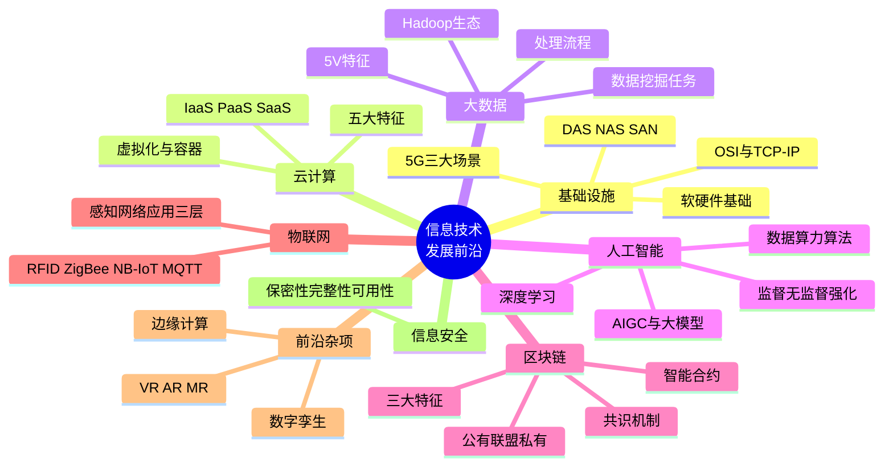
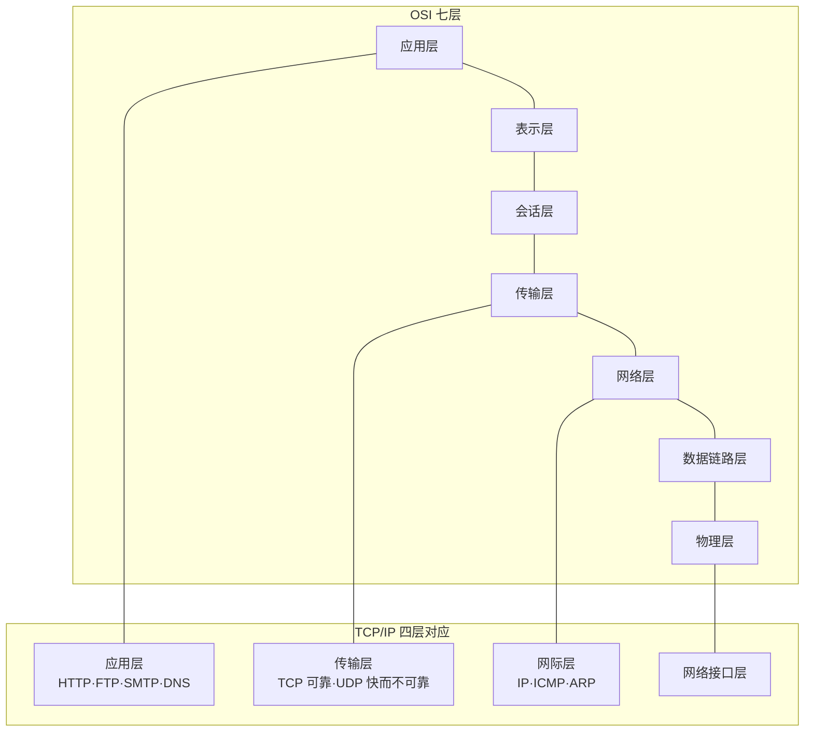
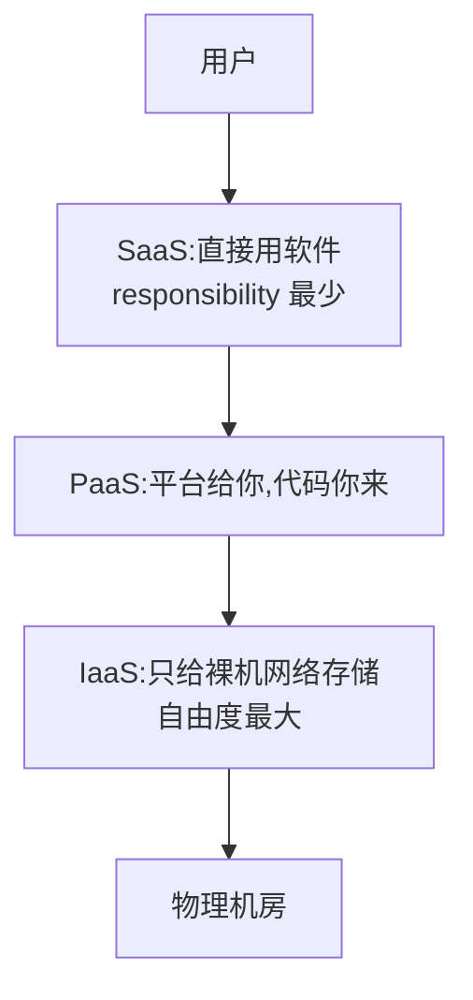
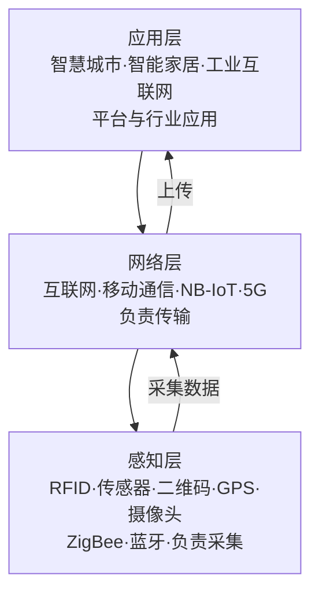

> **摘要**：
> 本章是"技术名词轰炸区":软硬件与网络、5G、存储、数据库、云计算、大数据、人工智能、区块链、物联网、边缘计算、数字孪生、VR/AR/MR,外加信息安全 CIA。特点是**名词多、定义短、判断题密**,上午题近年高频,论文写背景也全靠它撑场面。零基础学弟不用怕深原理——高项只考"它是什么、有什么特征、怎么分类"。建议投入 8~10 小时。

## 🗺️ 知识地图

## 📖 掰碎讲解

### 2.1 计算机软硬件基础

**是什么**:硬件 = 运算器 + 控制器(CPU)+ 存储器 + 输入输出设备;软件 = 系统软件(操作系统、数据库管理系统、编译程序)+ 应用软件;**中间件**是介于操作系统和应用软件之间的"翻译官/胶水"(如消息中间件、交易中间件)。

**大白话**:CPU 是大脑(运算器算题、控制器指挥),内存是草稿纸(快但断电忘),硬盘是笔记本(慢但记得住),操作系统是大管家,中间件是物业——住户(应用)和楼(系统)之间的事都归它管。

**怎么考**:考分类判断:"数据库管理系统属于系统软件"(对);"中间件属于应用软件"(错);存储器层次"越靠近 CPU 越快越贵"。

### 2.2 网络标准与协议:OSI 七层与 TCP/IP

**是什么**:OSI 七层从下到上:**物理、数据链路、网络、传输、会话、表示、应用**;TCP/IP 实用四层:网络接口层、网际层、传输层、应用层。

**大白话**:寄快递——物理层是公路,数据链路层是"相邻两个站点别送丢",网络层是"全国怎么规划路线"(IP 地址),传输层是"确保包裹完整送达"(TCP 查收)还是"扔出去就行"(UDP),应用层是你写的快递单内容。口诀:**物数网传会表应**(谐音"物联网会上represent应")。

**怎么考**:层数排序;协议归属(TCP/UDP 在传输层,IP 在网际层,HTTP/FTP/DNS 在应用层);TCP 可靠连接 vs UDP 无连接快;常见端口(HTTP 80、HTTPS 443、FTP 21、SMTP 25、DNS 53)。

### 2.3 通信技术与 5G 三大场景(必背)

**是什么**:5G 三大应用场景:
- **eMBB**:增强移动宽带 —— 大带宽,高清视频、VR/AR;
- **uRLLC**:超高可靠低时延通信 —— 自动驾驶、远程手术、工业控制;
- **mMTC**:海量机器类通信 —— 海量物联网连接,智能抄表、传感器网络。

**大白话**:eMBB 是"八车道高速"(快),uRLLC 是"救护车专用道"(稳且快,慢半秒出人命),mMTC 是"千万辆共享单车都能入网"(连接多)。

**怎么考**:场景与缩写配对——看到"自动驾驶/远程手术"选 **uRLLC**;"智能抄表/海量传感器"选 **mMTC**;"4K/VR 直播"选 **eMBB**。这是近年高频送分点,千万别丢。

### 2.4 存储技术:DAS / NAS / SAN 对比

| 对比项 | DAS 直连存储 | NAS 网络附加存储 | SAN 存储区域网络 |
| --- | --- | --- | --- |
| 接入方式 | 硬盘/磁带直连服务器 | 挂在以太网上,即插即用 | 专用高速网络(FC SAN / IP SAN) |
| 传输级别 | — | **文件级**(NFS/CIFS) | **块级**(性能最高) |
| 典型用途 | 单服务器本地盘 | 文件共享、小办公 | 数据库等高性能场景 |
| 类比 | 随身 U 盘 | 网盘/共享文件夹 | 专属地下仓库+高速专运线 |

**大白话**:DAS 是插在自家电脑上的移动硬盘;NAS 是家里或公司的"共享网盘";SAN 是给大型数据库专修的一条"仓储高速专线"。

**怎么考**:三兄弟配对——"文件级、以太网、文件共享"=NAS;"块级、专用网络、数据库"=SAN;"直接连服务器"=DAS。

### 2.5 数据库类型:关系型与 NoSQL

**是什么**:
- **关系型数据库**:二维表 + SQL,严格 **ACID**(原子性、一致性、隔离性、持久性),如 Oracle、MySQL、PostgreSQL。适合交易型强一致场景。
- **NoSQL(非关系型)** 四大类:
  - 键值型:Redis(缓存之王);
  - 列存储:HBase、Cassandra;
  - 文档型:MongoDB;
  - 图数据库:Neo4j(社交网络、关系网络)。

**大白话**:关系库像 Excel 表格,横平竖直、账目一丝不苟(银行最爱);NoSQL 像收纳箱,形状随你放,要的是**海量、灵活、高并发**,代价是"最终一致"而非"立刻一致"。

**怎么考**:NoSQL 分类与代表产品配对;"图数据库适合处理复杂关系网络";关系库关键词"ACID、二维表、SQL"。

### 2.6 云计算(特征必背 + SPI 判断)

**是什么**:云计算是一种按需、可弹性获取与释放计算资源的模式。**五大特征(必背,一字别改)**:
1. **按需自服务**——用户自助开通;
2. **广域网络接入**——网络在手,随处可用;
3. **资源池化**——资源集中成池,按需分配;
4. **快速弹性伸缩**——流量高峰自动扩容;
5. **可计量服务**——用多少付多少,可度量。

**大白话**:云计算=自来水厂。拧开龙头就有水(按需自服务),家里工厂都能接(广域接入),水厂有大水池(资源池化),用水高峰自动加压(快速弹性),月底按水表交钱(可计量)。你不用自己挖井建水塔。

服务模式 SPI(判断题之王):

| 模式 | 你得到什么 | 你管什么 | 例子 |
| --- | --- | --- | --- |
| IaaS 基础设施即服务 | 虚拟机、存储、网络 | 系统、应用都自己管 | 云服务器 ECS |
| PaaS 平台即服务 | 运行环境、数据库、中间件 | 只管代码和应用 | 云函数、应用引擎 |
| SaaS 软件即服务 | 拎包入住的成品软件 | 什么都不用管 | 在线文档、云邮箱 |

**怎么考**:"买了云主机自己装系统部署"=IaaS;"只上传代码不管服务器"=PaaS;"打开浏览器就能用在线办公"=SaaS。**部署模式**:公有云、私有云、社区云、混合云(敏感数据放私有、弹性业务放公有)。

虚拟化与容器:
- 虚拟化:服务器虚拟化(KVM/VMware)、存储虚拟化、网络虚拟化、桌面虚拟化——一台物理机切出多台"假电脑"。
- **容器 vs 虚机**(高频对比):容器共享宿主机内核、**秒级启动、轻量**、隔离性较弱;虚机带完整操作系统、**重、分钟级启动、隔离性强**。容器编排的事实标准是 Kubernetes(K8s)。

### 2.7 大数据(5V 与流程必背)

**是什么**:大数据特征 **5V**:
1. **Volume** 数据量大;
2. **Velocity** 处理速度快;
3. **Variety** 类型多样(结构化+非结构化);
4. **Value** 价值密度低(沙里淘金);
5. **Veracity** 数据真实性/准确性要求。

处理流程(顺序题):**采集 → 预处理(清洗/集成/转换)→ 存储与管理 → 分析与挖掘 → 可视化呈现**。

**大白话**:5V 就是"量特大、来得特快、花样特多、值钱的少(10 吨沙子淘 1 克金)、还得是真的"。大数据工程师就是淘金工人:先挖矿(采集),洗矿(预处理),入仓(存储),冶炼(挖掘),最后打戒指卖(可视化变现)。

Hadoop 生态一句话记:
- **HDFS**:分布式文件系统(仓库);
- **MapReduce**:并行计算框架(流水线工人);
- **YARN**:资源调度(工头);
- **Hive**:数据仓库,用 SQL 查(仓库查询窗口);
- **Spark**:基于内存,快(电动流水线);
- **Kafka**:消息队列(传送带);Flink:流处理。

数据挖掘任务四类(有标签无标签是命门):

| 任务 | 有无标签 | 一句话 | 例子 |
| --- | --- | --- | --- |
| 分类 | **有监督** | 贴好类别标签学 | 判断邮件是不是垃圾邮件 |
| 聚类 | **无监督** | 物以类聚自动分组 | 客户分群 |
| 关联规则 | — | 买了 A 常买 B | 购物篮分析"尿布与啤酒" |
| 预测/回归 | 有监督 | 按趋势算数值 | 预测下月销量 |

**怎么考**:分类 vs 聚类(有标签/无标签);"价值密度低"对应 Value;流程排序题;Hadoop 组件分工配对。

### 2.8 人工智能:三要素、机器学习三类、AIGC

**是什么**:人工智能发展三要素:**数据(基础/燃料)、算力(支撑/动力)、算法(引擎/核心)**。

机器学习三类(判断题):

| 类型 | 特点 | 例子 |
| --- | --- | --- |
| 监督学习 | 有标签,学"标准答案" | 分类、回归 |
| 无监督学习 | 无标签,自己找规律 | 聚类、降维 |
| 强化学习 | 试错 + 奖励反馈 | AlphaGo 下棋、机器人控制 |

深度学习:多层神经网络自动提取特征,代表结构 CNN(图像)、RNN(序列)、Transformer(大模型地基)。
应用方向:**NLP**(机器翻译、情感分析、智能问答)、**CV 计算机视觉**(人脸识别、目标检测)。
**AIGC**:人工智能生成内容——大语言模型(LLM)写文案、写代码、画图、做视频;典型应用:智能客服、代码助手、数字人、智能体 Agent。

**大白话**:数据是米,算力是灶火,算法是菜谱,三者齐了才炒得出"智能"这道菜。监督学习是"妈妈手把手教",无监督是"自己观察总结",强化学习是"打游戏通关拿奖励越玩越溜"。

**怎么考**:三要素配对;三类机器学习场景判断("给海量用户自动分群"=无监督);"大模型属于深度学习/Transformer 架构"。

### 2.9 区块链(特征 + 共识 + 三种链)

**是什么**:区块链是去中心化的分布式账本:数据打包成"区块",用哈希值首尾相连成"链",全网共同记账。

- **三大特征(必背)**:**去中心化、不可篡改、可追溯**(另有:集体维护、公开透明/匿名性)。
- **共识机制**:PoW 工作量证明(比特币,"挖矿",耗能)、PoS 权益证明(按持币/权益投票)、DPoS 委托权益证明(选代表)、PBFT 实用拜占庭容错(联盟链常用)。
- **智能合约**:满足条件自动执行的程序——"码上履约",像自动售货机:投币(条件)自动掉货(执行)。
- **三种链对比**:

| 类型 | 谁能用 | 典型 | 类比 |
| --- | --- | --- | --- |
| 公有链 | 任何人 | 比特币、以太坊 | 广场大喇叭 |
| 联盟链 | 若干指定机构 | Hyperledger、政务链 | 行业协会内部群 |
| 私有链 | 单一组织 | 企业内部链 | 公司内网 |

**怎么考**:"不可篡改的原因=哈希链+多方共同记账";"多省政务数据共享选联盟链";"智能合约"概念判断;共识机制与代表项目配对。

### 2.10 物联网三层架构(必背)+ 协议考点

**是什么**:物联网三层:**感知层 → 网络层 → 应用层**。

- **RFID 射频识别**:标签 + 读写器 + 天线,非接触识别(门禁卡、ETC)。
- **ZigBee**:短距离、低功耗、自组网(智能家居传感器)。
- **NB-IoT**:广域、低功耗、海量连接(智能水表,跑运营商的网)。
- **MQTT**:轻量级**发布/订阅**消息协议,物联网应用层的"快递小哥"。

**大白话**:感知层是五官(看、听、摸),网络层是神经和血管(传信号),应用层是大脑做的事(智能决策)。水表装在地下室也能联网 reporting——那就是 NB-IoT 的功劳。

**怎么考**:三层归属判断(RFID/传感器=感知层;5G/NB-IoT=网络层;智慧平台=应用层);ZigBee(短距)与 NB-IoT(广域)区分;MQTT 是发布/订阅模式。

### 2.11 边缘计算、数字孪生、VR/AR/MR

**是什么 + 大白话 + 怎么考**:

| 技术 | 是什么 | 类比 | 考点 |
| --- | --- | --- | --- |
| 边缘计算 | 在**靠近数据源的一侧**就近提供计算存储 | 在小区门口取快递,不用都跑市中心仓库 | 低时延、省带宽、本地隐私;与云计算"云边协同" |
| 数字孪生 | 物理实体在数字世界的**实时镜像**,可仿真、预测 | 飞机的"数字影子"先摔一百次,真飞机再上天 | "物理实体与虚拟模型双向映射" |
| VR 虚拟现实 | 完全沉浸在虚拟世界 | 做梦,整个世界都是假的 | 沉浸式体验 |
| AR 增强现实 | 虚拟信息**叠加**到现实 | 摩托车头盔上的导航投影 | 现实为主+虚拟辅助 |
| MR 混合现实 | 虚实融合且可交互 | 虚拟小人能"坐"在你的真桌子上 | 虚实融合交互,VR/AR 的融合体 |

**怎么考**:判断"某工厂给每台机床建立数字模型实时同步状态"=数字孪生;"摄像头画面叠加导航箭头"=AR;边缘计算解决的核心痛点=低时延。

### 2.12 信息安全基础:CIA 三要素

**是什么**:
- **保密性(Confidentiality)**:信息不泄露给未授权者——手段:加密、访问控制;
- **完整性(Integrity)**:信息不被未授权篡改——手段:校验、数字签名;
- **可用性(Availability)**:授权用户需要时能用上——手段:备份、冗余、容灾。
(延伸:可控性、不可否认性/不可抵赖性。)

**大白话**:保密性=你的日记只有你能看;完整性=日记没被人偷改;可用性=你想看的时候一定找得到。三样凑齐,日记才安全。

**怎么考**:场景对应——"数据库被黑客篡改"破坏完整性;"系统宕机无法访问"破坏可用性;"数据被窃取"破坏保密性;"电子签名防抵赖"=不可否认性。

## 🎬 推荐视频

| 视频 | 讲什么 | 什么时候看 |
| --- | --- | --- |
| [夏天老师 2027 第 4 版公开课 53 集](https://www.bilibili.com/video/BV1TFBpBKExt) | 新技术部分(云计算/大数据/AI/区块链)讲得新且细 | 第一轮重点看本章对应集数 |
| [希赛第 4 版精讲 187 集](https://www.bilibili.com/video/BV1i3ovYrEek) | 最体系化,把本章名词串成知识网 | 一轮跟完 + 二轮按小节回看 |
| [summer 课堂第 4 版快速串讲 30 集](https://www.bilibili.com/video/BV1vz4y1a7fM) | 快速过 1-7 章含本章 | 二轮冲刺刷记忆 |

## ⭐ 章节重点(考前必背)

| 考点 | 必背内容 | 考法标签 |
| --- | --- | --- |
| OSI/TCP-IP | 物数网传会表应;TCP 可靠 UDP 快;HTTP 80/HTTPS 443/DNS 53 | 上午题 |
| 5G 三场景 | eMBB 大带宽 / uRLLC 低时延高可靠 / mMTC 海量连接 | **上午必考送分** |
| 存储 | NAS 文件级以太网;SAN 块级专用网;DAS 直连 | 上午题配对 |
| NoSQL | 键值 Redis / 列 HBase / 文档 MongoDB / 图 Neo4j | 上午题 |
| 云计算五特征 | 按需自服务、广域接入、资源池化、快速弹性、可计量服务 | **必背默写** |
| SPI | IaaS 给裸机 / PaaS 给平台 / SaaS 给成品 | 上午题判断 |
| 容器 vs 虚机 | 容器共享内核轻量秒级;虚机隔离强但重 | 上午题 |
| 大数据 | 5V;采集→预处理→存储→挖掘→可视化;分类有标签聚类无标签 | 上午题 |
| AI | 三要素数据算力算法;监督/无监督/强化 | 上午题 |
| 区块链 | 去中心化、不可篡改、可追溯;PoW/PoS;公有/联盟/私有链 | 上午题 |
| 物联网 | 感知(RFID/ZigBee)—网络(NB-IoT)—应用(MQTT)三层 | 上午题 |
| CIA | 保密性/完整性/可用性,场景对应 | 上午题 |
| 数字孪生/边缘计算 | 实时镜像双向映射 / 就近计算低时延 | **论文素材** |

## 🧠 高频考法与陷阱

> **注意**：
> 1. **错误认知**:自动驾驶属于 eMBB 场景。→ **正确认知**:自动驾驶要的是"低时延高可靠",属 **uRLLC**;eMBB 是看高清视频。
> 2. **错误认知**:NAS 和 SAN 差不多,都是网络存储。→ **正确认知**:NAS 是**文件级**、走普通以太网;SAN 是**块级**、走专用高速网络,性能远超 NAS。
> 3. **错误认知**:SaaS 意味着要自己部署服务器和环境。→ **正确认知**:SaaS 是成品软件直接用;要自己装系统的云主机是 **IaaS**。
> 4. **错误认知**:聚类和分类一样,都要先有标签。→ **正确认知**:分类是**有监督**(有标签),聚类是**无监督**(无标签,自动物以类聚)。
> 5. **错误认知:容器就是轻量级虚拟机,原理完全相同。→ 正确认知**:容器**共享宿主机内核**,秒级启动、隔离弱;虚机带完整操作系统,隔离强但笨重。
> 6. **错误认知:AR 就是 VR 的另一种叫法。→ 正确认知**:VR 完全虚拟;AR 是虚拟叠加在现实上;MR 是虚实融合可交互。

## ✍️ 反复练习题

**第 1 题(选择)** 某高速路段实现"车路协同",要求车与路侧设备通信时延低于 1 毫秒且高度可靠,该场景对应 5G 的:
A. eMBB　B. uRLLC　C. mMTC　D. NB-IoT

> **示例**：
> **答案:B**
> 低时延 + 高可靠 → uRLLC(超高可靠低时延通信)。NB-IoT 是广域低功耗物联网技术,不是 5G 三大场景之一(干扰项)。

**第 2 题(选择)** 以下不属于云计算"五大特征"的是:
A. 按需自服务　B. 资源池化　C. 快速弹性伸缩　D. 数据绝对不可篡改

> **示例**：
> **答案:D**
> 五大特征:按需自服务、广域网络接入、资源池化、快速弹性伸缩、可计量服务。"不可篡改"是区块链特征,张冠李戴。

**第 3 题(选择)** 某企业将自研系统部署在云主机上,自行安装操作系统、数据库并运维应用,该模式属于:
A. SaaS　B. PaaS　C. IaaS　D. DaaS

> **示例**：
> **答案:C**
> 只提供虚拟机/存储/网络等基础资源、上层全自己管 = IaaS。PaaS 是连运行环境都给你(只写代码);SaaS 是成品直接用。

**第 4 题(选择)** 从海量历史订单中自动发现"购买尿布的顾客常同时购买啤酒",这属于数据挖掘中的:
A. 分类　B. 聚类　C. 关联规则分析　D. 图像识别

> **示例**：
> **答案:C**
> 典型购物篮分析 = 关联规则(经典例子"尿布与啤酒")。分类需预先定义标签;聚类是把相似对象自动分组,均不符。

**第 5 题(选择)** 多个省级政府部门共建一条链用于跨省数据共享核验,外部机构未经许可不能接入,最合适的是:
A. 公有链　B. 联盟链　C. 私有链　D. 集中式数据库

> **示例**：
> **答案:B**
> 若干特定机构共同管理、授权接入 → 联盟链。公有链任何人可用;私有链限于单一组织;题目强调"区块链+多机构共享核验",选联盟链。

**第 6 题(选择)** 智能水表部署在地下管廊,要求电池续航数年、广域覆盖、连接数巨大,最合适的联网技术是:
A. ZigBee　B. NB-IoT　C. 蓝牙　D. Wi-Fi

> **示例**：
> **答案:B**
> NB-IoT:广覆盖、低功耗、海量连接,天生为智能抄表而生。ZigBee/蓝牙是短距离技术;Wi-Fi 功耗高覆盖小。

**第 7 题(选择)** 某医院 HIS 系统遭攻击,病历数据被恶意篡改,主要破坏了信息安全的:
A. 保密性　B. 完整性　C. 可用性　D. 不可否认性

> **示例**：
> **答案:B**
> "被篡改"破坏完整性;若是数据泄露破坏保密性;系统瘫痪无法访问破坏可用性。抓关键词:**篡改→完整性、泄露→保密性、瘫了→可用性**。

**第 8 题(案例风格)** 某制造企业计划建设"智能工厂":车间数千个传感器采集设备数据,要求毫秒级响应控制机械臂;全厂设备需在数字世界建立实时映射模型;历史数据存入云端大数据平台用于分析优化。请回答:
(1) 机械臂实时控制应采用哪种计算架构,为什么?
(2) 设备的实时映射模型属于什么技术?简述其含义。
(3) 大数据平台分析数据应遵循哪些处理环节?

> **示例**：
> (1) 采用**边缘计算**(云边协同):计算能力部署在靠近设备的车间侧,就近处理,满足毫秒级低时延、大带宽回传省费、数据本地化更安全;若全靠远端云端往返,时延无法满足控制要求。
> (2) **数字孪生**:针对物理实体构建数字化模型,实现物理实体与虚拟模型的实时映射、仿真与预测,虚实双向交互。
> (3) 大数据处理流程:**数据采集 → 数据预处理(清洗/集成/转换)→ 数据存储与管理 → 数据分析与挖掘 → 数据可视化呈现**。

## 🔗 相关章节

- 前置基础:[01-信息化与信息系统](01-信息化与信息系统/)
- 治理与安全标准:[03-信息系统治理与标准](03-信息系统治理与标准/)
- 涉及数学与计算:[17-项目管理科学基础](17-项目管理科学基础/)
- 真题分布:[项管-考试分析](../项管-考试分析/)、[qicoder真题索引](../../99-真题资源/qicoder真题索引/)
- 论文背景素材库:[项管-论文攻略](../项管-论文攻略/)
