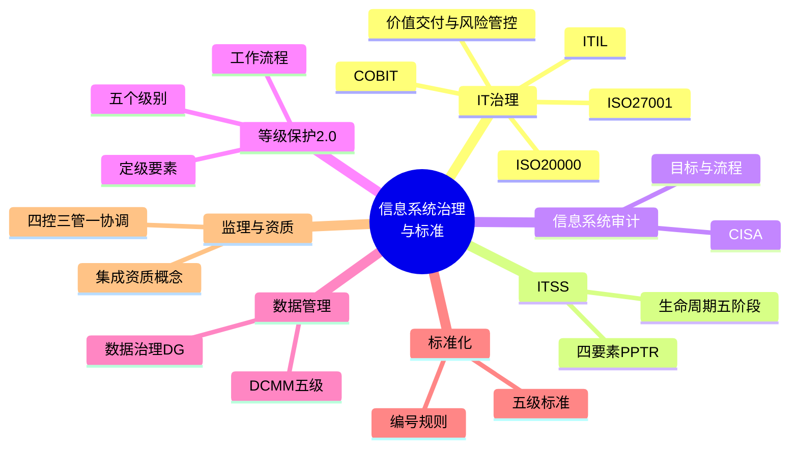
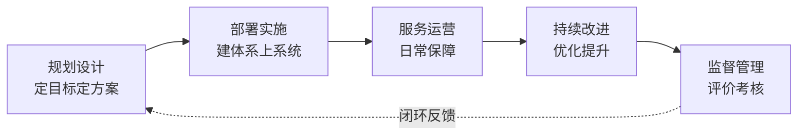

> **摘要**：
> 本章讲"谁来管、按什么规矩管":IT 治理与四大框架(COBIT/ITIL/ISO20000/ISO27001)、ITSS、信息系统审计、等级保护 2.0、数据管理 DCMM、标准分类、监理与集成资质。全是**"定义+要素+流程"的记忆型考点**,上午题近年高频,案例偶尔考监理与等保,论文讲"治理背景"用得上。建议投入 6~8 小时。

## 🗺️ 知识地图

## 📖 掰碎讲解

### 3.1 IT 治理:定义、目标与框架

**是什么**:IT 治理是董事会和高管层的职责,通过**明确 IT 决策权归属和责任机制**,确保 IT 投资**创造价值(价值交付)**并**控制风险(风险管控)**,实现 IT 与业务战略对齐。

**大白话**:IT 管理是"把事做对"(干活),IT 治理是"做对的事、定规矩"(谁来拍板、花了钱值不值、出了事谁负责)。治理是老板层面,管理是经理层面,治理高于管理、指挥管理。

**怎么考**:核心目标两个词——**价值交付 + 风险管控**;"IT 治理与 IT 管理谁包含谁"——治理统摄管理。

四大框架一句话定位(配对题之王):

| 框架 | 定位 | 记忆点 |
| --- | --- | --- |
| COBIT | **IT 治理**框架,业务导向,覆盖"治理+管理"目标域 | 治理找 COBIT |
| ITIL | **IT 服务管理**最佳实践库(非认证标准,是方法论) | 服务找 ITIL |
| ISO20000 | IT 服务管理**国际标准**(体系可认证) | "标准版 ITIL" |
| ISO27001 | **信息安全管理体系(ISMS)**国际标准(可认证) | 安全找 27001 |

> **提示**：
> "治理 COBIT、服务 ITIL、服务标准 20000、信息安全 27001"。题目问"IT 服务管理最佳实践"选 ITIL,问"信息安全管理体系标准"选 ISO27001。

### 3.2 ITSS:四要素 PPTR 与生命周期五阶段(必背)

**是什么**:ITSS(信息技术服务标准)是在中国环境下指导 IT 服务研发、经营和管理的一整套标准体系。核心是能力四要素 **PPTR**:

| 要素 | 含义 | 类比开饭店 |
| --- | --- | --- |
| **P** 人员 Personnel | 人的知识、技能、经验 | 厨师 |
| **P** 过程 Process | 规范的流程方法 | 菜谱工序 |
| **T** 技术 Technology | 支撑服务的技术手段 | 灶具厨艺 |
| **R** 资源 Resource | 工具、知识库、备件等 | 食材与仓库 |

IT 服务生命周期五阶段(顺序必背):

**大白话**:开一家 IT 服务"餐厅":先规划设计菜单(规划),装修开业(部署实施),天天营业(运营),听差评改菜(持续改进),卫生局检查评级(监督管理)。

**怎么考**:PPTR 四要素默写与判断("人员、过程、技术、资源");五阶段排序题——**规划设计→部署实施→服务运营→持续改进→监督管理**。最易错:把"监督管理"排到最前或漏掉。

### 3.3 IT 服务管理(ITSM)与运维管理

**是什么**:ITSM 以**流程为中心、以客户为导向**,把 IT 服务变成标准流程来管。核心流程:事件管理(快速恢复)、问题管理(找根因)、变更管理、配置管理、发布管理等。运维管理强调按 **SLA(服务级别协议)**承诺的质量保障日常运行:监控、巡检、备份、故障响应。

**大白话**:ITSM 就是 IT 部门的"员工手册"——用户报修(事件),查为什么老坏(问题),要换零件走审批(变更),所有设备登记造册(配置),答应几点修好就几点修好(SLA)。

**怎么考**:"事件管理 vs 问题管理"——事件求**快恢复**,问题挖**根因**;SLA 是服务质量承诺的书面协议。

### 3.4 数据管理:数据治理 DG 与 DCMM

**是什么**:
- **数据治理(DG)**:对数据资产管理的一整套**决策权与职责**体系,目标是让数据可用、可信、可控(数据质量、数据标准、数据安全、元数据管理等)。
- **DCMM(数据管理能力成熟度评估模型)**:国家标准,8 个能力域(数据战略、数据治理、数据架构、数据应用、数据安全、数据质量、数据标准、数据生存周期),**五级成熟度**:

| 级别 | 名称 | 状态 |
| --- | --- | --- |
| 1 | 初始级 | 拍脑袋、无序 |
| 2 | 受管理级 | 局部有规矩 |
| 3 | 稳健级 | 全局标准化 |
| 4 | 量化管理级 | 用数字说话 |
| 5 | 优化级 | 持续自我优化,行业标杆 |

**大白话**:DCMM 五级像健身水平:1 级小白乱练,2 级请了教练有点章法,3 级全身系统训练,4 级戴手环看数据练,5 级自己能调整出一套新练法。

**怎么考**:五级名称与特征配对(顺序:初始→受管理→稳健→量化管理→优化);"数据治理是数据管理的核心/基础之一"类判断。

### 3.5 信息系统审计

**是什么**:信息系统审计是由审计人员对信息系统的**规划、开发、运行维护**等全过程及其产出进行检查评价,判断其真实性、完整性、可靠性、安全性、效率与效果,并提出改进建议。知名资格:**CISA(注册信息系统审计师)**。

审计基本流程:**审计计划(准备)→ 审计实施(符合性测试+实质性测试)→ 审计报告 → 后续跟踪**。

**大白话**:IT 审计师像"查账的侦探":先列侦查计划,再实地取证(制度执行了吗?数据对得上吗?),最后写报告揪问题,回头还要看整改没整改。

**怎么考**:审计目标关键词(真实、完整、可靠、安全、效率、效果);流程排序;"符合性测试查制度执行、实质性测试查数据结果"的区分。

### 3.6 网络安全等级保护 2.0(五级 + 流程必背)

**是什么**:等级保护 2.0 是我国网络安全的基本制度,对信息系统分**五个级别**保护(定性理解):

| 级别 | 通俗定性 | 受破坏后果 |
| --- | --- | --- |
| 第一级 | 自主保护 | 损害公民法人合法权益,不危害社会秩序和国家安全 |
| 第二级 | 指导保护 | 严重损害公民法人权益,或损害社会秩序公共利益,不危害国家安全 |
| 第三级 | **监督保护** | 严重危害社会秩序公共利益,或**危害国家安全** |
| 第四级 | 强制保护 | 特别严重危害社会秩序公共利益,或严重危害国家安全 |
| 第五级 | 专控保护 | 特别严重危害国家安全 |

定级两要素:**受侵害的客体** + **侵害程度**。工作流程(顺序必背):**定级 → 备案 → 建设整改 → 等级测评 → 监督检查**。

**大白话**:像给建筑定防火等级:小仓库自己看着办(一级),写字楼要消防指导(二级),机场车站国家重点盯(三级以上)。二级以上系统要到公安机关备案,测评不达标要整改。

**怎么考**:级别与定性描述配对("关乎国家安全→三级及以上");五步流程排序;"谁是定级要素"选客体+程度。

### 3.7 标准与标准化(编号规则判断)

**是什么**:标准分级(我国):

| 层级 | 代号 | 说明 |
| --- | --- | --- |
| 国家标准 | **GB(强制性)/ GB/T(推荐性)** / GB/Z 指导性 | 强制性必须执行 |
| 行业标准 | 如 YD(通信)、SJ(电子)等,加 /T 为推荐 | 行业内统一 |
| 地方标准 | **DB**+省级行政区代码 | 地方特色 |
| 团体标准 | **T/** 开头 | 学会、协会制定 |
| 企业标准 | **Q/** 开头 | 企业自定,应严于国标 |

编号格式:**代号 + 顺序号 — 年份**(如 GB/T 19001—2016)。国际标准组织:ISO(国际标准化组织)、IEC(电工)、ITU(电信)。

**大白话**:GB 带 /T 是"建议这么做",不带 /T 是"必须这么做"。一旦推荐性标准被合同或文件引用,也就有了约束力。

**怎么考**:代号识别(GB/T 是推荐性国标;T/xxx 是团体标准;DB 是地方标准);"强制性标准必须执行"。

### 3.8 信息系统工程监理(四控三管一协调)

**是什么**:与第 1 章呼应:监理单位受**建设单位**委托,依据法律法规、标准和合同,对信息化工程实施监督管理。内容必背——
- **四控**:质量控制、进度控制、**投资控制**、变更控制;
- **三管**:合同管理、信息(文档)管理、安全管理;
- **一协调**:沟通协调。

监理依据:法律法规与技术标准、信息化工程监理规范、**建设合同与监理合同**。

**大白话**:监理是甲方雇的"第三方监工":不替你干活,但替你盯着干活的——干得好不好(质量)、快不快(进度)、花得多不多(投资)、改图纸有没有走流程(变更)。

**怎么考**:案例默写"四控三管一协调";判断"'成本控制'属于监理四控"是**错**的(是投资控制);监理受"建设单位"委托而非承建单位。

### 3.9 信息系统集成资质相关概念

**是什么**:信息系统集成与服务资质曾实行行政审批认定,后**取消行政审批**,转向行业自律的**能力评估**(如信息系统建设和服务能力评估 CS、信息系统服务商交付能力评估等),由第三方机构评估发证,分等级反映企业能力。

**大白话**:以前是"政府发驾照",现在是"行业协会考级"——证书还是那张证书,但发证方式从行政强制变成了自愿评估、市场认可。

**怎么考**:判断"系统集成资质仍属行政审批"是**错**的;"能力评估强调企业自身服务能力与交付水平"。

## 🎬 推荐视频

| 视频 | 讲什么 | 什么时候看 |
| --- | --- | --- |
| [野人老师高项全集 67 集](https://www.bilibili.com/video/BV1dJ41117Aa) | 治理/ITSS/监理部分,口诀讲得溜 | 第一轮入门 |
| [希赛第 4 版精讲 187 集](https://www.bilibili.com/video/BV1i3ovYrEek) | 标准体系讲解最全,条目清晰 | 一轮补漏 + 二轮查表式回看 |
| [summer 课堂第 4 版快速串讲 30 集](https://www.bilibili.com/video/BV1vz4y1a7fM) | 快速串 1-7 章 | 二轮冲刺过框架 |

## ⭐ 章节重点(考前必背)

| 考点 | 必背内容 | 考法标签 |
| --- | --- | --- |
| IT 治理目标 | 价值交付 + 风险管控;治理统摄管理 | 上午题 |
| 四大框架 | COBIT 治理 / ITIL 服务最佳实践 / ISO20000 服务标准 / ISO27001 信息安全 | 上午题配对 |
| ITSS 四要素 | PPTR:人员、过程、技术、资源 | **必背默写** |
| ITSS 生命周期 | 规划设计→部署实施→服务运营→持续改进→监督管理 | 排序题 |
| 等保 2.0 | 五级(三级起涉国家安全);定级→备案→建设整改→测评→监督检查 | 排序 + 定性配对 |
| DCMM | 初始→受管理→稳健→量化管理→优化(五级) | 上午题 |
| 标准代号 | GB 强制 / GB/T 推荐 / DB 地方 / T/ 团体 / Q/ 企业 | 上午题 |
| 监理 | 四控(质量进度投资变更)+三管(合同信息安全)+一协调 | **案例必考默写** |
| 审计 | 计划→实施→报告→跟踪;CISA | 上午题 |
| 集成资质 | 行政审批已取消,转为能力评估 | 判断题 |

## 🧠 高频考法与陷阱

> **注意**：
> 1. **错误认知:ITIL 是国际标准。→ 正确认知**:ITIL 是**最佳实践方法论**,可认证的国际标准是 **ISO20000**(服务)和 **ISO27001**(安全)。
> 2. **错误认知:ITSS 生命周期第一环是"监督管理"。→ 正确认知**:顺序是规划设计→部署实施→服务运营→持续改进→**监督管理**(监督在最后,起闭环作用)。
> 3. **错误认知:监理的"四控"包含成本控制。→ 正确认知**:四控 = 质量、进度、**投资**、变更;"成本控制"是项目成本管理语境的词。
> 4. **错误认知:信息系统受破坏影响国家安全也只是二级。→ 正确认知**:凡"危害国家安全"至少**第三级**(监督保护)。
> 5. **错误认知:GB/T 是强制性国标。→ 正确认知**:GB/T 是**推荐性**国标;不带 T 的 GB 才是强制性。
> 6. **错误认知:事件管理和问题管理是一回事。→ 正确认知**:事件管理追求**快速恢复服务**,问题管理追求**查明根因**防止再犯。

## ✍️ 反复练习题

**第 1 题(选择)** IT 治理的核心目标可以概括为:
A. 降低成本与提高效率　B. 价值交付与风险管控　C. 技术选型与人员考核　D. 系统建设与运行维护

> **示例**：
> **答案:B**
> IT 治理通过明确决策权与责任机制,确保 IT 投资产生价值(价值交付)并控制风险(风险管控),实现 IT 与业务对齐。

**第 2 题(选择)** 下列框架/标准与定位对应错误的是:
A. COBIT—IT 治理框架　B. ITIL—IT 服务管理最佳实践　C. ISO20000—信息安全管理体系　D. ISO27001—信息安全管理体系

> **示例**：
> **答案:C**
> ISO20000 是 **IT 服务管理**体系标准;信息安全管理体系是 ISO27001。记忆:安全找 27001,服务标准找 20000。

**第 3 题(选择)** ITSS 信息技术服务能力四要素是:
A. 人员、过程、技术、资源　B. 人员、产品、技术、资源　C. 计划、过程、技术、风险　D. 人员、流程、工具、成本

> **示例**：
> **答案:A**
> PPTR:人员(Personnel)、过程(Process)、技术(Technology)、资源(Resource)。案例默写同样考。

**第 4 题(选择)** ITSS 生命周期的正确顺序是:
A. 部署实施→规划设计→服务运营→持续改进→监督管理
B. 规划设计→部署实施→服务运营→持续改进→监督管理
C. 规划设计→服务运营→部署实施→监督管理→持续改进
D. 规划设计→部署实施→持续改进→服务运营→监督管理

> **示例**：
> **答案:B**
> 五阶段:规划设计 → 部署实施 → 服务运营 → 持续改进 → 监督管理。记忆:先设计、再上线、然后运营、边运营边改进、全程被监督。

**第 5 题(选择)** 根据等级保护 2.0,一旦系统被破坏会"危害国家安全",该系统至少应定为:
A. 第一级　B. 第二级　C. 第三级　D. 第五级

> **示例**：
> **答案:C**
> 第三级的定性描述:严重危害社会秩序和公共利益,或**危害国家安全**。五级是"特别严重危害国家安全"。定级要素 = 受侵害客体 + 侵害程度。

**第 6 题(选择)** 以下标准代号属于推荐性国家标准的是:
A. GB　B. GB/T　C. DB　D. Q/

> **示例**：
> **答案:B**
> GB 是强制性国家标准,GB/T 是推荐性国家标准,DB 是地方标准,Q/ 是企业标准,T/ 开头为团体标准。推荐性标准一经合同引用即具约束力。

**第 7 题(选择)** 关于信息系统集成资质,正确的说法是:
A. 仍由国家主管部门行政审批认定
B. 已取消行政审批,转向能力评估等行业自律方式
C. 资质证书由承建单位自行颁发
D. 监理单位必须持有集成资质

> **示例**：
> **答案:B**
> 集成资质行政审批已取消,现通过信息系统建设和服务能力评估(CS)等自律性评估反映企业能力。监理单位需要的是监理相关能力/资格,不是集成资质。

**第 8 题(案例风格)** 某单位政务信息系统定级为第三级,即将上线。请回答:
(1) 写出等级保护 2.0 的主要工作流程(五个环节)。
(2) 该系统上线后,运维方依据 ITSS 建立服务体系,请写出 ITSS 能力四要素和生命周期五阶段。
(3) 甲方同时聘请了监理,请写出监理工作内容口诀及其全部条目。

> **示例**：
> (1) **定级 → 备案 → 建设整改 → 等级测评 → 监督检查**。第三级系统需向公安机关备案,测评合格方可运行,之后接受定期测评与监督检查。
> (2) 四要素(PPTR):**人员、过程、技术、资源**;生命周期五阶段:**规划设计、部署实施、服务运营、持续改进、监督管理**。
> (3) 口诀"**四控三管一协调**":四控=质量控制、进度控制、投资控制、变更控制;三管=合同管理、信息(文档)管理、安全管理;一协调=沟通协调。

## 🔗 相关章节

- 信息化与监理背景:[01-信息化与信息系统](01-信息化与信息系统/)
- 技术与安全基础:[02-信息技术发展前沿](02-信息技术发展前沿/)
- 法规与职业道德:[16-法规标准与职业道德](16-法规标准与职业道德/)
- 概论衔接:[04-项目管理概论](04-项目管理概论/)
- 真题战略:[项管-真题战略](../项管-真题战略/)、[qicoder真题索引](../../99-真题资源/qicoder真题索引/)
