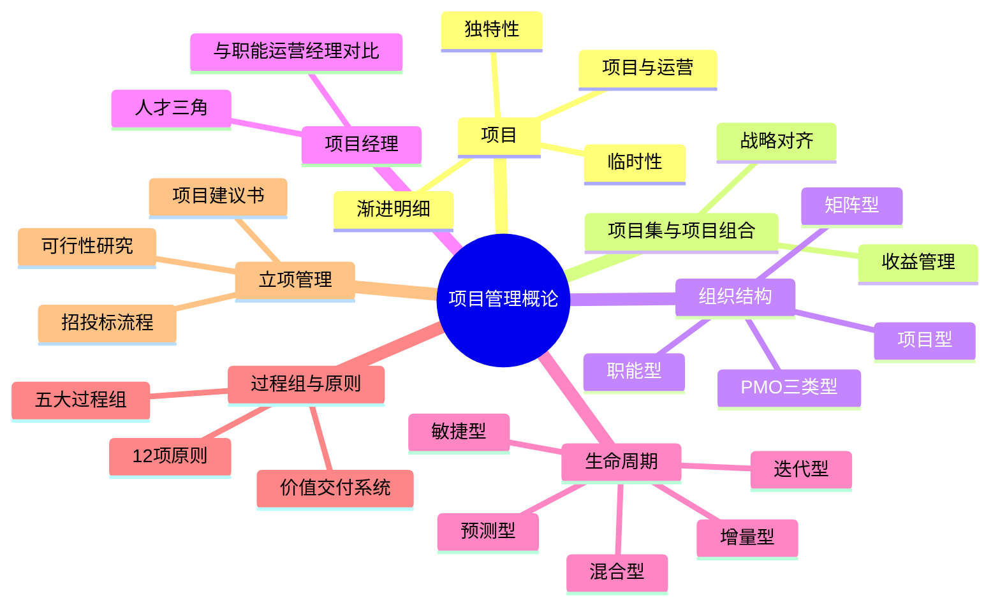
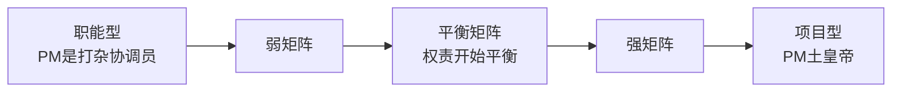
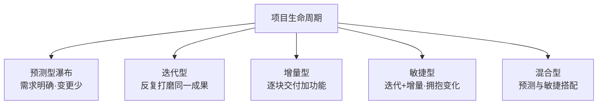
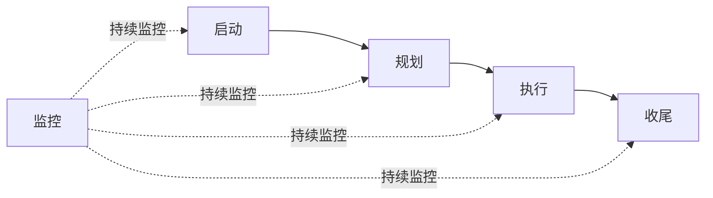

> **摘要**：
> 本章是项目管理的"世界观":项目的定义与特征、项目与运营、项目集/项目组合、组织结构与 PMO、项目经理人才三角、生命周期类型、五大过程组、12 项原则、价值交付系统,最后落到**项目立项管理与招投标**。上午题近年高频(组织结构、过程组、立项流程),案例也爱考组织结构与立项,论文里"项目经理角色""生命周期选择"是万能素材。建议投入 8~10 小时。

## 🗺️ 知识地图

## 📖 掰碎讲解

### 4.1 项目:定义与三大特征(判断题之母)

**是什么**:项目是为创造**独特的产品、服务或成果**而进行的**临时性**工作。三大特征:
- **临时性**:有明确的开始和结束,不代表时间短,代表"有终点";
- **独特性**:可交付成果独一无二,至少某方面不同;
- **渐进明细**:细节随进展逐步清晰,先粗后细。

**大白话**:办婚礼是项目(有日子、独一无二的婚礼、半年前只定酒店半年后才定菜谱);过日子是运营(每天买菜做饭,重复持续)。判断"是不是项目"就看三点:**有终点吗?独特吗?细节是不是越干越清楚?**

**怎么考**:"重复性生产是项目"(错,那是运营);"项目一定是短期任务"(错,临时性≠时间短,修青藏线好几年也是项目);"渐进明细=范围蔓延"(错,渐进明细是正常逐步细化,蔓延是未受控增加)。

### 4.2 项目 vs 运营(对比表)

| 维度 | 项目 | 运营 |
| --- | --- | --- |
| 持续性 | 临时,有始有终 | 持续、重复 |
| 目标 | 达成后结束 | 维持业务运转 |
| 特点 | 独特 | 例行 |
| 例子 | 开发一套新系统 | 系统上线后的日常值班运维 |

> **提示**：
> 项目是"结婚",运营是"过日子";项目结束有"散伙饭"(收尾),运营没有散伙的那天。

### 4.3 项目集与项目组合(收益管理重点)

**是什么**:
- **项目集**:一组**相互关联**且被协调管理的项目、子项目集和项目集活动,目的是获得**单独管理所无法获得的收益**——灵魂是**收益管理**。
- **项目组合**:为实现战略目标而组合管理的项目、项目集、子项目组合和运营工作,**不必相互依赖**,核心是**优先级排序、资源分配、战略对齐**。

**大白话**:项目集像"连续剧"——几部剧共享世界观、联动播出,合起来才赚大钱(1+1>2);项目组合像"投资理财组合"——股票、基金、存款凑一起,只问"哪些最值、先投谁",彼此不必认识。

**怎么考**:关键词配对——"相互关联、协同收益"→项目集;"战略对齐、不一定相互依赖、定期评审优先级"→项目组合;"项目集管理重点关注收益"是经典考点。

### 4.4 组织结构三种对比(大表必背)

**是什么**:项目经理权力从"没有"到"全权"的频谱:

| 维度 | 职能型 | 弱矩阵 | 平衡矩阵 | 强矩阵 | 项目型 |
| --- | --- | --- | --- | --- | --- |
| 项目经理权力 | 几乎没有 | 小 | 小到中 | 中到大 | 几乎全权 |
| 全职项目人员比例 | 几乎没有 | 0~25% | 15%~60% | 50%~95% | 85%~100% |
| 预算控制者 | 职能经理 | 职能经理 | 项目经理与职能经理共同 | 项目经理 | 项目经理 |
| 项目经理角色 | 兼职(协调员/联络员) | 兼职 | 全职 | 全职 | 全职 |
| 资源可用性 | 几乎没有 | 少 | 少到中 | 中到大 | 几乎全部 |

**大白话**:职能型=在部门里"借调着帮忙干活,说话没人听";项目型="自带人马、管钱管人,一呼百应";矩阵型=两头听命于"职能经理(亲妈)"和"项目经理(班主任)",平衡矩阵就是两边权力打平。

**怎么考**:给场景判断组织类型;数字考点(项目型全职比例 85%~100%、预算控制者);矩阵下员工"双重汇报"的冲突;弱/平衡/强矩阵的判别(看项目经理权力与是否全职)。

**PMO 三种类型**:

| 类型 | 控制程度 | 职责 |
| --- | --- | --- |
| 支持型 | 低 | 顾问+模板+经验库,项目爱听不听 |
| 控制型 | 中 | 要求遵从模板与流程,提供支持+适度管控 |
| 指令型 | 高 | 直接管理和控制项目,PM 由 PMO 派 |

### 4.5 项目经理:人才三角与角色对比

**是什么**:项目经理胜任力**人才三角**(第 4 版表述):**项目管理专业技能(技术能力)、领导力、战略与商务管理能力**。

**大白话**:优秀 PM 是"三头六臂":一头懂技术手法(能把活管明白),一头会带人鼓劲(领导力:带队、沟通、谈判、影响力),一头懂生意(明白项目为公司赚什么、花什么)。

与职能经理、运营经理对比:

| 角色 | 关注点 | 权力来源 |
| --- | --- | --- |
| 项目经理 | 临时性任务的**目标达成** | 职权+影响力(矩阵下职权有限) |
| 职能经理 | 部门专业与**人员管理** | 行政职权 |
| 运营经理 | 持续性业务的**效率稳定** | 行政职权 |

**怎么考**:人才三角三要素配对;"项目经理更多靠影响力而非职权开展工作"(矩阵环境);领导力技能包括沟通、谈判、决策、影响力等。

### 4.6 项目生命周期与开发方法(对比必考)

| 类型 | 思路 | 需求要求 | 类比 | 风险 |
| --- | --- | --- | --- | --- |
| 预测型(瀑布) | 一次性规划,顺序执行到底 | 一开始就明确 | 盖楼:图纸定死再动工 | 变更代价大 |
| 迭代型 | 反复循环打磨**同一个东西**,越改越精 | 可以先不明确 | 雕像:一刀刀修出来 | — |
| 增量型 | 分块交付,**逐步增加功能**,每块都可用 | 相对明确 | 吃自助:一盘一盘端上来 | — |
| 敏捷型 | 迭代+增量结合,短周期小步快跑 | 高度不确定 | 刷剧更新:两周一集边拍边改 | 适应变化 |
| 混合型 | 预测+敏捷混搭 | 部分明确部分不明 | 楼体按图纸盖,装修按你口味改 | — |

**产品生命周期**:引入 → 成长 → 成熟 → 衰退——产品从生到死;一个产品生命周期可包含**多个项目生命周期**。"产品生命周期包含项目生命周期"是判断点。

**怎么考**:迭代 vs 增量的区分(迭代是"反复改同一件",增量是"一件一件加");场景选型;产品生命周期四阶段排序。

### 4.7 五大过程组(交互与贯穿)

**是什么**:**启动 → 规划 → 执行 → 监控 → 收尾**。

| 过程组 | 关键活动 | 记忆点 |
| --- | --- | --- |
| 启动 | 制定项目章程、识别干系人 | 立项开工、拿到"尚方宝剑" |
| 规划 | 制定计划与各基准 | 想清楚再干 |
| 执行 | 按计划干活、团队管理 | 花钱最多、人最多 |
| 监控 | 对照基准看偏差、控制变更 | **贯穿始终**,从启动直到收尾 |
| 收尾 | 验收移交、总结经验、释放资源 | 正式结束、善后 |

**怎么考**:监控组**贯穿全过程**(不是排在最后);执行过程组消耗预算和资源最多;收尾要做"经验教训总结";过程组≠项目阶段(阶段里也会循环各过程组)。

### 4.8 项目管理 12 项原则(第 4 版新增,论文素材库)

**是什么与口诀记忆**(每条抓 2 个字):

| # | 原则 | 2 字缩记 |
| --- | --- | --- |
| 1 | 成为勤勉、尊重和关心他人的**管家** | 管家 |
| 2 | 营造协作的**团队**环境 | 团队 |
| 3 | 有效地促进**干系人**参与 | 干系 |
| 4 | 聚焦于**价值** | 价值 |
| 5 | 识别、评估和响应**系统**交互 | 系统 |
| 6 | 展现**领导**力行为 | 领导 |
| 7 | 根据环境进行**裁剪** | 裁剪 |
| 8 | 将**质量**融入过程和可交付成果 | 质量 |
| 9 | 驾驭**复杂**性 | 复杂 |
| 10 | 优化**风险**应对 | 风险 |
| 11 | 拥抱适应性和**韧性** | 韧性 |
| 12 | 为实现目标而驱动**变革** | 变革 |

**大白话**:口诀串成一句话——"**管家带团队,干系要价值;系统看领导,裁剪保质量;复杂与风险,韧性促变革**"。12 条原则是第 4 版教材的灵魂新增,论文里每条都能当"指导思想"写。

**怎么考**:上午题考原则关键词匹配(如"根据环境进行裁剪");论文中引用 2~3 条原则显得专业。

### 4.9 价值交付系统(第 4 版新框架)

**是什么**:组织是一个**价值交付系统**,通过价值链创造价值;**项目组合、项目集、项目**与运营一起,围绕战略和商业目标协作交付价值;价值包括客户/最终用户的价值,也包含组织自身的收益。项目存在于更大的系统环境中,干系人价值是核心。

**大白话**:公司是个"价值工厂":战略是总图纸,项目组合是车间排产,项目集是流水线,项目是每个工位;光造出产品不算完,客户用着爽、公司赚到钱,价值才真正落地。

**怎么考**:"项目是为干系人创造价值的手段";项目组合/项目集/项目与运营协作于价值交付链;详细展开在 [14-绩效域与价值交付](14-绩效域与价值交付/)。

### 4.10 项目立项管理(可研 + 招投标,流程必背)

**是什么**:立项管理 = 从"想干"到"批准干"的全过程:

可行性研究内容(背关键词):**技术可行性、经济可行性(投资估算与效益)、社会效益可行性、运行环境可行性(管理与人员)、法律可行性**等;先**初步可研**(粗判值不值得细做),再**详细可研**(出报告),再**项目评估与决策**(第三方/专家评审,拍板)。

招投标要点(必考判断):
- 方式:**公开招标**(公告,人人可投)与**邀请招标**(向 3 家以上具备能力的发出邀请);
- 资格审查:**资格预审**(发标前)与**资格后审**(开标后);
- **评标委员会**:招标人代表 + 技术经济专家,成员**5 人以上单数**,其中技术经济专家**不少于 2/3**;
- 开标在投标截止时间的**同一时间**公开进行;中标后应**签订合同**,禁止转包与违法分包。

**大白话**:立项像相亲结婚流程:项目建议书是"我想结婚的理由",可研是"他俩合不合适(技术行不行、钱够不够、日子能不能过)",评估决策是"父母拍板",招投标是"办婚礼招标婚庆公司",签合同是"领证"。

**怎么考**:流程排序(建议书→可研→评估决策→招标→投标→开标→评标→中标→签合同);"评标委员会人数与专家比例"数字题;"资格预审在哪个阶段";可研内容匹配。

## 🎬 推荐视频

| 视频 | 讲什么 | 什么时候看 |
| --- | --- | --- |
| [夏天老师 2027 第 4 版公开课 53 集](https://www.bilibili.com/video/BV1TFBpBKExt) | 概论+组织结构+生命周期,第 4 版口径 | 第一轮主力跟课 |
| [野人老师高项全集 67 集](https://www.bilibili.com/video/BV1dJ41117Aa) | 组织结构与生命周期讲得生动 | 第一轮补充,难懂处反复听 |
| [summer 课堂第 4 版快速串讲 30 集](https://www.bilibili.com/video/BV1vz4y1a7fM) | 快速串 1-7 章 | 二轮过框架 |
| [软考老金高项](https://www.bilibili.com/video/BV1KtRQBtEQa) | ITTO 记忆思路,帮你建立全局观 | 学完 5-9 章后回看串联 |

## ⭐ 章节重点(考前必背)

| 考点 | 必背内容 | 考法标签 |
| --- | --- | --- |
| 项目三特征 | 临时性、独特性、渐进明细 | 上午题判断 |
| 项目 vs 运营 | 临时独特 vs 持续重复 | 上午题 |
| 项目集 | 相互关联 + **收益管理**(单独管理无法获得的收益) | 上午题 |
| 项目组合 | 战略对齐、优先级、**不必相互依赖** | 上午题 |
| 组织结构 | 五型频谱表:权力、全职比例、预算控制者 | **案例必考** |
| PMO | 支持型/控制型/指令型,控制程度低中高 | 上午题 |
| 人才三角 | 项目管理专业技能、领导力、战略与商务管理 | **论文素材** |
| 生命周期 | 预测/迭代/增量/敏捷/混合;迭代≠增量 | 上午题对比 |
| 过程组 | 启动规划执行监控收尾;**监控贯穿始终** | 上午题 |
| 12 原则 | 管家/团队/干系人/价值/系统/领导/裁剪/质量/复杂/风险/韧性/变革 | **论文素材** |
| 立项流程 | 建议书→可研→评估决策→招标投标→开标评标→定标签合同 | **案例必考排序** |
| 评标委员会 | 5 人以上单数,技术经济专家≥2/3 | 上午题数字 |
| 可研内容 | 技术、经济、社会效益、运行环境、法律 | 案例简答 |

## 🧠 高频考法与陷阱

> **注意**：
> 1. **错误认知:项目是临时性的,所以都是短期的。→ 正确认知**:临时性指"有明确的开始与结束",青藏铁路修了好几年也是项目。
> 2. **错误认知:迭代型和增量型一回事。→ 正确认知**:迭代是**反复打磨同一成果**(先出丑版再改精),增量是**一块一块加功能**(每块都可用)。
> 3. **错误认知:项目组合里的项目相互依赖、协同产出收益。→ 正确认知**:那是**项目集**;项目组合只看战略优先级,**不必相互依赖**。
> 4. **错误认知:监控过程组在执行之后进行。→ 正确认知**:监控**贯穿始终**,启动开始就监控,直到收尾。
> 5. **错误认知:平衡矩阵中预算由职能经理控制。→ 正确认知**:平衡矩阵预算由**项目经理与职能经理共同**控制;职能型/弱矩阵才是职能经理控制。
> 6. **错误认知:开标后审查投标资格叫资格预审。→ 正确认知**:开标**前**审查是资格预审,开标后是资格后审。

## ✍️ 反复练习题

**第 1 题(选择)** 以下属于项目的是:
A. 每天例行的系统数据备份　B. 为公司开发一套全新的报销系统　C. 每月固定的工资发放　D. 客服热线的日常接听

> **示例**：
> **答案:B**
> 项目 = 临时 + 独特。A/C/D 都是持续重复的**运营**;开发新系统有明确起止、成果独特,是项目。

**第 2 题(选择)** 某公司同时管理多个不相互依赖的项目与运营工作,按战略贡献排序分配资源,这属于:
A. 项目集管理　B. 项目组合管理　C. 单项目管理　D. PMO 行政管理

> **示例**：
> **答案:B**
> 项目组合的关键词:战略对齐、优先级排序、**不必相互依赖**。项目集强调"相互关联、协同产生单独管理无法获得的收益"。

**第 3 题(选择)** 在平衡矩阵组织中,项目预算通常由谁控制?
A. 职能经理　B. 项目经理与职能经理共同控制　C. 项目经理单独控制　D. PMO 主任

> **示例**：
> **答案:B**
> 职能型/弱矩阵:职能经理控制预算;**平衡矩阵:双方共同控制**;强矩阵与项目型:项目经理控制。对照"权力频谱"大表记忆。

**第 4 题(选择)** 关于五大过程组,正确的说法是:
A. 监控过程组在执行过程组结束后才开始
B. 收尾过程组无需监控
C. 监控过程组贯穿项目始终
D. 过程组就是项目阶段

> **示例**：
> **答案:C**
> 监控从启动前段就开始,一直持续到收尾。过程组是管理维度,阶段是时间维度,两者不是一回事;收尾同样需要监控与确认。

**第 5 题(选择)** 评标委员会的组成,正确的是:
A. 5 人以上单数,技术经济专家不少于 1/2
B. 5 人以上双数,技术经济专家不少于 2/3
C. 5 人以上单数,技术经济专家不少于 2/3
D. 3 人以上单数,专家不限比例

> **示例**：
> **答案:C**
> 评标委员会由招标人代表和技术、经济方面专家组成,**5 人以上单数**,技术经济专家**不得少于成员总数的 2/3**。数字题年年变着花样考。

**第 6 题(选择)** "先反复打磨同一个模型,越改越精细"描述的生命周期类型是:
A. 预测型　B. 迭代型　C. 增量型　D. 混合型

> **示例**：
> **答案:B**
> 迭代 = 反复循环打磨**同一成果**;增量 = 逐块**新增功能**、每块可用。区分口诀:迭代"越改越好",增量"越加越多"。

**第 7 题(选择)** 项目管理 12 项原则中,"根据环境对项目管理方法、治理和过程进行调整"对应:
A. 驾驭复杂性　B. 根据环境进行裁剪　C. 拥抱适应性和韧性　D. 优化风险应对

> **示例**：
> **答案:B**
> 这是"裁剪"原则的定义。裁剪 ≠ 随意删减,而是按项目环境量身定制管理方式。案例和论文都可直接引用。

**第 8 题(案例风格)** 某国企拟投资建设生产管理系统,领导安排你牵头前期工作。请回答:
(1) 写出项目立项管理的主要流程环节(含招投标)。
(2) 可行性研究应从哪些方面展开?
(3) 若采用公开招标,从发布招标公告到签订合同,写出正确顺序,并说明评标委员会组成要求。

> **示例**：
> (1) **项目建议书 → 可行性研究(机会研究/初步可研/详细可研)→ 项目评估与决策 → 招标 → 投标 → 开标 → 评标 → 中标(定标)→ 签订合同**。
> (2) 主要包括:**技术可行性、经济可行性(投资估算与效益分析)、社会效益可行性、运行环境可行性(管理基础与人员条件)、法律可行性**等。
> (3) 顺序:编制招标文件并发布公告 → 投标 → 开标(投标截止同一时间公开)→ 评标 → 定标(中标)→ 签订合同。评标委员会由招标人代表和技术、经济专家组成,**成员 5 人以上单数,其中技术经济专家不少于 2/3**。

## 🔗 相关章节

- 十大知识领域从这里展开:[05-项目整合管理](05-项目整合管理/)、[06-项目范围管理](06-项目范围管理/)、[07-项目进度管理](07-项目进度管理/)
- 价值交付系统详解:[14-绩效域与价值交付](14-绩效域与价值交付/)
- 立项涉及的法规:[16-法规标准与职业道德](16-法规标准与职业道德/)
- 计算基础:[17-项目管理科学基础](17-项目管理科学基础/)
- 攻略:[项管-案例分析攻略](../项管-案例分析攻略/)、[项管-论文攻略](../项管-论文攻略/)、[项管-考试分析](../项管-考试分析/)
