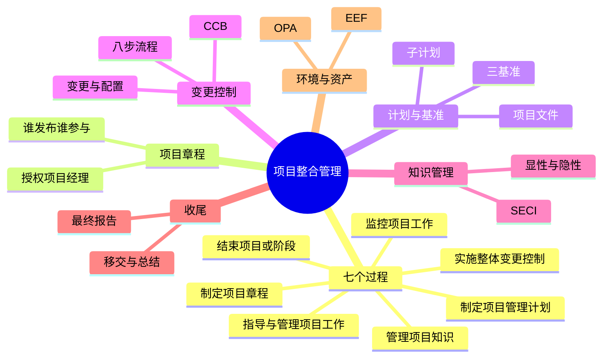
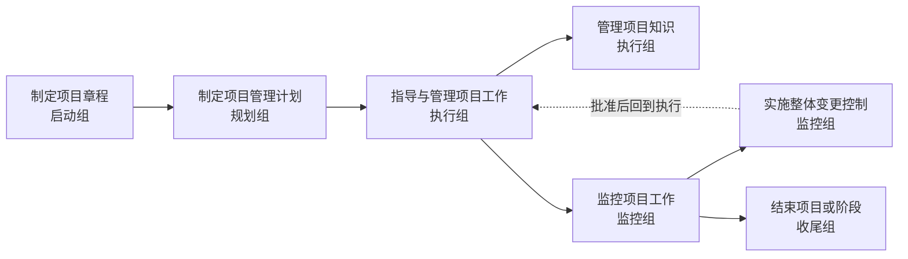
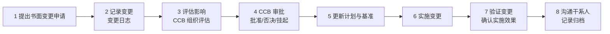

> **摘要**：
> 整合管理是十大知识领域的"总指挥":项目章程、项目管理计划、变更控制八步、知识管理、收尾全在这里。它是**案例题和论文的绝对高频**(变更流程可以默写,论文"整合"是最好写的领域之一),上午题同样近年高频。学弟记住一句话:**整合 = 统筹协调,把所有领域粘成一件事**。建议投入 8~10 小时。

## 🗺️ 知识地图

## 📖 掰碎讲解

### 5.1 整合管理为什么"最难管"

**是什么**:整合管理是对项目管理各过程与活动的**识别、组合、统一与协调**,贯穿项目全程,是项目经理**不可授权**的职责。

**大白话**:其他九大领域像九个声部(范围唱低音、进度打节拍、成本控音量……),整合管理就是指挥家——缺了指挥,每个声部单独听都对,合起来就是灾难。所以整合最难:**它管的是"关系",不是"单科"**。

**怎么考**:"整合管理是项目经理专属、不可向他人授权"——判断题正确;整合发生在过程组之间、知识领域之间的"接口处"。

### 5.2 七个过程总览(按过程组分布)

| 过程 | 所属过程组 | 一句话 |
| --- | --- | --- |
| 制定项目章程 | 启动 | 拿到授权、名正言顺 |
| 制定项目管理计划 | 规划 | 编"总剧本"含三大基准 |
| 指导与管理项目工作 | 执行 | 按剧本开拍 |
| 管理项目知识 | 执行 | 沉淀经验不流失 |
| 监控项目工作 | 监控 | 全程盯着比基准 |
| 实施整体变更控制 | 监控 | 改剧本要走流程 |
| 结束项目或阶段 | 收尾 | 散伙也要有仪式感 |

**怎么考**:过程↔过程组配对;"管理项目知识属于执行过程组"(易错,很多人以为在监控);七个过程的名字要能默写(论文框架)。

### 5.3 项目章程(判断题必考)

**是什么**:项目章程是**正式批准项目成立**、并**授权项目经理动用组织资源**的文件。要点:
- **作用**:授权;把项目与组织战略联系起来;确立项目正式地位。
- **内容**:项目目的、可测量的目标与成功标准、高层级需求、高层级风险、里程碑进度、预先批准的预算、干系人清单、审批要求、**项目经理及其职权**、发起人签名。
- **谁发布**:由**项目以外的机构发布**,如发起人、PMO 或高层;**项目经理可以参与编制**(甚至起草),但**签发不是项目经理**。

**大白话**:章程=项目经理的"圣旨/上岗证"。没有章程,你管项目就是"无名之师",要人没人、要钱没钱。圣旨由皇帝(发起人)下,但可以让你(项目经理)先起草。

**怎么考**:"章程由项目经理签发"(错,由发起人/高层发布);"章程授权项目经理使用组织资源"(对);章程在**启动**过程组制定;变更"章程能不能改"——一般通过变更流程,很少改章程本身。

### 5.4 商业论证与效益管理计划

**是什么**:
- **商业论证**:论证"这个项目值不值得做"(成本效益分析、可行性),文档化经济可行性,为立项和后续验证提供依据;
- **效益管理计划**:说明"收益什么时候、以什么方式实现"(目标效益、时限、责任人、测量指标)。效益实现常在项目结束后才完成,靠运营接力。

**大白话**:商业论证是"开店前的盈利测算",效益管理计划是"开业后每季度怎么核查真赚了没"。项目结了,追收益的路还没走完。

**怎么考**:"效益都在项目结束前实现"(错);商业论证在项目之前/启动阶段形成,项目过程中可修订。

### 5.5 项目管理计划与项目文件(三基准必背)

**是什么**:
- **项目管理计划** = 各**子管理计划**(范围、进度、成本、质量、资源、沟通、风险、采购、干系人)+ **三大基准**(范围基准、进度基准、成本基准)+ 其他组件(生命周期、开发方法、变更管理计划、配置管理计划等);
- **项目文件**:活动清单、风险登记册、干系人登记册、经验教训登记册、变更日志等——**计划是要执行的"法律",文件是随时更新的"工作记录"**。

> **提示**：
> "基准三件套 = 范围 + 进度 + 成本"。口诀:"**范进成**"。质量基准?没有!质量没有基准,别被挖坑。

**大白话**:项目管理计划像"装修合同+施工图",基准是合同里锁死的报价、工期、户型;项目文件像"工地日志",天天记、随便翻新,但改合同(基准)必须走变更。

**怎么考**:"属于基准的有哪些"(三选三);"风险登记册属于项目管理计划"(错,是项目文件);"计划一经批准,更改需走整体变更控制"。

### 5.6 指导与管理项目工作 + 知识管理(SECI)

**是什么**:指导与管理=按计划执行、交付成果、处理变更请求;管理项目知识=使用既有知识并**创造新知识**,分**显性知识**(文档、图纸,说得清)与**隐性知识**(经验、诀窍,说不清),核心思想是 SECI 转化:
- **社会化 S**:隐性 → 隐性(师带徒、共同干活);
- **外化 E**:隐性 → 显性(老司机把经验写成文档);
- **组合 C**:显性 → 显性(汇总多份文档成知识库);
- **内化 I**:显性 → 隐性(新人学文档变成自己的本事)。

**大白话**:显性知识是"菜谱",隐性知识是"妈妈手上的咸淡"。想让店开得久,既要抄下菜谱(外化),也要让徒弟跟着掌勺悟(社会化)。

**怎么考**:SECI 四向转化配对;"隐性知识难以用文档完整传递,人际互动更有效";输出有经验教训登记册、可交付成果、工作绩效数据、变更请求、问题日志。

### 5.7 监控项目工作 + 整体变更控制(案例默写级)

**是什么**:监控=拿**工作绩效信息**与基准比对,预测趋势,提变更请求;整体变更控制=审查所有变更请求,**批准或否决**变更,并管理基准的变更。

**变更控制八步流程(背到能默写)**:

**CCB(变更控制委员会)**:
- 组成:项目经理、用户代表、管理层、相关技术专家等;
- 职责:**审查、评价、批准/否决/推迟**变更请求;是**决策机构**,不亲自实施变更;
- 项目经理可以是成员,但**不能绕过 CCB 擅自批准影响基准的变更**;
- 紧急情况可"先处置、后补手续",但仍需记录与事后追认。

**大白话**:变更流程就像"改购房合同":先书面提(1),备案登记(2),评估改动影响(3),双方谈判拍板(4),改合同文本(5),照新合同施工(6),验房(7),通知所有人新合同生效(8)。谁也不能口头改合同直接开工!

**怎么考**:案例找错题——"项目经理口头同意甲方需求并直接安排开发"连错多处(无书面申请、未走 CCB、未更新基准);排序题;CCB 职责判断("CCB 负责实施变更"错)。

**变更与配置的关系**:变更管理关注**基准与计划的改变**(改不改),配置管理关注**可交付成果及其版本状态**(改了之后东西对不对、版本清不清);变更管理是配置管理的重要组成部分/两者协同,配置项的变更通过变更控制管理。详见 [15-配置与变更管理](15-配置与变更管理/)。

### 5.8 OPA vs EEF(判断题收割机)

| 对比 | 组织过程资产 OPA | 事业环境因素 EEF |
| --- | --- | --- |
| 来源 | 组织**内部**积累 | 组织内外部的**环境** |
| 可控性 | 项目团队**可更新、可控** | 团队**不可控,只能遵守** |
| 例子 | 流程程序、模板、历史信息、经验教训库、知识库 | 政府法规、行业标准、市场条件、**组织文化**、现有设施与人力资源、IT 软件环境 |

**大白话**:OPA 是"祖传家宝"(自己家的模板和账本,可以添置更新);EEF 是"天气和交规"(下雨不能种太阳,红灯必须停,你只能适应)。

**怎么考**:判断归属——"公司历史项目数据"=OPA;"国家行业标准"=EEF;"组织文化"=**EEF**(虽然在公司内部,但团队改不了,这是最经典的坑!);"项目管理信息系统"=EEF。

### 5.9 结束项目或阶段(收尾)

**是什么**:收尾要做的事:
1. 确认可交付成果已验收(拿验收文件);
2. **移交**产品给运营/客户;
3. 总结**经验教训**(更新经验教训登记册并归档);
4. 更新**组织过程资产**(模板、历史数据沉淀);
5. **释放资源**(开散伙饭,人放回部门);
6. 编写**最终报告**(概述、目标达成情况、绩效、偏差原因、经验教训等)。

**大白话**:好聚好散——验完货(验收)、交钥匙(移交)、写复盘(经验教训)、存档案(OPA)、发遣散费(释放资源),最后交一份"项目一生的总结报告"。

**怎么考**:"项目提前终止就不用收尾"(错,终止也要走收尾程序);"收尾要释放资源"(对);最终报告内容匹配;行政收尾 vs 合同收尾的概念区分。

## 🎬 推荐视频

| 视频 | 讲什么 | 什么时候看 |
| --- | --- | --- |
| [软考老金高项](https://www.bilibili.com/video/BV1KtRQBtEQa) | ITTO 记忆法,把整合七过程串成故事 | 一轮后立刻看,治"背了就忘" |
| [夏天老师 2027 第 4 版公开课 53 集](https://www.bilibili.com/video/BV1TFBpBKExt) | 第 4 版口径的整合管理精讲 | 第一轮主力 |
| [野人老师高项全集 67 集](https://www.bilibili.com/video/BV1dJ41117Aa) | 章程/变更讲得生动 | 难点回炉 |
| [summer 课堂第 4 版快速串讲 30 集](https://www.bilibili.com/video/BV1vz4y1a7fM) | 串讲巩固 | 二轮冲刺 |

## ⭐ 章节重点(考前必背)

| 考点 | 必背内容 | 考法标签 |
| --- | --- | --- |
| 整合定位 | 统筹协调;**项目经理专属不可授权** | 上午题 |
| 七个过程 | 章程/计划/指导管理/知识/监控/整体变更/结束 | 论文框架默写 |
| 项目章程 | 授权项目经理;发起人发布;PM 可参与编制 | **判断题必考** |
| 三基准 | 范围基准、进度基准、成本基准("范进成") | **必背** |
| 变更八步 | 书面申请→记录→评估→CCB 审批→更新计划基准→实施→验证→沟通归档 | **案例必考默写** |
| CCB | 决策机构(批准/否决/推迟);不实施变更 | 案例找错 |
| OPA vs EEF | OPA 可控可更新;EEF 不可控;**组织文化属 EEF** | 判断题收割 |
| 知识管理 | 显性/隐性;SECI 四向转化 | 上午题 |
| 收尾 | 验收、移交、经验教训、更新 OPA、释放资源、最终报告 | 案例简答 |
| 商业论证 | 论证值不值得做;效益可跨项目结束后实现 | 上午题 |

## 🧠 高频考法与陷阱

> **注意**：
> 1. **错误认知:项目章程由项目经理签发。→ 正确认知**:章程由**发起人/高层/PMO 等项目以外的人发布**,项目经理可**参与编制**但无权签发自己。
> 2. **错误认知:质量基准属于三大基准之一。→ 正确认知**:三基准 = **范围 + 进度 + 成本**,没有"质量基准"。
> 3. **错误认知:组织文化是组织过程资产。→ 正确认知**:组织文化属于**事业环境因素 EEF**——它在组织内部,但项目团队改变不了它,这正是 EEF 的特征。
> 4. **错误认知:紧急变更可以先干再补流程,就不用记录了。→ 正确认知**:紧急时可以先处置**后补审批**,但必须**记录并事后追认**,流程一步不能省。
> 5. **错误认知:CCB 负责实施变更。→ 正确认知**:CCB 是**决策机构**(批准/否决/推迟),实施由项目团队执行。
> 6. **错误认知:管理项目知识属于监控过程组。→ 正确认知**:属于**执行**过程组,与"指导与管理项目工作"并行。

## ✍️ 反复练习题

**第 1 题(选择)** 关于项目章程,正确的说法是:
A. 由项目经理签发并发布
B. 授权项目经理使用组织资源开展项目
C. 只能在项目结束后修订
D. 内容需包含详细的 WBS

> **示例**：
> **答案:B**
> 章程的核心作用就是**授权**。A 错(发起人/高层发布);C 错(必要时可按变更流程修订);D 错(章程只有**高层级**信息,WBS 是规划阶段的产物)。

**第 2 题(选择)** 以下属于项目管理计划中"基准"的是:
A. 范围基准、进度基准、成本基准　B. 范围基准、质量基准、成本基准　C. 风险基准、进度基准、成本基准　D. 进度基准、资源基准、采购基准

> **示例**：
> **答案:A**
> 三大基准"范进成":范围、进度、成本。质量、风险、资源、采购只有子计划,没有"基准"。

**第 3 题(选择)** 某公司已有的项目管理模板和历史项目数据库属于:
A. 事业环境因素　B. 组织过程资产　C. 项目管理计划　D. 项目文件

> **示例**：
> **答案:B**
> 组织内部积累、团队**可以更新使用**的模板、流程、历史信息 = OPA。若是政府法规、组织文化、市场环境则选 EEF。

**第 4 题(选择)** 老师傅带徒弟,通过手把手协作把个人诀窍传给徒弟,这属于 SECI 中的:
A. 社会化(隐性→隐性)　B. 外化(隐性→显性)　C. 组合(显性→显性)　D. 内化(显性→隐性)

> **示例**：
> **答案:A**
> 师徒共同工作、观察模仿,隐性经验直接传隐性——社会化。写成文档是外化;文档汇总成库是组合;学员照文档练成自己的本事是内化。

**第 5 题(选择)** 关于 CCB,错误的说法是:
A. 由项目经理、用户代表、管理层等组成
B. 负责批准或否决变更请求
C. 负责实施已批准的变更
D. 是变更的决策机构

> **示例**：
> **答案:C**
> CCB 只做**决策**(批准/否决/推迟),**实施**由项目团队按更新后的计划执行。C 是经典挖坑点。

**第 6 题(案例风格)** 某系统集成项目执行三个月后,甲方口头提出"再增加一个数据分析模块",项目经理觉得工作量不大,口头答应并安排程序员一周完成。上线后甲方又多次追加功能,项目严重超期超支。请回答:
(1) 指出项目经理做法中的错误。
(2) 写出规范的整体变更控制流程(八步)。
(3) 说明 CCB 的组成与职责。

> **示例**：
> (1) 错误:①未要求甲方提交**书面变更申请**;②未**记录**变更(变更日志);③未**评估**对范围、进度、成本的影响;④未提交 **CCB 审批**,项目经理无权擅自批准影响基准的变更;⑤未**更新项目管理计划与基准**;⑥未与相关干系人**沟通**并归档。纵容多次追加,造成**范围蔓延**。
> (2) 八步:**提出书面变更申请 → 记录变更 → 评估影响(CCB 组织)→ CCB 审批(批准/否决/挂起)→ 更新项目管理计划与基准 → 实施变更 → 验证变更 → 沟通干系人并记录归档**。
> (3) CCB 由**项目经理、用户代表、管理层及有关技术专家**等组成;职责是**审查、评估并批准/否决/推迟变更请求**;它是决策机构,不负责实施变更。

**第 7 题(案例风格)** 项目因资金问题提前终止,项目经理认为"项目都没做完,不需要收尾",直接解散团队。请评价其做法。

> **示例**：
> 做法错误。**项目无论正常完成还是提前终止,都必须执行收尾程序**:①确认当前成果并办理验收或移交(含合同收尾);②总结**经验教训**并归档;③更新**组织过程资产**;④**释放资源**(有序解散团队而非一哄而散);⑤编写最终报告说明终止原因与已完成情况。提前终止更要"善后",否则资产、合同、团队风险都失控。

## 🎨 漫画图解

*变更审批八步*-先审批后实施,顺序错了就是案例找错题*

## 🔗 相关章节

- 计划的地基:[04-项目管理概论](04-项目管理概论/)
- 三基准的分领域展开:[06-项目范围管理](06-项目范围管理/)、[07-项目进度管理](07-项目进度管理/)、[08-项目成本管理](08-项目成本管理/)
- 配置管理与变更深化:[15-配置与变更管理](15-配置与变更管理/)
- 干系人与变更沟通:[11-项目沟通与干系人管理](11-项目沟通与干系人管理/)
- 攻略:[项管-案例分析攻略](../项管-案例分析攻略/)、[项管-论文攻略](../项管-论文攻略/)
