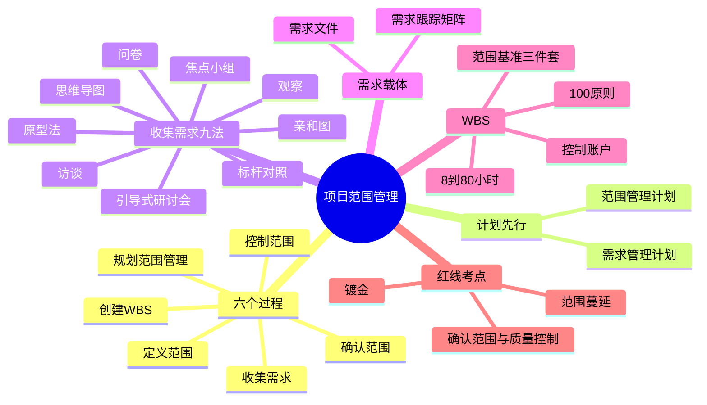
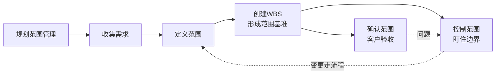
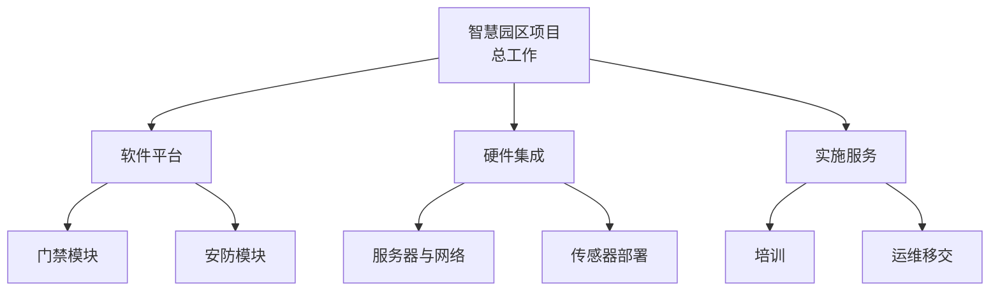
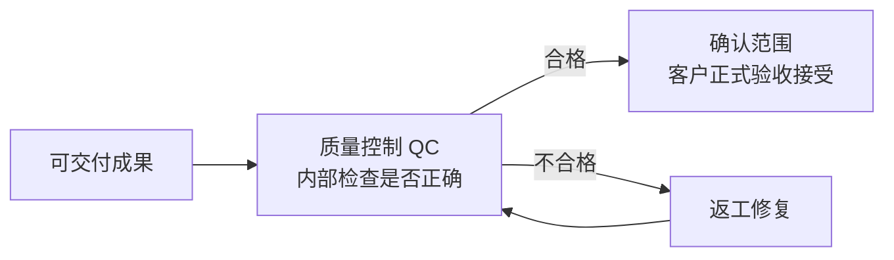

> **摘要**：
> 范围管理回答两个问题:**做什么、不做什么**。六个过程、需求收集 9 法、需求跟踪矩阵、WBS 与范围基准三件套、"确认范围 vs 质量控制"、"范围蔓延 vs 镀金"全是考点钉子户。**案例找错题的常驻嘉宾**,论文里范围管理也是稳妥选题。建议投入 6~8 小时。

## 🗺️ 知识地图

## 📖 掰碎讲解

### 6.1 范围管理概述与六个过程

**是什么**:项目范围 = 为交付**约定产品和服务**必须完成的工作;范围管理 = 定义**该做什么、不该做什么**,并控制边界。六个过程:

| 过程 | 过程组 | 输出关键词 |
| --- | --- | --- |
| 规划范围管理 | 规划 | 范围管理计划、需求管理计划 |
| 收集需求 | 规划 | 需求文件、需求跟踪矩阵 |
| 定义范围 | 规划 | **项目范围说明书** |
| 创建 WBS | 规划 | 范围基准(说明书+WBS+词典) |
| 确认范围 | **监控** | 验收的可交付成果 |
| 控制范围 | **监控** | 变更请求、更新 |

**大白话**:装修房子:先定规矩怎么管范围(规划),列出全家人的愿望清单(收集需求),确定"三室两厅、中央空调,阳台改书房"(定义范围),拆成水电瓦木油各工序(创建 WBS),完工后全家逐项验收(确认范围),过程中防止"顺便把厨房也砸了吧"(控制范围)。

**怎么考**:过程与过程组配对——确认范围、控制范围在**监控过程组**;前四个在规划组。

### 6.2 规划范围管理:两份计划

**是什么**:
- **范围管理计划**:规定"如何定义、确认和控制范围",含 WBS 怎么建、基准怎么维护——**无范围本身**;
- **需求管理计划**:规定"如何收集、分析、记录、跟踪需求",含需求优先级规则、跟踪矩阵结构。

**大白话**:这两份计划是"规章制度",不是"货物清单"。范围管理计划管"怎么定规矩",需求管理计划管"愿望清单怎么登记、怎么核对"。

**怎么考**:"范围管理计划中包含具体需求清单"(错,那是需求文件);两计划名字相近,注意"谁管什么"。

### 6.3 收集需求:9 大方法(场景匹配必考)

| 方法 | 怎么干 | 适用场景 | 一句话识别 |
| --- | --- | --- | --- |
| 访谈 | 一对一深聊 | 机密话题、专家意见 | "单独、深入" |
| 焦点小组 | 同领域一群人**互动**讨论 | 有主题的预审讨论 | "同质群体互动" |
| 引导式研讨会 | 跨职能人员**集中快速**达成一致(JAD、QFD) | 快速对齐、化解分歧 | "跨部门共识会" |
| 问卷调查 | 书面题目广撒网 | 受众**多、地理分散**、要统计 | "人多且散" |
| 观察(工作跟踪) | 到现场看用户实际干活 | 用户**说不清**自己的需求 | "会做不会说" |
| 原型法 | 先做样品边看边改 | 需求不明确、渐进明细 | "先给个样儿" |
| 标杆对照 | 对比**行业最佳实践** | 找差距、定目标 | "对标先进" |
| 亲和图 | 把海量需求**分组归类** | 需求杂乱无章时整理 | "贴便签分堆" |
| 思维导图 | 中心发散联想 | 头脑风暴后的整理 | "发散画图" |

**大白话**:想摸清全家装修需求——跟老婆单聊(访谈),拉着装修过的朋友群聊(焦点小组),把两家人拉到一起开共识会(引导式研讨会),给全楼发问卷(问卷调查),蹲在厨房看妈妈做饭动线(观察),先出 3D 效果图(原型法),参观邻居家的神装修(标杆对照),把几百张愿望便签分堆(亲和图),画一张全屋联想图(思维导图)。

**怎么考**:场景→方法匹配是送分题,认准关键词:人多分散=问卷;说不清=观察;不明确=原型;对标=标杆;跨职能共识=引导式研讨会。

### 6.4 需求文件与需求跟踪矩阵(作用必考)

**是什么**:
- **需求文件**:把需求分类、编号、写清楚(业务需求、功能需求、非功能需求等);
- **需求跟踪矩阵(RTM)**:一张表把"需求来源 → 需求 → 设计 → 代码 → 测试用例 → 验收"串起来。

**RTM 三大作用(背)**:①确保每个需求**有出处、被落实、被验证**;②为**变更影响分析**提供依据(改一个需求,顺藤摸瓜看动多少设计);③防止需求丢失、便于审计。

**大白话**:RTM 是需求的"户口本+族谱"——从哪来、变成啥、验证没,一查一条线。甲方改需求时翻它,像查族谱一样知道会牵连谁。

**怎么考**:"需求跟踪矩阵的作用"(三选正确);"RTM 贯穿整个项目生命周期全程维护"。

### 6.5 定义范围与项目范围说明书

**是什么**:定义范围 = 把高层级需求细化为**项目范围说明书**,内容:
- **产品范围描述**(做什么产品/服务);
- **可交付成果**(列出要交的东西);
- **验收标准**(怎么算合格);
- **项目的除外责任**(明确"不做什么"——防扯皮神器);
- **制约因素**(硬约束:预算、期限);
- **假设条件**(默认成立的前提)。

**大白话**:范围说明书就是"婚庆合同明细":项目除外责任一栏写着"不含酒水、不含伴娘"——白纸黑字,婚礼当天谁也别想"顺便"加项目。

**怎么考**:"除外责任"的意义(划清边界);范围说明书是**范围基准的组成部分之一**。

### 6.6 创建 WBS(100% 原则 + 8/80 必背)

**是什么**:WBS(工作分解结构)= 把项目工作**逐层分解为更小、更易管理的组件**,最底层叫**工作包**。

分解原则(必背):
1. **面向可交付成果**分解,不是按"部门"或"时间顺序"分解;
2. **100% 原则**:下层之和 = 上层全部工作,**不重不漏**;
3. **8/80 规则**:一个工作包的工作量约 **8~80 小时**(不小于 8、不大于 80);
4. **控制账户**:WBS 上选定的**管理控制点**,把范围、预算、实际成本和进度整合考核;
5. 远期工作可粗分解,**滚动式规划**(近细远粗);
6. WBS **不表示时间先后**,只表示组成关系;每个节点有唯一**账户编码**。

**大白话**:WBS 像"拆家":一栋楼拆成单元,单元拆成房间,房间拆到"这个灯泡谁装"为止(工作包)。100% 原则=拆完必须能原样装回去,一块砖都不能多、不能少。

**怎么考**:8/80 小时数字题;"面向可交付成果";100% 原则判断;"WBS 反映时间顺序"(错!)。

**范围基准三件套(必背)**:**项目范围说明书 + WBS + WBS 词典**。WBS 词典解释每个工作包的内容、负责人、验收标准——像每个房间的"装修说明书"。

### 6.7 确认范围 vs 质量控制(对比必考)

| 维度 | 确认范围 | 质量控制 |
| --- | --- | --- |
| 干什么 | **客户/发起人正式验收**可交付成果 | 检查成果**是否正确、符合质量标准** |
| 谁主导 | 客户/发起人(对外) | 质量团队(对内) |
| 强调 | **接受**(验收) | **正确**(检查) |
| 时点 | 通常在每个阶段末/交付节点 | 通常**先于**确认范围(内部先检) |
| 输出 | 验收的可交付成果 | 核实的可交付成果、质量控制测量结果 |

**大白话**:QC 是"出厂自检",确认范围是"买家验货"。先自检(别把次品拿给客户丢人),再让客户签字收货。顺序:**一般先质量控制,后确认范围**。

**怎么考**:角色与时点判断;"确认范围强调客户接受、QC 强调检查正确性";两者都涉及"检查"但主体不同——案例最爱让你分辨。

### 6.8 范围蔓延 vs 镀金 vs 范围潜变(案例找错必考)

| 现象 | 谁干的 | 怎么发生 | 对策 |
| --- | --- | --- | --- |
| **范围蔓延 / 范围潜变** | 甲方/用户/团队"不知不觉" | 未经变更控制,**悄悄**增加需求 | 一切变更走整体变更控制流程 |
| **镀金** | 项目团队**主动** | 超出范围多做、给客户"惊喜" | 只做范围内的事,杜绝镀金 |

**大白话**:范围蔓延是"温水煮青蛙"——今天加个按钮、明天加张报表,没人反对,项目就撑死了;镀金是"舔狗式献殷勤"——客户没要,你加班加出个炫酷动画,客户未必领情,钱和时间倒是真花了。

**怎么考**:案例找错:"程序员觉得功能不够炫,主动加了美颜特效"=**镀金**;"甲方东一句西一句陆续加需求,都没走流程"=**范围蔓延**;两者的共同解药=**按变更流程管理 + 客户验收把关**。

### 6.9 范围变更处理

**是什么**:范围变了怎么办?**只认流程**:提交书面变更申请 → 评估影响(范围/进度/成本/质量联动)→ CCB 审批 → 批准则更新范围基准及相关计划 → 实施并验证 → 沟通归档;不批准则说明理由并记录。涉及 [05-项目整合管理](05-项目整合管理/) 的八步流程与 [15-配置与变更管理](15-配置与变更管理/) 的配置管理。

**大白话**:范围基准是"国土边界",任何"开疆拓土"都要走"国会审批",否则一律视为侵略(蔓延),当场打回。

## 🎬 推荐视频

| 视频 | 讲什么 | 什么时候看 |
| --- | --- | --- |
| [软考老金高项](https://www.bilibili.com/video/BV1KtRQBtEQa) | 范围六过程 ITTO 串联记忆 | 一轮后看,建立骨架 |
| [野人老师高项全集 67 集](https://www.bilibili.com/video/BV1dJ41117Aa) | WBS/确认范围讲得通俗 | 第一轮入门 |
| [夏天老师 2027 第 4 版公开课 53 集](https://www.bilibili.com/video/BV1TFBpBKExt) | 第 4 版口径精讲 | 对照补漏 |
| [summer 课堂第 4 版快速串讲 30 集](https://www.bilibili.com/video/BV1vz4y1a7fM) | 快速串 1-7 章 | 二轮冲刺 |

## ⭐ 章节重点(考前必背)

| 考点 | 必背内容 | 考法标签 |
| --- | --- | --- |
| 六个过程 | 规划/收集/定义/创建 WBS(规划组)+确认/控制(监控组) | 上午题配对 |
| 需求九法 | 人多散=问卷;说不清=观察;不明确=原型;对标=标杆;跨职能共识=引导式研讨会 | **上午题场景匹配** |
| 需求跟踪矩阵 | 有出处、被落实、被验证;支撑变更影响分析 | 上午题/案例 |
| 范围说明书 | 可交付成果、验收标准、**除外责任**、制约、假设 | 案例简答 |
| WBS | 100% 原则;8~80 小时;面向可交付成果;控制账户;不表时间顺序 | **必背数字与原则** |
| 范围基准 | 范围说明书 + WBS + WBS 词典(三件套) | **必背** |
| 确认范围 vs QC | 确认=客户验收接受(对外);QC=检查正确性(对内);QC 先行 | **案例必考对比** |
| 蔓延 vs 镀金 | 蔓延=未受控悄悄加;镀金=团队主动多做 | **案例找错** |
| 范围变更 | 一律走整体变更控制八步 | **案例默写** |

## 🧠 高频考法与陷阱

> **注意**：
> 1. **错误认知:确认范围和质量控制是一回事。→ 正确认知**:QC 由质量团队**内部检查正确性**,确认范围由**客户正式验收接受**;一般先 QC 后确认范围。
> 2. **错误认知:WBS 中下层工作之和可以小于上层(留点余量)。→ 正确认知**:必须满足 **100% 原则**,下层之和=上层全部,不重不漏。
> 3. **错误认知:客户没提、程序员主动多做的功能是加分项。→ 正确认知**:那是**镀金**,浪费资源且可能引入风险,范围管理坚决杜绝。
> 4. **错误认知:范围管理计划里应写明具体需求清单。→ 正确认知**:范围管理计划是"怎么管范围"的规则;需求本身写在**需求文件**里。
> 5. **错误认知:WBS 体现了活动的先后顺序。→ 正确认知**:WBS 只体现**组成关系**,不表示时间顺序;顺序是进度管理(网络图)的事。
> 6. **错误认知:小变更口头确认就行。→ 正确认知**:任何影响范围的变更都应走**书面申请 + CCB 审批**流程,否则就是范围蔓延的温床。

## ✍️ 反复练习题

**第 1 题(选择)** 需要向分布在全国各地的 2000 名用户了解系统使用习惯,最合适的收集需求方法是:
A. 访谈　B. 问卷调查　C. 观察　D. 焦点小组

> **示例**：
> **答案:B**
> 受众数量大、地理分散、需统计汇总 → 问卷调查。访谈/观察适合少数深入对象,焦点小组适合同领域小群体互动。

**第 2 题(选择)** 关于 WBS,错误的说法是:
A. 面向可交付成果分解
B. 满足 100% 原则
C. 工作包工作量一般控制在 8~80 小时
D. WBS 中的节点按时间先后顺序排列

> **示例**：
> **答案:D**
> WBS 只表示**组成/包含关系**,不表示时间顺序;活动排序属于进度管理。A/B/C 均为 WBS 的正确原则。

**第 3 题(选择)** 范围基准由哪些文件组成?
A. 项目章程、WBS、WBS 词典　B. 项目范围说明书、WBS、WBS 词典　C. 需求文件、范围管理计划、WBS　D. 项目范围说明书、需求文件、WBS 词典

> **示例**：
> **答案:B**
> 范围基准三件套 = **项目范围说明书 + WBS + WBS 词典**。项目章程是启动文件,需求文件不属于范围基准。

**第 4 题(选择)** 客户/发起人对可交付成果进行正式验收,强调"接受",这属于:
A. 质量控制　B. 确认范围　C. 控制质量　D. 控制成本

> **示例**：
> **答案:B**
> 确认范围 = 客户方**正式验收接受**可交付成果。质量控制(控制质量)是内部检查"是否正确",一般先于确认范围进行。

**第 5 题(选择)** 项目团队觉得客户可能会喜欢,主动开发了一个客户并未要求的报表功能,这属于:
A. 范围蔓延　B. 镀金　C. 渐进明细　D. 变更控制

> **示例**：
> **答案:B**
> 团队**主动**超出范围多做 = 镀金。若"客户/用户未经流程陆续加需求"才是范围蔓延。渐进明细是正常的需求逐步细化,两者都要区分。

**第 6 题(选择)** 需求跟踪矩阵的主要作用不包括:
A. 确保每个需求都有来源并被落实和验证
B. 支持变更影响分析
C. 防止需求丢失
D. 代替 WBS 进行工作分解

> **示例**：
> **答案:D**
> RTM 管"需求到实现到验证"的追踪,不做工作分解;分解是 WBS 的职责。A/B/C 均为 RTM 三大作用。

**第 7 题(案例风格)** 某公司开发客户管理系统。项目启动后,甲方市场部张经理多次在走廊里对开发人员说"顺手加个导出 Excel 吧""再帮我加个生日提醒"。开发人员觉得功能小,都答应了,没告诉项目经理。三个月后项目进度严重滞后,且客户验收时抱怨"当初要的报表怎么没有"。请回答:
(1) 指出该项目管理中存在的问题。
(2) 说明规范的范围变更处理流程。
(3) 为防止类似问题,应建立哪些机制?

> **示例**：
> (1) 问题:①客户需求**未走变更流程**,随意口头增加功能,造成**范围蔓延**;②开发人员越权接受需求,缺少统一入口;③**范围基准**未受控维护,进度基准被连带冲击;④需求沟通与**需求跟踪矩阵**缺失,导致"当初要的报表"无法追溯;⑤缺少对客户的**确认范围/验收机制**。
> (2) 规范流程:提交**书面变更申请** → 记录变更 → **评估**对范围/进度/成本/质量的影响 → 提交 **CCB 审批** → 批准后**更新范围基准**及相关计划 → **实施**变更 → **验证**实施效果 → **沟通**干系人并记录归档。
> (3) 机制:①建立**需求管理计划与需求跟踪矩阵**,需求统一登记、变更统一入口;②明确"一切变更走 CCB",任何人不得口头承诺;③定期**确认范围**,分阶段请客户验收签字;④加强干系人沟通管理,引导需求集中提交。

## 🔗 相关章节

- 变更八步与章程:[05-项目整合管理](05-项目整合管理/)
- 由范围基准展开:[07-项目进度管理](07-项目进度管理/)、[08-项目成本管理](08-项目成本管理/)
- 配置管理视角:[15-配置与变更管理](15-配置与变更管理/)
- 客户沟通:[11-项目沟通与干系人管理](11-项目沟通与干系人管理/)
- 攻略:[项管-案例分析攻略](../项管-案例分析攻略/)、[项管-真题战略](../项管-真题战略/)
