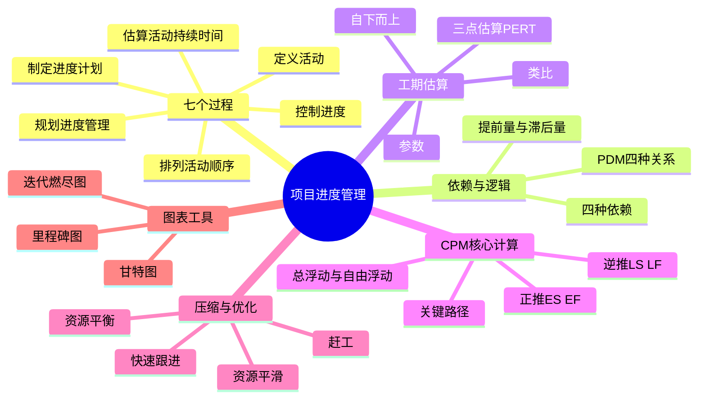
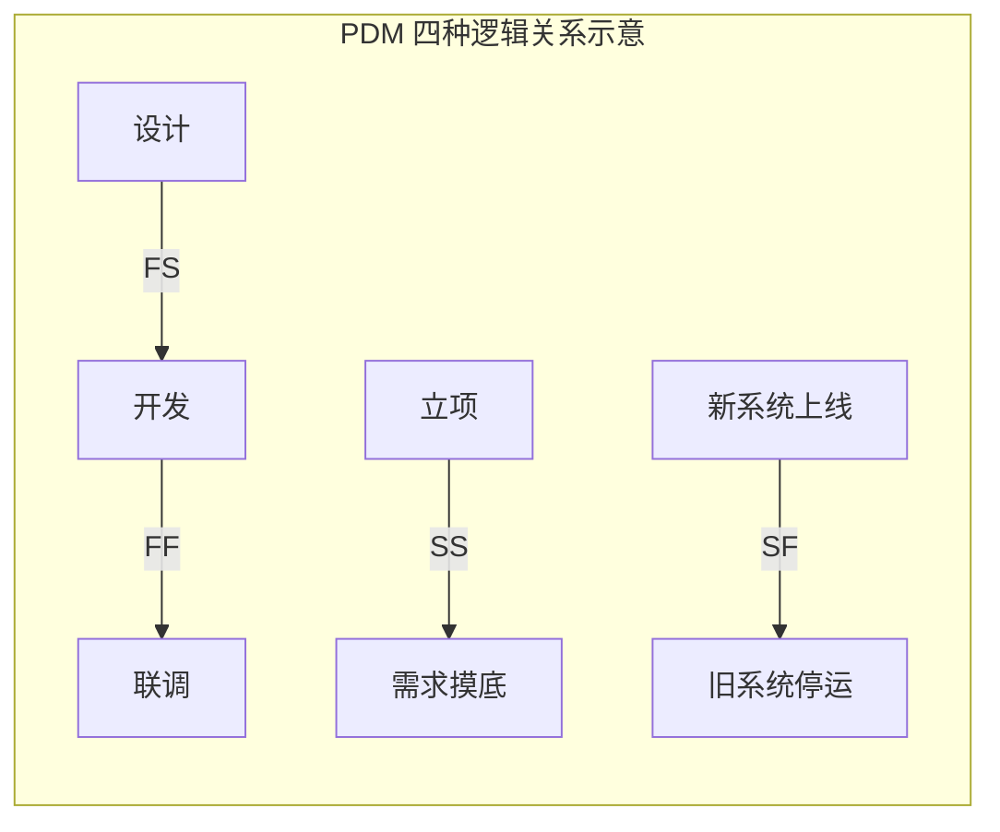
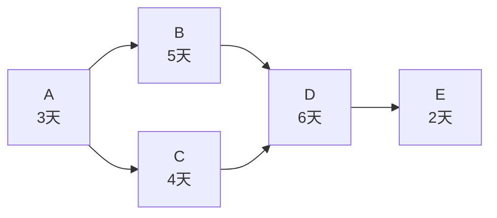
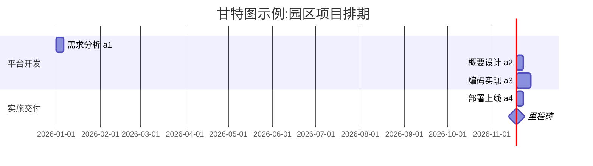

> **摘要**：
> **案例计算的头号主场**:七个过程、PDM 四种逻辑关系、三点估算 PERT、关键路径法 CPM(正推逆推、总浮动、自由浮动)、赶工与快速跟进、资源平衡与平滑。案例大题几乎年年从"画网络图 + 算关键路径 + 压缩工期"里出,上午题也有 2~4 分的计算。这一章要"写厚、算熟",配 [17-项目管理科学基础](17-项目管理科学基础/) 一起练。建议投入 10~12 小时,其中一半时间动手算题。

## 🗺️ 知识地图

## 📖 掰碎讲解

### 7.1 七个过程与进度管理计划

**是什么**:

| 过程 | 过程组 | 输出关键词 |
| --- | --- | --- |
| 规划进度管理 | 规划 | 进度管理计划(单位、精确度、控制临界值) |
| 定义活动 | 规划 | 活动清单、里程碑清单 |
| 排列活动顺序 | 规划 | 项目进度网络图 |
| 估算活动持续时间 | 规划 | 持续时间估算 |
| 制定进度计划 | 规划 | **进度基准**、项目进度计划(甘特图) |
| 控制进度 | **监控** | 更新进度、变更请求 |

**大白话**:装修流程——先定"工期怎么管"(规划管理),列要做的事(定义活动),排先后(排序),估每件活几天(估算),拼出总排期表(制定计划),开工后盯着别拖延(控制)。

**怎么考**:过程组配对(控制进度在监控组);进度管理计划是"规则"不含具体日期;**进度基准**由制定进度计划产出,改基准走变更。

### 7.2 活动与依赖:四种依赖、提前量与滞后量

**是什么**:
- **工作包**(WBS 最底层)进一步分解成**活动**(具体要干的活),活动才算工期;
- 四种依赖(先后关系从哪来):
  1. **强制性依赖**:客观规律决定的"硬逻辑"(先打地基后砌墙);
  2. **选择性依赖**:最佳实践决定的"软逻辑"(惯例先设计后编码);
  3. **外部依赖**:取决于外部方(等客户批复);
  4. **内部依赖**:项目内部可控的前后关系;
- **提前量(lead)**:后活动**提前**开始,如"测试在开发结束前 2 天开始"(FS - 2 天);
- **滞后量(lag)**:后活动**推迟**等待,如"混凝土浇筑后等 3 天才拆模"(FS + 3 天)。

**大白话**:强制性依赖是"自然规律"(不收房没法装修);选择性依赖是"行业习惯"(一般先画图再施工,你要反着来也行但费劲);外部依赖是"等快递";提前量=插队提前干,滞后量=强制等冷却。

**怎么考**:依赖类型判断(给场景问"属于哪种依赖");提前量/滞后量的正负号(负=提前、正=滞后)。

### 7.3 PDM 四种逻辑关系(案例画图必考)

**是什么**:前导图法(PDM,画在节点上)四种关系:

| 关系 | 全称 | 含义 | 例子 | 出现频率 |
| --- | --- | --- | --- | --- |
| **FS** | 完成到开始 | A 完了 B 才能开始 | 收房后才能开工 | **最常用** |
| **SS** | 开始到开始 | A 开始后 B 才能开始 | 开发开始 3 天后测试开始 | 常见 |
| **FF** | 完成到完成 | A 完成后 B 才能完成 | 文档写完 2 天后培训才能结束 | 一般 |
| **SF** | 开始到完成 | A 开始后 B 才能完成 | 新系统上线后旧系统才能停运 | **最少见** |

**大白话**:FS 是"接力赛"(我跑完你跑);SS 是"并排起跑但你有晚点出发";FF 是"同时收尾";SF 是"新人上岗,老人才能退休"。

**怎么考**:给关系描述选 FS/SS/FF/SF;**AOA(箭线图)有虚活动(虚工作,只表逻辑不耗资源),PDM 没有虚活动**——经典对比坑;案例题让你画单代号网络图(PDM)。

### 7.4 估算活动持续时间:四方法 + PERT(计算必考)

**是什么**:
- **类比估算**:拿类似历史项目套,便宜但粗(早期、信息少时);
- **参数估算**:用"单位量 × 参数"算,如"500 平 × 每平 2 天 = 1000 人天模型";
- **自下而上**:从工作包逐层汇总,**最准但最费时**;
- **三点估算(PERT / 贝塔分布)**:

$$期望工期 E = \frac{乐观 O + 4 \times 最可能 M + 悲观 P}{6}$$
$$标准差 \sigma = \frac{P - O}{6},\quad 方差 = \sigma^2$$

概率记忆:**±1σ 68.26%,±2σ 95.46%,±3σ 99.73%**。

**大白话**:PERT 是"加权平均的聪明拍脑袋":最可能的情况占 4 票,乐观悲观各 1 票,除以 6。悲观乐观差距越大,σ 越大,说明越"心里没底"。

**怎么考**:三年点估算直接代公式;问"在 ±1σ 内完工概率"答 68.26%;"自下而上最准确、类比最粗糙"的排序判断。

**小练手**:某活动 O=6 天、M=9 天、P=12 天 → E=(6+36+12)/6=**9 天**,σ=(12-6)/6=**1 天**;实际工期在 8~10 天(±1σ)内完成的概率约 68.26%。

### 7.5 关键路径法 CPM(案例大题核心,模板化演示)

**是什么**:
- **正推**求最早:**ES(最早开始)→ EF = ES + 工期**;多汇入取 **max**(各紧前 EF 的最大值);
- **逆推**求最晚:**LS = LF − 工期**;多发出取 **min**(各紧后 LS 的最小值);
- **总浮动时间 TF = LS − ES = LF − EF**(不影响总工期的机动时间);
- **自由浮动时间 FF = 紧后活动最早开始的最小值 − 本活动 EF**(不影响紧后活动最早开始的机动时间);
- **关键路径 = 总浮动时间为 0 的活动连成的最长路径**,决定项目最短工期。

**完整例题(背下这张表的算法流程)**:如上图,依赖:A→B、A→C、B→D、C→D、D→E。

| 活动 | 工期 | 紧前 | ES | EF | LS | LF | TF | FF |
| --- | --- | --- | --- | --- | --- | --- | --- | --- |
| A | 3 | — | 0 | 3 | 0 | 3 | **0** | 0 |
| B | 5 | A | 3 | 8 | 3 | 8 | **0** | 0 |
| C | 4 | A | 3 | 7 | 4 | 8 | **1** | 1 |
| D | 6 | B,C | 8 | 14 | 8 | 14 | **0** | 0 |
| E | 2 | D | 14 | 16 | 14 | 16 | **0** | 0 |

**演算过程(学弟照抄这个节奏)**:
1. 正推:A: ES=0, EF=3 → B: ES=3, EF=8;C: ES=3, EF=7 → D: ES=max(8,7)=8, EF=14 → E: ES=14, EF=16。**总工期 = 16 天**。
2. 逆推:E: LF=16, LS=14 → D: LF=14, LS=8 → C: LF=D 的 LS=8, LS=4;B: LF=8, LS=3 → A: LF=min(B.LS=3, C.LS=4)=3, LS=0。
3. 浮动:C: TF=LS−ES=4−3=**1**;其余活动 TF=0。
4. **关键路径:A→B→D→E(16 天)**;C 是非关键活动,有 1 天机动。
5. FF 验证:C 的 FF = 紧后 D 的 ES(8) − C 的 EF(7) = **1**;TF ≥ FF 永远成立。

**大白话**:关键路径是项目里的"肠梗阻段"——最长又最紧的那条链,它拖一天,全项目拖一天;非关键活动像有弹性假期的员工(TF 是它的"带薪机动天数"),只要在机动范围内磨蹭,项目不延。

**怎么考**:案例大题标准三连问:①画单代号网络图;②求总工期与关键路径;③求某活动总浮动/自由浮动,或"压缩 X 天怎么压"。记住:**只能压关键路径上的活动**;多条关键路径要同时压。

### 7.6 进度压缩:赶工 vs 快速跟进(对比必考)

| 方式 | 原理 | 代价 | 适用 | 关键词 |
| --- | --- | --- | --- | --- |
| **赶工(crashing)** | 关键路径活动**增加资源**(加人加班) | **成本增加** | 活动能靠堆资源提速 | "花钱买时间" |
| **快速跟进(fast tracking)** | 顺序活动改**部分并行** | **风险增加**(返工概率大) | 活动可安全重叠 | "抢跑担风险" |

**赶工操作口诀**:①只压**关键路径**;②选**单位压缩成本最低**的活动;③每压一步**重算网络图**(关键路径可能转移);④压到极限(最短持续时间)为止。

**大白话**:赶工=雇 4 个装修工一起刷墙(钱多了,墙刷快了);快速跟进=墙没干透就开始刷漆(快是快,漆皮鼓了返工哭)。

**怎么考**:两种方式与代价配对(赶工→成本,快跟→风险);案例算"最小成本压缩方案":列出每个活动每天赶工费,贪心选便宜的,每步重算关键路径。

### 7.7 资源优化:资源平衡 vs 资源平滑

| 方式 | 手段 | 是否改变关键路径 | 是否延长工期 |
| --- | --- | --- | --- |
| **资源平衡** | 按资源限时限额调整开始/结束时间 | **可能改变**(重大任务被挪) | **可能延长** |
| **资源平滑** | 只在**自由/总浮动时间内**调整 | **不改变** | **不延长** |

**大白话**:资源平衡是"不加班,活儿往后挪,工期随它去";资源平滑是"在缓冲带内悄悄挪活,工期红线不能动"。

**怎么考**:配对题——"不延长工期的是平滑";"可能改变关键路径的是平衡"。两个词像双胞胎,认准"平滑=不改变"。

### 7.8 进度基准与三类图表

**是什么**:
- **进度基准**:经批准的进度计划,考核绩效的依据,变更走流程;
- **甘特图(横道图)**:活动条形显示时间跨度,直观,**适合给客户/管理层看**;
- **里程碑图**:只标重大节点(里程碑=零工期的重要事件),适合汇报"到没到点";
- **迭代燃尽图**:敏捷用,横轴时间、纵轴**剩余工作量**,线降得比理想线慢=落后。

**怎么考**:图型与用途配对;"里程碑持续时间为零";燃尽图用于**监控迭代/冲刺进度**;甘特图与横道图是同一种图(别被问懵)。

### 7.9 控制进度与常见计算坑

**是什么**:控制进度=比较实际与计划,分析偏差(结合 [08-项目成本管理](08-项目成本管理/) 的 SPI),预测趋势,必要时赶工/快跟/调整计划。敏捷项目用迭代计划与燃尽图控制。

> **注意**：
> ①**虚活动**:只在 AOA(箭线图)存在,PDM 单代号图**没有虚活动**;②**关键路径可能不止一条**,压缩时每条都要压;③**TF ≠ FF**:总浮动 ≥ 自由浮动,别混用公式;④关键路径是**最长**路径,不是最短;⑤压缩**非关键路径**活动对总工期**无效**;⑥每压缩一步,关键路径**可能转移**,要重算。

## 🎬 推荐视频

| 视频 | 讲什么 | 什么时候看 |
| --- | --- | --- |
| [希赛案例计算题专题](https://www.bilibili.com/video/BV1M64y1q7Vj) | 网络图/关键路径案例真题逐步演算 | 学完本章立刻刷,案例冲刺主菜 |
| [蜗牛软考 164 集(运筹与计算专题)](https://www.bilibili.com/video/BV1844y1R7YW) | 运筹学与进度计算专攻 | 计算薄弱者反复看 |
| [夏天老师 2027 第 4 版公开课 53 集](https://www.bilibili.com/video/BV1TFBpBKExt) | 进度管理过程精讲 | 第一轮跟课 |
| [summer 课堂第 4 版快速串讲 30 集](https://www.bilibili.com/video/BV1vz4y1a7fM) | 快速串讲 | 二轮复盘 |

## ⭐ 章节重点(考前必背)

| 考点 | 必背内容 | 考法标签 |
| --- | --- | --- |
| 七个过程 | 规划/定义/排序/估时/制定计划(规划组)+控制(监控组) | 上午题 |
| PDM 四关系 | FS 最常用,SF 最少见;AOA 才有虚活动 | **案例画图** |
| 依赖四类 | 强制(硬逻辑)/选择性(软逻辑)/外部/内部 | 上午题 |
| 提前量滞后量 | 负值=提前,正值=滞后 | 上午题 |
| PERT | E=(O+4M+P)/6;σ=(P−O)/6;±1σ=68.26% | **计算必考** |
| CPM 公式 | EF=ES+工期;LS=LF−工期;TF=LS−ES=LF−EF;FF=紧后最早开始min−EF | **案例必考** |
| 关键路径 | TF=0 的最长路径,决定总工期,可能多条、可能转移 | **案例必考** |
| 赶工 vs 快跟 | 赶工加资源(成本↑);快跟并行(风险↑) | **案例/上午必考** |
| 平衡 vs 平滑 | 平衡可改关键路径延工期;平滑不改不延 | 上午题配对 |
| 图表 | 甘特图直观;里程碑零工期;燃尽图看剩余工作量 | 上午题 |
| 压缩口诀 | 只压关键路径、选单位成本最低、每步重算 | **案例大题** |

## 🧠 高频考法与陷阱

> **注意**：
> 1. **错误认知:关键路径就是耗时最短的那条路。→ 正确认知**:关键路径是**最长**路径,决定项目最短总工期。
> 2. **错误认知:压缩任何活动都能缩短工期。→ 正确认知**:只有压缩**关键路径**上的活动才有效;压非关键活动白花钱。
> 3. **错误认知:总浮动时间和自由浮动时间一样。→ 正确认知**:TF=LS−ES(不影响总工期),FF=紧后最早开始min−本活动EF(不影响紧后);**TF ≥ FF**。
> 4. **错误认知:PDM 网络图里也有虚活动。→ 正确认知**:虚活动只在 AOA(双代号/箭线图)中存在,PDM 单代号图无虚活动。
> 5. **错误认知:快速跟进不增加成本所以更好。→ 正确认知**:快跟省了钱但**增加了返工风险**,可能得不偿失;赶工则实打实增加成本。
> 6. **错误认知:资源平衡和资源平滑都会延长工期。→ 正确认知**:**平滑**只在浮动时间内调整,不延长工期不改关键路径;平衡才可能延。

## ✍️ 反复练习题

**第 1 题(选择)** 某活动乐观 5 天、最可能 8 天、悲观 17 天,其期望工期和标准差为:
A. 9 天,2 天　B. 10 天,2 天　C. 9 天,3 天　D. 10 天,3 天

> **示例**：
> **答案:A**
> E=(5+4×8+17)/6=(5+32+17)/6=54/6=**9 天**;σ=(17−5)/6=12/6=**2 天**。±1σ 内完工概率约 68.26%。

**第 2 题(选择)** "新系统上线运行后,旧系统才能停止运行"属于 PDM 中的:
A. FS　B. SS　C. FF　D. SF

> **示例**：
> **答案:D**
> "前者的开始解锁后者的完成"= 开始到完成(SF),四种关系中最少见。记忆:旧系统停运(F)取决于新系统上线(S)。

**第 3 题(选择)** 为了缩短工期,项目经理决定将原顺序执行的设计与部分开发工作并行开展,这种做法是:
A. 赶工　B. 快速跟进　C. 资源平衡　D. 资源平滑

> **示例**：
> **答案:B**
> 顺序改并行 = **快速跟进**,代价是风险增加。若"加人加班让某活动更快完成"才是赶工(成本增加)。

**第 4 题(选择)** 关于资源优化,正确的说法是:
A. 资源平滑可能延长项目工期
B. 资源平衡不改变关键路径
C. 资源平滑只能在浮动时间内调整活动
D. 两者都会增加项目成本

> **示例**：
> **答案:C**
> 资源平滑只利用**浮动时间**调整,不改变关键路径、不延长工期;资源平衡受资源限额约束,可能改变关键路径、延长工期。两者主要动"时间安排",不直接增加成本。

**第 5 题(选择)** 某活动总浮动时间为 5 天,自由浮动时间为 3 天,以下说法正确的是:
A. 该活动最多可延迟 3 天而不影响总工期
B. 该活动最多可延迟 5 天而不影响紧后活动的最早开始
C. 该活动最多可延迟 5 天而不影响总工期
D. 该活动是关键活动

> **示例**：
> **答案:C**
> 总浮动 TF=5:延迟 5 天内**不影响总工期**;自由浮动 FF=3:延迟 3 天内不影响**紧后活动最早开始**。TF≥FF,该活动 TF≠0,非关键。

**第 6 题(选择)** 下列关于虚活动的说法,正确的是:
A. PDM 单代号网络图中必须使用虚活动
B. 虚活动消耗资源和时间
C. 虚活动只存在于 AOA 箭线图法中,不耗时间资源
D. 虚活动用于表示工期较长的工作

> **示例**：
> **答案:C**
> 虚活动(虚工作)是 AOA 双代号图中表示逻辑依赖的"零工期箭线",不消耗资源与时间;PDM 把活动画在节点上,不需要虚活动。

**第 7 题(案例风格)** 某项目活动及逻辑:A→B、A→C、B→D、C→D、D→E;工期:A=3 天,B=5 天,C=4 天,D=6 天,E=2 天。请回答:
(1) 计算各活动的 ES、EF、LS、LF(列出过程)。
(2) 求总工期、关键路径。
(3) 求活动 C 的总浮动时间和自由浮动时间。
(4) 若要将总工期压缩 2 天,C 活动可否作为压缩对象?应压缩哪些活动?

> **示例**：
> (1) 正推:A: ES=0,EF=3;B: ES=3,EF=8;C: ES=3,EF=7;D: ES=max(8,7)=8,EF=14;E: ES=14,EF=16。逆推:E: LF=16,LS=14;D: LF=14,LS=8;C: LF=8,LS=4;B: LF=8,LS=3;A: LF=min(3,4)=3,LS=0。
> (2) 总工期 = 16 天;TF=0 的路径为 **A→B→D→E**,即关键路径,工期 3+5+6+2=16 天。
> (3) C 的 TF=LS−ES=4−3=**1 天**;FF=紧后 D 的 ES(8)−C 的 EF(7)=**1 天**。
> (4) **不能压缩 C**:C 不在关键路径上,压了不影响总工期。应压缩关键路径 A→B→D→E 上的活动:结合各活动的赶工费率,优先选择**单位压缩成本最低**者,且若压缩后出现新的关键路径(路径转移),需**多条关键路径同时压缩**共 2 天。

## 🎨 漫画图解

*赶工 vs 快速跟进*-一个花成本,一个冒风险*

## 🔗 相关章节

- 挣值联动(SPI/CPI):[08-项目成本管理](08-项目成本管理/)
- 范围与进度基准:[06-项目范围管理](06-项目范围管理/)、[05-项目整合管理](05-项目整合管理/)
- 数学基础:[17-项目管理科学基础](17-项目管理科学基础/)
- 敏捷与燃尽:[14-绩效域与价值交付](14-绩效域与价值交付/)
- 攻略:[项管-案例分析攻略](../项管-案例分析攻略/)、[学习方法与记忆术](../../00-备考指南/学习方法与记忆术/)
