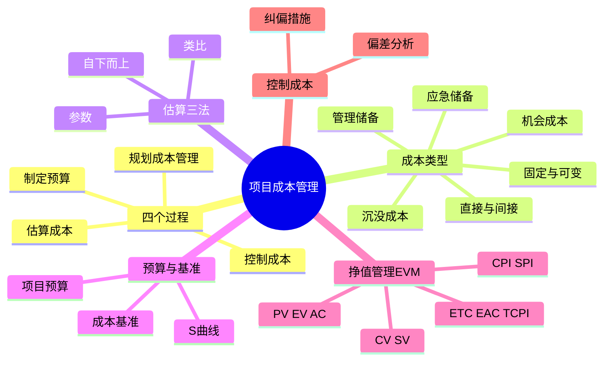
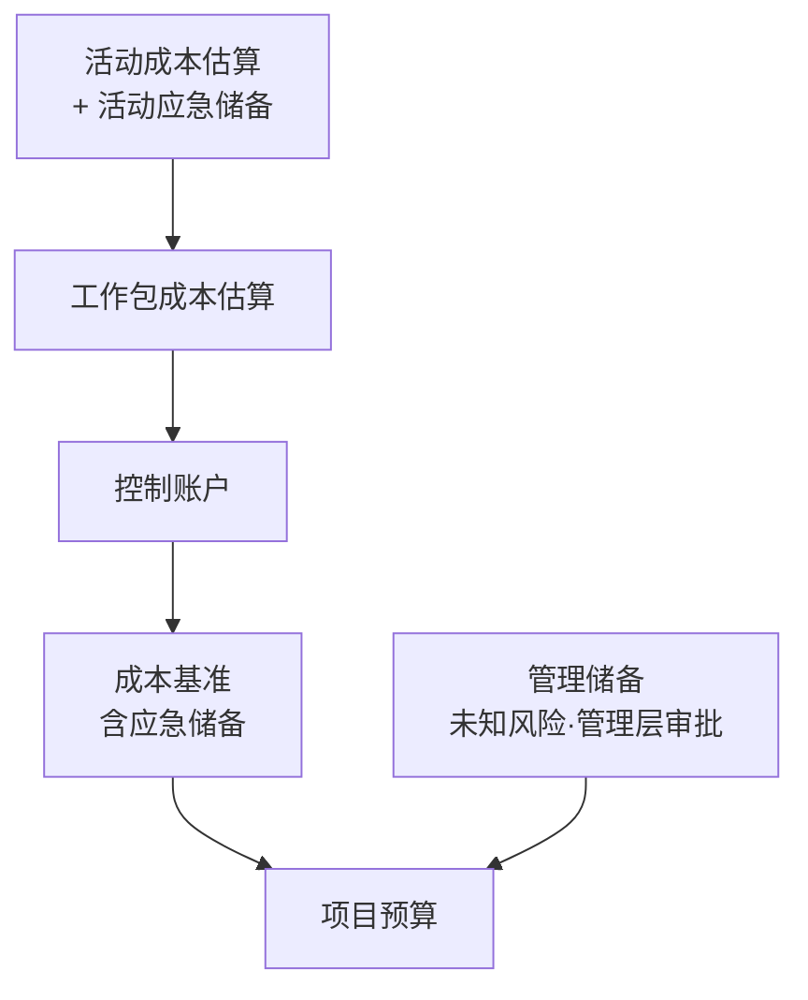
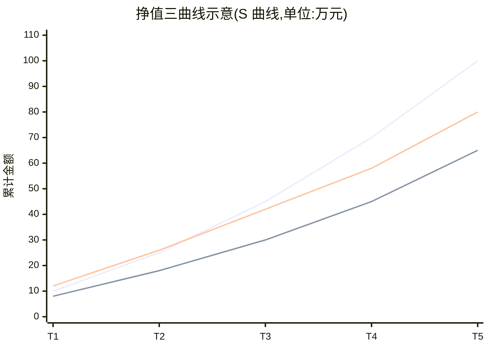

> **摘要**：
> **案例挣值计算的第二主场**(与进度并称"计算双雄"):成本类型大表、估算三法、预算与 S 曲线、挣值管理 EVM 全家桶(PV/EV/AC、CV/SV、CPI/SPI、ETC/EAC/TCPI)。案例年年出"给三个数算全表 + 判断 + 给建议",上午题考成本类型与储备判断。这章公式多但套路固定,练熟一道题=会十道。建议投入 10~12 小时。

## 🗺️ 知识地图

## 📖 掰碎讲解

### 8.1 四个过程与成本管理计划

**是什么**:

| 过程 | 过程组 | 干什么 | 输出关键词 |
| --- | --- | --- | --- |
| 规划成本管理 | 规划 | 定规则 | 成本管理计划(单位、精确度、控制临界值) |
| 估算成本 | 规划 | 近似值 | 成本估算 |
| 制定预算 | 规划 | 分配汇总 | **成本基准** |
| 控制成本 | **监控** | 盯偏差 | 挣值分析、预测 |

**大白话**:先定"钱怎么管"(规划),再"估个总价"(估算),然后"把钱分到每个房间"(预算),装修过程中"对账防超支"(控制)。

**怎么考**:过程组配对(控制成本在监控组);成本管理计划管"规则"不含具体金额;控制临界值=偏差多大才报警。

### 8.2 成本类型大表(判断题收割机)

| 类型 | 定义 | 例子 | 记忆钩子 |
| --- | --- | --- | --- |
| 固定成本 | 不随工作量变化 | 房租、固定折旧 | 不干不干都在花 |
| 可变成本 | 随工作量变化 | 材料费、计件工资 | 干多花多 |
| 直接成本 | 直接花在项目上 | 项目组人工、专用设备 | 明账 |
| 间接成本 | 多项目分摊 | 写字楼租金、水电、管理层工资 | 暗账分摊 |
| 沉没成本 | 已花且收不回 | 已报废的研发投入 | **决策时不应考虑**(覆水难收) |
| 机会成本 | 选 A 而放弃 B 的潜在收益 | 投项目放弃的理财收益 | 选了这个就错过那个 |
| 应急储备 | 已知-未知风险的费用 | 预算里留的"防雨钱" | **含在成本基准内**,项目经理可动用 |
| 管理储备 | 未知-未知风险的费用 | 公司层留的"天灾钱" | **不含在成本基准内、含在项目预算内**,需**管理层审批**动用 |

**大白话**:房租是"躺着也烧钱"(固定);装修材料"买多少花多少"(可变);给这个项目买的水泥是直接成本,大楼电费大家摊是间接成本;沉没成本=泼出去的水,决策别心疼;机会成本=选了这条街就错过那条街的生意;应急储备是你兜里的伞(已知可能下雨),管理储备是公司保险柜(出大事走特批)。

**怎么考**:"项目经理可自行动用管理储备"(错!要管理层审批);判断某项属于直接/间接、固定/可变;"沉没成本不应影响当前决策"。

### 8.3 成本估算三法与准确度

| 方法 | 怎么做 | 准确度 | 何时用 |
| --- | --- | --- | --- |
| 类比估算 | 拿相似历史项目整体套 | **最粗** | 启动早期、信息少 |
| 参数估算 | 统计模型/单价 × 工程量 | 较准(模型要好) | 有可靠参数时 |
| 自下而上 | 从工作包逐层汇总 | **最准最费时** | 详细规划后 |

**大白话**:类比="隔壁楼花了 300 万,我这栋差不多"(快但糙);参数="每平 3000 元 × 1000 平"(有公式);自下而上="每个房间逐项报价再加总"(累但准)。

**怎么考**:准确度排序(自下而上>参数>类比);场景选方法;"估算 vs 预算"——估算是近似值,预算是**批准后分配**到各工作包的数。

### 8.4 制定预算与 S 曲线(公式必背)

**是什么**:预算形成路径:**活动成本估算 → 工作包成本估算 → 控制账户 → 成本基准**;再加**管理储备**构成**项目预算**。

> **提示**：
> **成本基准 = 项目预算 − 管理储备**
> **项目预算 = 成本基准 + 管理储备**
> 成本基准**包含应急储备**,不包含管理储备。

**S 曲线**:成本基准随时间累计绘出,呈"缓—陡—缓"的 S 形;执行期的 PV/EV/AC 三条曲线都在 S 曲线坐标系里比较。

**大白话**:成本基准是"批准的 S 形花钱路线图";应急储备是路线图里画的"缓冲带",管理储备是路线图外的"应急车道",要开上去必须公司(管理层)点头。

**怎么考**:"管理储备属于成本基准"(错);"应急储备包含在成本基准内"(对);S 曲线含义;"成本基准是绩效测量基准之一"。

### 8.5 挣值管理 EVM:三个基本值(一切之始)

| 指标 | 全称 | 含义 | 一句话判断 |
| --- | --- | --- | --- |
| **PV** | 计划价值 | 到此时**计划**完成工作的预算值 | "应该干多少" |
| **EV** | 挣值 | 到此时**实际完成**工作的预算值 | "实际干了多少(按预算价折算)" |
| **AC** | 实际成本 | 到此时**实际花费** | "实际花了多少" |

**大白话**:装修进行到第 2 个月——PV=计划里该花 40 万的活;EV=你实际干完了原价 30 万的活;AC=这些活实际花了 45 万。三个数一出来,健康与否全见分晓。

**怎么考**:给场景辨认三个数(最容易错的是 EV——"完成工作的预算价值",不是实际花的钱!);EV 只能 ≤ PV 对应工作的价值口径比较。

### 8.6 偏差与指数(四个公式 + 判断口诀)

> **提示**：
> **CV = EV − AC**(成本偏差);**SV = EV − PV**(进度偏差)
> **CPI = EV / AC**;**SPI = EV / PV**
> 判断:偏差 **>0 / 指数 >1 = 好**;<0 / <1 = 坏。
> 口诀:"**EV 打头,减谁比谁;除谁比谁;正好零,负了坏,小于一糟糕**"。

| 公式 | 结果 | 结论 |
| --- | --- | --- |
| CV = EV − AC | 负 | **超支**(完成同样的活花了更多钱) |
| SV = EV − PV | 负 | **落后**(干了比计划少的活) |
| CPI = EV/AC < 1 | — | 每花 1 元只挣回 CPI 元 → 超支 |
| SPI = EV/PV < 1 | — | 进度只完成了计划的 SPI 倍 → 落后 |

**大白话**:CV 是"钱包体检"(负数=钱包瘦得快);SV 是"行程体检"(负数=落后于打卡点);CPI/SPI 是两者的"汇率版",>1 优秀,=1 刚好,<1 报警。

**怎么考**:直接代数判断;注意 SPI 落后**不代表一定延期**(还有浮动时间),要结合关键路径看;"非典型 vs 典型偏差"影响预测公式选择。

### 8.7 预测:ETC、EAC、TCPI(进阶计算)

| 公式 | 适用 | 含义 |
| --- | --- | --- |
| **ETC = BAC − EV** | 非典型偏差(以后按原计划走) | 完工尚需估算:剩余工作还需多少钱 |
| **ETC = (BAC − EV) / CPI** | **典型偏差**(以后继续按当前 CPI 花钱) | 剩余工作按当前效率还需多少钱 |
| **EAC = AC + ETC** | 通用 | 完工估算:全部干完预计花的钱 |
| **EAC = BAC / CPI** | 典型偏差快捷式 | 由上两式推出 |
| **TCPI = (BAC − EV) / (BAC − AC)** | 按原预算完成 | 完工尚需绩效指数:剩的钱要按多大效率干活 |

**TCPI 解读**:TCPI=1.25 → 剩余工作必须以原效率的 **1.25 倍**进行才能不超总预算;**>1 越大越难**(要拼命);<1 说明比原计划轻松。

**大白话**:ETC 是"还得花多少";EAC 是"最后总共花多少";TCPI 是"剩的钱除以剩的活——以后每天得多努力"。就像跑马拉松:CPI 是你目前配速,EAC 是按这配速预计总用时,TCPI 是想按时到终点、剩下路程需要的配速。

**怎么考**:选公式(题目给"按目前偏差趋势继续"→用 CPI 版);TCPI 含义判断;"BAC"=完工预算(总预算中基准部分)。

### 8.8 案例完整例题演示(模板题,必须会)

**题目**:某项目总预算 BAC=100 万元,计划工期 10 个月。第 4 个月末检查:计划完成工作的预算值 PV=40 万,实际完成工作的预算值 EV=30 万,实际花费 AC=45 万。
(1) 计算四个偏差指数;(2) 判断项目状态;(3) 按典型偏差预测 EAC;(4) 求按原预算完成所需的 TCPI 并给管理建议。

**解答(背套路:先算 CV/SV,再算 CPI/SPI,再预测,再给建议)**:
1. CV = EV − AC = 30 − 45 = **−15 万**(超支);SV = EV − PV = 30 − 40 = **−10 万**(落后)。
2. CPI = 30/45 ≈ **0.67**(<1,超支:每花 1 元只挣 0.67 元的活);SPI = 30/40 = **0.75**(<1,进度只完成计划的 75%)。
3. 状态判断:**项目既超支又落后**,且成本恶化更严重(CPI 0.67 < SPI 0.75)。
4. 典型偏差:EAC = BAC / CPI = 100 / 0.67 ≈ **150 万**(若按当前效率,最终约花 150 万);ETC = EAC − AC = 105 万。
5. TCPI = (BAC − EV)/(BAC − AC) = (100−30)/(100−45) = 70/55 ≈ **1.27** → 剩余工作要以原效率的 1.27 倍进行才能守住 100 万预算,压力很大。
6. **管理建议**(案例加分点):①分析偏差根因(范围蔓延?返工?低效?),对症纠偏;②成本上压缩非增值支出、改进工艺与采购;③进度上对关键路径活动赶工(注意成本联动)或快速跟进(注意风险);④加强变更控制,防止范围继续蔓延;⑤及时向管理层与客户通报,更新预测并重估储备动用需求。

**怎么考**:这套"算全表 + 判断 + 建议"就是案例标准题型;注意若题目说"剩余工作按原计划执行"(非典型),则 ETC=BAC−EV=70、EAC=AC+70=115。

### 8.9 控制成本措施

**是什么**:基于挣值分析找偏差 → 查根因 → 措施:压缩非增值支出、优化资源效率、严控变更、必要时调整基准(走变更流程)、定期重估 EAC 并预警。与 [07-项目进度管理](07-项目进度管理/) 的 SPI/赶工联动,与 [06-项目范围管理](06-项目范围管理/) 的蔓延控制联动。

**大白话**:控成本=家庭记账:每天对账(EV/AC),发现超支(负 CV)就查"是买了不该买的(镀金/蔓延)还是买贵了(低效)",然后省钱、换供应商、砍非必要支出,重大超支还得"申请加预算"(走变更)。

## 🎬 推荐视频

| 视频 | 讲什么 | 什么时候看 |
| --- | --- | --- |
| [希赛案例计算题专题](https://www.bilibili.com/video/BV1M64y1q7Vj) | 挣值计算真题全套演算 | 学完公式立刻刷 |
| [蜗牛软考 164 集(运筹与计算专题)](https://www.bilibili.com/video/BV1844y1R7YW) | 计算专题,含 EVM 与预测公式 | 计算薄弱反复看 |
| [软考老金高项](https://www.bilibili.com/video/BV1KtRQBtEQa) | ITTO 视角串四大过程 | 一轮后串联 |
| [summer 课堂第 4 版快速串讲 30 集](https://www.bilibili.com/video/BV1vz4y1a7fM) | 快速过 1-7 章框架 | 二轮复盘 |

## ⭐ 章节重点(考前必背)

| 考点 | 必背内容 | 考法标签 |
| --- | --- | --- |
| 成本类型 | 固定/可变、直接/间接、沉没(决策不考虑)、机会成本 | 上午题判断 |
| 储备 | 应急储备**在基准内**PM 可用;管理储备**在预算内**需**管理层**审批 | **判断题必考** |
| 核心公式 | 成本基准=项目预算−管理储备 | **必背** |
| 估算三法 | 类比最粗、自下而上最准最费时、参数用模型 | 上午题 |
| 三个基本值 | PV 计划、EV 完成的预算价值、AC 实际花费 | 案例识别 |
| 四个公式 | CV=EV−AC、SV=EV−PV、CPI=EV/AC、SPI=EV/PV;负/小于1=坏 | **案例必考** |
| 预测 | 典型:EAC=BAC/CPI;非典型:ETC=BAC−EV;EAC=AC+ETC | **案例必考** |
| TCPI | (BAC−EV)/(BAC−AC);>1 要拼命,<1 轻松 | 案例进阶 |
| S 曲线 | 成本基准随时间累计呈 S 形;PV/EV/AC 同图比较 | 上午题/画图 |
| 控制成本 | 偏差→根因→纠偏;动基准走变更 | 案例建议题 |

## 🧠 高频考法与陷阱

> **注意**：
> 1. **错误认知:EV 就是实际花的钱。→ 正确认知**:EV 是"实际完成工作的**预算价值**";实际花的是 **AC**。三者混一锅,全盘皆输。
> 2. **错误认知:管理储备包含在成本基准里,项目经理可自主动用。→ 正确认知**:管理储备**不在**成本基准内(在项目预算内),动用需**管理层审批**;应急储备才在基准内。
> 3. **错误认知:SPI<1 项目一定延期。→ 正确认知**:SPI 只说明"干的活比计划少",是否延期还要看关键路径与浮动时间;SPI 也无法衡量关键路径上的工作占比。
> 4. **错误认知:沉没成本大,所以要继续投入把项目做完。→ 正确认知**:沉没成本**不应影响决策**,是否继续只看未来投入与未来收益(机会成本思维)。
> 5. **错误认知:EAC=BAC/CPI 万能。→ 正确认知**:该式假设**典型偏差**(以后按当前效率);若剩余工作按原计划(非典型),用 ETC=BAC−EV、EAC=AC+ETC。
> 6. **错误认知:CV 正数说明进度好。→ 正确认知**:CV 只管**成本**;进度好坏看 SV/SPI。两个维度别互相客串。

## ✍️ 反复练习题

**第 1 题(选择)** 某项目办公室主任的工资、办公场地租金按多个项目分摊,这属于:
A. 直接成本　B. 间接成本　C. 应急储备　D. 可变成本

> **示例**：
> **答案:B**
> 为多个项目共同服务的支出,需分摊 = **间接成本**。为特定项目发生的(如项目组人工)才是直接成本。

**第 2 题(选择)** 关于两类储备,正确的说法是:
A. 应急储备用于未知-未知风险
B. 管理储备包含在成本基准内
C. 动用管理储备需要管理层审批
D. 项目经理可自由动用管理储备

> **示例**：
> **答案:C**
> 应急储备对付**已知-未知**风险(在成本基准内,PM 可用);管理储备对付**未知-未知**风险(在项目预算内、基准外,须**管理层审批**)。A/B/D 全反了。

**第 3 题(选择)** 项目预算 BAC=200 万,管理储备 20 万,则成本基准为:
A. 200 万　B. 180 万　C. 220 万　D. 160 万

> **示例**：
> **答案:B**
> 成本基准 = 项目预算 − 管理储备 = 200 − 20 = **180 万**。管理储备不在基准内。

**第 4 题(选择)** 到检查点:PV=50 万,EV=40 万,AC=45 万。下列判断正确的是:
A. 成本节省,进度提前
B. 成本超支,进度落后
C. 成本超支,进度提前
D. 成本节省,进度落后

> **示例**：
> **答案:B**
> CV=40−45=−5(超支);SV=40−50=−10(落后)。口诀:两个偏差都为负,双差(超支+落后)。

**第 5 题(选择)** BAC=100 万,EV=30 万,AC=45 万,按典型偏差预测,完工估算 EAC 约为:
A. 115 万　B. 130 万　C. 150 万　D. 100 万

> **示例**：
> **答案:C**
> CPI=30/45≈0.67;典型偏差 EAC=BAC/CPI≈100/0.67≈**150 万**。若按非典型(剩余按原计划):ETC=100−30=70,EAC=45+70=115 万(选项 A 的算法)。

**第 6 题(选择)** TCPI=(BAC−EV)/(BAC−AC) 中,若 TCPI=1.4,正确的理解是:
A. 剩余工作只需按原效率的 0.7 倍即可完成
B. 剩余工作必须按原效率的 1.4 倍进行,才能不超总预算
C. 项目一定无法按原预算完成
D. TCPI 与成本绩效无关

> **示例**：
> **答案:B**
> TCPI=剩余工作预算价值/剩余资金,含义是"今后要达到的成本绩效指数"。1.4 表示要以原效率的 1.4 倍干活才能守住 BAC,难度很大;但只是"难",并非"一定无法完成"(C 过于绝对)。

**第 7 题(案例风格)** 某信息系统项目总预算 120 万元(管理储备不计),工期 8 个月。第 3 个月末:PV=45 万,AC=54 万,项目按预算价折算完成了原值 36 万的工作。请回答:
(1) 计算 CV、SV、CPI、SPI。
(2) 判断项目状态并分析可能原因。
(3) 按典型偏差计算 EAC 与 ETC,并求按原预算完工的 TCPI。
(4) 作为项目经理,给出下一步的管理措施(至少三条)。

> **示例**：
> (1) CV=36−54=**−18 万**;SV=36−45=**−9 万**;CPI=36/54≈**0.67**;SPI=36/45=**0.8**。
> (2) 状态:**严重超支 + 进度落后**。可能原因:范围蔓延/镀金导致多做工作;需求不清返工;人员效率低或成本估算不准;采购与外包超支;管理不善等。
> (3) CPI≈0.67 → 典型偏差:**EAC=BAC/CPI=120/0.67≈180 万**;**ETC=EAC−AC≈126 万**;**TCPI=(120−36)/(120−54)=84/66≈1.27**——剩余工作须以 1.27 倍效率进行才能守住 120 万,压力极大。
> (4) 措施:①开展偏差与根因分析(范围/效率/估算),形成纠偏报告;②严控范围变更,杜绝镀金与蔓延;③压缩非增值支出,优化资源与采购;④对关键路径活动赶工或快速跟进,追赶进度并评估成本与风险影响;⑤按程序评估动用应急储备/申请追加预算(动用管理储备需管理层审批),更新 EAC 并向干系人通报。

## 🎨 漫画图解

*挣值三兄弟*-PV 看计划、EV 看完成、AC 看花销,EV 永远站 C 位*

## 🔗 相关章节

- 进度联动与赶工:[07-项目进度管理](07-项目进度管理/)
- 成本基准的源头:[06-项目范围管理](06-项目范围管理/)
- 变更与储备动用审批:[05-项目整合管理](05-项目整合管理/)
- 计算基础:[17-项目管理科学基础](17-项目管理科学基础/)
- 攻略:[项管-案例分析攻略](../项管-案例分析攻略/)、[学习方法与记忆术](../../00-备考指南/学习方法与记忆术/)
