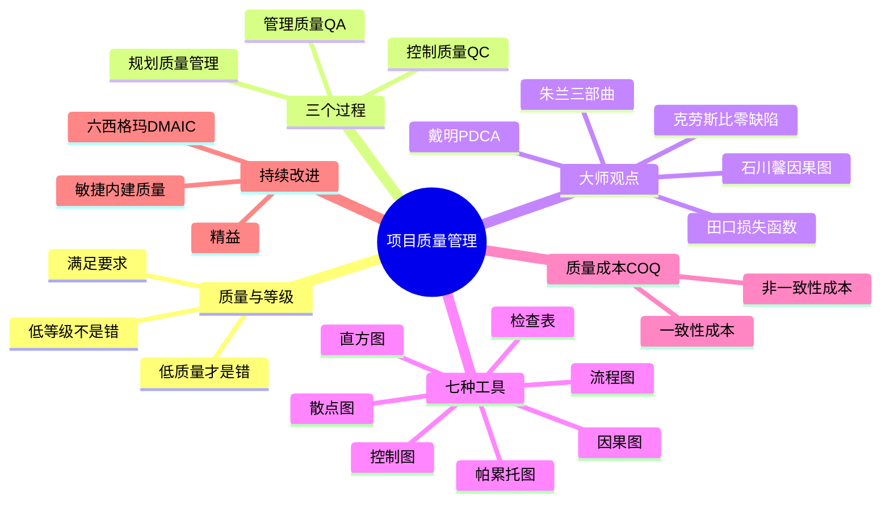
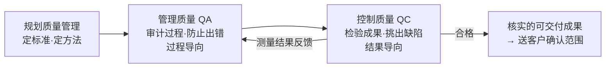
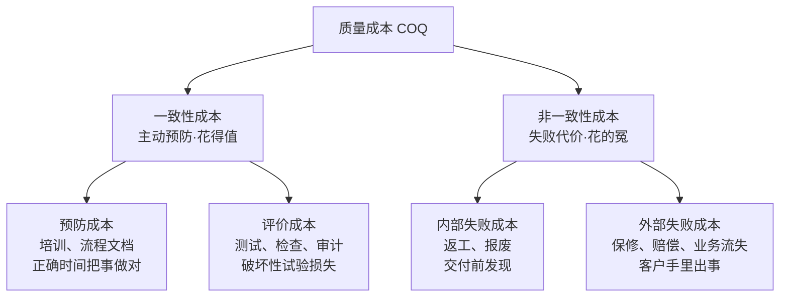

> **摘要**：
> 质量管理讲"怎么把事一次做对":质量与等级、三个过程、五位大师观点、七种质量工具、QA 与 QC 大对比、质量成本 COQ、六西格玛与精益。**大师观点配对 + 七工具辨析是上午题钉子户**,案例爱考"用哪种工具找原因/找主要问题",论文里质量管理是经典好写题(大师名言是现成素材)。建议投入 8~10 小时。

## 🗺️ 知识地图

## 📖 掰碎讲解

### 9.1 质量的定义与质量 vs 等级(判断题)

**是什么**:**质量** = 一组固有特性**满足要求的程度**;**等级** = 具有相同功能用途、不同技术特征的产品分类。

**大白话**:经济型酒店 vs 五星级酒店是**等级**不同(功能档次不同);床单有没有洗干净是**质量**问题。低等级可以接受(预算有限住经济型),**低质量不可接受**(经济型的床单也得干净)。

**怎么考**:"低等级 + 低质量都不可接受"(错,低等级可以是合理选择);"质量是满足要求的程度,不是越高越好"(对,过度质量=浪费)。

### 9.2 质量管理三个过程

| 过程 | 过程组 | 干什么 | 输出关键词 |
| --- | --- | --- | --- |
| 规划质量管理 | 规划 | 定标准定方法 | **质量管理计划、质量测量指标** |
| 管理质量(质量保证 QA) | 执行 | **审计过程**,确信过程能产出合格品 | 质量报告、测试与评估文件、变更请求 |
| 控制质量(QC) | 监控 | **检验成果**,验证是否合格 | 核实的可交付成果、质量控制测量结果、不合格处理 |

**大白话**:规划=定"菜要几成熟、咸淡多少";QA=检查厨师操作规不规范(洗手没、火候对没,防患于未然);QC=菜端出来前先尝一口(不合格打回)。QA 管过程,QC 管结果;QC 的检查结果反过来帮 QA 改流程。

**怎么考**:三过程与过程组配对(QA 在**执行**组、QC 在**监控**组——高频坑);质量管理计划的输出;"管理质量=质量保证"是同义表述(第 4 版叫管理质量)。

### 9.3 质量管理大师观点(配对必背,论文素材)

| 大师 | 核心观点 | 一句话识别 |
| --- | --- | --- |
| **戴明** | **PDCA 循环**(计划-执行-检查-处理);14 条管理原则;"85% 的质量问题源于管理/系统" | 关键词:PDCA、持续改进 |
| **朱兰** | **质量三部曲**:质量策划、质量控制、质量改进;质量=适用性(Fitness for use) | 关键词:三部曲、适用性 |
| **克劳斯比** | **零缺陷**;"质量是免费的";**第一次就把事情做对**;质量=符合要求 | 关键词:零缺陷、免费 |
| **田口玄一** | **质量损失函数**:偏离目标值越远,社会损失越大 | 关键词:损失函数 |
| **石川馨** | **因果图(鱼骨图)**;QC 小组;全面质量管理在日本推广 | 关键词:鱼骨图 |

**大白话**:戴明说"PDCA 转起来,别停下";朱兰说"质量就是好用";克劳斯比喊"一次做对,返工才是最贵的";田口画了条抛物线告诉你"偏离标准就是亏钱";石川馨掏出鱼骨图说"原因给我一条条找出来"。

**怎么考**:人物 ↔ 观点配对年年考;论文引言写一句"正如克劳斯比所言,质量是免费的"立刻加分。

### 9.4 七种质量工具(辨析必考)

| 工具 | 用途 | 识别关键词 | 易混点 |
| --- | --- | --- | --- |
| **因果图(鱼骨图/石川图)** | 从结果倒推**根本原因** | "分析原因" | 层层追问"为什么" |
| **帕累托图** | 按频率排序+累计曲线,抓**主要问题**(80/20) | "关键少数、二八原则" | 柱状降序+累计折线 |
| **控制图** | 判断过程**是否受控**(3σ 控制界限) | "七点规则、失控" | 见下方规则 |
| **直方图** | 展示数据**分布形状** | "分布、柱子相连" | 与散点图区分 |
| **散点图** | 看两个变量的**相关关系** | "两变量、相关性" | 点是散开的 |
| **检查表(核查表)** | 收集数据时**计数核对** | "清单打钩计数" | 最朴素的工具 |
| **流程图** | 展示过程步骤,找**改进环节** | "过程分析" | 也能预估质量问题环节 |

> **提示**：
> ①点超出**控制界限**(±3σ);②**七点规则**:连续 7 点位于中心线**同一侧**,或连续 7 点**持续上升/下降**——即使都在界限内,也判为异常,要查原因。

**大白话**:鱼骨图=审讯室(逼问原因);帕累托=抓大放小(20% 的原因造成 80% 的问题,先掐最大的那根);控制图=体温单(超线或连续 7 天低烧都是警报);直方图=身高分布图(看整体胖瘦);散点图=身高体重关系图(看两者是否正相关);检查表=点菜单;流程图=做菜步骤图。

**怎么考**:场景选工具——"要找导致缺陷的主要原因"→帕累托;"找根本原因"→因果图;"判断过程是否稳定"→控制图;"看两个指标是否相关"→散点图。**直方图 vs 散点图**是经典辨析(分布 vs 相关)。

### 9.5 质量保证(QA)与质量控制(QC)大对比(案例必考)

| 维度 | 管理质量(QA / 质量保证) | 控制质量(QC / 质量控制) |
| --- | --- | --- |
| 导向 | **过程导向**(把过程做对) | **结果导向**(把成果查对) |
| 性质 | 审计过程、预防性 | 检验产品、发现缺陷 |
| 谁来做 | 质量保证部门/全员参与 | 质量控制人员/测试人员 |
| 时点 | 贯穿全过程(执行组) | 阶段末对可交付成果(监控组) |
| 典型活动 | 过程审计、质量评审、过程改进 | 测试、检查、评审成果 |
| 依据 | 质量管理计划 | 质量测量指标 |
| 输出 | 质量报告、变更请求 | 核实的可交付成果、测量结果 |

**大白话**:QA 是"教练查训练方法",QC 是"裁判验比赛成绩"。方法对,成绩才稳;成绩差,回头改方法——两者闭环。

**怎么考**:活动归属判断("审计过程是否符合质量要求"=QA;"检查某个模块的代码质量"=QC);QC 在确认范围**之前**(先内部核实,再客户验收,呼应 [06-项目范围管理](06-项目范围管理/))。

### 9.6 质量成本 COQ(判断题必背)

**是什么**:为达到质量付出的总代价,分两大类四小类:

| 类别 | 子类 | 例子 |
| --- | --- | --- |
| 一致性成本 | 预防成本 | 培训、编写流程文档、设备、正确完成时间 |
| 一致性成本 | 评价成本 | 测试、检查、破坏性试验损失、审计 |
| 非一致性成本 | 内部失败 | 返工、报废 |
| 非一致性成本 | 外部失败 | 保修、赔偿、失去业务、声誉损失 |

**大白话**:一致性成本是"买保险+体检"(预防+评价),花在出事**前**;非一致性成本是"撞车维修费"(内部=修自己车,外部=赔别人车)。越早发现缺陷越便宜,流到客户手里最贵——这就是"质量免费"的真意。

**怎么考**:例子归属判断(培训=预防;测试=评价;返工=内部失败;客户索赔=外部失败);**预防成本 vs 评价成本**最易混(培训是防、测试是查)。

### 9.7 持续改进与敏捷内建质量

**是什么**:
- **六西格玛(6σ)**:追求极低缺陷率(约百万分之 3.4),改进方法 **DMAIC**:**D**efine 定义 → **M**easure 测量 → **A**nalyze 分析 → **I**mprove 改进 → **C**ontrol 控制;
- **精益**:消除浪费、只做增值活动(7 大浪费:过量生产、等待、搬运、过度处理、库存、多余动作、缺陷);
- **敏捷内建质量**:质量"内建"于每次迭代——结对评审、持续集成、自动化测试、完成的定义(DoD),不把质量留到最后。

**大白话**:六西格玛是"把出错率压到几乎为零的抠细节流水线";精益是"能省的步骤全砍掉";敏捷内建质量是"每两周交货时就自带质检",而不是"最后一起大返工"。

**怎么考**:DMAIC 五字母顺序;六西格玛目标缺陷率(百万分之 3.4);精益=消除浪费;敏捷"完成的定义"包含质量要求。

## 🎬 推荐视频

| 视频 | 讲什么 | 什么时候看 |
| --- | --- | --- |
| [野人老师高项全集 67 集](https://www.bilibili.com/video/BV1dJ41117Aa) | 质量管理章,大师观点讲得有趣 | 第一轮入门 |
| [软考老金高项](https://www.bilibili.com/video/BV1KtRQBtEQa) | 质量三过程 ITTO 串联 | 一轮后串骨架 |
| [夏天老师 2027 第 4 版公开课 53 集](https://www.bilibili.com/video/BV1TFBpBKExt) | 第 4 版口径精讲 | 对照补漏 |
| [summer 课堂第 4 版快速串讲 30 集](https://www.bilibili.com/video/BV1vz4y1a7fM) | 快速串 1-7 章 | 二轮冲刺 |

## ⭐ 章节重点(考前必背)

| 考点 | 必背内容 | 考法标签 |
| --- | --- | --- |
| 质量定义 | 满足要求的程度;低等级≠低质量 | 上午题判断 |
| 三过程 | 规划(计划+测量指标)/管理 QA(执行组)/控制 QC(监控组) | **配对必考** |
| 戴明 | PDCA 环;14 条;"85% 问题源于管理" | 上午题+论文 |
| 朱兰 | 三部曲:策划、控制、改进;适用性 | 上午题 |
| 克劳斯比 | 零缺陷;"质量是免费的";第一次做对 | 论文素材 |
| 田口玄一 | 质量损失函数 | 上午题 |
| 石川馨 | 因果图(鱼骨图);QC 小组 | 上午题 |
| 七工具 | 鱼骨找根因;帕累托找主要(80/20);控制图七点规则;直方看分布;散点看相关 | **案例必考** |
| QA vs QC | QA 过程导向执行组;QC 结果导向监控组;QC 先于确认范围 | **案例对比** |
| COQ | 一致(预防+评价)/非一致(内部失败+外部失败) | **判断题必考** |
| 六西格玛 | DMAIC;百万分之 3.4 缺陷率 | 上午题 |
| 精益/敏捷 | 消除浪费;内建质量、DoD | 论文素材 |

## 🧠 高频考法与陷阱

> **注意**：
> 1. **错误认知:质量越高越好,要多投入把质量做到极致。→ 正确认知**:质量是"满足要求",**过度质量是浪费**;与等级无关,等级低可以是合理选择。
> 2. **错误认知:质量保证就是检查产品有没有缺陷。→ 正确认知**:那是**质量控制**;QA 审计的是**过程**(防止缺陷产生),QC 检验的是**成果**(发现缺陷)。
> 3. **错误认知:控制图上所有点都在控制界限内,过程一定正常。→ 正确认知**:**七点规则**——连续 7 点同侧或同趋势,即使未出界也算异常。
> 4. **错误认知:直方图和散点图差不多。→ 正确认知**:直方图看**一个变量的分布**(柱相连),散点图看**两个变量的相关**(点散开)。
> 5. **错误认知:培训费用属于失败成本。→ 正确认知**:培训属于**预防成本**(一致性成本);测试检查属**评价成本**;返工报废才属失败成本。
> 6. **错误认知:质量控制之后立刻就到客户手里了。→ 正确认知**:QC 核实后还要经**确认范围**(客户正式验收),两步别合并(详见 [06-项目范围管理](06-项目范围管理/))。

## ✍️ 反复练习题

**第 1 题(选择)** 关于质量与等级,正确的说法是:
A. 低等级的产品一定质量差
B. 高等级的产品不可能有质量问题
C. 低等级可以接受,低质量不可接受
D. 质量就是产品功能越多越好

> **示例**：
> **答案:C**
> 等级是功能档次差异(可以有低等级产品),质量是满足要求的程度,低质量绝不可接受;功能堆砌不等于质量好,过度质量反而浪费。

**第 2 题(选择)** 提出"零缺陷"和"质量是免费的"观点的质量管理大师是:
A. 戴明　B. 朱兰　C. 克劳斯比　D. 田口玄一

> **示例**：
> **答案:C**
> 克劳斯比:零缺陷、第一次就把事情做对、"质量是免费的"(返工与失败才昂贵)。戴明=PDCA;朱兰=三部曲;田口=质量损失函数。

**第 3 题(选择)** 项目中缺陷数据统计后发现,80% 的缺陷集中在 20% 的模块上,为确定优先修复对象,最合适的工具是:
A. 因果图　B. 帕累托图　C. 控制图　D. 散点图

> **示例**：
> **答案:B**
> 帕累托图按频次降序排列并画累计曲线,体现"关键的少数"(二八原则),专门用于**抓主要问题**。因果图找根因,控制图看过程稳定性。

**第 4 题(选择)** 质量控制图中,即使所有点都在控制界限内,出现下列哪种情况也应判为异常:
A. 点均匀分布在中心线两侧
B. 连续 7 个点位于中心线同一侧
C. 有一个点恰好落在中心线上
D. 点分布随机波动

> **示例**：
> **答案:B**
> **七点规则**:连续 7 点在中心线同一侧,或连续 7 点持续上升/下降,均为失控信号,须查明原因。A/D 是正常随机波动。

**第 5 题(选择)** 为减少缺陷而开展员工质量培训,该成本属于:
A. 内部失败成本　B. 评价成本　C. 预防成本　D. 外部失败成本

> **示例**：
> **答案:C**
> 培训、流程文档建设都是"防患于未然"=**预防成本**(一致性);测试检查=评价成本;返工报废=内部失败;保修赔偿=外部失败。

**第 6 题(选择)** 下列活动中属于"管理质量(质量保证)"的是:
A. 对交付代码执行系统测试
B. 审计项目管理与开发过程是否符合质量要求
C. 与客户一起验收可交付成果
D. 修复测试中发现的缺陷

> **示例**：
> **答案:B**
> QA=过程导向的**审计**;A/C/D 分别是 QC、确认范围、缺陷修复执行。记忆:QA 查"做事的方式",QC 查"做出来的东西"。

**第 7 题(选择)** 六西格玛改进方法 DMAIC 的正确顺序是:
A. 定义→测量→分析→改进→控制　B. 定义→分析→测量→改进→控制　C. 测量→定义→分析→控制→改进　D. 定义→测量→改进→分析→控制

> **示例**：
> **答案:A**
> DMAIC:Define 定义问题 → Measure 测量现状 → Analyze 分析根因 → Improve 实施改进 → Control 控制固化。六西格玛目标是缺陷率约百万分之 3.4。

**第 8 题(案例风格)** 某公司开发的 APP 上线后用户投诉不断:主要问题是闪退(占缺陷 76%)、加载慢(占 12%)。测试部抱怨"每次都到最后一周才集中测试,根本改不过来"。请回答:
(1) 应使用哪种质量工具确定优先整改对象?为什么?
(2) 针对闪退,应该用什么工具追溯根本原因?
(3) 针对测试部的抱怨,请从质量成本与敏捷实践角度提出改进建议。

> **示例**：
> (1) 用**帕累托图**:把缺陷按类型降序排列并绘制累计频率曲线,识别"关键的少数"。闪退占 76%,加上加载慢累计约 88%,应优先集中资源整改这两类,符合 80/20 原则,避免平均用力。
> (2) 用**因果图(鱼骨图)**:以"APP 闪退"为结果,从人、机(设备/环境)、料(数据/第三方库)、法(编码规范/流程)、环(操作系统版本/网络)等维度逐层展开,结合头脑风暴与数据验证找到根本原因;必要时辅以**散点图**验证闪退次数与某变量(如特定 OS 版本)的相关性。
> (3) 建议:①当前模式带来的大量**返工属于内部失败成本**,代价最高;应把投入前移到**预防成本**(评审、编码规范、培训)与**评价成本**(持续测试),整体降低总质量成本;②推行**敏捷内建质量**:把质量要求纳入"完成的定义(DoD)",每个迭代都做代码评审、持续集成与自动化测试,小步发现、小步修复;③用**控制图**监控构建/测试质量趋势,出现连续恶化即预警;④最后交客户前再走**确认范围**正式验收。

## 🔗 相关章节

- QC 之后是验收:[06-项目范围管理](06-项目范围管理/)
- 缺陷返工与成本联动:[08-项目成本管理](08-项目成本管理/)
- 团队与质量文化:[10-项目资源管理](10-项目资源管理/)
- 变更与质量基线:[05-项目整合管理](05-项目整合管理/)
- 攻略:[项管-论文攻略](../项管-论文攻略/)、[项管-案例分析攻略](../项管-案例分析攻略/)
