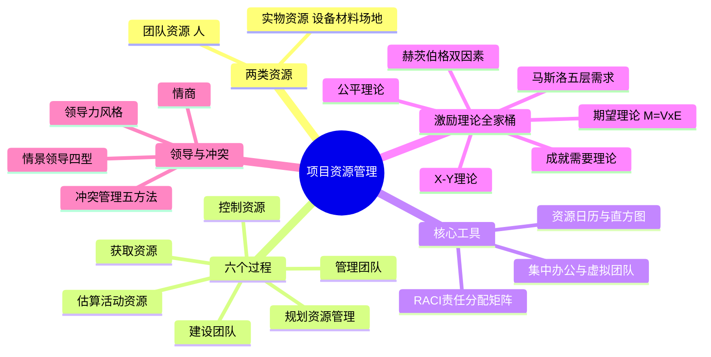
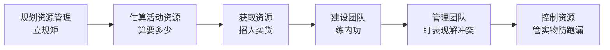
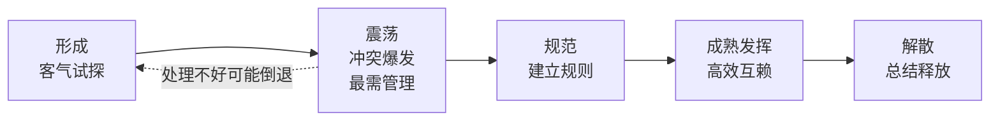

> **摘要**：
> 资源管理回答"人和物从哪来、怎么带、怎么还":团队资源 + 实物资源两条线,六个过程贯穿始终。**激励理论全家桶、团队五阶段顺序、冲突管理五法、RACI 四角色**是上午题钉子户(近年稳定出分);案例爱考"团队士气低落/成员冲突/责任矩阵找错";论文里人力资源是经典好写题(激励理论当理论依据现成好用)。建议投入 8~10 小时。

## 🗺️ 知识地图

## 📖 掰碎讲解

### 10.1 资源分两类:管人和管物(判断题)

**是什么**:第 4 版把资源分成**团队资源(人力资源)**和**实物资源**(设备、材料、设施、场地)。团队资源靠"建设 + 管理",实物资源靠"估算 + 获取 + 控制"。

**大白话**:开火锅店——服务员、厨师是**团队资源**,要招聘、培训、留人;锅底牛油、桌椅电磁炉是**实物资源**,要采购、入库、清点。一句话:**人要"哄",物要"管"**。

**怎么考**:"控制资源管的是实物资源,不管人"(对);题目出现"服务器、软件许可、办公用品"→实物;出现"工程师、外包人员、专家"→团队。

### 10.2 六个过程总览(配对必考)

| 过程 | 过程组 | 一句话 | 关键输出 |
| --- | --- | --- | --- |
| 规划资源管理 | 规划 | 定规矩:角色怎么分、团队怎么带 | **资源管理计划、团队章程** |
| 估算活动资源 | 规划 | 每个活动要多少人、多少物 | 资源需求、资源分解结构 RBS |
| 获取资源 | 执行 | 把人把物弄到手 | 实物资源分配、项目团队派工单、**资源日历** |
| 建设团队 | 执行 | 提升能力、凝聚士气 | **团队绩效评价** |
| 管理团队 | 执行 | 日常跟踪表现、解决冲突、反馈绩效 | 变更请求、计划更新 |
| 控制资源 | 监控 | 确保实物资源按计划到位并正确使用 | 工作绩效信息、变更请求 |

**大白话**:先立规矩(规划),再算要多少(估算),然后招人买货(获取),带队伍练内功(建设),天天盯人解扣子(管理),最后清点货物别跑冒滴漏(控制)。

**怎么考**:过程与过程组配对——建设团队/管理团队在**执行**组,控制资源在**监控**组;第 4 版旧名"规划人力资源管理"已改为**规划资源管理**,选项里出现旧名要认得。

### 10.3 资源管理计划与团队章程

**是什么**:
- **资源管理计划**:怎么识别资源、怎么获取、角色职责怎么定、怎么培训、怎么遣散;其中**角色与职责**可用 RACI 矩阵、层级图(组织图/OBS)、文本型三种方式表示。
- **团队章程**:团队自己的"约法三章"——核心价值观、行为规范、决策规则、会议规则、沟通期望,由**团队成员共同制定**。

**大白话**:资源管理计划是"编制表 + 用工制度";团队章程是宿舍公约——大家商量好"晚上 11 点后别开黑",白纸黑字贴墙上,自己定的规矩自己守,约束力最强。

**怎么考**:"团队行为规范由谁定"→成员共同制定(团队章程);"RACI 矩阵属于哪份计划的工具"→资源管理计划。

### 10.4 RACI 责任分配矩阵(四角色判断必考)

| 字母 | 含义 | 大白话 | 规则 |
| --- | --- | --- | --- |
| **R**(Responsible) | 执行 | 实际干活的人 | **可以有多个** |
| **A**(Accountable) | 负责/问责 | 出了事找谁拍板 | **每项任务只能 1 个** |
| **C**(Consult) | 咨询 | 动手前要问过他意见 | **双向沟通** |
| **I**(Inform) | 知情 | 干完告诉他一声 | **单向通知** |

**大白话**:装修房子——R 是工人师傅(抡锤子的,可以水电工、瓦工好几个);A 是你本人(花钱拍板,一个家只能一个人说了算);C 是设计师(动工前得问过他);I 是你爸妈(完工了汇报一声就行)。

**怎么考**:"一项任务可以有多个 A,更保险"(错!A 只能 1 个,多头负责=没人负责);案例题给矩阵找错——某活动两个 A、某任务没有 A,都是必挑的错误。

### 10.5 估算与获取:资源日历、直方图、预分派、虚拟团队

**是什么**:
- **资源需求 / 资源分解结构(RBS)**:按类别层级列出"要什么资源、要多少"。
- **资源日历**:记录**具体某项资源什么时候有空**(获取资源的输出)。
- **资源直方图**:柱状图显示**各时间段资源投入总量**,一柱一时间段。
- **预分派**:项目章程里就内定了(项目经理、关键骨干)。
- **谈判**:和职能经理、其他项目团队、外部供应商"借人"。
- **虚拟团队**:成员不在同一地点办公(远程、跨时区、居家)。

**大白话**:资源日历是"某员工的排班表";资源直方图是"全组人力柱状图,一眼看出哪周加班爆表";预分派是"老板钦点";谈判是"去职能部门借人,得跟人家经理套近乎";虚拟团队是"北上广深招不到人,招成都远程"。

虚拟团队**优点**:节省办公与差旅成本、不限地域广纳人才、照顾行动不便等特殊人群;**缺点**:沟通困难、孤立感强、时差与文化差异、信任难建立——靠**完善的沟通计划 + 协作平台 + 定期视频会**弥补。

**怎么考**:虚拟团队优缺点判断;"资源日历 vs 资源直方图"辨析(日历=某资源可用时间;直方图=整体投入量);获取资源的三种方式(预分派/谈判/招募)场景判断。

### 10.6 团队发展阶段五阶段(顺序与特征必背)

| 阶段 | 关键词 | 团队氛围 | 项目经理该干嘛 |
| --- | --- | --- | --- |
| **形成**(Forming) | 相识、试探、客气 | 礼貌但生疏 | 指导:明确目标与分工 |
| **震荡**(Storming) | 冲突、分歧、争权 | 矛盾公开爆发 | **最需介入**:引导化解 |
| **规范**(Norming) | 立规矩、开始协作 | 有默契 | 支持协作、固化规范 |
| **成熟/发挥**(Performing) | 高效运转、相互依靠 | 渐入佳境 | 授权,少干预 |
| **解散**(Adjourning) | 完成任务、释放资源 | 恋恋不舍 | 总结庆功、安排去向 |

**大白话**:新组建的篮球队——刚见面互相吹捧(形成);打几场就开始甩锅、抢出手权(震荡);慢慢定了"谁控球谁防守"的规矩(规范);最后心有灵犀打出流畅配合(发挥);赛季结束吃散伙饭(解散)。口诀:**"形震规成解"**(谐音:行!真归成姐)。

**怎么考**:给场景判断阶段("成员开始公开争论技术方案"=震荡;"高效默契不需要监督"=成熟);顺序排错题;"震荡阶段冲突最激烈、最需要项目经理引导"(对)。

### 10.7 团队建设三招:集中办公、认可激励、培训

- **集中办公(别名"紧密矩阵"/作战室)**:把成员聚到一处办公,沟通快、归属感强。
- **认可与奖励**:要**及时、与绩效挂钩、人人都有机会获得**;只奖励少数明星反而打击多数人士气;奖励要满足被奖励者的需求(呼应激励理论)。
- **培训**:技能不足就安排培训,费用计入项目或组织预算。
- **团队绩效评价**看四个变化:技能提升、流失率降低、凝聚力增强、成员满意度提高。

**怎么考**:"集中办公的别名是紧密矩阵"(送分);"只重奖个别骨干能提升整体士气"(错)。

### 10.8 激励理论全家桶(上午钉子户,论文素材库)

**① 马斯洛需求层次**:五层从低到高——**生理 → 安全 → 社交(归属) → 尊重 → 自我实现**;低层满足后高层才有激励作用,已满足的层次不再有激励效果。口诀:"生理安全社尊自"。

**② 赫茨伯格双因素**:
- **保健因素**:工资、工作条件、公司政策、人际关系、职位安全——没有会**不满**,有了也只是"没不满",**不产生满意**(退烧药,不治病)。
- **激励因素**:成就、认可、工作本身、责任、晋升、成长——有了才**满意**(兴奋剂)。
- 易错:给员工**涨工资**长期看不会带来满意,因为工资是保健因素。

**③ X-Y 理论(麦格雷戈)**:X 假设"人天性懒、逃避责任"→要**强制、监督、惩罚**;Y 假设"人愿意工作、有责任心"→要**授权、鼓励、参与**。现代管理以 Y 理论为主流。

**④ 期望理论(弗鲁姆)**:激励力 **M = V × E**(效价 × 期望值)。V=奖品有多想要,E="跳一跳够得着"的主观概率。**任一为 0,激励为 0**——画大饼(V 大)但根本吃不到(E=0)照样白搭。

**⑤ 公平理论(亚当斯)**:人会拿自己的(报酬/投入)比与他人的(报酬/投入)比;感到不公→消极怠工、要求涨薪。启示:分配公平透明,薪酬保密有其道理。

**⑥ 成就需要理论(麦克利兰)**:三种需要——**成就、权力、亲和**;高成就需要者偏爱**中等难度**任务和**即时反馈**(太难够不着、太简单没意思)。

**怎么考**:场景配理论——"发奖金没起色"→双因素(奖金保健);"目标定太高没人干"→期望理论 E 低;"新人工资比老员工高引发不满"→公平理论;"爱挑战性任务"→成就需要;**理论↔人物**配对年年考:马斯洛/赫茨伯格/麦格雷戈/弗鲁姆/亚当斯/麦克利兰。

### 10.9 领导力风格与情景领导(按场景选)

| 风格 | 特点 | 适用场景 |
| --- | --- | --- |
| 命令/指令型 | 我说了算 | 危机、紧急、新团队 |
| 参与/民主型 | 集体讨论共同决策 | 团队成熟、需要共识 |
| 授权型 | 给目标、放权力 | 下属能力强意愿高 |
| 变革型 | 画愿景、激发内在动力 | 转型、创新项目 |
| 交易型 | 论功行赏、奖惩分明 | 日常运营维护 |
| 服务型 | 先服务后领导,成就他人 | 敏捷团队、赋能文化 |

**情景领导(赫塞-布兰查德)**:按下属**成熟度(能力 + 意愿)**匹配风格——

| 成熟度 | 特征 | 领导风格 |
| --- | --- | --- |
| M1 | 不会也不愿 | **指令(告知)**:高任务、低关系 |
| M2 | 不会但愿 | **教练(推销)**:高任务、高关系 |
| M3 | 会但不愿/不稳定 | **支持(参与)**:低任务、高关系 |
| M4 | 会又愿 | **授权**:低任务、低关系 |

**大白话**:带徒弟学开车——M1 在副驾直接吼"踩离合!";M2 手把手教边讲道理;M3 他会开但不敢上路,你在旁边鼓励;M4 直接把车钥匙给他。

**怎么考**:"对新员工直接授权充分信任"(错,应指令);"骨干能力强却消极怠工"(M3,用支持型)。

### 10.10 冲突管理五方法(考"最优"与场景选择)

| 方法 | 特点 | 适用时机 | 结果 |
| --- | --- | --- | --- |
| **合作/解决问题** | 直面问题,找双方都赢的方案 | 时间充裕、要根治 | **双赢,最推崇** |
| **强制/命令** | 一方压一方 | 紧急重大、必须快断 | 输-赢,伤关系 |
| **妥协/调解** | 各让一步 | 势均力敌、时间紧 | 双输一点,无完全赢家 |
| **缓和/包容** | 强调一致、淡化分歧 | 关系比事重要 | 治标不治本 |
| **撤退/回避** | 先放下冷处理 | 需要冷静/信息不足 | 暂时搁置,问题还在 |

**大白话**:两口子吵架——坐下来把账算清楚(合作);火烧眉毛家长拍板(强制);各退一步海阔天空(妥协);"都怪天气别吵了"(缓和);"等我冷静会儿"(撤退)。考试口诀:**问"最优"答"合作/问题解决"**。

**怎么考**:场景选方法("进度危急 PM 直接拍板"=强制,紧急时合理);"冲突都是有害的要消灭"(错,适度冲突激发创意);冲突应由**团队成员尽早、私下**自行解决,解决不了再升级给项目经理。

### 10.11 管理团队、控制资源与两类"绩效"辨析

- **管理团队工具**:**观察与交谈**(泡在现场聊)、**项目绩效评估**(给成员个人做绩效反馈)、冲突管理、人际技能(情商)。
- **情商**四要素:自我意识、自我管理、社交意识(同理心)、关系管理——项目经理软实力核心。
- **控制资源**只管**实物**:资源到位了没?用得对不对?出问题走问题解决流程:**识别问题→定义→调查→分析→解决→检查**。
- **团队绩效评价**(建设团队的输出)评**团队整体**;**项目绩效评估**(管理团队的工具)评**个人**。一字之差,年年有人栽。

**怎么考**:"团队绩效评价评的是个人绩效"(错);"控制资源中发现实物资源短缺要发起变更请求"(对)。

## 🎬 推荐视频

| 视频 | 讲什么 | 什么时候看 |
| --- | --- | --- |
| [野人老师高项全集 67 集](https://www.bilibili.com/video/BV1dJ41117Aa) | 资源管理章,五阶段+冲突讲得生动 | 第一轮入门 |
| [软考老金高项(ITTO 记忆)](https://www.bilibili.com/video/BV1KtRQBtEQa) | 六过程 ITTO 串联口诀 | 一轮后串骨架 |
| [夏天老师 2027 第 4 版公开课 53 集](https://www.bilibili.com/video/BV1TFBpBKExt) | 第 4 版口径(控制资源等新表述) | 对照补漏 |
| [希赛第 4 版精讲 187 集](https://www.bilibili.com/video/BV1i3ovYrEek) | 激励理论逐个细讲 | 二轮查缺 |

## ⭐ 章节重点(考前必背)

| 考点 | 必背内容 | 考法标签 |
| --- | --- | --- |
| 六过程 | 规划/估算(规划组)、获取/建设/管理(执行组)、控制(监控组) | 配对必考 |
| RACI | R 执行可多个;**A 问责只能 1 个**;C 咨询双向;I 知情单向 | **案例找错** |
| 资源日历 vs 直方图 | 日历=某资源可用时间;直方图=投入量柱状图 | 上午辨析 |
| 虚拟团队 | 优:省成本、纳人才;缺:沟通难、信任难;靠沟通+平台 | 上午判断 |
| 五阶段 | **形→震→规→成(发挥)→解**;震荡最需介入 | **顺序必考** |
| 团队建设 | 集中办公=紧密矩阵;奖励及时、挂钩绩效、人人可得 | 上午判断 |
| 马斯洛 | 生理→安全→社交→尊重→自我实现;满足后失效 | **配对+论文** |
| 双因素 | 工资条件政策=保健;成就认可责任晋升=激励 | **判断必考+论文** |
| X-Y 理论 | X 强制监督;Y 授权鼓励;现代以 Y 为主 | 上午 |
| 期望理论 | **M=V×E,任一为 0 激励为 0** | 判断/计算 |
| 公平理论 | 比报酬/投入之比;不公→消极怠工 | 上午 |
| 成就需要 | 成就/权力/亲和;高成就爱中等难度+即时反馈 | 上午 |
| 情景领导 | M1 指令→M2 教练→M3 支持→M4 授权 | 场景必考 |
| 冲突五法 | **合作(解决问题)最优**;强制紧急;妥协各让;缓和求同;回避冷处理 | **案例必考** |
| 情商 | 自我意识/自我管理/社交意识/关系管理 | 论文素材 |
| 两类评价 | 团队绩效评价评整体;项目绩效评估评个人 | 辨析 |

## 🧠 高频考法与陷阱

> **注意**：
> 1. **错误认知:控制资源就是把项目里的所有人管好。→ 正确认知**:控制资源只管**实物资源**(设备、材料、设施);人由建设团队(提能力)和管理团队(盯表现)负责。
> 2. **错误认知:RACI 里一项任务设两个 A 更保险。→ 正确认知**:**A(问责)每项任务只能 1 个**,多头负责=没人负责;R(执行)才可以多个。
> 3. **错误认知:给员工多发钱就能持续激励。→ 正确认知**:工资属**保健因素**,不发会不满、发了不产生满意;长期激励靠激励因素(成就、认可、责任、晋升)。
> 4. **错误认知:冲突都是坏事,要彻底消灭。→ 正确认知**:适度冲突激发创意;冲突应**尽早、私下**解决,解决不了再升级;最优方法是合作(问题解决)。
> 5. **错误认知:团队刚组建就直接授权,充分信任。→ 正确认知**:按成熟度选风格——新人(M1)用**指令**;会而不稳(M3)用支持;又会又愿(M4)才授权。
> 6. **错误认知:奖励只要金额大就有效。→ 正确认知**:奖励要**及时、与绩效挂钩、人人都有机会获得**;只重奖明星员工反而打击多数人士气。

## ✍️ 反复练习题

**第 1 题(选择)** RACI 责任分配矩阵中,说法正确的是:
A. 每项任务可以有多个 A(问责)
B. R(执行)每项任务只能有一个
C. A(问责)每项任务只能有一个
D. I(知情)需要与任务负责人双向沟通

> **示例**：
> **答案:C**
> A(Accountable 问责)每项任务**有且只有 1 个**;R(执行)可以有多个;C(咨询)才是双向沟通(先问意见),I(知情)是单向通知。B 把 R 和 A 的规则弄反了。

**第 2 题(选择)** 项目团队从互相客客气气,发展到公开争论技术方案、质疑分工安排,此时团队处于:
A. 形成阶段　B. 震荡阶段　C. 规范阶段　D. 成熟阶段

> **示例**：
> **答案:B**
> 争论、分歧公开化是**震荡阶段**典型特征,也是**最需要项目经理介入引导**的阶段。形成=客气试探;规范=立规矩开始协作;成熟=高效互赖。

**第 3 题(选择)** 某公司给全员普涨 10% 工资,两个月后满意度调查未见明显提升。用赫茨伯格双因素理论解释最合适的是:
A. 工资是激励因素,涨幅不够所以无效
B. 工资是保健因素,涨薪只能消除不满,不能带来满意
C. 该公司存在公平问题
D. 期望理论中效价 V 为零

> **示例**：
> **答案:B**
> 工资、工作条件、公司政策属**保健因素**——没有会不满,有了只消除不满、不产生满意。要提升满意度需激励因素:成就、认可、工作本身、责任、晋升。

**第 4 题(选择)** 某任务目标定得过高,员工认为"怎么努力也完不成",按期望理论 M=V×E,激励失效的原因是:
A. 效价 V 太低　B. 期望值 E 太低　C. 分配不公平　D. 保健因素缺失

> **示例**：
> **答案:B**
> 期望值 E 是"努力后能达成目标"的主观概率。"怎么努力也完不成"即 E≈0,由 M=V×E 知 M≈0。目标要"跳一跳够得着"。

**第 5 题(选择)** 项目关键阶段,两位核心工程师就技术方案争执不下,时间紧迫必须立即定夺,项目经理最合适的做法是:
A. 组织双方充分研讨达成一致　B. 直接拍板选定方案　C. 先搁置争论继续别的任务　D. 分别安抚双方情绪

> **示例**：
> **答案:B**
> 时间紧迫、必须快断时用**强制/命令**(PM 拍板),虽是输-赢但紧急情况下合理;若时间充裕,最优方法是**合作/解决问题**(A)。C=回避、D=缓和,都贻误时机。

**第 6 题(选择)** 下列关于虚拟团队的说法,错误的是:
A. 可以吸纳不同地域的优秀人才
B. 节省办公场地与差旅成本
C. 成员孤立感弱,沟通天然顺畅
D. 需要更完善的沟通计划与协作工具支撑

> **示例**：
> **答案:C**
> 虚拟团队的缺点恰是**沟通困难、孤立感强**、时差文化差异、信任难建立,必须靠沟通计划、共享平台、定期视频会议弥补。A/B/D 均为正确表述。

**第 7 题(选择)** 某老员工业务能力强,但近期积极性下降、偶有消极怠工。按情景领导理论应采取:
A. 指令型　B. 教练型　C. 支持型　D. 授权型

> **示例**：
> **答案:C**
> "会但不愿"=M3,对应**支持(参与)型**:低任务行为、高关系行为,多倾听鼓励、共同参与决策。M1 指令、M2 教练、M4 授权。

**第 8 题(案例风格)** 某信息系统项目开发中期出现以下状况:①两名骨干因接口方案争执,已影响进度;②新入职 3 名成员开会从不发言;③检查发现某任务在责任分配矩阵中被安排了两个 A。请回答:
(1) 状况①中团队处于哪个发展阶段?项目经理应优先采用哪种冲突处理方式?为什么?
(2) 针对状况②,提出两条帮助新成员融入的措施。
(3) 指出状况③的问题并给出改正办法。

> **示例**：
> (1) 团队处于**震荡阶段**(分歧公开化是必经阶段)。应优先采用**合作/解决问题**:组织双方直面分歧,围绕项目目标摆数据、比方案,寻找双方都认可的最优接口设计。理由:合作是双赢且根治分歧的最优方法;同时应提醒冲突尽量尽早、私下解决。若进度已到临界点,可先强制拍板定方案、再私下沟通善后。
> (2) 措施(任答两条):①依据**团队章程**组织破冰,明确行为规范与沟通期望,并给新人指定导师;②短期**集中办公**增强归属感;③采用**参与型领导**,会上主动请新人发言并及时认可;④按能力圈分配任务并安排**培训**,帮其建立信心。
> (3) 问题:RACI 矩阵中每项任务的 **A(问责)只能有 1 个**,两个 A 会导致多头负责、出问题互相推诿。改正:沟通后只保留一个 A(通常为对该任务有最终决策权者),另一人调整为 R(执行)、C(咨询)或 I(知情)。

## 🔗 相关章节

- 团队能力与质量联动:[09-项目质量管理](09-项目质量管理/)
- 沟通不畅引发团队问题:[11-项目沟通与干系人管理](11-项目沟通与干系人管理/)
- 外包资源的管理:[13-项目采购管理](13-项目采购管理/)
- 资源估算与进度联动:[07-项目进度管理](07-项目进度管理/)
- 攻略:[项管-案例分析攻略](../项管-案例分析攻略/)、[项管-论文攻略](../项管-论文攻略/)、[学习方法与记忆术](../../00-备考指南/学习方法与记忆术/)
