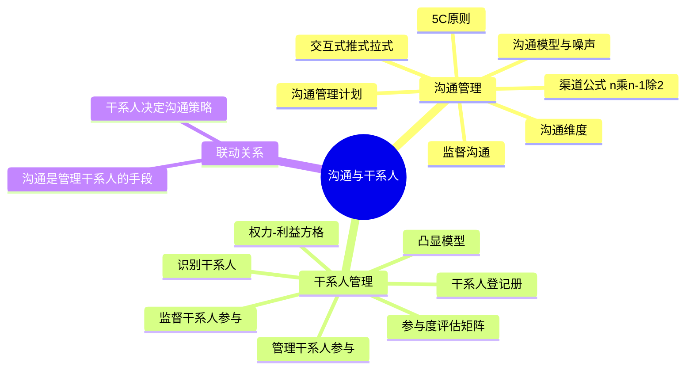
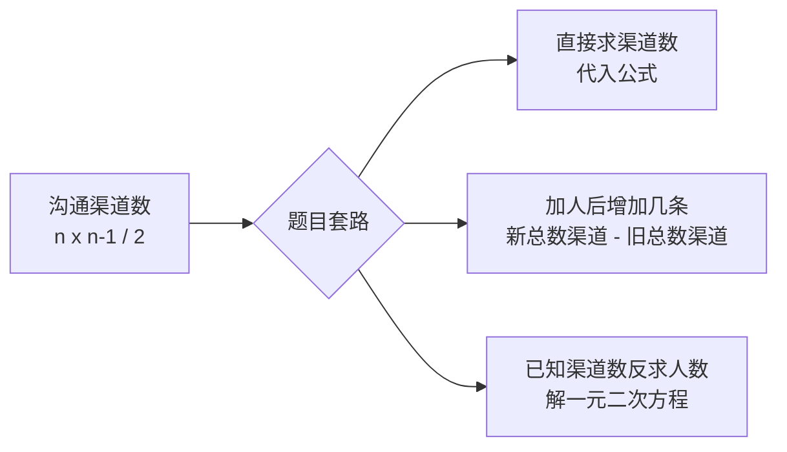
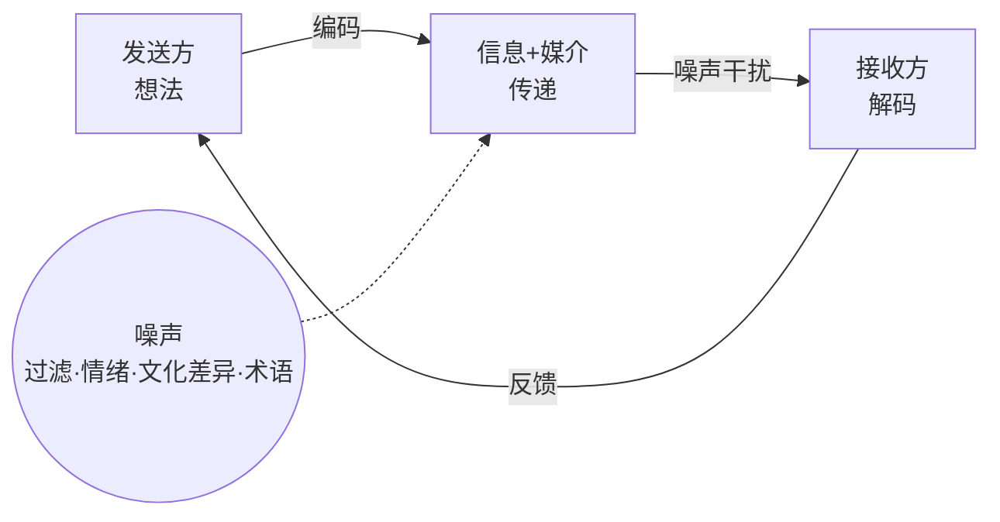
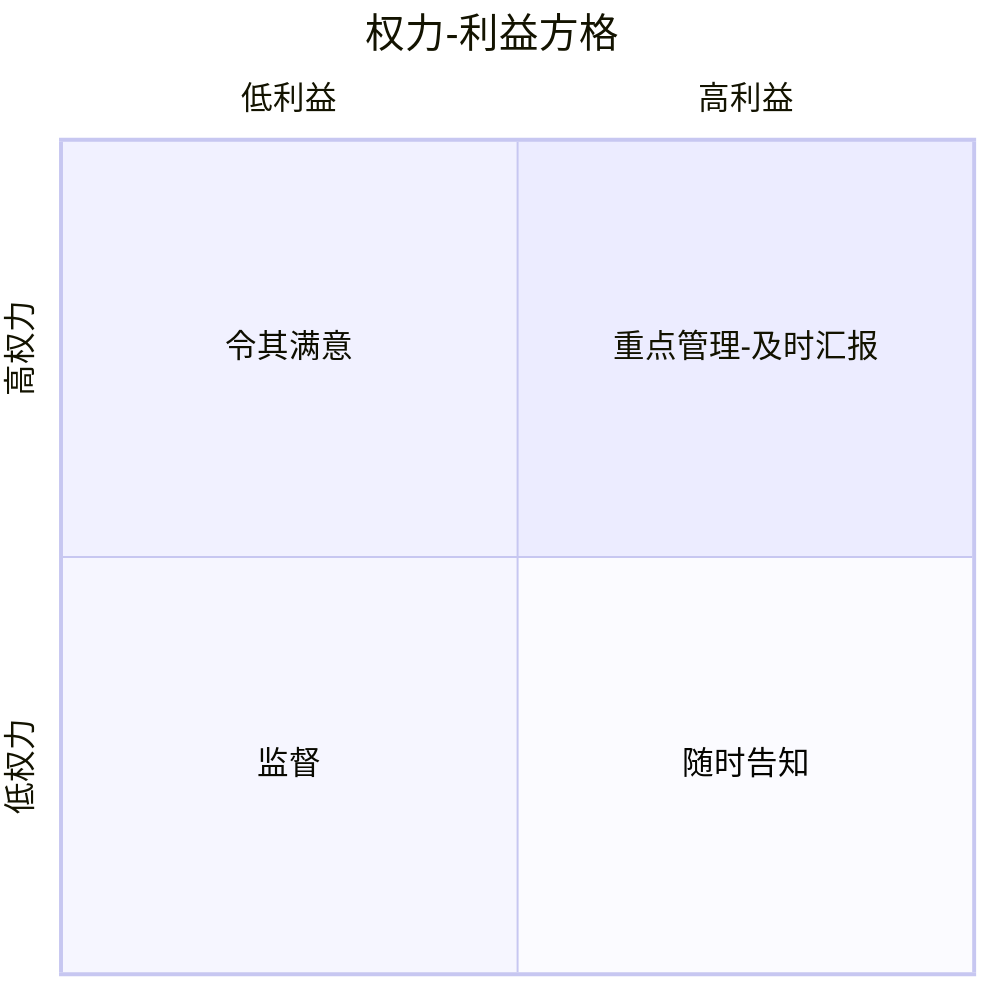

> **摘要**：
> 这章讲"把话说到位、把人安顿好":沟通维度与渠道公式、三种沟通方式、沟通模型、干系人权力-利益方格、参与度评估矩阵。**渠道数计算 n(n-1)/2、方格四象限策略、参与度五级填空**是上午+案例双料钉子户(近年稳定出分);案例爱考"干系人反对怎么办/沟通计划缺什么";论文沟通与干系人都是高频好写题。建议投入 7~9 小时。

## 🗺️ 知识地图

## 📖 掰碎讲解

### 11.1 沟通的维度(分类判断)

**是什么**:沟通可以按多个维度分类——**内部/外部**(团队内 vs 客户供应商)、**正式/非正式**(报告会议 vs 邮件寒暄)、**层级**(向上/向下/横向)、**官方/非官方**(年报 vs 私下吹风)、**书面/口头**。

**大白话**:跟老板汇报用正式书面(周报);跟同事打听进度用非正式口头(下午茶聊一句);对外发公告要官方,内部先吹吹风摸底是非官方。**场合适配,别用错频道**。

**怎么考**:"非官方沟通没有价值"(错,非官方沟通常有助干系人关系建立);"项目例会属于正式沟通"(对)。

### 11.2 沟通渠道公式 n(n-1)/2(必考计算)

**是什么**:n 个人两两沟通,沟通渠道数 = **n(n-1)/2**;每加 1 个人,渠道增加 n 条(n 为加人后总数减 1)。

**大白话**:3 人群聊有 3 条私聊线,5 人群聊有 10 条——人越多,沟通复杂度指数级上涨。这也解释了为什么要**分小组、设接口人**,而不是全员自由沟通。

**怎么考**:经典题:"项目组 6 人,新增 2 人后沟通渠道增加几条?"→ 6×5/2=15,8×7/2=28,28-15=**13 条**。陷阱:①别忘除以 2;②"新增 2 人"后总数是 8 不是 7;③若问"某 1 人加入后增加几条"=加人后总数减 1。

### 11.3 沟通方式三类:交互式、推式、拉式(选择必考)

| 方式 | 特点 | 典型例子 | 效率与效果 |
| --- | --- | --- | --- |
| **交互式沟通** | 双向、即时确认 | 会议、电话、视频、即时消息、谈判 | **最有效**,信息量大但费时 |
| **推式沟通** | 单向发给接收方,不保证理解 | 邮件、报告、备忘录、新闻稿 | 效率高,不知道对方看不看 |
| **拉式沟通** | 接收方**自主**取用,信息量大受众广 | 知识库、内网门户、电子课程、经验教训库 | 适合海量信息 |

**大白话**:交互式=打电话(你说我答);推式=群发邮件(发完就跑,看不看随你);拉式=食堂自助(想吃啥自己拿)。**要确认理解→交互式;要广而告之→推式;要海量自取→拉式**。

**怎么考**:场景三选一——"需求评审会"=交互式;"向 200 名员工发布新版操作手册"=推式或拉式(放知识库);"向全员公开政策细则供随时查阅"=拉式。

### 11.4 沟通模型与沟通障碍

**是什么**:基本沟通模型——**发送方编码 → 通过媒介传递 → 接收方解码 → 反馈**,全程可能混入**噪声**(干扰因素)。

**常见障碍**:过滤(信息被层层截留加工,报喜不报忧)、语言障碍、文化差异、情绪、专业术语过多、信息过载。

**5C 原则**(书面沟通):**正确的语法和拼写(Correct)、简洁的表述(Concise)、清晰的目的与表述(Cl Clear)、连贯的思维逻辑(Coherent)、受控的语句和想法的流畅(Control)**。口头沟通加分项:积极倾听、提问澄清、理解文化差异、管理期望。

**大白话**:编码=把想法翻译成人话;噪声=楼道装修声、对方心情差、满屏专业黑话;过滤=下属汇报时"优化"了坏消息——层层传到老板耳朵里已经全是好消息,这就是大公司病。

**怎么考**:"报喜不报忧、信息层层衰减"=过滤;5C 填空;"反馈能确认信息是否被正确理解"(对,反馈是闭环关键)。

### 11.5 三个过程:规划沟通管理、管理沟通、监督沟通

| 过程 | 过程组 | 干什么 | 关键输出/工具 |
| --- | --- | --- | --- |
| 规划沟通管理 | 规划 | 谁需要什么信息、何时给、怎么给 | **沟通管理计划** |
| 管理沟通 | 执行 | 按计划生成、分发、存储、检索信息 | 项目沟通记录、**工作绩效报告** |
| 监督沟通 | 监控 | 沟通是否有效,不灵就调计划 | 工作绩效信息、变更请求 |

**沟通管理计划主要内容**:干系人的沟通需求;要沟通的信息(语言、格式、内容、详细程度);升级流程;发布信息的原因、时限与频率;负责沟通的人;信息接收人;传递方法与技术;通用术语表;**随项目进展更新沟通计划的方法**等。

**大白话**:沟通管理计划是"信息快递单"——谁寄件(谁负责)、寄什么(内容与格式)、何时寄(频率时限)、怎么寄(会议/邮件/看板)、寄丢了怎么办(升级路径)。管理沟通=照单发货;监督沟通=查快递差评,差评就改物流方案。

**怎么考**:"沟通管理计划里应该写具体每个会议的会议纪要"(错,计划写规则不写纪要本身);"工作绩效报告是管理沟通过程中分发给干系人的典型信息"(对);沟通管理计划要随项目**更新**,不是一次定终身。

### 11.7 干系人识别与干系人登记册

**是什么**:**识别干系人**要尽早并持续进行(每个阶段都要重做);输出**干系人登记册**——记录身份信息(姓名、职位、联系方式)、评估信息(需求、期望、影响力)、干系人分类(内部/外部、支持者/中立者/反对者)。

**大白话**:开工前先画"人物关系图"——谁出钱(客户/发起人)、谁干活(团队/供应商)、谁管你(领导/监管部门)、谁用你的东西(最终用户),连"小区居委会"这种隐形人物都要想到(比如系统上线影响保安值班流程,保安就是干系人)。

**怎么考**:"识别干系人一次做完即可"(错,要**持续**识别);"干系人登记册在启动过程组就开始编制"(对)。

### 11.8 干系人分析:权力-利益方格(必考画图)

**是什么**:按**权力(影响力)**和**利益(关注程度)**两个维度把干系人放进四象限,每个象限有对应策略:

| 象限 | 特征 | 策略 |
| --- | --- | --- |
| 高权力 + 高利益 | 出钱又出力的甲方 | **重点管理**:及时汇报、充分满足期望 |
| 高权力 + 低利益 | 有权但不关心的领导/监管 | **令其满意**:关键节点请示,别让他意外 |
| 低权力 + 高利益 | 天天用系统的基层用户 | **随时告知**:多沟通、收集反馈 |
| 低权力 + 低利益 | 路人甲 | **监督**:花最少精力,留意变化 |

**大白话**:把干系人当成牌桌上的玩家——又大又有钱的(高权高利)当财神供着重点伺候;官大不管事的(高权低利)别惹,逢年过节礼数到位("令其满意");热心肠小用户(低权高利)常通知常倾听;纯粹路人(双低)暗中观察就好。

**怎么考**:**给场景定象限选策略**(案例最爱);"让高层满意的关键是让他随时掌握细节"(错,是关键节点令其满意,信息详略要看象限);方格法还有**权力-影响格、影响-作用格**等变体,原理相同。

### 11.9 凸显模型与干系人分类

**是什么**:**凸显模型**用三个属性评估干系人——**权力**(施加影响的能力)、**紧迫**(需求紧急程度)、**合法性**(参与是否正当得体);三属性组合把干系人分成 7 类( dormant 静态型、discretionary 自主型、demanding 要求型、dominant 支配型、dangerous 危险型、dependent 依赖型、definitive 确定型),三属性全有的**确定型**干系人优先级最高。

**大白话**:给干系人"体检"——他有没有权(权力)、事儿急不急(紧迫)、他管得着吗(合法性)。三项全占的"大 boss"必须优先伺候;又没权又不急还名不正的,先放一放。

**怎么考**:三属性填空(权力/紧迫/合法性);"凸显模型比权力-利益方格多了优先级维度"(对)。

### 11.10 干系人参与度评估矩阵(五级,必考会填)

**是什么**:给每个干系人评"当前参与度 C"和"期望参与度 D",五级从低到高——**不知晓(Unaware)→ 抵制(Resistant)→ 中立(Neutral)→ 支持(Supportive)→ 领导(Leading)**。

| 干系人 | 不知晓 | 抵制 | 中立 | 支持 | 领导 |
| --- | --- | --- | --- | --- | --- |
| 用户代表 | | | C | D | |
| 运维主管 | | C | | D | |

**大白话**:五级像"粉丝进阶"——不知晓=根本不知道有这项目;抵制=知道但唱反调;中立=不帮不闹;支持=点赞转发;领导=主动当自来水替你宣传。管理干系人的目标就是**把 C(当前)拉到 D(期望)**,表上 C 和 D 错位的格子就是你的工作清单。

**怎么考**:**给出场景让你在矩阵里填 C/D**(案例高频);"期望参与度所有干系人都定成领导"(错,期望按干系人角色合理设定);当前为"抵制"而期望"支持"→要重点管理沟通。

### 11.11 管理干系人参与与监督干系人参与

| 过程 | 过程组 | 干什么 |
| --- | --- | --- |
| 管理干系人参与 | 执行 | 沟通协作、处理**关切与诉求**、化解阻力、争取支持 |
| 监督干系人参与 | 监控 | 盯参与度变化、修订策略、维护登记册 |

管理干系人参与的核心技能:**人际关系技能**(建立信任、化解冲突、积极倾听、变更意愿)、沟通方法、谈判。干系人反对时的套路:先**倾听找根源**(怕失业?怕麻烦?利益受损?)→ 换位沟通讲清收益 → 邀请参与设计(参与感是最好的说服)→ 升级到更高层背书。

**大白话**:管理参与=灭火加拉票——反对者逐个谈心找病根;监督参与=定期复查体检表,发现"支持者变中立了"赶紧补救并更新登记册。

**怎么考**:"干系人管理与沟通管理是两回事互不相干"(错,**干系人分析决定沟通策略**,干系人需求是沟通管理计划的输入);案例题干"某关键干系人强烈反对项目"→先识别原因、评估参与度、调整沟通与管理策略,而不是硬推。

## 🎬 推荐视频

| 视频 | 讲什么 | 什么时候看 |
| --- | --- | --- |
| [软考老金高项(ITTO 记忆)](https://www.bilibili.com/video/BV1KtRQBtEQa) | 沟通/干系人过程串联,渠道公式秒解 | 一轮后串骨架 |
| [夏天老师 2027 第 4 版公开课 53 集](https://www.bilibili.com/video/BV1TFBpBKExt) | 第 4 版口径(监督沟通、干系人过程) | 对照补漏 |
| [野人老师高项全集 67 集](https://www.bilibili.com/video/BV1dJ41117Aa) | 权力-利益方格讲得接地气 | 第一轮入门 |
| [大匠论文专题(沟通领域)](https://www.bilibili.com/video/BV1Bh411L79s) | 沟通领域论文怎么写、怎么凑素材 | 准备论文阶段 |

## ⭐ 章节重点(考前必背)

| 考点 | 必背内容 | 考法标签 |
| --- | --- | --- |
| 渠道公式 | **n(n-1)/2**;加 1 人增 n 条;先算新旧再相减 | **计算必考** |
| 三种方式 | 交互式(会议)最有效;推式(邮件);拉式(知识库) | **场景选择** |
| 沟通模型 | 编码→传递→解码→反馈,噪声全程干扰 | 填空 |
| 沟通障碍 | 过滤(层层截留)、噪声、文化差异、术语 | 上午辨析 |
| 5C 原则 | 正确/简洁/清晰/连贯/控制(书面沟通) | 填空 |
| 沟通管理计划 | 谁、何时、如何发什么信息+升级路径;要持续更新 | **案例找漏项** |
| 工作绩效报告 | 管理沟通过程中分发给干系人的典型信息 | 上午 |
| 识别干系人 | 尽早并**持续**识别;输出干系人登记册 | 上午判断 |
| 权力-利益方格 | 高权高利重点管理;高权低利令其满意;低权高利随时告知;双低监督 | **案例画图必考** |
| 凸显模型 | 权力/紧迫/合法性;三项全有=确定型最优先 | 填空 |
| 参与度五级 | 不知晓→抵制→中立→支持→领导;C 当前/D 期望 | **案例填表必考** |
| 管理参与 | 人际技能、解决关切、化解阻力、争取支持 | 案例 |
| 联动关系 | 干系人分析决定沟通策略;沟通是管理干系人的手段 | 判断 |

## 🧠 高频考法与陷阱

> **注意**：
> 1. **错误认知:沟通渠道数=人数 n。→ 正确认知**:**n(n-1)/2**;加人后渠道增加数要用"新总数渠道数 - 旧总数渠道数",8 人比 6 人多 13 条而不是 2 条。
> 2. **错误认知:邮件发出去了=沟通完成。→ 正确认知**:推式沟通不保证对方理解;需要确认理解必须用**交互式**沟通并获取**反馈**。
> 3. **错误认知:识别干系人开工时做一次就够。→ 正确认知**:要**尽早并持续**识别——新阶段、新变更都会带来新干系人(比如验收阶段冒出的运维团队)。
> 4. **错误认知:所有干系人都要花同等精力维护。→ 正确认知**:按权力-利益方格分层——双低象限**监督**即可,精力留给"重点管理"和"令其满意"象限。
> 5. **错误认知:干系人反对就说明他不专业,绕过他继续干。→ 正确认知**:反对背后是未被满足的诉求;先倾听找根源、调整参与策略,必要时请高层出面,硬推会埋下更大的雷。
> 6. **错误认知:参与度矩阵里期望参与度越高越好。→ 正确认知**:期望(D)按干系人**角色合理设定**,不是人人都要"领导"级;目标是把 C 拉到 D,而非全员满级。

## ✍️ 反复练习题

**第 1 题(选择)** 某项目团队现有 8 名成员,为赶进度新增 2 人,沟通渠道将增加:
A. 2 条　B. 17 条　C. 19 条　D. 36 条

> **示例**：
> **答案:B**
> 8 人渠道数=8×7/2=28 条;新增 2 人后共 10 人,渠道数=10×9/2=45 条;增加 45-28=**17 条**。陷阱:①先算加人后的总人数(10 人),别用 9 人;②问"增加几条"要用新渠道数减旧渠道数,别直接填人数。

**第 2 题(选择)** 向分布在全国的 5000 名运维人员发布"系统升级操作手册",供其随时自行查阅,最合适的沟通方式是:
A. 交互式沟通　B. 推式沟通　C. 拉式沟通　D. 官方沟通

> **示例**：
> **答案:C**
> 信息量大、受众广、由接收方**自主取用**——典型的**拉式沟通**(知识库/内网门户)。交互式适合需双向确认的会议;推式适合定向发送(邮件)。

**第 3 题(选择)** 下属向领导汇报时"报喜不报忧",导致上层获得的信息失真。这种沟通障碍是:
A. 噪声　B. 过滤　C. 语言障碍　D. 信息过载

> **示例**：
> **答案:B**
> **过滤**指信息在传递过程中被层层主观截留、加工(选择性报喜);噪声是传递中的客观干扰;语言障碍与术语有关。

**第 4 题(选择)** 某政府部门领导对本项目拥有很高的决策影响力,但平时并不关注项目细节。按权力-利益方格,应对其采取的策略是:
A. 重点管理　B. 令其满意　C. 随时告知　D. 监督

> **示例**：
> **答案:B**
> 高权力+低利益=**令其满意**:在关键节点主动请示汇报,确保他不因"意外"而不满,不必让其卷入日常细节。高权高利才重点管理。

**第 5 题(选择)** 凸显模型中评估干系人优先级的三个属性是:
A. 权力、利益、影响　B. 权力、紧迫、合法性　C. 能力、意愿、成熟度　D. 角色、职责、权限

> **示例**：
> **答案:B**
> 凸显模型三属性:**权力**(施加影响的能力)、**紧迫**(需求紧急程度)、**合法性**(参与的正当性);三者兼备为"确定型"干系人,优先级最高。A 是方格法维度。

**第 6 题(选择)** 关于沟通管理计划,正确的是:
A. 沟通管理计划编制完成后不得修改
B. 沟通管理计划应包含每个会议的详细纪要
C. 沟通管理计划应说明信息的收集、存储、发布方式及升级流程
D. 沟通管理计划只需项目经理一人知晓

> **示例**：
> **答案:C**
> 沟通管理计划写"规则":谁、何时、以什么方式、发布什么信息、如何存储检索、**升级流程**;它要**随项目进展更新**(A 错)、按计划向相关方公开使用(D 错)、纪要是沟通记录而非计划内容(B 错)。

**第 7 题(选择)** 干系人参与度评估矩阵中,某用户代表目前对项目知之甚少、偶尔有抱怨,期望其积极支持项目。矩阵中应标注:
A. C=抵制,D=支持　B. C=中立,D=领导　C. C=不知晓,D=支持　D. C=支持,D=领导

> **示例**：
> **答案:C**
> "知之甚少"=**不知晓**(C);"偶尔抱怨"说明还不是抵制;"期望积极支持"=D=支持。C=当前、D=期望,两者的差距就是干系人参与管理的工作量。

**第 8 题(案例风格)** 某公司 ERP 升级项目中:①财务总监(项目关键决策人)认为旧系统"用得好好的",对升级消极观望;②仓库一线操作员天天使用新系统却从未被征询意见;③项目启动三个月,项目经理靠临时口头传达信息,已发生两次"信息不同步"事故。请回答:
(1) 用权力-利益方格分析财务总监和一线操作员分别属于哪个象限?应分别采取什么策略?
(2) 针对状况③,项目经理应编制什么文件?至少列出该文件应包含的四项内容。
(3) 针对财务总监的态度,提出扭转其参与度的思路。

> **示例**：
> (1) 财务总监:高权力+低利益→**令其满意**象限:关键节点主动汇报、请示,重要决策提前沟通,不让其被动"惊喜"。一线操作员:低权力+高利益→**随时告知**象限:定期通报进展、征询使用反馈,把他们的体验纳入需求(他们也应进入干系人登记册)。
> (2) 应编制**沟通管理计划**。内容(任答四项):干系人的沟通需求;需沟通的信息内容、语言、格式与详细程度;信息发布的原因、时限与频率;负责沟通的人员与接收人;传递信息的方法与技术;问题升级流程;术语表;随项目进展更新沟通计划的方法。
> (3) 思路:①先在参与度矩阵中记录其现状(中立/抵制)与期望(支持);②**倾听根源**——顾虑多半是数据迁移风险、流程改变影响财务合规;③用其关心的语言沟通(财务口径、合规、审计收益),提供试点数据;④邀请其**参与关键方案评审**(参与感转化支持);⑤必要时请公司高层背书,明确其决策角色;⑥过程持续**监督参与度**变化并更新干系人登记册。

## 🎨 漫画图解

*干系人权力-利益方格*-高权低利要满意,低权高利要告知*

## 🔗 相关章节

- 沟通与团队协作:[10-项目资源管理](10-项目资源管理/)
- 风险上报也是沟通:[12-项目风险管理](12-项目风险管理/)
- 整合管理与变更沟通:[05-项目整合管理](05-项目整合管理/)
- 干系人绩效域(第 4 版新视角):[14-绩效域与价值交付](14-绩效域与价值交付/)
- 攻略:[项管-案例分析攻略](../项管-案例分析攻略/)、[项管-论文攻略](../项管-论文攻略/)、[万能项目背景](../../00-备考指南/万能项目背景/)
