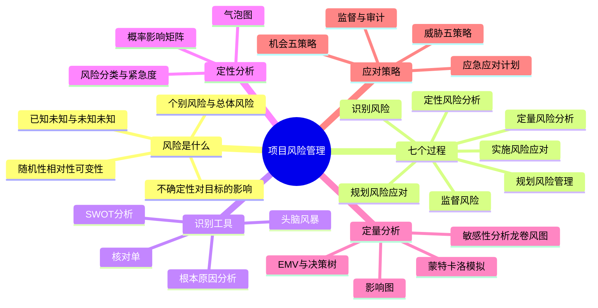
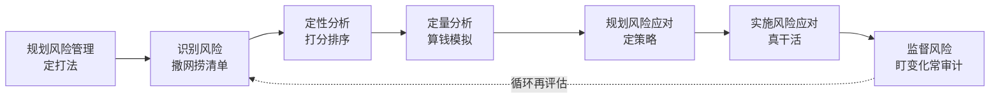
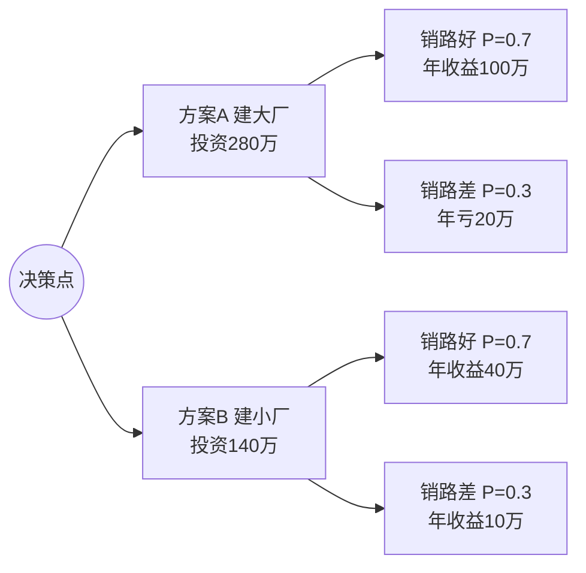
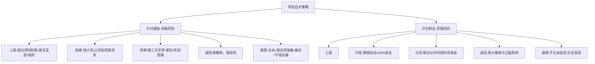

> **摘要**：
> 风险管理讲"晴天修屋顶":识别风险、定性定量分析、七种应对策略。**案例与论文双高频章**——上午爱考应对策略辨析与工具归属,案例爱考"识别+应对措施默写",论文风险领域是十大领域里最常被抽到的话题之一(EMV/决策树/储备都是好素材)。**定量分析四工具、应对策略大表必须滚瓜烂熟**。建议投入 10~12 小时。

## 🗺️ 知识地图

## 📖 掰碎讲解

### 12.1 风险的定义与属性(判断题)

**是什么**:**风险 = 不确定性对项目目标的影响**。第 4 版强调风险是**中性的**:既可能是威胁(消极影响),也可能是机会(积极影响)。风险三属性:**随机性**(发生与否不确定)、**相对性**(同样的风险,承受主体不同结果不同)、**可变性**(会随条件转化、变大变小甚至消失)。

**大白话**:风险是"没开奖的彩票"——可能刮出"谢谢参与"(威胁),也可能刮出奖励(机会)。同一笔 50 万亏损,对大厂是挠痒,对小微公司是灭顶之灾(相对性);而"工期紧"这个风险,加班加出来后可能就没了(可变性)。

**怎么考**:"风险只会带来损失"(错!风险包括机会);"风险具有主观性、绝对性"(错,是随机性/相对性/可变性);风险管理的对象包括**个别项目风险**和**整体项目风险**两层。

### 12.2 风险的分类(储备金归属必考)

| 分类维度 | 类别 | 要点 |
| --- | --- | --- |
| 按可知性 | **已知-未知风险**(已识别、可分析) | 用**应急储备**(应急费用)应对 |
| 按可知性 | **未知-未知风险**(无法预见) | 用**管理储备**应对(动用要改成本基准) |
| 按性质 | 威胁(消极风险)/机会(积极风险) | 应对策略分两套(见 12.7) |
| 按范围 | 个别项目风险 / **整体项目风险** | 整体风险是所有不确定性对整体目标的累积影响 |

**大白话**:已知-未知="我知道冬天可能下雪,备了应急预算";未知-未知="谁能想到地震把机房震了"——这种天灾进**管理储备**,由高层审批动用。应急储备在项目经理权限内,管理储备**不在成本基准里但属于项目总预算**。

**怎么考**:"应急储备应对已识别风险,管理储备应对未识别风险"(必背);"管理储备动用需变更成本基准"(对);细节风险与整体风险的区分。

### 12.3 七个过程总览(配对必考)

| 过程 | 过程组 | 干什么 | 关键输出 |
| --- | --- | --- | --- |
| 规划风险管理 | 规划 | 定打法:风险怎么管、谁负责、什么口径 | **风险管理计划** |
| 识别风险 | 规划 | 撒网捞风险,形成清单 | **风险登记册**、风险报告 |
| 定性风险分析 | 规划 | 给风险打分排序(概率×影响) | 风险登记册更新(优先级排序) |
| 定量风险分析 | 规划 | 用数字算影响(EMV、模拟) | 风险报告更新 |
| 规划风险应对 | 规划 | 为高风险定策略与行动 | **风险应对计划**、变更请求 |
| 实施风险应对 | 执行 | 按计划执行应对措施 | 工作绩效数据 |
| 监督风险 | 监控 | 跟踪、再评估、审计、储备分析 | 工作绩效信息、变更请求 |

**大白话**:先定"怎么抓贼"(规划)→列嫌疑名单(识别)→给嫌疑人按危险度排座次(定性)→估算损失金额(定量)→对高危分子布控(应对规划)→真抓真防(实施)→天天巡逻防新贼(监督)。

**怎么考**:过程与过程组配对(实施风险应对在**执行**组、监督风险在**监控**组,其余五个都在**规划**组);定量分析**不是必做**,项目越小越可以只做定性。

### 12.4 识别风险:工具与风险登记册

**是什么**:识别风险强调**全员、全过程、反复识别**。常用工具:

| 工具 | 用法 | 识别关键词 |
| --- | --- | --- |
| **头脑风暴** | 集体畅想,越多越疯越好 | 开"诸葛亮会" |
| **核对单(检查表)** | 用历史清单逐项核对 | 对照老项目经验 |
| **SWOT 分析** | 从优势/劣势/机会/威胁四象限分析 | 内部环境+外部环境 |
| **访谈** | 与专家/资深者一对一深挖 | 一对一 |
| **根本原因分析(RCA)** | 追问"为什么"找风险源头 | 鱼骨图同源 |
| 假设分析/文件审查 | 检查假设是否站得住 | 审计划、审合同 |

**风险登记册主要内容**:**已识别风险清单**(描述:风险原因-事件-影响)、**责任人**、**应对措施**、风险优先级(定性结果)、紧急程度、风险类别等。

**大白话**:头脑风暴是"集体开脑洞";核对单是"老司机的检查清单,一条条过";SWOT 是"知己知彼四宫格"——把内部强弱(S/W)和外部机会威胁(O/T)摆一张表里,交叉组合还能出新策略;RCA 是"打破砂锅问到底"。

**怎么考**:SWOT 四象限会写会判;"核对单的缺点是容易受限思维、难涵盖新风险"(对);"风险登记册是识别风险的输出,风险管理计划是规划风险管理的输出"(配对)。

### 12.5 定性风险分析:概率-影响矩阵(必考画图)

**是什么**:给每个风险评**概率 P** 和**影响 I**,相乘得到**风险值**,放进 **P-I 矩阵**分级(高/中/低),排出优先级。还要做:**风险数据质量评估**(数据靠不靠谱)、**风险分类**(按来源/影响区域分类)、**紧急度评估**(多久内必须处理)。

| 概率↓ 影响→ | 低影响 | 中影响 | 高影响 |
| --- | --- | --- | --- |
| **高概率** | 中 | 高 | **高(红色区)** |
| **中概率** | 低 | 中 | 高 |
| **低概率** | 低 | 低 | 中 |

**大白话**:P-I 矩阵像"体检报告的红绿灯"——又常发生又伤得重的进红区,优先治;概率低影响小的先放放。注意:**概率低但影响致命的风险也不能完全不管**(如数据泄露),矩阵只是排序工具。

**气泡图**:三维展示——X 轴影响、Y 轴概率、**气泡大小=紧急程度/其他维度**,一图看全局。

**怎么考**:"定性分析给风险排优先级,定量分析算出具体数值影响"(对比);气泡图三维度;风险数据质量评估判断"数据可信吗"。

### 12.6 定量风险分析四工具(必考,附决策树完整例题)

| 工具 | 一句话 | 输出形态 |
| --- | --- | --- |
| **EMV 预期货币值** | **EMV=Σ(概率×影响)**,常配决策树 | 一个钱数 |
| **决策树分析** | 画树比较各方案期望值 | 选出最优方案 |
| **蒙特卡洛模拟** | 随机模拟成千上万次 | **概率分布/累积概率曲线(S 曲线)** |
| **敏感性分析(龙卷风图)** | 单个因素变动对目标的影响幅度 | 龙卷风图(影响大的排最上) |
| **影响图** | 用图示表达决策/变量/结果的关系 | 逻辑关系图 |

**决策树完整例题(建大厂还是小厂)**:某企业拟建厂,使用期 10 年。方案 A 建大厂:投资 280 万,销路好(概率 0.7)年收益 100 万,销路差(概率 0.3)年亏 20 万;方案 B 建小厂:投资 140 万,销路好年收益 40 万,销路差年收益 10 万。

**演算**:
- 方案 A:EMV = [0.7×100 + 0.3×(-20)]×10 − 280 = (70−6)×10 − 280 = 640 − 280 = **360 万**
- 方案 B:EMV = [0.7×40 + 0.3×10]×10 − 140 = (28+3)×10 − 140 = 310 − 140 = **170 万**
- 360 > 170 → **选建大厂**。口诀:各分支"概率×收益"加总×年限,再减投资,谁大选谁。

**大白话**:EMV 就是"按开奖概率折算的平均钱数";决策树是"把每条路都按最可能结果折现,选最值钱的那条";蒙特卡洛是"让电脑把项目跑一万遍,画出'多少钱内能完工'的累积概率曲线";龙卷风图是"挨个拧因素旋钮,看哪个一拧指标晃得最厉害——它就是最敏感因素,画成条形图像龙卷风"。

**怎么考**:EMV 计算(上午+案例都可能);决策树完整计算(案例计算大题常见,详见 [17-项目管理科学基础](17-项目管理科学基础/));蒙特卡洛输出=概率分布/累积图(判断);"敏感性分析要同时分析多个因素组合"(错,单因素变动)。

### 12.7 应对策略七种(大表必背,案例默写级)

| 威胁策略 | 例子 | 机会策略 | 例子 |
| --- | --- | --- | --- |
| 上报 | 法规风险移交法务部/管理层 | 上报 | 机遇超出项目范围移交组织 |
| **规避** | 取消高危需求、延长工期、换技术路线 | **开拓** | 挖来顶尖团队让新产品**必然**领先 |
| **转移** | 买保险、固定总价合同外包、担保 | **分享** | 与伙伴成立联合体共享市场 |
| **减轻** | 加测试、原型验证、冗余备份 | **提高** | 增加资源缩短周期,扩大机会窗口 |
| **接受** | 主动:设应急储备;被动:记入观察清单 | **接受** | 不刻意追求,来了就接着 |

**大白话**:对付坏事的五招——躲开(规避)、推给别人(转移)、钝化它(减轻)、认了(接受)、交给上面(上报);对好事的五招——死死抓住(开拓)、拉人入伙分蛋糕(分享)、火上浇油(提高)、顺其自然(接受)、交给上面(上报)。

**怎么考**:"给项目关键岗位买保险"→转移;"多轮原型测试降低技术失败概率"→减轻;"取消某高风险功能"→规避;**"买保险"永远是转移的标志词**;"降低概率和影响"是减轻、把风险"转嫁第三方"是转移——两者区别必辨。

### 12.8 应急应对计划与整体项目风险应对

**是什么**:
- **主要应对计划 vs 应急应对计划**:主要计划失效时启用的**备用预案**(触发条件事先定好)。
- **弹回计划**:应对措施本身失败时的"退路"。
- **整体项目风险应对**:针对整体风险的态度与组合行动——**规避/开拓**整体风险、转移/分享、减轻/提高、接受(设整体储备)。

**大白话**:出门看天气预报(风险识别),带伞是主要计划(应对),伞丢了就打车是应急应对计划,打车也打不到就请假在家(弹回计划)。层层有退路,才叫风险管理成熟。

**怎么考**:"应急应对计划需要定义触发条件"(对);"弹回计划与应急计划是一回事"(错)。

### 12.9 监督风险与敏捷视角

**是什么**:**监督风险**贯穿全程——**风险再评估**(定期重开会识别会)、**风险审计**(检查应对措施是否有效、管理流程是否到位)、**储备分析**(应急储备还剩多少,够不够)、技术绩效测量、风险预警指标。敏捷视角:**快速迭代本身就是降低风险的策略**——短周期小批量交付,早暴露问题、早反馈、早纠偏,把"大赌局"拆成"多次小赌局"。

**大白话**:风险登记册不是写完锁抽屉的——每月把名单重新盘一遍(再评估);审计是"自查一下,上次说的防返工措施真做了吗";储备分析是"看应急钱包还剩几张票子"。

**怎么考**:"风险审计的目的是评估应对措施有效性"(对);敏捷=迭代降低整体风险(论文加分点);"风险登记册随项目动态更新"(对)。

## 🎬 推荐视频

| 视频 | 讲什么 | 什么时候看 |
| --- | --- | --- |
| [软考老金高项(ITTO 记忆)](https://www.bilibili.com/video/BV1KtRQBtEQa) | 七过程 ITTO+应对策略口诀 | 一轮后串骨架 |
| [野人老师高项全集 67 集](https://www.bilibili.com/video/BV1dJ41117Aa) | 风险章入门,例子生动 | 第一轮入门 |
| [夏天老师 2027 第 4 版公开课 53 集](https://www.bilibili.com/video/BV1TFBpBKExt) | 第 4 版口径(实施风险应对等) | 对照补漏 |
| [大匠论文专题(风险领域)](https://www.bilibili.com/video/BV1Bh411L79s) | 风险领域论文写作套路与素材 | 准备论文阶段 |

## ⭐ 章节重点(考前必背)

| 考点 | 必背内容 | 考法标签 |
| --- | --- | --- |
| 风险定义 | **不确定性对目标的影响**;风险中性(威胁+机会) | 上午判断 |
| 三属性 | 随机性、相对性、可变性 | 填空 |
| 储备归属 | 已知-未知→**应急储备**;未知-未知→**管理储备** | **必考** |
| 七过程 | 五个在规划组;实施=执行组;监督=监控组 | 配对 |
| 识别工具 | 头脑风暴/核对单/SWOT/访谈/根本原因分析 | 案例默写 |
| 风险登记册 | 风险清单(原因-事件-影响)、责任人、应对措施、优先级 | **案例找漏项** |
| P-I 矩阵 | 概率×影响=风险值,分高中低排序 | 画图 |
| 定量四工具 | EMV/决策树、蒙特卡洛(概率分布)、敏感性(龙卷风图)、影响图 | **案例计算** |
| EMV | Σ(概率×影响),决策树减投资比大小 | **计算必考** |
| 威胁五策略 | **上/避/转/减/接**;买保险=转移;取消功能=规避 | **案例必考** |
| 机会五策略 | **上/开/分/提/接**;开拓=确保发生;分享=联合伙伴 | **案例必考** |
| 应急计划 | 备用预案要定**触发条件**;弹回计划=最后退路 | 判断 |
| 监督风险 | 再评估+风险审计+储备分析 | 案例默写 |
| 敏捷与风险 | 快速迭代=把大赌拆小赌,早暴露早纠偏 | 论文素材 |

## 🧠 高频考法与陷阱

> **注意**：
> 1. **错误认知:风险就是坏事,风险管理就是防损失。→ 正确认知**:风险是**不确定性对目标的影响**,包括**机会**(积极风险);机会要开拓/分享/提高,不只是防坏。
> 2. **错误认知:未识别的风险也从应急储备里出钱。→ 正确认知**:已识别风险(已知-未知)用**应急储备**;未识别的未知-未知风险动用**管理储备**,且要走变更流程调整成本基准。
> 3. **错误认知:给风险买保险=减轻。→ 正确认知**:买保险、外包、担保都是把后果转给第三方=**转移**;**减轻**是自己动手降低概率或影响(加测试、备份)。
> 4. **错误认知:做了风险登记册就万事大吉。→ 正确认知**:登记册要**持续更新**——再评估、审计、储备分析贯穿全程;识别+应对+监督是闭环,不是一次性动作。
> 5. **错误认知:定量分析每个项目都必须做。→ 正确认知**:定量分析视项目规模与数据而定,**小项目可以只做定性**;但考题里"大项目重大决策"基本都要上 EMV/蒙特卡洛。
> 6. **错误认知:蒙特卡洛模拟输出的是精确的完工日期。→ 正确认知**:输出是**概率分布与累积概率曲线**,告诉你是"80% 把握内多少天完成",不是单一确定值。

## ✍️ 反复练习题

**第 1 题(选择)** 下列关于项目风险的说法,正确的是:
A. 风险只会对项目目标造成负面影响
B. 风险具有随机性、相对性和可变性
C. 已识别的风险应使用管理储备应对
D. 整体项目风险等于所有个别风险数值之和

> **示例**：
> **答案:B**
> 风险是中性的,机会也是风险(A 错);已识别风险(已知-未知)用**应急储备**(C 错);整体风险是所有不确定性对整体目标的**综合影响**,不是简单加总(D 错)。

**第 2 题(选择)** 项目组识别出"核心开发人员可能被竞争对手挖走"并安排了交接人与知识库备份,该应对策略是:
A. 规避　B. 转移　C. 减轻　D. 接受

> **示例**：
> **答案:C**
> 交接人+知识库是**降低影响**(人员走后损失可控),属**减轻**。规避是让风险不可能发生(如锁定竞业协议也算减轻/规避组合,但"备份降低损失"是典型减轻);转移是把后果推给第三方。

**第 3 题(选择)** 决策树例题:建大厂投资 280 万,销路好(0.7)年收益 100 万、销路差(0.3)年亏 20 万,使用期 10 年,建大厂的期望货币值 EMV 为:
A. 360 万　B. 420 万　C. 640 万　D. 140 万

> **示例**：
> **答案:A**
> 年期望收益=0.7×100+0.3×(-20)=64 万;10 年=640 万;减投资 280 万得 **360 万**。注意"减投资"这步最容易漏。

**第 4 题(选择)** 蒙特卡洛模拟对进度计划进行上千次随机模拟后,典型的输出结果是:
A. 一张单代号网络图
B. 项目工期的概率分布与累积概率曲线
C. 一张关键路径表
D. 一张龙卷风图

> **示例**：
> **答案:B**
> 蒙特卡洛输出**概率分布/累积概率曲线(S 曲线)**,回答"以 80% 把握多少天完成"。龙卷风图是敏感性分析的输出;网络图是建模的输入。

**第 5 题(选择)** 某组织发现某法规风险已超出项目团队权限,应将其移交组织管理层处理。该策略是:
A. 上报　B. 规避　C. 转移　D. 减轻

> **示例**：
> **答案:A**
> **上报**:风险超出项目范围/项目经理权限时,移交组织更高层处理,且不再由项目团队监督。威胁与机会都有上报策略。

**第 6 题(选择)** SWOT 分析中,"本项目团队技术积累深厚"与"市场出现同类竞品"分别属于:
A. 优势、威胁　B. 弱势、机会　C. 优势、机会　D. 劣势、威胁

> **示例**：
> **答案:A**
> S(优势)/W(劣势)是**内部**条件;O(机会)/T(威胁)是**外部**环境。"团队技术强"=内部优势;"竞品出现"=外部威胁。SWOT 还可交叉组合出 SO/WO/ST/WT 策略。

**第 7 题(选择)** 关于风险监督,说法正确的是:
A. 风险审计用于检查风险应对措施的有效性
B. 风险再评估只在项目收尾做一次
C. 储备分析只关心管理储备
D. 监督风险是执行过程组的过程

> **示例**：
> **答案:A**
> 风险审计=检查应对是否有效、管理流程是否到位;再评估应**定期/反复**进行(B 错);储备分析对**应急储备**的使用情况做盘查(C 错);监督风险在**监控**过程组(D 错)。

**第 8 题(案例风格)** 某公司承接一个大型数据中心建设项目,项目经理小李组织会议识别出以下风险:①进口设备海运延误;②机房所在地雨季供电不稳定;③客户需求在施工期可能大改;④竞争厂商可能在同期推出更便宜的方案(若抓住先机可扩大市场)。请回答:
(1) 从"积极/消极"角度分类风险③④,并说明理由。
(2) 针对风险①写出两种应对措施,并分别指明所属策略。
(3) 为项目整体制定风险监督机制,写出三条应定期开展的活动。

> **示例**：
> (1) 风险③"需求大改"是**消极风险(威胁)**:可能引起返工、延期、成本超支。风险④是**积极风险(机会)**:若抢先推出、抢占市场,会给项目/组织带来收益——风险是中性的,机会也纳入风险管理。
> (2) 措施一:提前下单并采用海陆多式联运、预留到货缓冲期→**减轻**(降低发生概率/影响);措施二:与设备供应商签订固定总价合同并约定延迟违约金,把延误后果转给供应商→**转移**(也可答"改用国产设备"=规避)。任两种且策略对应正确即可。
> (3) 监督机制(任答三条):①**风险再评估**——每月召开风险例会,更新风险登记册、排查新风险;②**风险审计**——季度审计应对措施落实情况与有效性;③**储备分析**——按月盘点应急储备消耗与剩余,评估是否充足;④建立风险预警指标(如到货偏差天数),超阈值即触发应急应对计划;⑤更新风险报告并向干系人通报。

## 🎨 漫画图解

*风险应对七招*-威胁-避转减受,机会-开分提受,搞不定就上报*

## 🔗 相关章节

- 定量计算通吃章:[17-项目管理科学基础](17-项目管理科学基础/)
- 风险应对带来的变更:[15-配置与变更管理](15-配置与变更管理/)、[05-项目整合管理](05-项目整合管理/)
- 成本储备与预算:[08-项目成本管理](08-项目成本管理/)
- 不确定性绩效域(新视角):[14-绩效域与价值交付](14-绩效域与价值交付/)
- 攻略:[项管-案例分析攻略](../项管-案例分析攻略/)、[项管-论文攻略](../项管-论文攻略/)、[项管-真题战略](../项管-真题战略/)
