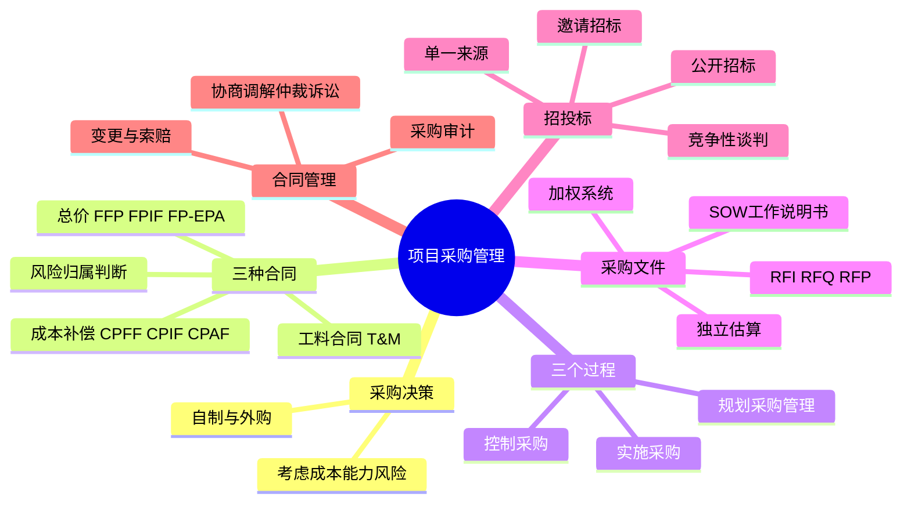
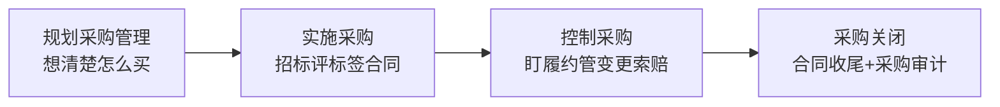
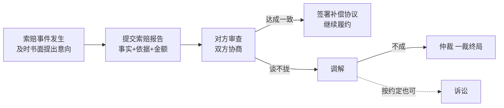

> **摘要**：
> 采购管理讲"别人替你干活怎么管":自制还是外购、三种合同类型(总价/成本补偿/工料)、采购三过程、招投标与供应商管理。**合同类型与风险归属是上午+案例双料高频**(总价风险在卖方、成本补偿风险在买方,几乎年年出);案例爱考"该签哪种合同/合同找错/索赔怎么处理";招投标数字与 [16-法规标准与职业道德](16-法规标准与职业道德/) 联动。建议投入 6~8 小时。

## 🗺️ 知识地图

## 📖 掰碎讲解

### 13.1 为什么要采购:自制 vs 外购(判断题)

**是什么**:**规划采购管理**第一步是 make-or-buy 决策,依据:**成本**(外购总成本 vs 自制成本,考虑全生命周期)、**能力**(自己有没有)、**风险**(技术风险、保密风险)、**核心业务**(核心的尽量不外包)。

**大白话**:开餐厅要不要自己种菜?——种菜不专业、成本高(能力+成本),去市场买(外购);但招牌秘制酱料绝不能外包(核心机密)。**买着省心但受制于人,自制费劲但可控**。

**怎么考**:"凡是能外包的都外包以降低成本"(错,核心能力与保密业务不宜外购);决策因素判断题。

### 13.2 三个过程总览(配对必考)

| 过程 | 过程组 | 干什么 | 关键输出 |
| --- | --- | --- | --- |
| 规划采购管理 | 规划 | 定买什么、怎么买、签什么合同 | **采购管理计划、采购工作说明书 SOW、采购策略** |
| 实施采购 | 执行 | 发标、收标、评标、**选定卖方签合同** | **协议(合同)**、选定的卖方 |
| 控制采购 | 监控 | 管合同履行:监督履约、变更、索赔、收尾 | 采购关闭、工作绩效信息 |

**大白话**:规划=写购物清单和预算(还要想清楚"去超市买还是自己腌");实施=货比三家、砍价、下单;控制=验货、催货、扯皮退换货;收尾=确认没差评、做采购审计总结经验。

**怎么考**:过程与过程组配对(实施采购在**执行**组,控制采购在**监控**组);"选定卖方、签订协议"发生在实施采购过程。

### 13.3 协议(合同)类型大表(必考中的必考)

| 大类 | 子类 | 全称 | 特点 | **风险归属** |
| --- | --- | --- | --- | --- |
| **总价合同** | **FFP** | 固定总价 | 一口价,范围明确时用 | **卖方**(亏了自认) |
| | **FPIF** | 总价激励费用 | 目标成本+费用分摊,激励卖方省成本 | 共担(偏卖方) |
| | **FP-EPA** | 总价经济价格调整 | 允许按通胀/汇率等**定期调价**,适合多年期 | 共担(偏卖方) |
| **成本补偿合同** | **CPFF** | 成本加固定费用 | 实报实销+固定费用 | **买方**(超支买家掏) |
| | **CPIF** | 成本加激励费用 | 实报实销+按分摊比例奖惩 | 共担(偏买方) |
| | **CPAF** | 成本加奖励费用 | 实报实销+买方主观评奖 | **买方** |
| **工料合同** | **T&M** | 工料合同 | 按"人天单价×工作量"结算,小金额快启动 | **双方中性**(工作量风险买方、单价风险卖方) |

**大白话**:总价合同=装修公司一口价全包——超支了装修公司自己吞,所以**风险在卖方**,但报价里会留水分;成本补偿=你出材料费还付工钱——花多花少你买单,**风险在买方**,得勤监督;工料合同=按小时计费的钟点工——干多少算多少,适合"活儿说不清、钱不多、想快点开工"。

**怎么考**:
- **范围明确程度**决定选型:范围越明确→总价;越不明确→成本补偿;小额快速→工料。
- "风险最小的选择"判断:站在**买方**角度,范围明确时选 FFP 最省心;站在卖方角度怕超支。
- **FPIF 计算例题**(案例高频):目标成本 100 万、目标费用(利润)10 万、目标价 110 万、分摊比例 80/20(买方 80%、卖方 20%),实际成本 120 万:
  - 实际价格 = 实际成本 + 目标费用 + (目标成本−实际成本)×卖方分摊比例 = 120+10+(100−120)×0.2 = **126 万**
  - 卖方实际利润 = 10 − 20×0.2 = **6 万**(超支部分卖方自担 20%)
  - 若设**价格上限 130 万**,126 未触及,按 126 万结算。

### 13.4 采购文件:SOW、招标文件家族与评价标准

**是什么**:
- **采购工作说明书(SOW)**:详细描述拟采购的**产品/服务/成果**,让卖方判断"能不能干、要多少钱"。
- 招标文件家族:**RFI**(信息邀请书,先摸市场底)、**RFQ**(报价邀请书,要求明确价格谈判成分少)、**RFP**(建议书邀请书,要求方案,综合评审)。
- **独立估算**:采购方自己(或请第三方)算一笔账,用来核对卖方报价有没有"宰客"。
- **建议书评价标准(加权系统)**:给技术、价格、资历等指标加权打分,量化选卖方,避免拍脑袋。

**大白话**:SOW 是"购物需求清单",写不清卖方没法报价;RFI 是"市场上有啥",RFQ 是"多少钱",RFP 是"请给个完整方案";独立估算是你自己先偷偷算一遍价,免得被漫天要价唬住;加权系统是"打分表":技术 40%+价格 30%+案例 30%,算总分定中标人。

**怎么考**:RFI/RFQ/RFP 区别(要方案选 RFP,只要报价选 RFQ);"独立估算的作用是评价卖方报价合理性"(对);"加权系统避免主观臆断"(对)。

### 13.5 实施采购:四种招标/采购方式(适用情形判断)

| 方式 | 适用情形 | 大白话 |
| --- | --- | --- |
| **公开招标** | 无限制,公告邀请不特定对象 | 全网吆喝,价低者得,最透明 |
| **邀请招标** | 向**特定的**若干家(≥3 家? 按法规具体家数执行)发出邀请 | 点名请靠谱的几家来 |
| **竞争性谈判** | 招标后没有合格标的;技术复杂无法确定详细规格;**时间紧急**;不能事先计算价格总额 | 拉几家坐下来边谈边改需求 |
| **单一来源** | **唯一**供应商;不可预见的紧急情况;添购(原合同续买,一般≤原合同 10%) | 没得选,只能找他 |

**大白话**:公开招标=大海撒网;邀请招标=圈子里点名;竞争性谈判="这活儿太复杂标书写不出来,大家坐下来聊";单一来源="独门生意/救急/续购配件"。

**怎么考**:**适用情形配对**是上午钉子户——"技术复杂无法事先确定规格"=竞争性谈判;"只能从唯一供应商处采购"=单一来源;政府采购方式详见 [16-法规标准与职业道德](16-法规标准与职业道德/)。

### 13.6 控制采购:履约监督、变更与索赔(案例高频)

**是什么**:
- **控制采购**:监督合同履行、支付管理、**合同变更**走变更流程、处理索赔与争议、管理卖方关系、合同收尾。
- **索赔**:一方认为对方违约造成损失,要求补偿。**流程**:提出索赔意向(及时书面)→ 提交索赔报告(事实+依据+金额)→ 对方审查、协商 → 协商不成按合同约定走争议解决。
- **争议解决方式顺序**:**协商 → 调解 → 仲裁或诉讼**(仲裁一裁终局;或裁或审,选了仲裁就不能再起诉)。

**大白话**:索赔不是撕破脸,是"按合同办事的合法讨说法"——先打招呼(意向),再递证据(报告),能私了就私了(协商),有台阶下台阶(调解),最后才是打官司(仲裁/诉讼)。**越拖证据越少,所以"及时书面"是第一步**。

**怎么考**:争议解决**先协商后调解再仲裁/诉讼**的顺序;"仲裁裁决具有终局效力"(对);索赔要在**合同约定时限**内书面提出(案例找错:"口头告知"不合格)。

### 13.7 合同收尾与采购审计

**是什么**:合同完成或终止后进行**采购关闭**——核实交付物验收合格、款项结清、文档归档;再做**采购审计**:总结"从规划到收尾全过程"的经验教训(买得对不对、流程有没有漏洞),沉淀到组织过程资产。

**大白话**:购物结束不是"付完钱"就完了——先验货打分(关闭),再写个"这次剁手心得"(审计),下次买东西少踩坑。

**怎么考**:"采购审计在控制采购过程开展,审查卖方账目"?(辨析:审计对象是**采购全流程的经验教训**);合同收尾前必须完成所有未决索赔(对)。

### 13.8 供应商管理与评估

**是什么**:对供应商全生命周期管理——**准入**(资质审查)、**评价**(质量、价格、交付、服务;常用加权打分)、**分级管理**(战略/优选/合格/淘汰)、**绩效考核与激励**。IT 项目还要关注供应商的技术能力、人员稳定性与后续服务能力。

**大白话**:供应商像"长期饭票"——进门要体检(准入),定期打分(考核),表现好加菜(更多订单),表现差出局(淘汰名单),不能一次中标终身躺赢。

**怎么考**:供应商评价指标归属(质量/价格/交付/服务);"战略供应商=最低价中标"(错,看综合)。

## 🎬 推荐视频

| 视频 | 讲什么 | 什么时候看 |
| --- | --- | --- |
| [软考老金高项(ITTO 记忆)](https://www.bilibili.com/video/BV1KtRQBtEQa) | 三过程+合同类型口诀记忆 | 一轮后串骨架 |
| [夏天老师 2027 第 4 版公开课 53 集](https://www.bilibili.com/video/BV1TFBpBKExt) | 第 4 版口径(FPIF 计算、控制采购) | 对照补漏 |
| [野人老师高项全集 67 集](https://www.bilibili.com/video/BV1dJ41117Aa) | 采购章入门、招投标流程 | 第一轮入门 |
| [希赛第 4 版精讲 187 集](https://www.bilibili.com/video/BV1i3ovYrEek) | 合同类型与索赔细讲 | 二轮查缺 |

## ⭐ 章节重点(考前必背)

| 考点 | 必背内容 | 考法标签 |
| --- | --- | --- |
| 自制外购 | 看成本/能力/风险/核心业务;核心能力不宜外包 | 上午判断 |
| 三过程 | 规划(计划+SOW)/实施(执行组,签协议)/控制(监控组) | 配对 |
| 总价合同 | FFP 一口价、FPIF 激励、FP-EPA 可调价;**风险在卖方** | **必考** |
| 成本补偿 | CPFF/CPIF/CPAF;**风险在买方**;范围不明确时用 | **必考** |
| 工料合同 | T&M 小金额快启动;双方中性风险 | 必考 |
| FPIF 计算 | 实际价=实际成本+目标费用+(目标成本−实际成本)×卖方比例 | **案例计算** |
| SOW | 采购工作说明书:写清买什么、什么标准 | 填空 |
| RFI/RFQ/RFP | 要信息/要报价/要方案 | 辨析 |
| 独立估算 | 自备"底价"核报价合理性 | 上午 |
| 加权系统 | 技术价格资历加权打分,量化选卖方 | 上午 |
| 四种采购方式 | 公开/邀请/竞争性谈判/单一来源适用情形 | **场景判断** |
| 索赔流程 | 及时书面意向→索赔报告→协商→调解→仲裁/诉讼 | **案例默写** |
| 采购审计 | 总结采购全过程经验教训,沉淀组织资产 | 上午 |
| 供应商管理 | 准入-评价-分级-考核;综合评价非唯低价 | 案例 |

## 🧠 高频考法与陷阱

> **注意**：
> 1. **错误认知:总价合同风险大,千万别签。→ 正确认知**:要分清**谁的风险**——总价合同风险在**卖方**(报价含水分),买方反而省心;成本补偿合同风险才在**买方**。
> 2. **错误认知:范围说不清楚就签固定总价合同图省事。→ 正确认知**:范围不明确时应选**成本补偿**或工料合同;硬签总价,卖方要么漫天报价、要么疯狂索赔,后期扯皮不断。
> 3. **错误认知:工料合同金额小风险就小,可以无限制使用。→ 正确认知**:工料合同**工作量风险在买方**,范围大了总价失控;它只适合**小金额、快启动、工作量不确定**的场景。
> 4. **错误认知:供应商违约直接去法院起诉。→ 正确认知**:争议解决顺序是**协商→调解→仲裁/诉讼**;且若合同约定了仲裁,则**或裁或审**,不能再诉讼。
> 5. **错误认知:索赔就是撕破脸打官司。→ 正确认知**:索赔是**合同赋予的正当权利**,流程是"及时书面意向→索赔报告→协商优先",打官司是最后手段。
> 6. **错误认知:采购完成=验收付款即可收尾。→ 正确认知**:还要做**采购审计**沉淀经验教训,并把文档归入组织过程资产;未决索赔必须先解决才能合同收尾。

## ✍️ 反复练习题

**第 1 题(选择)** 某项目拟采购一批服务器,型号规格完全明确、市场竞争充分。对买方而言最合适的合同类型是:
A. 成本加固定费用合同　B. 固定总价合同　C. 工料合同　D. 成本加奖励费用合同

> **示例**：
> **答案:B**
> 范围明确、规格清晰→**FFP 固定总价**:价格锁定,风险由卖方承担,买方最省心。成本补偿用于范围不明确场景(风险在买方);工料用于小额快速启动。

**第 2 题(选择)** 一份总价激励合同(FPIF):目标成本 100 万、目标费用 10 万、分摊比例 80/20。实际成本 120 万时,买方应支付:
A. 120 万　B. 124 万　C. 126 万　D. 130 万

> **示例**：
> **答案:C**
> 实际价格=实际成本+目标费用+(目标成本−实际成本)×卖方分摊比例=120+10+(100−120)×20%=120+10−4=**126 万**。卖方利润=10−20×20%=6 万,超支部分按比例共担。

**第 3 题(选择)** 某项目技术复杂,无法事先确定详细规格,也不宜公开招标,且工期紧张。最合适的采购方式是:
A. 公开招标　B. 邀请招标　C. 竞争性谈判　D. 单一来源采购

> **示例**：
> **答案:C**
> "技术复杂无法确定详细规格/时间紧急/招标后无合格标的/无法事先计算价格总额"是**竞争性谈判**的适用情形。单一来源需满足"唯一供应商"等法定情形。

**第 4 题(选择)** 采购方在收到卖方报价后,为判断报价是否合理,自行委托第三方机构进行估价。该做法属于:
A. 独立估算　B. 加权系统　C. 挣值分析　D. 审计

> **示例**：
> **答案:A**
> **独立估算**:采购方自己(或第三方)测算"底价",用于对照卖方报价、识别报价异常。加权系统是选卖方的打分法,挣值是进度成本监控工具。

**第 5 题(选择)** 关于合同争议解决,正确的是:
A. 应直接向法院提起诉讼,效率最高
B. 顺序通常为:协商→调解→仲裁或诉讼
C. 约定仲裁后,对裁决不服还可以再起诉
D. 调解结果具有强制执行力

> **示例**：
> **答案:B**
> 争议解决**先协商、再调解、最后仲裁或诉讼**;仲裁**一裁终局**(C 错,且"或裁或审"约定仲裁即排除诉讼);调解依靠自愿履行,不具备强制执行力(D 错)。

**第 6 题(选择)** 关于采购审计,说法正确的是:
A. 采购审计就是审查卖方的会计账簿
B. 采购审计总结从规划到收尾的采购全过程经验教训
C. 采购审计在合同签订前开展
D. 采购审计结果不需要归档

> **示例**：
> **答案:B**
> 采购审计面向**采购全流程**,目的是沉淀经验教训、改进后续采购,结果纳入**组织过程资产**(D 错);审查卖方账目是财务稽核范畴(A 错);审计在采购收尾阶段开展(C 错)。

**第 7 题(选择)** 下列哪项最适合采用工料合同(T&M):
A. 大型 ERP 总包,范围明确
B. 短期运维支持,按人天结算、金额较小
C. 新技术研发,成本无法预估
D. 多年期服务,存在通胀风险

> **示例**：
> **答案:B**
> 工料合同适合**小金额、工作量不确定、需要快速启动**的场景(如按人天的临时支持)。A 选总价;C 选成本补偿;D 选 FP-EPA(经济价格调整)。

**第 8 题(案例风格)** 某公司信息化项目需外购一套定制化开发服务:需求尚在探索、技术路线不确定,预计金额较大。项目实施半年后,卖方提出"因需求变更增加 30% 工作量,要求追加费用 80 万",买方项目经理口头回复"再议",此后三个月未做书面处理;卖方随即停工。请回答:
(1) 本项目在合同类型选择上是否合适?应选哪种合同?为什么?
(2) 买方在处理卖方追加费用诉求过程中存在哪些问题?给出正确做法。
(3) 双方协商不成,列出后续可采用的争议解决方式及其顺序。

> **示例**：
> (1) 不合适(若原签总价合同,则与"需求探索、技术不确定"不匹配,卖方风险过大易引发纠纷;若签成本补偿,买方须加强监督)。应选**成本补偿合同**(如 CPIF,激励卖方控成本)或分阶段"总价+探索期工料"的组合;理由:范围不明确时总价合同必然争议频发,成本补偿可随范围演进按实结算并设激励分摊。
> (2) 问题:①对变更**未走合同变更流程**(应评估变更影响,提交双方认可的变更/补充协议,重大变更经双方管理层或 CCB 批准);②**口头回复且长期不处理**——合同变更与索赔须**及时书面**处理;③放任卖方停工,未按合同行使权利(催告、保留索赔证据)。正确做法:收到诉求即启动变更评估(工作量、费用、进度影响),形成书面变更协议后支付;同时留存往来函件作为索赔证据,必要时按合同提出/应对索赔。
> (3) 顺序:**协商 → 调解 → 仲裁或诉讼**;若合同约定仲裁,则提交仲裁机构,裁决**一裁终局**;未约定仲裁的,可向有管辖权的法院提起诉讼。

## 🔗 相关章节

- 招投标法定时限与政府采购:[16-法规标准与职业道德](16-法规标准与职业道德/)
- 合同变更走变更流程:[15-配置与变更管理](15-配置与变更管理/)、[05-项目整合管理](05-项目整合管理/)
- 采购风险与转移:[12-项目风险管理](12-项目风险管理/)
- 采购来的"外包资源"怎么带:[10-项目资源管理](10-项目资源管理/)
- 攻略:[项管-案例分析攻略](../项管-案例分析攻略/)、[项管-论文攻略](../项管-论文攻略/)、[qicoder真题索引](../../99-真题资源/qicoder真题索引/)
