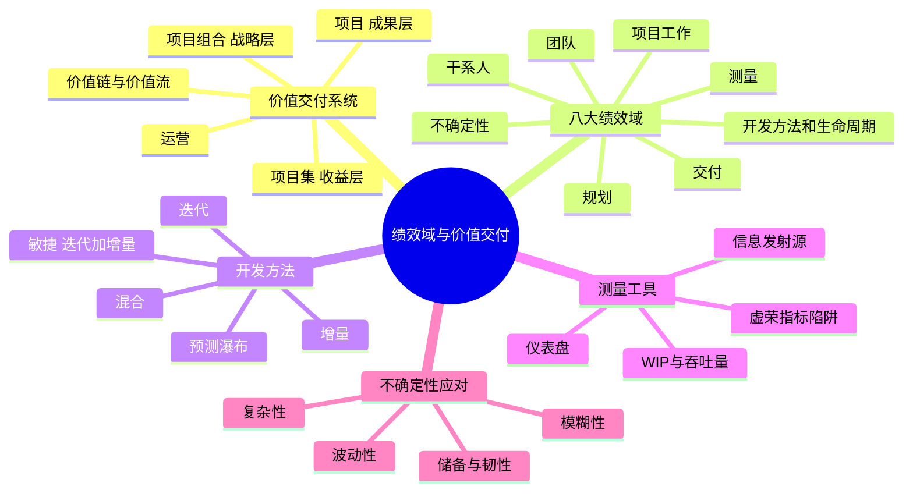
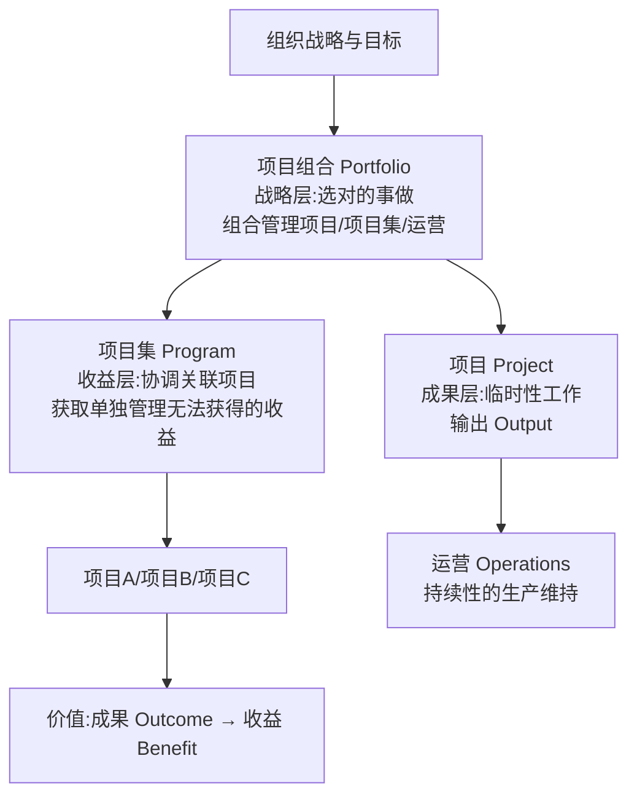
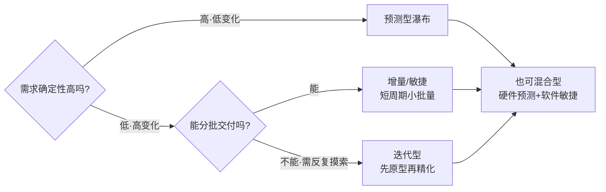

> **摘要**：
> 第 4 版**全新重点**:从"按过程干活"(十大知识领域)转向"看结果说话"(八大绩效域)。要掌握价值交付系统、项目组合/项目集/项目的关系,以及**八大绩效域各自的关键要点、预期目标与检查方法**。近年案例已考绩效域,论文里"绩效域"是新热门加分角度(测量/不确定性/干系人域最好写)。新章节要背的表多,建议投入 8~10 小时。

## 🗺️ 知识地图

## 📖 掰碎讲解

### 14.1 绩效域是什么:从"过程"到"结果"(判断题)

**是什么**:**绩效域 = 一组集中关注并相互关联的活动,它们共同对项目成功至关重要**。十大知识领域回答"**做什么过程**",八大绩效域回答"**要达成什么结果**"——从**过程导向**转向**结果导向**。绩效域之间**相互关联、相互依赖**,不是一个域只管一段。

**大白话**:以前考驾照按步骤教:"先打火、再踩离合、挂挡、松手刹"(过程);绩效域问的是:"你能不能安全把车开到目的地"(结果)。步骤可以变,目标不变。

**怎么考**:"绩效域就是知识领域换了名字"(错!视角不同:过程→结果);"各绩效域相互独立、只关注各自阶段"(错,**相互关联、贯穿始终**);"绩效域关注的最终目的是实现价值交付"(对)。

### 14.2 价值交付系统:组合、项目集、项目(层级必考)

**是什么**:组织是一个**价值交付系统**——通过**价值链**(从创意到交付的一系列业务活动)和**价值流**(端到端为客户创造价值的活动流)创造价值。管理层级从上到下:**项目组合 → 项目集 → 项目**(+运营):

| 层级 | 关键词 | 目标 | 例子(造车集团) |
| --- | --- | --- | --- |
| **项目组合** | 对齐战略 | 选"对的事",优先级排序 | 新能源车战略组合 |
| **项目集** | 相互关联、协调管理 | 获得**整体收益** | 新车型研发项目集(整车+电池+软件) |
| **项目** | 临时性、独特性 | 交付可交付物/成果 | 电池工厂建设项目 |

**大白话**:集团董事长拍板"五年进军新能源"(组合,管选赛道);"新车型项目集"把整车、电池、智驾几条线捏在一起,要的是"做出有竞争力的新车"这个整体收益;其中"建电池厂"就是一个项目,交付一座工厂;工厂建成后交生产部天天造车(运营),最后卖车赚钱=价值实现。

**怎么考**:"项目组合中的项目必须相互依赖"(错,**不必**相互依赖,只需服务战略);"项目集关注收益、项目关注可交付物"(对);"运营是持续性、重复性的"(对)。

### 14.3 干系人绩效域

**是什么**:关注**与干系人建立并维持良好的关系,促进其有效参与**。
- **关键要点**:尽早识别干系人、优先排序;持续沟通;干系人参与贯穿全程(呼应 [11-项目沟通与干系人管理](11-项目沟通与干系人管理/))。
- **预期目标**:①与干系人保持积极工作关系;②干系人认同项目目标;③支持项目的干系人满意度提高并积极拥护;④干系人之间冲突最小化。
- **检查方法**:看**关系**(互动质量)与**参与度**(行为变化:出席率、发言、支持行为);做干系人参与度评估(C/D 对比)。

**大白话**:这个域管"人气"——项目能不能成,一半看有多少人真心挺你。检查手段就是"回头看看:该来的来了吗?该说的说通了吗?反对的转化了吗?"

**怎么考**:"检查方法=测量参与度与关系变化"(问答题考);目标里"冲突最小化"易漏。

### 14.4 团队绩效域

**是什么**:关注**打造高绩效团队**。
- **关键要点**:**共享领导**(人人都是领导者的适当行为)、高绩效团队的特质(开放沟通、信任、协作、解决问题能力)、**量身定制的团队文化**、团队结构选择(专职/兼职/矩阵)、** servant leadership 服务型领导**在敏捷中尤为重要。
- **预期目标**:①团队**共同拥有**(ownership)目标与责任;②全员展现适用于项目的领导力行为(共享领导);③团队文化与实践适合项目需要。
- **检查方法**:观察**责任感/归属感**、团队氛围与冲突水平、成员技能成长与留任、沟通协作行为。

**大白话**:好的团队不是"老板带一群兵",而是"一群人互相补位、谁看到问题谁上"(共享领导)。检查=看这队人是不是"把项目当自己的事"。

**怎么考**:"共享领导=没有领导"(错,是领导力行为的共享);"团队绩效域与 [10-项目资源管理](10-项目资源管理/) 的建设团队呼应"(对)。

### 14.5 开发方法和生命周期绩效域(选择必考)

**是什么**:关注**选择合适的开发方法与交付节奏**。
- **开发方法四件套**:**预测型(瀑布)**(需求确定、一次交付)、**迭代型**(先做出来再精化,反复迭代方案)、**增量型**(一块块增加,分批交付)、**敏捷=迭代+增量**(短周期反复产出可用增量)、**混合型**(部分预测+部分敏捷)。
- **选择因素**:创新程度/需求确定性(变化快→迭代/敏捷)、范围稳定性、**风险**(高技术风险→迭代)、**安全与法规**(强合规→预测)、**交付节奏**(一次性/多次/定期)、技术确定性、投资规模。
- **节拍(Cadence)**:按固定节奏交付(每两周一个版本)。

**大白话**:盖房子照图纸一步步来(预测);拍照修图先出草稿再精修(迭代);水果摊每周上新一批(增量);互联网 App 两周一版越改越好(敏捷)。**需求越稳越瀑布,需求越飘越敏捷**。

**怎么考**:"迭代与增量的区别"(迭代=反复完善同一东西;增量=分批增加成品);"敏捷开发方法适合需求不确定、频繁变更的项目"(对);"合规强的项目用敏捷以快速响应"(错,强法规倾向预测)。

### 14.6 规划绩效域

**是什么**:关注**让项目有条理、协调一致地推进**。
- **关键要点**:规划是**渐进明细**(逐步细化)而非一次到位;估算(数量/精度随阶段演进);计划整合(进度/成本/资源/风险计划相互咬合,呼应 [05-项目整合管理](05-项目整合管理/)、[07-项目进度管理](07-项目进度管理/));**滚动式规划**(近期细、远期粗);采购与变更的规划衔接([13-项目采购管理](13-项目采购管理/))。
- **预期目标**:①项目以有条理、协调一致的方式推进;②采用**系统的方法**交付;③对交付成果**渐进明细**;④规划信息足以管理干系人期望;⑤能根据新情况和变化的需求**调整计划**。
- **检查方法**:绩效与计划对比(基准 vs 实际);计划是否及时更新、信息是否充分。

**大白话**:规划像 GPS 导航——出发前给全程路线(粗),开到路口给精确转向(细);堵车了就重算路线(滚动式+调整),而不是死抱着出发时的地图。

**怎么考**:"渐进明细/滚动式规划"名词解释(案例);"计划制定后应保持不变"(错)。

### 14.7 项目工作绩效域

**是什么**:关注**项目"日常运转"的高效**。
- **关键要点**:高效项目过程(PDCA)、**沟通高效**(呼应 [11-项目沟通与干系人管理](11-项目沟通与干系人管理/))、实物资源管理、**采购管理**、**监督新工作与变更**(区分"新工作"与"变更",防止范围蔓延,呼应 [06-项目范围管理](06-项目范围管理/))、持续学习与改进(经验教训)。
- **预期目标**:①过程高效且适合项目;②沟通有效;③实物资源与采购管理高效;④**变更得到高效管理**(变更率可控、不失控);⑤团队能力持续改进。
- **检查方法**:过程执行情况(是否按定义流程走)、变更请求处理效率与数量趋势、沟通有效性、资源利用率。

**大白话**:这是项目的"管家域"——日常流程顺不顺、话说到位没、东西到货没、变更乱不乱。尤其盯两个口子:**新工作别混进来当"免费加需求"**,变更必须走流程。

**怎么考**:"项目工作绩效域要监督新工作与变更"(填空/判断);变更管理与 [15-配置与变更管理](15-配置与变更管理/) 呼应。

### 14.8 交付绩效域

**是什么**:关注**把东西真正交出去、让价值落地**。
- **关键要点**:可交付物符合验收标准与**质量要求**(呼应 [09-项目质量管理](09-项目质量管理/));在**时间框架内实现收益**;干系人接受可交付物;交付节奏与开发方法匹配。
- **预期目标**:①项目对商业目标和战略有贡献;②项目**实现预期成果(Outcome)**;③在既定时间框架内**实现收益**;④干系人接受可交付物并满意。
- **检查方法**:验收合格率、质量指标达标情况、**收益实现情况**(不是只看交付,还要看收益兑现)。

**大白话**:前面各域都在"造",这个域管"交货+收钱"——东西好不好用户说了算(验收),而且还要追踪"这套系统上线后真省钱了吗"(收益)。

**怎么考**:"交付绩效域只关心可交付物数量"(错,还要**质量与收益**);"输出(Output)→成果(Outcome)→收益(Benefit)→价值(Value)"链条是第 4 版高频表述。

### 14.9 测量绩效域(名词必背)

**是什么**:关注**用可靠的数据评估绩效、支持决策**。
- **关键要点**:设计**有效的度量指标**——常见指标:**WIP 在制品**(在做的数量,堆积=瓶颈)、**吞吐量**(单位时间完成量)、**周期时间**(一件活从开始到完成的时长)、完成度/进度指标、质量指标(缺陷率)、**挣值指标**(PV/EV/AC/SPI/CPI,详见 [08-项目成本管理](08-项目成本管理/))、士气/流失率。
- **呈现工具**:**仪表盘**(信号灯图/条形图/大头针图)、**信息发射源**(贴在办公区的大幅可视图表,人人随时可见)、大型可视图表。
- **metric 陷阱**:**虚荣指标**(看着漂亮无行动价值,如累计注册数)、替代(代理)指标误导、士气类指标误用;指标要有**阀值/临界值**触发行动。

**大白话**:仪表盘=汽车仪表盘(时速、油量一眼可见);信息发射源=贴墙上的"作战图",谁路过谁看得到,不用开会就知道项目死活。**要警惕"虚荣指标"**:粉丝数 10 万但转化率 0——好看,没用。

**怎么考**:"WIP 越高说明团队效率越高"(错,WIP 过高=瓶颈积压);"信息发射源的特点是公开可见、及时更新"(对);"测量目的是支持决策与及时行动"(问答题)。

### 14.10 不确定性绩效域(第 4 版新语汇,重点)

**是什么**:关注**在不确定环境中交付**。四类要素:
- **风险**(威胁+机会,详见 [12-项目风险管理](12-项目风险管理/));
- **模糊性**:**概念模糊**(同一说法多种理解,如"快一点"是多快)与**情景模糊**(多种可能结果并存,不知道哪种发生);
- **复杂性**:变量多、交互强、难预测(应对:基于系统的思考、多样视角、重新框架、分解简化);
- **波动性**:环境变化快(价格、需求、人员流动)。

**应对手段**:收集更多**信息**(降模糊)、**实验**(小步试错)、专家判断、**储备**(进度/成本/人力缓冲)、**多次迭代**降风险、**韧性(Resilience)**——被打了一拳还能快速爬起来继续走(预留冗余、快速恢复能力)。

**大白话**:概念模糊=领导说"做个大点的按钮"(多大算大?);情景模糊=天气预报"可能有雨"(带不带伞?);复杂性=一碗意大利面,拽一根动全身;波动性=菜价天天变。应对:多问清需求(信息)、先试做一版(实验)、多备两天预算(储备)、心态好摔了能爬(韧性)。

**怎么考**:"概念模糊 vs 情景模糊"辨析(案例爱考);"韧性=预测风险不发生"(错,韧性是**受挫后快速恢复**的能力);"应对不确定性可以用储备、迭代、实验、专家判断"(多选)。

### 14.11 八大绩效域总表(预期目标+检查方法,问答题必背)

| 绩效域 | 核心关键词 | 预期目标(精简) | 检查方法 |
| --- | --- | --- | --- |
| 干系人 | 关系与参与 | 积极关系;认同目标;拥护者增多;冲突最小 | 参与度评估、关系互动质量 |
| 团队 | 高绩效+共享领导 | 共同拥有责任;领导力行为共享;文化适配 | 责任感、氛围、技能成长 |
| 开发方法和生命周期 | 选对方法节奏 | 方法与可交付物一致;生命周期衔接商业目标;交付节奏高效 | 需求确定性检查、节奏评估 |
| 规划 | 渐进明细 | 有条理推进;系统方法;计划可调整 | 绩效与计划对比 |
| 项目工作 | 高效过程 | 过程高效;沟通有效;采购资源高效;变更受控 | 过程审计、变更率、沟通有效性 |
| 交付 | 成果与收益 | 实现预期成果;按期实现收益;干系人接受 | 验收合格率、收益实现跟踪 |
| 测量 | 数据驱动决策 | 可靠评估绩效;可行动数据;及时决策 | 仪表盘/信息发射源、指标趋势 |
| 不确定性 | 韧性 | 认识环境;主动应对风险/模糊/复杂/波动;负面影响最小 | 风险与储备监控、恢复速度 |

**大白话**:背法——"人(干系人)马(团队)打(开发方法)算(规划)工(工作)交(交付)测(测量)不(不确定性)"。每个域答题模板=**关键词+两三条目标+检查手段**,案例问"该项目应关注哪些绩效域/如何检查其效果",就按这张表套。

### 14.12 把绩效域写进论文(加分句式)

- 开头:"本项目规模大、干系人多,我依据第 4 版教材的绩效域思想,重点抓好**干系人、交付、测量**三个绩效域……"
- 正文句式:"在**测量绩效域**方面,我建立了仪表盘与信息发射源,以 WIP、吞吐量、CPI/SPI 为核心指标,设定预警阀值,每周据数据决策……"
- 收尾:"项目最终实现预期成果并按期兑现收益,验证了以结果为导向的绩效域方法的价值。"
- 注意:**绩效域不能替代知识领域**写正文——建议"知识领域为主线、绩效域为升华",两者结合最稳。

**怎么考**:论文题目若考"测量/不确定性/干系人",绩效域素材直接可用;小论文题目近年开始出现绩效域字样,务必备 2~3 个域的完整素材。

## 🎬 推荐视频

| 视频 | 讲什么 | 什么时候看 |
| --- | --- | --- |
| [夏天老师 2027 第 4 版公开课 53 集](https://www.bilibili.com/video/BV1TFBpBKExt) | 第 4 版新章节权威讲解,绩效域重点 | 第一轮主看 |
| [希赛第 4 版精讲 187 集](https://www.bilibili.com/video/BV1i3ovYrEek) | 价值交付系统+八域逐个细讲 | 二轮深化 |
| [野人老师高项全集 67 集](https://www.bilibili.com/video/BV1dJ41117Aa) | 项目概论与价值交付基础铺垫 | 补基础 |
| [大匠论文专题系列](https://www.bilibili.com/video/BV1Bh411L79s) | 论文写作套路,绩效域写作思路可迁移 | 准备论文阶段 |

## ⭐ 章节重点(考前必背)

| 考点 | 必背内容 | 考法标签 |
| --- | --- | --- |
| 绩效域定义 | 相互关联的活动集合,共同关乎项目成功;**结果导向** | 判断必考 |
| 价值交付系统 | 组合(战略)→项目集(收益)→项目(成果)→运营 | **层级必考** |
| 组合 vs 项目集 | 组合内项目**不必相互依赖**;项目集要整体收益 | 判断 |
| 八域名称 | 干系人/团队/开发方法和生命周期/规划/项目工作/交付/测量/不确定性 | 填空 |
| 开发方法 | 预测/迭代/增量/敏捷/混合;需求确定性决定选型 | **场景选择** |
| 节拍 | 固定节奏交付(如双周版本) | 名词 |
| 规划域 | 渐进明细、滚动式规划、计划整合 | 案例名词 |
| 项目工作域 | 监督**新工作与变更**;过程/沟通/采购高效 | 判断 |
| 交付域 | 输出→成果→收益→价值;干系人接受 | 问答 |
| 测量域 | WIP/吞吐量/周期时间/挣值;仪表盘/信息发射源;**虚荣指标陷阱** | **名词+判断** |
| 不确定性域 | 风险/模糊性(概念+情景)/复杂性/波动性;应对:信息/实验/储备/韧性 | **辨析必考** |
| 韧性 | 受挫后快速恢复的能力,不是"预测风险不发生" | 判断 |
| 论文素材 | 绩效域句式:知识领域主线+绩效域升华 | **论文素材** |

## 🧠 高频考法与陷阱

> **注意**：
> 1. **错误认知:绩效域就是十大知识领域换了包装。→ 正确认知**:知识领域是**过程导向**(规定做什么),绩效域是**结果导向**(衡量达成了什么);两者互补,不能互相替代。
> 2. **错误认知:项目组合里的项目必须相互关联。→ 正确认知**:项目组合只需**对齐战略**,成员间不必相互依赖;**项目集**才强调相互关联并协调管理以获取整体收益。
> 3. **错误认知:WIP 越大、指标越多,管理越精细。→ 正确认知**:WIP 过高=瓶颈积压、周期变长;指标要少而有效,警惕**虚荣指标**——不触发行动的数据是浪费。
> 4. **错误认知:不确定性=风险,应对就是预留应急储备。→ 正确认知**:不确定性还包括**模糊性、复杂性、波动性**;应对手段有收集信息、实验、专家判断、迭代、储备、**韧性**等一整套。
> 5. **错误认知:需求多变的项目应采用预测型瀑布法保证严肃性。→ 正确认知**:需求不确定性高、变化快→**迭代/增量/敏捷**;预测型适合需求明确、合规要求严的项目,选错方法本身就是最大风险。
> 6. **错误认知:交付绩效域只管把可交付物交出去。→ 正确认知**:还要跟踪**成果与收益的实现**(上线后是否真的产生价值),这才是"价值交付"的本意。

## ✍️ 反复练习题

**第 1 题(选择)** 关于项目组合、项目集与项目,说法正确的是:
A. 项目组合中的项目必须相互依赖
B. 项目集通过协调管理关联项目以获取单独管理无法获得的收益
C. 项目是永久性的重复工作
D. 运营属于项目组合,不属于价值交付系统

> **示例**：
> **答案:B**
> 项目集=协调管理相互关联的项目/子项目集,**获取整体收益**。组合内成员只需服务战略、不必相互依赖(A 错);项目是**临时性**独特工作(C 错);运营也是价值交付系统的组成部分(D 错)。

**第 2 题(选择)** 某项目需求变更频繁、需每两周发布一个可试用版本。最合适的开发方法是:
A. 预测型(瀑布)　B. 迭代+增量(敏捷)　C. 一次性交付后不再维护　D. 只加强变更控制不改开发方法

> **示例**：
> **答案:B**
> 需求不确定性高+定期交付节奏→**敏捷(迭代+增量)**:短周期反复产出可用增量。瀑布适合需求明确、合规要求严的场景;仅靠变更控制不解决交付节奏问题。

**第 3 题(选择)** 领导要求"系统要做得快一点",开发、测试、业务对"快"的理解各不相同。这属于不确定性绩效域中的:
A. 波动性　B. 复杂性　C. 概念模糊性　D. 风险

> **示例**：
> **答案:C**
> 同一表述存在**多种理解**=概念模糊性;应对办法是收集信息、澄清需求、明确验收标准。情景模糊性是"多种可能结果不知哪种发生";波动性是环境变化快。

**第 4 题(选择)** 下列属于"虚荣指标"的是:
A. 当前迭代的缺陷关闭率及趋势
B. 团队吞吐量(每周完成的用户故事数)
C. 累计注册用户数(只增不减,与业务目标无关联)
D. CPI/SPI 等挣值指标

> **示例**：
> **答案:C**
> **虚荣指标**只好看、不触发行动、与目标脱节——"累计注册数"典型。A/B/D 都是可行动的绩效指标,有趋势、有阀值、能支撑决策。

**第 5 题(选择)** 团队绩效域的"共享领导"含义是:
A. 项目里不设任何领导
B. 全体成员在不同情境下展现适合的领导力行为
C. 领导权由甲方行使
D. 轮流当项目经理

> **示例**：
> **答案:B**
> 共享领导=领导力行为的**共享**:谁擅长谁牵头(技术决策、士气鼓舞、对接干系人),不是没有领导、也不是机械轮岗。

**第 6 题(选择)** 检查"交付绩效域"是否达成预期目标,最合适的方式是:
A. 只统计可交付物的数量
B. 跟踪干系人验收情况、质量达标情况与收益实现情况
C. 检查会议纪要是否齐全
D. 比较团队成员加班时长

> **示例**：
> **答案:B**
> 交付域目标包含**实现预期成果、按期实现收益、干系人接受**;检查要覆盖验收、质量、收益三方面。数量(A)与加班(D)都不是成果与收益的度量。

**第 7 题(选择)** 下列属于不确定性绩效域应对措施的是:
A. 收集更多信息消除模糊性
B. 预留进度与成本储备
C. 开展小步实验、快速迭代
D. 以上都是

> **示例**：
> **答案:D**
> 应对不确定性组合拳:**信息、实验、专家判断、储备(缓冲)、多次迭代、韧性**。单一手段都不够,要按情境组合使用。

**第 8 题(案例风格)** 某省"智慧水务"平台项目:需求变化快、涉水数据敏感、用户覆盖市县两级水务局。项目按双周迭代推进,办公室墙上贴有燃尽图与缺陷趋势图。运营三个月后,发现部分基层单位"不看新系统仍用旧报表"。请回答:
(1) 本项目应重点运用哪些绩效域?说明理由。
(2) 办公室墙上的燃尽图、缺陷趋势图属于什么工具?其作用是什么?
(3) 针对基层单位"不用新系统"的问题,用干系人绩效域和交付绩效域的思路提出改进措施。

> **示例**：
> (1) 至少三个域并说明:**干系人绩效域**(市县两级水务局、运维等多方干系人,要促进参与、减少冲突);**开发方法和生命周期绩效域**(需求变化快→双周迭代的敏捷/增量方法,交付节奏匹配);**交付绩效域**(数据敏感要保证质量与合规,系统要真正被用起来、实现收益);可再加**测量绩效域**(燃尽图、缺陷趋势支撑数据决策)、**不确定性绩效域**(需求波动、数据安全风险)。
> (2) 属于**信息发射源**(也可归入仪表盘的组件)。作用:公开、直观、及时展示进度与质量状态,干系人路过即可掌握项目情况,减少沟通成本、促进及时行动。
> (3) 干系人绩效域思路:把基层单位纳入干系人登记册并重新分析(低权力高利益→随时告知+征询);开展需求访谈与培训,让其参与迭代评审,提升认同与参与度;设立基层反馈渠道并快速响应。交付绩效域思路:重新对齐**成果与收益**——明确新系统要替代旧报表的具体价值(省时、防错);改造适配基层使用习惯(离线、一键报表);以"旧报表使用率下降、数据录入及时率上升"等**收益指标**检验交付效果,而不是只看功能上线。

## 🔗 相关章节

- 绩效域的思想源头:[04-项目管理概论](04-项目管理概论/)
- 干系人与团队域的展开:[11-项目沟通与干系人管理](11-项目沟通与干系人管理/)、[10-项目资源管理](10-项目资源管理/)
- 交付与测量域的工具:[08-项目成本管理](08-项目成本管理/)、[09-项目质量管理](09-项目质量管理/)
- 不确定性域的展开:[12-项目风险管理](12-项目风险管理/)
- 攻略:[项管-论文攻略](../项管-论文攻略/)、[项管-案例分析攻略](../项管-案例分析攻略/)、[万能项目背景](../../00-备考指南/万能项目背景/)
