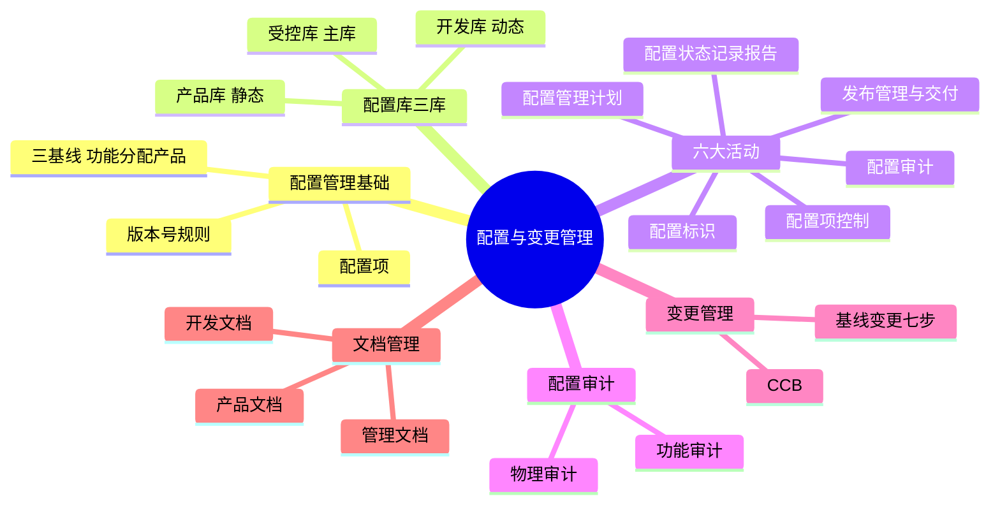
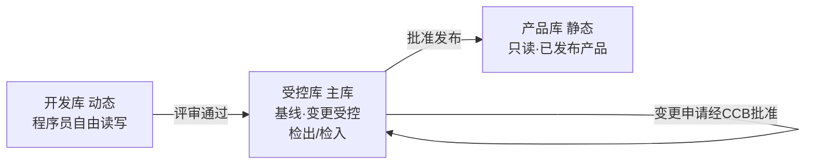
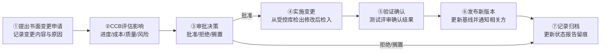

> **摘要**：
> 这章讲"改东西要有规矩":配置管理管"版本与基线"(配置项、三基线、版本号、三库、审计),变更管理管"改基线的流程"(CCB、七步变更)。**案例必考章**——三库权限、版本号规则、配置审计辨析、基线变更流程默写都是案例常客;上午题爱考版本号与三库归属。与 [05-项目整合管理](05-项目整合管理/) 的整体变更控制互相呼应。建议投入 6~8 小时。

## 🗺️ 知识地图

## 📖 掰碎讲解

### 15.1 配置管理是什么与为什么(定义必背)

**是什么**:**配置管理 = 通过技术或行政手段,对产品的信息(配置项)进行标识、控制,并保持其可追溯性的一组活动**。目的:保证产品在生命周期中**完整、一致、可追溯**。配置管理计划要明确配置管理组织与职责、配置项范围、基线、库结构与权限、标识规则、审计安排等。

**大白话**:配置管理就是"图书馆管理制度"——每本书(配置项)有编号(标识)、有存放区(库)、借还登记(检出/检入)、定期盘点(审计)。没有它,项目就成了"谁都能改代码、改完没人知道"的菜市场。

**怎么考**:"配置管理的对象只是代码"(错,还包括文档、数据、环境等一切**配置项**);"配置管理保证完整性与可追溯性"(对)。

### 15.2 配置项与三基线(必考)

**是什么**:
- **配置项(CI)**:纳入配置管理的工作产品——需求文档、设计文档、源代码、测试用例、工具、第三方组件、数据等。所有配置项要**唯一标识**(名称、编号、版本、责任人)。
- **基线**:一组**通过正式评审**的配置项集合,是进一步开发的**出发点**、变更的依据。**变更基线必须走变更流程**。

| 基线 | 建立时点 | 对应内容 |
| --- | --- | --- |
| **功能基线** | 需求确定(系统方案评审通过) | 需求规格说明书等 |
| **分配基线** | 设计完成(概要/详细设计评审通过) | 设计文档、接口定义 |
| **产品基线** | 系统测试后/交付时 | 最终产品+全套文档 |

**大白话**:基线是"盖章定稿"——需求盖一次章(功能基线),设计盖一次章(分配基线),最终交付成品再盖一次章(产品基线)。**盖了章的东西要改?对不起,先走流程**。口诀:"功能在需求、分配在设计、产品在交付"。

**怎么考**:三个基线与时点配对(上午必考);"配置项一经确定就不可修改"(错,要改走变更流程);"基线由正式评审确定"(对)。

### 15.3 配置项状态与版本号规则(计算/判断必考)

**是什么**:配置项三状态流转:**草稿 → 正式 → 修改 → (重新评审)→ 正式**。版本号规则:

| 状态 | 版本号格式 | 规则 |
| --- | --- | --- |
| **草稿** | **0.YZ**(如 0.72) | YZ 从 01 起每次修改递增;范围为 0.1~0.99 |
| **正式** | **X.Y**(如 1.0) | X 主版本、Y 次版本;正式发布后 Y 递增(小改)、X 递增(重大改) |
| **修改** | **X.YZ**(如 1.32) | 在正式版 X.Y 基础上修改,每次改动 Z 递增 |

**大白话**:草稿=在便签上打草稿(0.YZ,还没"转正");正式=盖章定稿(1.0);修改=定稿后要改(1.0Z,改一次 Z 加一),改完再评审,重新盖新章(1.1 或 2.0)。**认版本号知状态**:看到 0 开头=草稿;看到两段式=正式;三段式带主次前缀=修改中。

**怎么考**:"版本号 0.72 处于什么状态"→草稿;"1.21 处于什么状态"→修改;"正式状态的版本号格式"→X.Y;"草稿态 YZ 无限递增"(错,上限 0.99)。

### 15.4 配置库三库(案例找错高频)

| 库 | 别名 | 存放内容 | 谁能读写 | 用途 |
| --- | --- | --- | --- | --- |
| **开发库** | **动态库** | 开发中的配置项(未评审) | **开发人员**可自由读写 | 程序员的工作区,不严格受控 |
| **受控库** | **主库** | 通过评审、纳入基线的配置项 | 配置管理员管理;**修改须走变更流程**(检出/检入) | 基线存放地,变更控制的核心 |
| **产品库** | **静态库** | 已发布/交付的产品 | **只读**(取出用于发布安装) | 存放"出厂成品" |

**大白话**:开发库=自家厨房随便折腾;受控库=成品仓库,进门要登记、出门要审批;产品库=已上架的货架,只准看只准拿货不准改。**代码没评审进不了受控库;没批准发布进不了产品库**。

**怎么考**:案例题给场景找错——"开发人员直接修改受控库中的基线文档"(错,须先申请变更、经 CCB/配置管理员批准后检出);"产品库可自由写入"(错,只读);"受控库别名主库"(送分)。

### 15.5 配置管理六大活动(案例默写级)

| 活动 | 干什么 | 关键词 |
| --- | --- | --- |
| ①制定配置管理计划 | 定组织、职责、库结构、标识规则、工具 | 依项目情况裁剪 |
| ②配置标识 | 识别配置项并**唯一编号命名**、定基线 | 给"书"编书号 |
| ③配置项控制 | **检出/检入**、**变更控制**、版本管理 | 改东西走流程 |
| ④配置状态记录与报告 | 记录"谁改的、何时改、改了啥",定期出状态报告 | 台账+报表 |
| ⑤配置审计 | 核对配置项与需求/规范是否一致 | 见 15.6 |
| ⑥发布管理与交付 | 出库发布、版本交付客户、归档备份 | 出厂仪式 |

**大白话**:六活动口诀——**"计划标识控制账,审计发布不可少"**。图书馆:先立制度(计划)、书编号上架(标识)、借还登记(控制)、月度台账(状态报告)、年终盘点(审计)、新书发布会(发布交付)。

**怎么考**:活动排序题;案例问"配置管理缺了哪些活动"(常缺**配置审计**与**状态报告**);配置管理员职责——建立维护配置库、标识与版本控制、权限管理、备份、审计、状态报告。

### 15.6 配置审计两种(辨析必考)

| 审计 | 验证什么 | 大白话 |
| --- | --- | --- |
| **功能配置审计** | 配置项的**实际功能/性能与需求(合同、需求规格)一致** | "做的东西是不是客户要的" |
| **物理配置审计** | 配置项的**物理存在、标识、版本与设计/文档规范一致**,文档齐全 | "东西、文档、标签对不对得上号" |

**大白话**:功能审计="验收功能清单,一条条对需求";物理审计="查户口——名字、身份证号、档案袋是不是都齐、都对"。一个管**内容对不对**,一个管**形式齐不齐**。

**怎么考**:"检查软件是否满足需求规格说明书"→功能审计;"检查交付文档是否完整、版本标识是否正确"→物理审计;两词互换是经典陷阱。

### 15.7 基线变更流程(七步,案例默写级)

**是什么**:配置基线的变更必须走受控流程,与 [05-项目整合管理](05-项目整合管理/) 的整体变更控制一脉相承:

**七步口诀**:**"申请→评估→审批→实施→验证→发布→归档"**。

**大白话**:想改"盖章定稿"的东西,先递纸条(书面申请),管事的开会掂量影响(CCB 评估),批了才能动手(检出/检入),改完考试验收(验证),合格了重新盖章上架(发布新基线),全程记档案(归档)。**先申请后动手,顺序不能颠倒**——案例题最爱考"先改后报"这种错。

**怎么考**:步骤排序/找错(高频:"开发人员发现需求有误直接改了代码"→错,未申请未审批);与整合管理的变更流程对照记忆(申请→评估→CCB 审批→实施→验证→沟通→归档)。

### 15.8 CCB 变更控制委员会(填空必考)

**是什么**:**CCB(Change Control Board)**——评估和审批变更的组织:
- **组成**:多方代表——项目经理、用户代表、技术专家、质量/配置管理人员、管理层等;
- **职责**:评估变更影响、**批准或拒绝变更**、监督变更实施;**CCB 不制定技术方案,只做决策**;
- **特点**:**可分级设置**(公司级/项目级,按变更影响大小报不同层级);**非常设机构**(按需开会);大小变更可规定不同处理流程。

**大白话**:CCB 像"业委会"——不天天上班(非常设),但动公共区域(基线)必须找它批;重要的事全体商量(多方代表),小事按简化流程办(分级)。

**怎么考**:"CCB 是常设机构"(错);"CCB 负责实施变更"(错,它审批,**项目团队**实施);"CCB 可分级设置"(对)。

### 15.9 文档管理与发布交付

**是什么**:
- **文档三大类**:**开发文档**(可行性研究报告、需求规格说明书、设计说明书、测试计划/报告)、**产品文档**(用户手册、操作手册、维护手册)、**管理文档**(项目计划、进度报告、变更记录、会议纪要)。
- 文档也要纳入配置管理:编号、版本、评审、归档;重要文档在受控库管理。
- **发布管理与交付**:发布前评审+备份;交付时提供版本说明与用户文档;建立版本可追溯档案。

**大白话**:开发文档="做菜笔记"(给你自己看);产品文档="菜谱+说明书"(给用户看);管理文档="店长日志"(给领导看)。三类都进"档案馆"(配置库),别丢别乱。

**怎么考**:文档归类判断(测试报告=开发文档;操作手册=产品文档;会议纪要=管理文档);"文档不属于配置管理对象"(错)。

## 🎬 推荐视频

| 视频 | 讲什么 | 什么时候看 |
| --- | --- | --- |
| [野人老师高项全集 67 集](https://www.bilibili.com/video/BV1dJ41117Aa) | 三库与变更流程讲得形象 | 第一轮入门 |
| [软考老金高项(ITTO 记忆)](https://www.bilibili.com/video/BV1KtRQBtEQa) | 六活动+版本号口诀 | 一轮后背口诀 |
| [夏天老师 2027 第 4 版公开课 53 集](https://www.bilibili.com/video/BV1TFBpBKExt) | 第 4 版口径查漏 | 对照补漏 |
| [希赛第 4 版精讲 187 集](https://www.bilibili.com/video/BV1i3ovYrEek) | 案例真题里的配置管理找错 | 案例冲刺期 |

## ⭐ 章节重点(考前必背)

| 考点 | 必背内容 | 考法标签 |
| --- | --- | --- |
| 配置管理定义 | 标识+控制+**可追溯性**;对象是所有配置项 | 填空 |
| 三基线 | 功能(需求)/分配(设计)/产品(交付) | **配对必考** |
| 三状态 | 草稿→正式→修改→(评审)→正式 | 流程 |
| 版本号 | 草稿 **0.YZ**;正式 **X.Y**;修改 **X.YZ** | **计算/判断必考** |
| 三库 | 开发库(动态,自由读写)/受控库(主库,变更受控)/产品库(静态,只读) | **案例找错** |
| 六活动 | 计划/标识/控制/状态记录报告/审计/发布交付 | **案例默写** |
| 功能审计 | 实际功能与**需求一致** | **辨析必考** |
| 物理审计 | 文档、标识、版本与**规范一致** | **辨析必考** |
| 变更七步 | 申请→评估→审批→实施(检出/检入)→验证→发布→归档 | **案例默写级** |
| CCB | 多方代表;审批决策;**可分级**;**非常设**;只决策不实施 | **填空/判断** |
| 文档三类 | 开发/产品/管理文档 | 归类判断 |
| 配置管理员 | 建库、标识、权限、备份、审计、状态报告 | 案例 |

## 🧠 高频考法与陷阱

> **注意**：
> 1. **错误认知:配置管理就是管代码版本(等同于 Git)。→ 正确认知**:对象包括**文档、代码、数据、环境**等一切配置项;工具只是手段,核心是**标识、控制、可追溯**的管理制度。
> 2. **错误认知:版本号 1.21 表示正式版本。→ 正确认知**:**X.YZ 三段式=修改状态**;正式是 X.Y 两段式;0.YZ 是草稿。三段式最后一动 Z 递增,重新发布才升 Y。
> 3. **错误认知:开发库、受控库权限差不多,都是开发人员随便改。→ 正确认知**:开发库自由读写;**受控库(主库)修改必须先申请、经批准后检出/检入**;产品库只读。案例题"直接改受控库"是必挑错误。
> 4. **错误认知:功能审计和物理审计差不多。→ 正确认知**:功能审计对**需求**(内容对不对);物理审计对**设计文档与标识规范**(形式齐不齐)。
> 5. **错误认知:变更先改了再说,事后补个申请就行。→ 正确认知**:流程铁律是**先书面申请、经评估审批后才能实施**;"先改后报"是案例必挑错误,且易造成基线失控。
> 6. **错误认知:CCB 负责把变更实施到位。→ 正确认知**:CCB 只**评估与审批**(决策),实施由**项目团队/变更执行者**完成;CCB 还是**非常设机构**、可分级设置。

## ✍️ 反复练习题

**第 1 题(选择)** 某配置项版本号为 0.35,说明它当前处于:
A. 草稿状态　B. 正式状态　C. 修改状态　D. 已废弃状态

> **示例**：
> **答案:A**
> 草稿态版本号为 **0.YZ** 格式;正式态为 X.Y;修改态为 X.YZ。0.35 是典型的草稿编号。

**第 2 题(选择)** 需求规格说明书通过评审并纳入基线后,与之对应的基线是:
A. 产品基线　B. 功能基线　C. 分配基线　D. 测试基线

> **示例**：
> **答案:B**
> 需求确定建立**功能基线**;设计完成建立**分配基线**;系统交付建立**产品基线**。口诀:"功能需求、分配设计、产品交付"。

**第 3 题(选择)** 开发人员小王发现受控库中某模块代码有缺陷,正确的做法是:
A. 直接在受控库中修改并提交
B. 提出变更申请,经批准后检出代码修改,测试通过后检入
C. 把代码复制到本地改完后覆盖受控库
D. 先改产品库中的版本

> **示例**：
> **答案:B**
> 受控库存放基线,修改必须**先申请、经评估批准,再检出/检入**,并做验证与记录。A/C 未走流程,会造成基线失控;D 更错——产品库只读且存的是已发布产品。

**第 4 题(选择)** 检查"交付的用户手册、设计文档是否齐全,版本标识是否与产品一致",应进行的审计是:
A. 功能配置审计　B. 物理配置审计　C. 风险审计　D. 采购审计

> **示例**：
> **答案:B**
> 物理审计查**文档齐套性、标识与版本正确性**(形式);功能审计查**功能性能与需求的一致性**(内容)。"文档齐全、标识正确"是物理审计的标志词。

**第 5 题(选择)** 关于 CCB(变更控制委员会),说法正确的是:
A. CCB 是常设机构,需每天例会
B. CCB 负责实施所有变更
C. CCB 可分级设置,按变更影响大小由不同层级审批
D. CCB 成员只有项目经理和技术总监

> **示例**：
> **答案:C**
> CCB **可分级设置**(公司级/项目级)、**非常设**(按需开会);职责是**评估与审批**变更、监督实施,但不亲自实施(B 错);成员应**多方代表**(含用户、质量、配置等, D 错)。

**第 6 题(选择)** 下列文档中属于"管理文档"的是:
A. 概要设计说明书　B. 用户操作手册　C. 项目周报与会议纪要　D. 系统测试报告

> **示例**：
> **答案:C**
> 管理文档=计划、报告、纪要等管理类文件;概要设计(A)与测试报告(D)是**开发文档**;操作手册(B)是**产品文档**。

**第 7 题(选择)** 基线变更流程的正确顺序是:
A. 实施→申请→审批→验证　B. 申请→评估审批→实施→验证→发布→归档　C. 申请→实施→评估→审批　D. 评估→申请→审批→发布

> **示例**：
> **答案:B**
> 铁律:**先书面申请,经 CCB 评估审批后才能实施**;实施(检出/检入)后要**验证确认**,再**发布更新基线**并**记录归档**。A/C 都是"先斩后奏"的典型错误。

**第 8 题(案例风格)** 某公司软件项目配置管理情况如下:①配置库只有一个,开发人员可随时修改任何文档与代码;②需求文档已评审,但版本号仍为 0.9;③测试人员发现某基线代码有缺陷,直接在库中修改并覆盖;④项目发布前未做任何审计。请回答:
(1) 指出状况①的缺陷,并给出正确的配置库建设方案。
(2) 指出状况②、③的不当之处及改正办法。
(3) 状况④应在发布前补充什么工作?写出两种审计及其内容。

> **示例**：
> (1) 缺陷:只设一个库、无权限控制,任何人都可改一切,基线形同虚设。方案:**三库结构**——开发库(动态,开发人员自由读写)、受控库(主库,存放通过评审的基线,修改须变更审批后检出/检入,由配置管理员管理)、产品库(静态,只读,存放已发布产品);同时按角色分配权限。
> (2) 状况②:需求文档已通过评审应转为**正式状态**,版本号应为 X.Y 格式(如 1.0);0.9 属草稿态编号,应更新版本并纳入**功能基线**。状况③:测试人员**无权直接修改受控库基线**——应提出变更申请(或缺陷单),经评估审批后由有权限者**检出→修改→测试验证→检入**,并更新配置状态记录。
> (3) 发布前应做**配置审计**:①**功能配置审计**——核对交付软件的实际功能与性能是否满足需求规格说明书/合同;②**物理配置审计**——核对交付物(软件、文档、介质)是否齐全、标识与版本是否规范一致;审计通过并备份后方可发布交付。

## 🎨 漫画图解

*配置管理三库*-草稿间→档案室→展柜,版本号对应 0.YZ / X.Y / X.YZ*

## 🔗 相关章节

- 整体变更控制流程:[05-项目整合管理](05-项目整合管理/)
- 变更与范围基线:[06-项目范围管理](06-项目范围管理/)
- 采购中的合同变更:[13-项目采购管理](13-项目采购管理/)
- 交付与发布视角:[14-绩效域与价值交付](14-绩效域与价值交付/)
- 攻略:[项管-案例分析攻略](../项管-案例分析攻略/)、[项管-论文攻略](../项管-论文攻略/)、[qicoder真题索引](../../99-真题资源/qicoder真题索引/)
