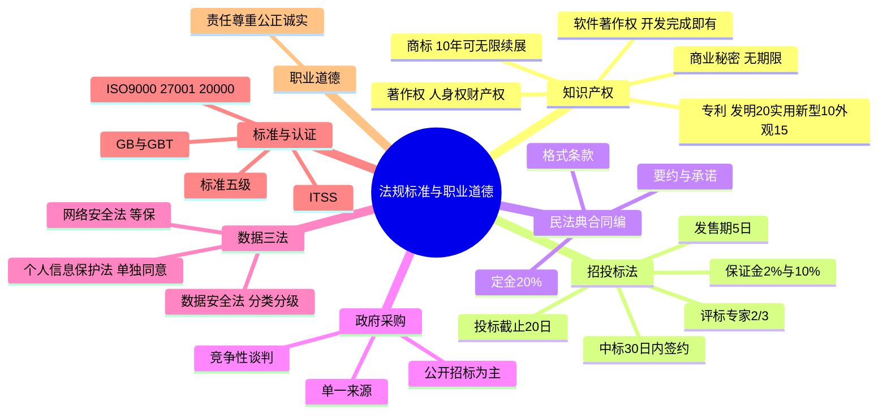
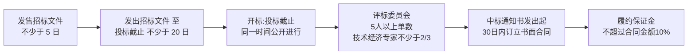

> **摘要**：
> 纯记忆章但分值稳定:知识产权(著作权/软件著作权/专利/商标/商业秘密)、招投标法必背数字、民法典合同编、政府采购六方式、网络安全/数据安全/个人信息保护三法、标准化五级、ISO 认证、职业道德四价值。**全是"数字+归属判断"**:保护期、保证金比例、评标专家 2/3……上午题近年高频出分,背熟就是送分;案例里索赔与招投标数字也能用上。建议投入 6~8 小时,考前滚两遍。

## 🗺️ 知识地图

## 📖 掰碎讲解

### 16.1 著作权:自动保护、人身权与财产权(必考)

**是什么**:作品**创作完成即自动享有著作权**,无需登记(登记只利于举证)。权利分两块:
- **人身权**(永久):**发表权、署名权、修改权、保护作品完整权**;
- **财产权**(可转让):复制、发行、信息网络传播、改编、翻译等 13 项经济权利。

**保护期**:

| 权利 | 保护期 |
| --- | --- |
| 署名权、修改权、保护作品完整权 | **无限期** |
| 发表权、财产权(自然人) | 作者**终身 + 死后 50 年**(至第 50 年 12 月 31 日) |
| 发表权、财产权(法人作品/职务作品归单位/视听作品) | **首次发表后 50 年**(创作后 50 年内未发表则不再保护) |

**合理使用**(不侵权、不付酬,常见 12 种):个人学习研究欣赏;**适当引用**;新闻报道不可避免再现;**课堂教学/科学研究**少量复制翻译;国家机关执行公务合理使用;图书馆档案馆陈列保存版本;免费表演;室外公共场所艺术作品临摹摄影录像;**考试命题**相关使用;汉语言作品翻译成少数民族语言;无障碍格式提供等。**法定许可**:可不经许可但要**付酬**(如教科书编写选用已发表作品、报刊转载)。

**大白话**:著作权像"出生即有身份证"(自动保护)。人身权是"永远跟着你的名分"——谁写的永远是你的名字(署名权无限期);财产权是"能卖钱的权利",自然人保到死后 50 年,单位作品从首次发表算 50 年。合理使用="不打招呼也不用给钱"(学习引用出题);法定许可="不打招呼但得给钱"(教科书选文)。

**怎么考**:保护期三档辨析(必考);"登记是取得软件著作权的必要条件"(错!自动保护);合理使用 vs 法定许可(给不给钱);职务作品/委托作品归属——委托作品**无约定归受托人(创作方)**。

### 16.2 软件著作权

**是什么**:**自软件开发完成之日起产生**;登记**非必需**(自愿登记,利于维权举证)。保护期:自然人的软件著作权=**终身 + 死后 50 年**;法人及其他组织的=**首次发表后 50 年**(开发完成 50 年内未发表不再保护)。软件著作权内容包括:发表权、署名权、修改权、复制权、发行权、出租权、信息网络传播权、翻译权等。

**大白话**:代码敲完那一刻权利就有了,不用去登记处"领证";登记相当于给权利"开个官方证明",打官司好用,但不是"准生证"。

**怎么考**:"软件著作权自登记之日起产生"(错,自**开发完成之日**);"合作开发的软件无约定则共有"(对);升级版本属于修改权的行使。

### 16.3 专利:三种专利与归属(数字必考)

**是什么**:

| 类型 | 保护期(自**申请日**起) | 授予条件 |
| --- | --- | --- |
| **发明** | **20 年** | 新颖性、创造性、实用性 |
| **实用新型** | **10 年** | 新颖性、创造性、实用性(创造性要求较低) |
| **外观设计** | **15 年**(2021 年 6 月 1 日起施行) | 新颖性(不属于现有设计) |

- **先申请原则**:两人先后申请同一发明,授予**先申请**者;
- **职务发明创造**:执行本单位任务或主要利用单位物质技术条件完成的,申请权归**单位**;
- 专利权可转让、可许可;未缴年费等情形专利权终止。

**大白话**:发明是"硬核原创"(20 年长保);实用新型是"小改进、新造型"(10 年);外观设计是"好看就行"(15 年,2021 年新法从 10 年延长到 15 年)。三兄弟都**从申请日起算**,先到先得(先申请原则),上班用公司资源搞出来的归公司。

**怎么考**:三种专利年限配对(年年考);起算点(自申请日,不是授权日);"职务发明归发明人个人"(错,归单位,发明人有署名与获得奖励报酬的权利)。

### 16.4 商标、商业秘密与反不正当竞争

**是什么**:
- **注册商标**:有效期 **10 年**,自**核准注册之日**起算;期满前 12 个月内可办续展(有 6 个月宽展期),**续展次数不限**——理论上可永久拥有;**先申请原则**。
- **商业秘密**三要件:**不为公众所知悉(秘密性)+ 具有商业价值(价值性)+ 权利人采取保密措施(保密措施)**;**无保护期限**——只要保密就保护,泄密即失守;涵盖技术信息与经营信息(配方、客户名单)。
- **反不正当竞争**典型行为:混淆(傍名牌)、商业贿赂、虚假宣传、**侵犯商业秘密**、不当有奖销售、诋毁商誉。

**大白话**:商标是"脸面",10 年一续、续到天荒地老;商业秘密是"心法"——**法律不给你年限,全靠你自己嘴严**(可口可乐配方保密上百年);隔壁老王挖你的墙角偷配方,反不正当竞争法管他。

**怎么考**:商标 10 年+无限续展;商业秘密三要件填空;"商业秘密保护期 20 年"(错,无期限,前提是保密措施到位);客户名单属于商业秘密。

### 16.5 招投标法必背数字(时间轴必背)

| 事项 | 数字 |
| --- | --- |
| 招标文件发售期 | 不得少于 **5 日** |
| 招标文件发出 → 投标截止 | 不得少于 **20 日** |
| 投标保证金 | 不超过项目估算价的 **2%** |
| 评标委员会 | **5 人以上单数**;技术经济专家不少于成员总数的 **2/3** |
| 中标通知书发出 → 订立书面合同 | **30 日内** |
| 履约保证金 | 不超过中标合同金额的 **10%** |

**大白话**:卖标书至少挂 5 天(5 日);从发标到交标书留足 20 天(20 日);评委至少 5 人单数好表决,外行(非技术经济专家)不能超过 1/3(专家≥2/3);中了标 30 天内签合同;进门押金 2%、履约押金 10%。口诀:**"5 发 20 截、5 人 2/3、30 签约、2 押 10 履"**。

**怎么考**:数字填空/判断(超高频);"评标委员会 6 人"(错,要**单数**);"投标保证金 5%"(错,上限 2%)。与 [13-项目采购管理](13-项目采购管理/) 的采购流程联动。

### 16.6 民法典合同编要点

**是什么**:
- **要约**:希望与他人订立合同的意思表示——**内容具体确定**、表明经承诺即受约束;**承诺**:受要约人同意要约,承诺生效时**合同成立**。
- **格式条款**:一方为重复使用预先拟定、未与对方协商;提供方须**公平拟定并履行提示说明义务**;**不合理免除己方责任、加重对方责任、排除对方主要权利的条款无效**。
- **违约责任**:继续履行、采取补救措施、赔偿损失;违约金与定金**不能同时**主张(可择一)。
- **定金**:不得超过主合同标的额的 **20%**;给付定金方违约无权返还,收受方违约**双倍返还**。
- 争议解决:协商 → 调解 → **仲裁(一裁终局)或诉讼**。

**大白话**:要约是"认真报价,答应就成交",承诺是"成交!",拍板瞬间合同成立。格式条款是"印好的小字"——霸王条款无效。定金是"违约的代价":你反悔钱没收,他反悔赔双倍,但最多收合同价的 20%。

**怎么考**:"承诺发出时合同成立"(辨析:承诺**生效**时成立);"定金 30%"(错,20% 上限);"违约金与定金可同时适用"(错,择一)。

### 16.7 政府采购法:六种方式(适用情形判断)

| 方式 | 适用情形 |
| --- | --- |
| **公开招标**(主要方式) | 限额以上的一般采购,应公开招标 |
| **邀请招标** | 具有特殊性,只能从**有限范围**的供应商处采购;公开招标费用占比过大 |
| **竞争性谈判** | 招标后无合格标的;技术复杂无法确定详细规格;**时间紧急**;不能事先计算价格总额 |
| **单一来源** | **唯一**供应商;不可预见的紧急情况;**添购**(与原合同一致,一般不超过原合同 10%) |
| **询价** | 规格标准统一、现货货源充足、价格变化幅度小的货物 |
| **框架协议采购** | 多频次、小额度的采购 |

**大白话**:默认吆喝着买(公开招标);点名买(邀请);坐下砍价买(谈判);没得选只能买他家(单一来源);超市明码标价拿货(询价);办个储值卡反复买小件(框架协议)。

**怎么考**:六方式情形配对(与 13 章呼应);"公开招标是政府采购的主要采购方式"(对);"添购不超过原合同采购金额的 10%"(数字考)。

### 16.8 网络安全法、数据安全法、个人信息保护法

**是什么**:
- **网络安全法**:网络运营者义务——实行**网络安全等级保护制度**(等保五级)、实名制、应急预案;**日志留存不少于 6 个月**;关键信息基础设施特殊保护。
- **数据安全法**:**数据分类分级**保护(一般/重要/**核心**数据);重要数据目录管理;数据安全审查;跨境流动管控。
- **个人信息保护法**:处理原则——合法正当必要诚信、**目的限制、最小必要**;处理敏感个人信息需取得**单独同意**;**敏感个人信息**包括:生物识别、宗教信仰、特定身份、**医疗健康、金融账户、行踪轨迹**+**不满 14 周岁未成年人**信息;个人享有知情、决定、查阅复制、更正、删除等权利。

**大白话**:网安法管"墙要修多高"(等保定级、留日志);数安法管"货分三六九等"(数据分级,核心数据最高级别看护);个保法管"看住每个人的隐私"——医疗记录、银行账号、行踪轨迹都是敏感货,**动它必须单独点头**(单独同意),小孩(14 岁以下)信息更金贵。

**怎么考**:"等保制度是网络安全法确立的"(对);"日志留存不少于 3 个月"(错,6 个月);"一般个人信息处理也需单独同意"(错,敏感信息才要单独同意);"14 周岁以下未成年人信息属敏感个人信息"(对)。

### 16.9 标准化法:五级标准与 GB 辨析

**是什么**:标准五级(效力从上到下):**国家标准 → 行业标准 → 地方标准 → 团体标准 → 企业标准**。国家标准的代号:
- **GB**:强制性国家标准——**必须执行**;
- **GB/T**:推荐性国家标准(T=推荐);
- **GB/Z**:国家标准化指导性技术文件。

**大白话**:国家标准是"国家统一卷";行业是"各门派卷";地方是"地方特色卷";团体/企业是"社团自加码卷"。**带 T 的是"建议你这么干"**,不带 T 的 GB 是"必须这么干"——安全、卫生、环保类常是强制。

**怎么考**:"GB/T 为强制性标准"(错,推荐性);"强制性标准必须执行"(对);"企业标准可低于国家标准"(错,企业标准不得低于强制性标准要求)。

### 16.10 ISO 认证与 ITSS

| 标准 | 领域 | 一句话 |
| --- | --- | --- |
| **ISO9000 族** | **质量管理体系**(QMS) | 质量管理的国际通用框架 |
| **ISO27001** | **信息安全管理体系**(ISMS) | 信息安全管理的国际标准 |
| **ISO20000** | **IT 服务管理体系**(ITSM) | IT 服务管理国际标准 |
| **ITSS**(中国) | 信息技术服务标准 | 四要素:**人员、过程、技术、资源**(PPTR) |

**大白话**:9000 管"产品质量体系",27001 管"信息别泄密",20000 管"IT 服务台怎么运转",ITSS 是国产版"IT 服务怎么干得好"——看人、过程、技术、资源四张牌。

**怎么考**:标准↔领域配对;ITSS 四要素填空(高频);"ISO27001 是质量管理标准"(错,是信息安全)。

### 16.11 职业道德:四价值(案例可引用)

**是什么**:项目管理从业者职业道德与专业行为规范的四大价值:
- **责任(Responsibility)**:对自己的决定与行为负责,守法、守知识产权;
- **尊重(Respect)**:尊重他人资源、能力、差异,倾听不同意见;
- **公正(Fairness)**:决策客观透明、利益冲突要回避,不偏袒不歧视;
- **诚实(Honesty)**:如实报告进度与问题,**不造假数据、不隐瞒真相**。

**大白话**:责任=自己的锅自己背;尊重=好好说话;公正=不偏心、有利益冲突要举手回避;诚实=进度差就说进度差,别 PPT 造假。案例答题时点一句"项目经理应秉持责任、尊重、公正、诚实的职业道德",规范又加分。

**怎么考**:四价值填空;场景匹配(数据造假→违背诚实;偏袒亲属供应商→违背公正);结合廉洁自律、爱岗敬业等社会公德一起作答。

## 🎬 推荐视频

| 视频 | 讲什么 | 什么时候看 |
| --- | --- | --- |
| [野人老师高项全集 67 集](https://www.bilibili.com/video/BV1dJ41117Aa) | 法规与知识产权章,数字讲得有梗 | 第一轮入门 |
| [希赛第 4 版精讲 187 集](https://www.bilibili.com/video/BV1i3ovYrEek) | 法条逐条过+配套题 | 二轮背数字 |
| [夏天老师 2027 第 4 版公开课 53 集](https://www.bilibili.com/video/BV1TFBpBKExt) | 新法口径(个保法等)查漏 | 对照补漏 |
| [软考老金高项(ITTO 记忆)](https://www.bilibili.com/video/BV1KtRQBtEQa) | 用口诀串数字 | 考前速记 |

## ⭐ 章节重点(考前必背)

| 考点 | 必背内容 | 考法标签 |
| --- | --- | --- |
| 著作权取得 | **自动保护**,登记非必需 | 判断必考 |
| 人身权 | 发表/署名/修改/保护完整;署名修改完整权**无限期** | 填空 |
| 保护期 | 自然人终身+50;法人/职务作品**首次发表后 50** | **数字必考** |
| 合理使用 | 不经许可**不付酬**(学习/引用/教学/公务/命题);法定许可**要付酬** | 辨析 |
| 软著产生 | 自**开发完成之日**产生 | 判断 |
| 专利年限 | 发明 20/实用新型 10/外观设计 15;自**申请日**起;职务发明归**单位** | **数字必考** |
| 商标 | 10 年、可**无限续展**;先申请 | 数字 |
| 商业秘密 | 秘密性+价值性+保密措施;**无期限** | 填空 |
| 招投标 | 发售≥5 日;发标→截标≥20 日;评委≥5 人单数、专家≥2/3;中标 30 日内签约;投标保证金≤2%、履约≤10% | **数字必考** |
| 定金 | ≤主合同标的额 **20%**;双倍返还;违约金与定金**择一** | 数字 |
| 政府采购 | 六方式;公开招标为主;添购≤原合同 10% | 情形判断 |
| 敏感个人信息 | 生物识别/医疗健康/金融账户/行踪轨迹/14 岁以下未成年;需**单独同意**;最小必要 | **判断必考** |
| 等保与日志 | 网络安全法确立**等级保护**;日志留存≥6 个月 | 数字 |
| 数据安全 | 分类分级:一般/重要/核心 | 填空 |
| 标准五级 | 国家/行业/地方/团体/企业;**GB 强制、GB/T 推荐** | **判断必考** |
| ISO | 9000 质量/27001 信息安全/20000 IT 服务;ITSS=人员过程技术资源 | 配对 |
| 职业道德 | **责任、尊重、公正、诚实** | 案例引用 |

## 🧠 高频考法与陷阱

> **注意**：
> 1. **错误认知:软件著作权要去版权局登记后才有。→ 正确认知**:著作权(含软件著作权)**自创作/开发完成之日起自动产生**,登记只是自愿的举证辅助。
> 2. **错误认知:外观设计专利保护期 10 年。→ 正确认知**:2021 年 6 月 1 日新专利法施行后,外观设计为 **15 年**;发明 20 年、实用新型 10 年,均自**申请日**起算。
> 3. **错误认知:投标保证金交 5% 更保险。→ 正确认知**:投标保证金**不超过项目估算价 2%**,履约保证金不超过合同金额 10%;多收违法。
> 4. **错误认知:GB/T 是强制性标准。→ 正确认知**:GB 是强制性(**必须执行**),GB/T 是推荐性(T=推荐);带 T 的"建议执行",不带 T 的"必须执行"。
> 5. **错误认知:处理所有个人信息都要单独同意。→ 正确认知**:一般个人信息取得**同意**即可;**敏感个人信息**(医疗健康、金融账户、行踪轨迹、生物识别、14 岁以下未成年人等)才需要**单独同意**且遵循最小必要。
> 6. **错误认知:商业秘密和专利一样有固定保护期。→ 正确认知**:商业秘密**无期限**——保密措施在、秘密就在;一旦泄密立即失守;而专利是"以公开换保护",到期公开。

## ✍️ 反复练习题

**第 1 题(选择)** 关于著作权保护期,说法正确的是:
A. 署名权的保护期为作者终身加死后 50 年
B. 法人作品的财产权保护期为首次发表后 50 年
C. 修改权保护期为发表后 50 年
D. 保护作品完整权保护期为 20 年

> **示例**：
> **答案:B**
> 署名权、修改权、保护作品完整权**无限期**(A/C/D 错);自然人的发表权与财产权=终身+死后 50 年;法人作品/职务作品归单位的=**首次发表后 50 年**。

**第 2 题(选择)** 2021 年 6 月 1 日之后申请的外观设计专利,保护期为自申请日起:
A. 5 年　B. 10 年　C. 15 年　D. 20 年

> **示例**：
> **答案:C**
> 新专利法(2021.6.1 施行)将外观设计保护期由 10 年延长至 **15 年**;发明 20 年、实用新型 10 年,均自申请日起算。

**第 3 题(选择)** 依法必须进行招标的项目,自招标文件开始发出之日起至投标人提交投标文件截止之日止,最短不得少于:
A. 5 日　B. 10 日　C. 15 日　D. 20 日

> **示例**：
> **答案:D**
> ≥**20 日**(招标文件发售期≥5 日是另一条,别混)。口诀:"5 发 20 截"。

**第 4 题(选择)** 依法必须招标项目的评标委员会,下列构成符合规定的是:
A. 6 人,技术经济专家 3 人
B. 5 人,技术经济专家 3 人
C. 7 人,技术经济专家 4 人
D. 5 人,技术经济专家 2 人

> **示例**：
> **答案:B**
> 评标委员会 **5 人以上单数**,技术经济专家**不少于 2/3**。A 人数偶数错;C 7 人专家须≥5(4<2/3 错);D 专家仅 2 人不足 2/3。B:5 人单数,3/5≥2/3,合规。

**第 5 题(选择)** 某公司采购合同约定定金 40 万元,合同标的额 150 万元。该定金约定:
A. 有效,按 40 万执行
B. 部分无效,超过标的额 20% 的部分不具有定金效力
C. 无效,定金不得约定
D. 需双方再签协议才生效

> **示例**：
> **答案:B**
> 定金不得超过主合同标的额的 **20%**=150×20%=30 万;约定 40 万中,超出部分(10 万)不具有定金效力,30 万有效。

**第 6 题(选择)** APP 收集用户行踪轨迹信息用于推荐服务,依据个人信息保护法应当:
A. 隐私政策统一勾选即可
B. 取得用户单独同意,并遵循最小必要原则
C. 无需告知,内部使用不违法
D. 只需向监管部门备案

> **示例**：
> **答案:B**
> 行踪轨迹属**敏感个人信息**,处理需**单独同意**,并遵循合法正当必要、**最小必要**原则;一揽子勾选隐私政策不构成单独同意。

**第 7 题(选择)** 下列标准中属于推荐性国家标准的是:
A. GB　B. GB/T　C. GB/Z　D. DB

> **示例**：
> **答案:B**
> GB=强制性国家标准(必须执行);GB/T=**推荐性**国家标准;GB/Z=指导性技术文件;DB 是地方标准代号。

**第 8 题(案例风格)** 某系统集成公司承接政府数据中心项目:①招标文件中要求投标保证金为项目估算价的 3%;②评标委员会共 6 人,其中技术经济专家 4 人;③中标通知书发出后第 45 天,招标人才与中标人订立合同;④公司员工老张在职期间利用公司设备开发的运维工具被同事私自以个人名义申请了专利。请指出上述每一条中的问题并给出正确做法。

> **示例**：
> (1) 投标保证金不得超过项目估算价的 **2%**,3% 违法,应降至 2% 以内。
> (2) 评标委员会应为 **5 人以上单数**且技术经济专家不少于 **2/3**;6 人为偶数不合规,应改为单数(如 7 人且专家≥5 人,4/7<2/3 也需补足专家比例)。
> (3) 应在**中标通知书发出之日起 30 日内**订立书面合同,第 45 天已超期,应立即补签并说明原因、承担相应责任。
> (4) 老张属**职务发明**(执行本单位任务、主要利用单位物质技术条件),申请权归**公司**;同事以个人名义申请不当,应由公司作为申请主体,老张享有署名及获得奖励报酬的权利。

## 🔗 相关章节

- 招投标流程与采购实务:[13-项目采购管理](13-项目采购管理/)
- 合同变更与索赔:[15-配置与变更管理](15-配置与变更管理/)、[05-项目整合管理](05-项目整合管理/)
- 标准与信息系统治理:[03-信息系统治理与标准](03-信息系统治理与标准/)
- 攻略:[项管-案例分析攻略](../项管-案例分析攻略/)、[项管-真题战略](../项管-真题战略/)、[qicoder真题索引](../../99-真题资源/qicoder真题索引/)
