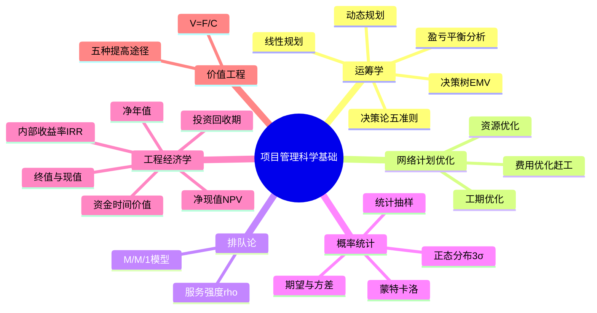
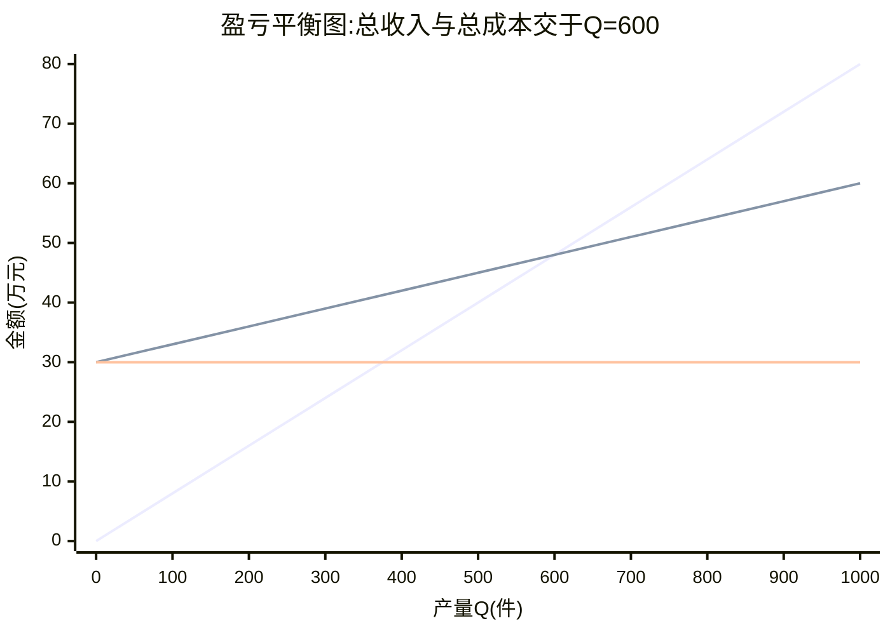
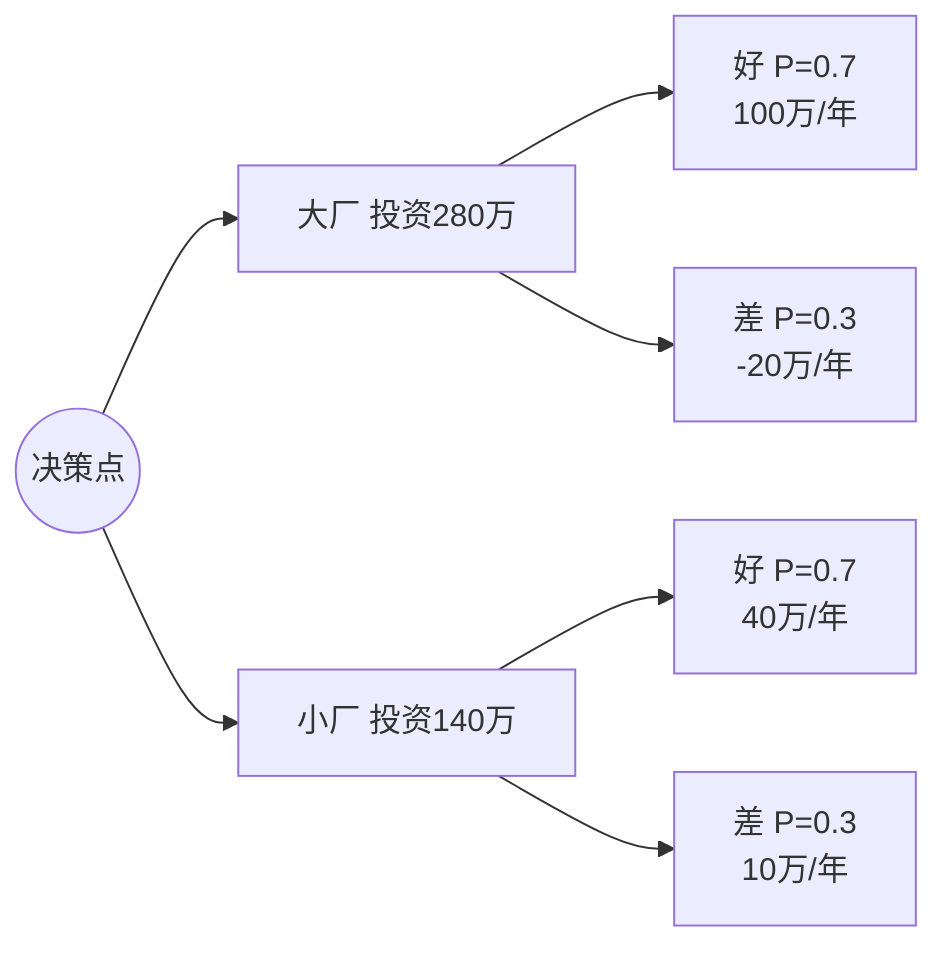

> **摘要**：
> **案例拿分关键章**:运筹学(线性规划/盈亏平衡/决策论/动态规划)、网络计划优化、排队论、概率统计、工程经济学(NPV/IRR/回收期)、价值工程。案例计算大题常从这里出(挣值+预测、决策树、NPV、盈亏平衡都是常客);上午题考概念与公式识别。**本章所有例题都给完整演算,照着算三遍就能拿分**。与 [07-项目进度管理](07-项目进度管理/)、[08-项目成本管理](08-项目成本管理/) 强联动。建议投入 10~12 小时(计算要动手练)。

## 🗺️ 知识地图

## 📖 掰碎讲解

### 17.1 运筹学概述:用数学帮项目拍板

**是什么**:运筹学=用数学模型在**有限资源**下求**最优解**。项目里最常用的四件套:线性规划(资源分配)、盈亏平衡(定价与销量)、决策论(方案选择)、动态规划(多阶段问题)。

**大白话**:项目经理每天都在"_allocation_:人只有 8 个、钱只有 100 万、活有 20 件,怎么安排最划算?"——运筹学就是把这种纠结写成算式,算给你看。

**怎么考**:工具与问题配对(资源分配→线性规划;方案选优→决策论;多阶段最短路→动态规划)。

### 17.2 线性规划:建模三步与完整例题

**是什么**:建模三步——①**设变量**(设 x、y 代表决策量);②**写目标函数**(max 利润或 min 成本);③**列约束条件**(资源限制+非负)。

**完整例题**:某厂生产甲、乙两种产品。甲每件利润 3 万元,乙每件利润 2 万元。设备 A:甲每件需 1 小时、乙需 2 小时,共有 8 小时;设备 B:甲每件需 2 小时、乙需 1 小时,共有 10 小时。问怎么安排产量利润最大?

- 设:生产甲 x 件、乙 y 件
- 目标:max Z = 3x + 2y
- 约束:x + 2y ≤ 8;2x + y ≤ 10;x ≥ 0,y ≥ 0

**图解法思想**:约束围出一个可行域(多边形),目标函数是平行直线族,**最优解必在可行域顶点**。逐个顶点代入:

| 顶点 | Z=3x+2y |
| --- | --- |
| (0,0) | 0 |
| (5,0) | 15 |
| **(4,2)** | **16(最大)** |
| (0,4) | 8 |

(交点求法:联立 x+2y=8 与 2x+y=10,解得 x=4、y=2,验证两约束均取等号成立。)

**结论**:甲产 4 件、乙产 2 件,最大利润 **16 万元**。

**大白话**:可行域像"围栏里的草地",利润线像"等高线",把等高线往最外推,推到最后卡住的那个**顶点**就是最优解——所以考试只需要**算顶点**。

**怎么考**:案例给资源约束求最优产量;顶点代入比较;也考"最优解在可行域顶点取得"这一概念。

### 17.3 盈亏平衡分析:BEP 公式与图(必考公式)

**是什么**:**BEP(盈亏平衡点)产量 = 固定成本 F ÷ (单价 P − 单位变动成本 V)**。Q<BEP 亏损,Q>BEP 盈利;**安全边际 = 预计销量 − 盈亏平衡销量**(越大越抗风险)。

**完整例题**:某产品固定成本 30 万元,单价 0.08 万元/件,单位变动成本 0.03 万元/件。BEP = 30 ÷ (0.08−0.03) = **600 件**;若预计销量 1000 件,安全边际 = 1000−600 = 400 件(安全边际率 40%)。

**大白话**:总收入线从 0 出发往右蹿,总成本线从 30(就算一件不卖也得付房租)出发慢慢爬,两条线**交叉点**就是回本点——600 件之前卖得越多亏得越少,过了 600 件开始数钱。安全边际是"离亏本还差多少件"的缓冲垫。

**怎么考**:BEP 计算(送分);给图判断盈亏区间;"安全边际越大风险越大"(错,越大越安全);成本结构判断(房租=固定成本,材料=变动成本)。

### 17.4 决策论:不确定型五准则 + 风险型决策树(案例核心)

**是什么**:**不确定型决策**(各状态概率未知)五准则;**风险型决策**(概率已知)用期望值 EMV/决策树。

**收益矩阵例题**(三种方案 × 三种市场状态,收益单位万元):

| 方案 | 市场好 | 市场中 | 市场差 |
| --- | --- | --- | --- |
| A 建大厂 | 60 | 20 | -30 |
| B 建小厂 | 40 | 25 | -5 |
| C 外包 | 20 | 15 | 10 |

**五准则逐一演算**:

| 准则 | 逻辑 | A | B | C | 选择 |
| --- | --- | --- | --- | --- | --- |
| **乐观法(max-max)** | 每方案取最大值,再取最大 | 60 | 40 | 20 | **A** |
| **悲观法(max-min)** | 每方案取最小值,再取最大 | -30 | -5 | 10 | **C** |
| **折中法(α=0.6)** | α×最大值+(1-α)×最小值 | 0.6×60+0.4×(-30)=24 | 0.6×40+0.4×(-5)=22 | 0.6×20+0.4×10=16 | **A** |
| **等可能法** | 每状态 1/3,求平均 | (60+20-30)/3≈16.7 | (40+25-5)/3=20 | (20+15+10)/3=15 | **B** |
| **最小遗憾法** | 每状态取最大为基准求遗憾,选最大遗憾最小 | 最大遗憾 40 | 最大遗憾 20 | 最大遗憾 40 | **B** |

(遗憾矩阵:市场好的最大收益 60→A 遗憾 0、B 20、C 40;市场中的最大 25→A 5、B 0、C 10;市场差的最大 10→A 40、B 15、C 0;各方案最大遗憾 A=40、B=20、C=40,取最小为 B。)

**风险型决策树(EMV 法)完整例题**:建大厂投资 280 万,销路好(0.7)年收益 100 万、销路差(0.3)年亏 20 万;建小厂投资 140 万,销路好(0.7)年收益 40 万、销路差(0.3)年收益 10 万;使用期 10 年。

五步法:①画树(决策点→方案→机会点→结果);②算各机会点期望值;③各方案 EMV=期望收益×年限−投资;④比较剪枝;⑤结论。
- 大厂:EMV = [0.7×100+0.3×(-20)]×10 − 280 = 64×10−280 = **360 万**
- 小厂:EMV = [0.7×40+0.3×10]×10 − 140 = 31×10−140 = **170 万**
- 360>170 → **选建大厂**。

**大白话**:乐观=赌徒("万一火了呢");悲观=怂人(先保底);折中=中庸;等可能=佛系(各三分之一);最小遗憾=事后不拍大腿党。风险型决策树=每条路按"概率×收益"算平均,再减本钱,谁大跟谁走。

**怎么考**:**五准则各算一遍选不同方案**(案例计算大题经典);"乐观法取各方案最大收益中的最大值"(对);决策树完整计算(与 [12-项目风险管理](12-项目风险管理/) 的 EMV 同源)。

### 17.5 动态规划:多阶段决策思想

**是什么**:把大问题拆成**相互联系的多阶段**小问题,逐段决策;利用**最优子结构**(最短路的后半段仍是最短路)与**无后效性**(当前状态定了,未来与路径无关)。经典应用:最短路、资源分配、设备更新。

**大白话**:导航找最短路,不是一次试完所有组合,而是"到每个路口的最短距离"从终点往回逐个算出来——记下小账本,大问题就解了。

**怎么考**:概念题(多阶段决策/最优子结构);"动态规划要求每阶段最优且全局最优"(对);轻量级,重在思想。

### 17.6 网络计划优化(与第 07 章呼应)

**是什么**:三种优化:
- **工期优化**:压缩**关键路径**上的活动工期(关键路径决定总工期);优先压**赶工成本低**且可压缩的活动;压缩后注意关键路径**可能转移**。
- **费用优化**:总费用=直接成本(赶工增加)+间接成本(随工期缩短减少),找**总费用最低**的工期。
- **资源优化**:**资源平衡**(削峰填谷,利用非关键活动浮动时间,**不改变工期**)与**资源限定**(资源不够时延长工期/调整计划)。

**大白话**:工期优化=给关键路径上的活动"打激素"(加人加班),专挑"性价比高"(赶工费率低)的下手;费用优化=算"加班费涨的钱"与"早完工省的房租"哪个划算;资源优化=把活儿挪来挪去让人不闲不爆(平衡),或人手不够认命延期(限定)。

**怎么考**:赶工计算(选费率最低的关键活动压缩);"资源平衡不会改变总工期"(对);"压缩非关键活动能缩短总工期"(错);关键路径转移陷阱(详见 [07-项目进度管理](07-项目进度管理/))。

### 17.7 排队论:M/M/1 模型(轻量掌握)

**是什么**:M/M/1=单个服务台、泊松到达、指数服务时间。核心指标:**服务强度 ρ=λ/μ**(λ 到达率,μ 服务率),**ρ<1 队列才稳定**;平均队长 L=ρ/(1−ρ);平均逗留时间 W=1/(μ−λ)。

**例题**:系统每分钟平均到达 λ=8 份请求,单台服务器每分钟处理 μ=10 份。ρ=8/10=**0.8**;平均逗留时间 W=1/(10−8)=0.5 分钟;平均队长 L=0.8/0.2=4 个请求。

**大白话**:ρ 是"忙的比例"——80% 时间在干活;ρ<1 才排得完,ρ≥1 队伍无限变长(系统崩溃)。想缩短排队:要么 λ 降(限流),要么 μ 升(加机器)。

**怎么考**:ρ 计算;"ρ=1.2 时系统能稳定"(错);指标含义(逗留时间 vs 等待时间)。

### 17.8 概率统计:期望方差、3σ 与蒙特卡洛

**是什么**:
- **期望** E(X)=Σ(概率×取值);**方差**=E(X²)−[E(X)]²,衡量波动。
- **正态分布 3σ 规则**:±1σ 内 **68.3%**、±2σ 内 **95.5%**、±3σ 内 **99.7%**。
- **统计抽样**:按方法抽样减少检查量;样本要有代表性。
- **蒙特卡洛**:随机模拟海量"如果",输出**概率分布**(与 [12-项目风险管理](12-项目风险管理/) 呼应)。

**例题(期望)**:某活动工期乐观 5 天、最可能 8 天、悲观 17 天,贝塔分布期望 = (5+4×8+17)/6 = 54/6 = **9 天**。方差 = [(17−5)/6]² = 4(σ=2 天)。±3σ 即 3~15 天内完成概率约 99.7%。

**大白话**:期望是"平均而言";σ 是"上下晃多厉害"——晃得越小计划越准。3σ 规则=几乎全部(99.7%)落在均值上下 3 个 σ 里,做 PERT 置信区间就靠它。

**怎么考**:贝塔期望 (O+4M+P)/6(进度计算老朋友,详见 [07-项目进度管理](07-项目进度管理/));3σ 百分比填空;"蒙特卡洛输出单一确定值"(错,输出概率分布)。

### 17.9 工程经济学:资金时间价值与 NPV(必考)

**是什么**:今天的一元钱比一年后的一元钱值钱(资金时间价值)。
- **一次支付终值**:**F = P(1+i)^n**;
- **一次支付现值**:**P = F(1+i)^-n = F/(1+i)^n**;
- **年金**:等额、定期的系列收支;
- **净现值 NPV = Σ(CI−CO)t /(1+i)^t**,判据:**NPV≥0 方案可行**,多方案比较 NPV 越大越好;
- **内部收益率 IRR**:使 **NPV=0** 的折现率,IRR≥基准收益率则可行;
- **静态投资回收期**=累计净现金流量为 0 的时点(不考虑折现);**动态投资回收期**考虑折现(必然**更长**);
- **净年值 NAV**=NPV×资本回收系数 (A/P,i,n),寿命期不同的方案比较用它。

**NPV 完整例题**:某项目期初一次投资 1000 万元,第 1~4 年每年净现金流 400 万元,折现率 10%。

| 年份 | 净现金流(万) | 折现系数 1/(1.1)^t | 现值(万) | 累计现值 |
| --- | --- | --- | --- | --- |
| 0 | -1000 | 1.0000 | -1000.0 | -1000.0 |
| 1 | 400 | 0.9091 | 363.6 | -636.4 |
| 2 | 400 | 0.8264 | 330.6 | -305.8 |
| 3 | 400 | 0.7513 | 300.5 | -5.3 |
| 4 | 400 | 0.6830 | 273.2 | **+267.9** |

- **NPV = 267.9 万 ≥ 0 → 方案可行**;
- **静态回收期** = 1000/400 = **2.5 年**;
- **动态回收期** = 3 + (1000−994.7)/273.2 ≈ **3.02 年**(动态>静态,因为折现);
- **IRR**:使 NPV=0 的折现率,本例约 **22%**(内插法近似),大于 10% 基准 → 可行;
- **净年值** NAV = 267.9 × (A/P,10%,4) = 267.9 × 0.3155 ≈ **84.5 万/年**。

**大白话**:折现是"把未来的钱换算成今天的购买力"——4 年后的 400 万只值今天的 273 万。NPV 就是"把所有未来的钱都翻译成今天,再扣掉本钱,还赚多少"。回收期=回本要几年,静态"裸算"、动态"打折后算",所以动态总是更久。IRR=项目自己的"内置利率",比银行利率高就值得投。

**怎么考**:NPV 完整计算+可行性判断(案例大题经典);动态回收期>静态(判断);IRR 概念(NPV=0 的折现率);终值现值互算。

### 17.10 敏感性分析(经济评价)

**是什么**:考察**单一因素变动**(投资额、单价、成本、工期)对评价指标(NPV/IRR/回收期)的影响程度;影响因素画成**龙卷风图**,最敏感的因素=最大风险源,决策时要重点核查。

**大白话**:挨个拧旋钮看谁让利润表抖得最厉害——单价一降 10% 利润腰斩,那单价就是命门;房租涨 10% 无所谓,那房租不敏感。命门因素要备预案。

**怎么考**:"敏感性分析需同时变动多个因素"(错,单因素逐个变动);"敏感度高的因素风险关注优先级高"(对);与 [12-项目风险管理](12-项目风险管理/) 的龙卷风图同源。

### 17.11 价值工程:V=F/C(概念必考)

**是什么**:**价值 V = 功能 F ÷ 成本 C**;提高价值的五种途径:
1. 功能不变,**成本降低**;
2. 成本不变,**功能提高**;
3. **功能提高,成本降低**(最优);
4. 成本略增,**功能大幅提高**;
5. 功能略降,**成本大幅降低**。

**大白话**:V 是"性价比"。消费者角度:同价更耐用(途径 2)、同耐用更便宜(途径 1)、又好又便宜(途径 3)。价值工程=拉高 F、压低 C 的组合拳,注意"成本略增功能大增"也算提升价值——**不是一味抠成本**。

**怎么考**:"价值=成本/功能"(错,反了);五种途径识别;"价值工程核心是功能分析"(对)。

## 🎬 推荐视频

| 视频 | 讲什么 | 什么时候看 |
| --- | --- | --- |
| [希赛案例计算题专题](https://www.bilibili.com/video/BV1M64y1q7Vj) | 案例五大计算题型逐题带练 | 案例冲刺期主看 |
| [蜗牛 164 集计算专题](https://www.bilibili.com/video/BV1844y1R7YW) | 挣值/网络图/预测计算保姆级 | 一轮同步练 |
| [希赛第 4 版精讲 187 集](https://www.bilibili.com/video/BV1i3ovYrEek) | 科学基础章节概念梳理 | 概念查漏 |
| [野人老师高项全集 67 集](https://www.bilibili.com/video/BV1dJ41117Aa) | 章节概览快速过 | 第一轮入门 |

## ⭐ 章节重点(考前必背)

| 考点 | 必背公式/结论 | 考法标签 |
| --- | --- | --- |
| 线性规划 | 设变量→目标函数→约束;最优解在**可行域顶点** | **案例计算** |
| 盈亏平衡 | **BEP=F/(P−V)**;安全边际越大越安全 | **公式必背** |
| 乐观法 | max-max(各方案最大值再取最大) | 案例计算 |
| 悲观法 | max-min(各方案最小值再取最大) | 案例计算 |
| 折中法 | α×最大+(1−α)×最小 | 案例计算 |
| 等可能法 | 各状态等概率求期望 | 案例计算 |
| 最小遗憾 | 遗憾矩阵,最大遗憾最小者胜 | 案例计算 |
| 决策树 | EMV=Σ(概率×收益)×年限−投资;谁大选谁 | **案例计算** |
| 动态规划 | 多阶段+最优子结构+无后效性 | 概念 |
| 工期优化 | 只压**关键路径**;选赶工费率低者;防路径转移 | **案例计算** |
| 资源平衡 | 削峰填谷**不改变工期**;资源限定可延期 | 判断 |
| 排队论 | **ρ=λ/μ<1** 才稳定;W=1/(μ−λ) | 计算 |
| 贝塔期望 | (O+4M+P)/6;σ=(P−O)/6 | **公式必背** |
| 3σ 规则 | ±1σ 68.3%;±2σ 95.5%;±3σ 99.7% | 填空 |
| 终值现值 | F=P(1+i)^n;P=F(1+i)^-n | 公式 |
| **NPV** | Σ(CI−CO)t/(1+i)^t;**≥0 可行** | **案例大题** |
| IRR | 使 **NPV=0** 的折现率;≥基准则可行 | 概念 |
| 回收期 | 静态裸算;动态折现后算,**动态>静态** | 计算+判断 |
| 净年值 | NAV=NPV×(A/P,i,n);寿命不同方案比NAV | 概念 |
| 价值工程 | **V=F/C**;五途径;"功能分析"为核心 | 概念 |

## 🧠 高频考法与陷阱

> **注意**：
> 1. **错误认知:压缩任意活动都能缩短总工期。→ 正确认知**:只有**关键路径**上的活动才决定总工期;压非关键活动白花钱;且压缩过多可能导致**关键路径转移**。
> 2. **错误认知:NPV 算出来是正的就选,是负的也能靠以后涨价翻身。→ 正确认知**:NPV≥0 是硬判据;负值方案在给定折现率下不可行,多方案比较 NPV 大者优先(寿命不同用净年值)。
> 3. **错误认知:动态回收期比静态回收期短,因为考虑了资金收益。→ 正确认知**:恰好相反——折现让未来的钱"变小",回本更慢,**动态回收期>静态回收期**。
> 4. **错误认知:排队系统 ρ=1.2 说明满负荷高效运行。→ 正确认知**:ρ=λ/μ 必须 **<1** 才稳定;ρ≥1 队列无限增长,系统瘫痪。
> 5. **错误认知:悲观法是"各方案最小值里取最小"。→ 正确认知**:悲观法(max-min)是"先取各方案**最小收益**(保底),再在保底值里取**最大**"——怂中求稳,不是比谁更惨。
> 6. **错误认知:价值工程就是拼命压成本。→ 正确认知**:价值 V=F/C,提高价值有五条路;"成本略增、功能大增"同样是提升;核心是**功能分析**,不是单纯砍预算。

## ✍️ 反复练习题

**第 1 题(选择)** 线性规划问题的最优解一定出现在:
A. 可行域的中心　B. 可行域的顶点　C. 坐标原点　D. 约束直线的交点以外

> **示例**：
> **答案:B**
> 目标函数是平行直线族,沿增益方向平移,最后离开可行域时接触的**顶点**即最优解(图解法核心;有多个最优解时是整条边)。

**第 2 题(选择)** 某产品固定成本 20 万元,单价 500 元,单位变动成本 300 元,盈亏平衡点销量为:
A. 400 件　B. 667 件　C. 1000 件　D. 2000 件

> **示例**：
> **答案:C**
> BEP=200000/(500−300)=**1000 件**。注意单位统一(固定成本万元→元)。

**第 3 题(选择)** 用悲观法(max-min)决策时,应选择:
A. 各方案最大收益中最大者
B. 各方案最小收益中最大者
C. 各方案期望值最大者
D. 各方案最大遗憾最小者

> **示例**：
> **答案:B**
> 悲观法先取各方案**最小收益**(保底),再取保底值**最大**者(max-min)。A 是乐观法;C 是等可能/期望值法;D 是最小遗憾法。

**第 4 题(选择)** 决策树例题:某方案销路好(概率 0.6)可赚 100 万,销路差(概率 0.4)亏损 50 万,不考虑投资,该方案的期望收益为:
A. 100 万　B. 60 万　C. 40 万　D. 50 万

> **示例**：
> **答案:C**
> EMV=0.6×100+0.4×(−50)=60−20=**40 万**。注意亏损用负值代入。

**第 5 题(选择)** 某活动乐观工期 6 天、最可能 9 天、悲观 12 天,按贝塔分布其期望工期与标准差为:
A. 9 天、1 天　B. 9 天、6 天　C. 10.5 天、1 天　D. 8 天、2 天

> **示例**：
> **答案:A**
> 期望=(6+4×9+12)/6=54/6=**9 天**;σ=(12−6)/6=**1 天**。口诀:"(O+4M+P)/6,P−O 再除 6"。

**第 6 题(选择)** 关于净现值 NPV 与内部收益率 IRR,说法正确的是:
A. NPV<0 的方案也可投资,因为资金会贬值
B. IRR 是使 NPV=0 的折现率
C. 动态回收期通常小于静态回收期
D. NPV 越小说明项目越抗风险

> **示例**：
> **答案:B**
> IRR 定义即**使 NPV=0 的折现率**,与基准收益率比较判断可行性。A:NPV≥0 才可行;C:动态回收期**大于**静态;D 无此逻辑。

**第 7 题(选择)** 排队系统 M/M/1,到达率 λ=6 人/小时,服务率 μ=8 人/小时,平均逗留时间 W 为:
A. 0.25 小时　B. 0.5 小时　C. 0.75 小时　D. 1 小时

> **示例**：
> **答案:B**
> ρ=6/8=0.75<1 系统稳定;W=1/(μ−λ)=1/(8−6)=**0.5 小时**。

**第 8 题(案例风格)** 某公司拟上线一套客服系统,期初投资 200 万元,预计运营 3 年,每年净现金流 80 万元,折现率取 10%。(折现系数:第 1 年 0.9091、第 2 年 0.8264、第 3 年 0.7513)
(1) 计算该项目的净现值 NPV,并判断是否可行。
(2) 计算静态投资回收期。
(3) 简述内部收益率 IRR 的含义及其与基准折现率的关系。
(4) 若运营期市场竞争加剧导致每年净现金流可能下降 20%,请说明应如何判断该变化对项目的影响。

> **示例**：
> (1) 现值:第 1 年 80×0.9091=72.7;第 2 年 80×0.8264=66.1;第 3 年 80×0.7513=60.1;合计 198.9 万。**NPV=198.9−200=−1.1 万<0,方案不可行**(在 10% 折现率下)。
> (2) 静态回收期=200/80=**2.5 年**(不考虑折现)。
> (3) IRR 是使 **NPV=0 的折现率**,代表项目自身的报酬率;当 **IRR≥基准折现率**时项目可行,IRR 越高方案越优。
> (4) 这是**敏感性分析**的应用:把"净现金流下降 20%"作为单因素变动,重新测算 NPV(80×0.8=64 万/年,现值合计 64×(0.9091+0.8264+0.7513)=64×2.4868≈159.2 万,NPV=−40.8 万,更不可行),说明项目对现金流高度敏感;决策时应重点核查收益预测的可靠性、准备应对预案(降本、分批投资),或寻求更高收益的方案。

## 🔗 相关章节

- 挣值与预测计算:[08-项目成本管理](08-项目成本管理/)
- 网络图与关键路径:[07-项目进度管理](07-项目进度管理/)
- 决策树与 EMV 源头:[12-项目风险管理](12-项目风险管理/)
- 造价与采购定价:[13-项目采购管理](13-项目采购管理/)
- 攻略:[项管-案例分析攻略](../项管-案例分析攻略/)、[项管-真题战略](../项管-真题战略/)、[qicoder真题索引](../../99-真题资源/qicoder真题索引/)、[学习方法与记忆术](../../00-备考指南/学习方法与记忆术/)
