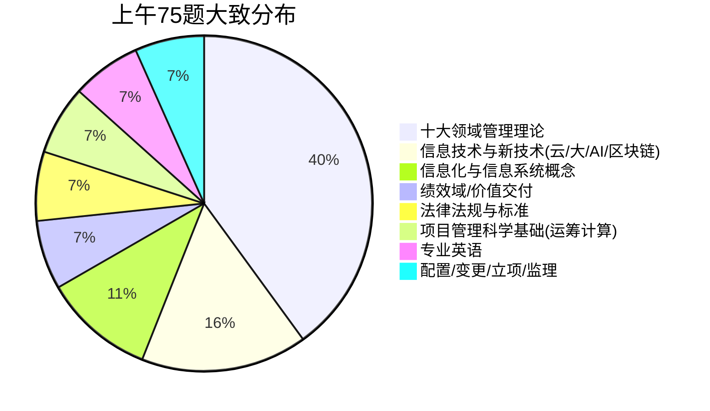
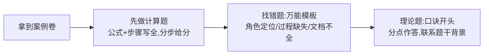
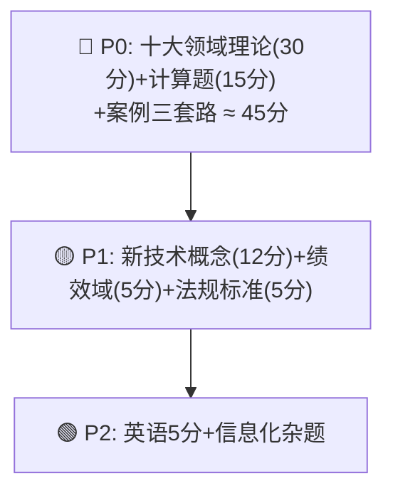

> **摘要**：
> 这是「背多分」型考试：管理理论占 60%+，技术只考概念。**第 4 版教材（2023 年 11 月首次启用）是现行考纲**，新增绩效域和价值交付，弱化了 49 过程的死记硬背。

## 三科结构

| 科目 | 形式 | 时长 | 题量 | 满分/及格 |
|---|---|---|---|---|
| 综合知识 | 75 道单选（机考） | 150 min | 75 题 | 75 / 45 |
| 案例分析 | 3 道大题（1 必答 + 2 选答，近改为 3 必答趋势） | 90 min | 3 题 | 75 / 45 |
| 论文 | 二选一，摘要≤300 字+正文 2000~3000 字 | 120 min | 1 篇 | 75 / 45 |

## 上午题分值地图（第 4 版教材时代）

> **提示**：
> ① 十大领域理论题 ≈ 30 分，是基本盘，口诀+表格背诵效率最高；② **计算题只考固定几类**（挣值、进度网络图、决策树、线性规划少量），套路化训练 10 小时内可全拿；③ 新技术题考「是什么/特点/场景」，不深究原理。

## 案例题题型拆解（90 分钟 3 道题，每题 25 分左右）

| 题型 | 特征 | 对应笔记 |
|---|---|---|
| ① **计算必考**：挣值(EV/PV/AC/CPI/SPI/ETC/EAC)、进度网络图(关键路径/总时差)、预测 | 每年必有 1 道，25 分 | [08-项目成本管理](项管-章节笔记/08-项目成本管理/) [07-项目进度管理](项管-章节笔记/07-项目进度管理/) |
| ② 理论问答：某领域「怎么做/输出什么/出问题怎么办」 | 高频：风险/质量/整合变更/干系人 | 各领域章节 |
| ③ 找错改错题：给一段项目经理的错误做法，让你指出问题并给正确做法 | 高频，万能句式可套 | [项管-案例分析攻略](项管-案例分析攻略/) |

## 论文命题规律（2019–2025 高频主题）

- **十大领域轮考**：近十年每场从十大领域抽 1-2 个出题（进度、成本、质量、风险、沟通、整合、资源、采购、干系人、范围）
- **子题目细化**：不只问「论 XX 管理」，还会带 2-3 个小问题（如「结合项目说明你如何编制 WBS」「风险应对措施及效果」）
- **新趋势**：第 4 版教材后可能结合 **绩效域**、敏捷/混合式出题
- 格式铁律：**摘要 ≤300 字（机考答题框上限）+ 正文 2000~3000 字（最佳 2500）**，正文按「项目背景 → 理论过程 → 我的做法 → 效果教训」展开

> **注意**：
> 准备 **1 个万能项目**（真实做过、能套 10 个领域、带金额/工期/团队规模的数字），按 [项管-论文攻略](项管-论文攻略/) 练 5 篇覆盖高频领域（进度/成本/质量/风险/沟通），考前每篇至少完整写 1 遍。

## 第 4 版教材变化速览（老资料会害死你）

| 变化点 | 说明 |
|---|---|
| 教材改版 | 2023 年 11 月考试起启用第 4 版（原第 3 版内容大量作废） |
| 新增 | **项目绩效域**（8 大绩效域）、**价值交付系统**、项目管理原则（12 项） |
| 弱化 | 49 个过程的 ITTO 死记要求降低，改为「原则+绩效导向」 |
| 重写 | 信息技术章节（云计算/大数据/AI/区块链/IoT/5G 全部更新） |
| 保留 | 十大领域框架、挣值计算、配置变更管理（仍是案例论文主力） |

## 备考优先级

## ➡️ 下一步

- 制定计划：[小白备考路线图](../00-备考指南/小白备考路线图/)
- 开始第一章：[01-信息化与信息系统](项管-章节笔记/01-信息化与信息系统/)
- 案例专项：[项管-案例分析攻略](项管-案例分析攻略/) · 论文专项：[项管-论文攻略](项管-论文攻略/)
