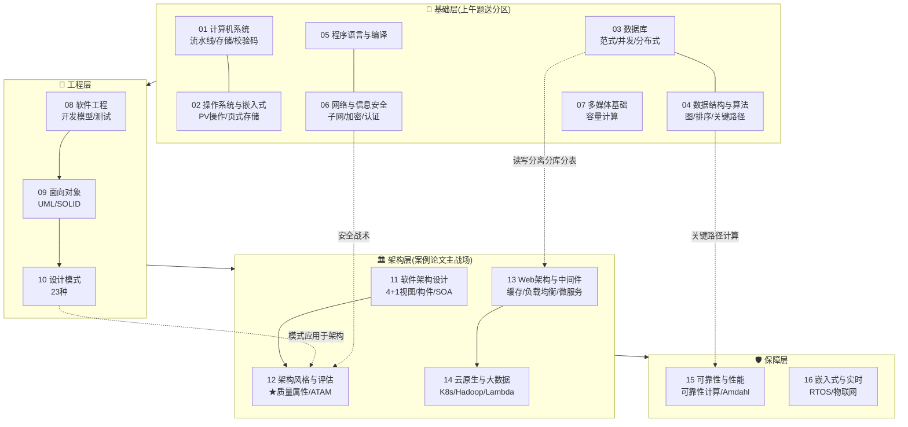
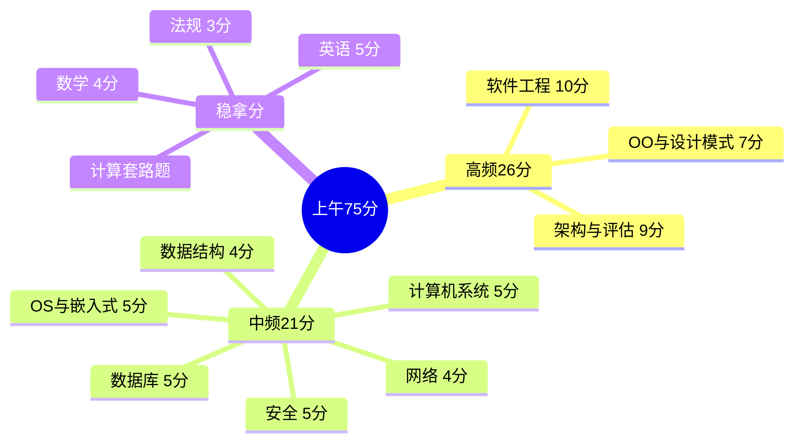

> **摘要**：
> 架构师知识像盖楼:**基础层**(01-07 地基)→ **工程层**(08-10 施工方法)→ **架构层**(11-14 楼体设计,占分最高)→ **保障层**(15-16 特殊场景)。箭头指向"上层依赖下层"。

## 全景图

## 上午题分值热度

## 案例论文的素材流向

| 案例题型 | 主要弹药库 | 联动章节 |
|---|---|---|
| 质量属性+评估(必考) | [12-架构风格与架构评估](../01-系统架构设计师/架构-章节笔记/12-架构风格与架构评估/) | [11-软件架构设计](../01-系统架构设计师/架构-章节笔记/11-软件架构设计/) [15-系统可靠性与性能](../01-系统架构设计师/架构-章节笔记/15-系统可靠性与性能/) |
| 数据库改造 | [03-数据库系统](../01-系统架构设计师/架构-章节笔记/03-数据库系统/) | [13-Web架构与中间件](../01-系统架构设计师/架构-章节笔记/13-Web架构与中间件/) |
| Web/微服务 | [13-Web架构与中间件](../01-系统架构设计师/架构-章节笔记/13-Web架构与中间件/) | [14-云原生与大数据架构](../01-系统架构设计师/架构-章节笔记/14-云原生与大数据架构/) |
| 设计模式应用 | [10-设计模式](../01-系统架构设计师/架构-章节笔记/10-设计模式/) | [09-面向对象方法](../01-系统架构设计师/架构-章节笔记/09-面向对象方法/) |
| 论文四主题 | 架构风格/质量属性/数据库/Web | 对应章节+"🎯 视频讲解" |

## 一句话串联(检验你是否真的懂了)

能顺着讲出下面 5 条逻辑链,架构层就通了:

1. 需求质量属性 → 选**架构风格** → 用**战术**落地 → 用 **ATAM** 评估 → 敏感点/权衡点收尾
2. 单体扛不住 → 拆**微服务**(11 章 SOA 对比)→ 引入注册中心/网关/熔断(13 章)→ 数据一致性用 MQ 最终一致(13 章)
3. 数据量爆炸 → 缓存 → 读写分离 → 分库分表 → NoSQL 补充(3 章)
4. 代码难维护 → 违反了什么原则(9 章 SOLID)→ 用什么模式治(10 章)
5. 系统要 99.99% → 可用性战术(12 章)→ 冗余模型可靠性计算(15 章)
