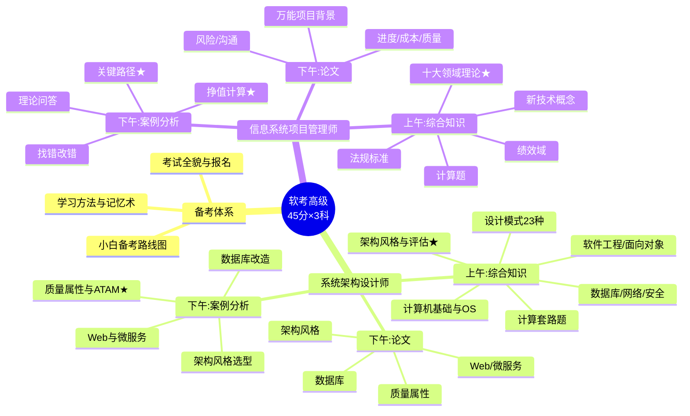

> **摘要**：
> 这是从 10000 米高空俯瞰两个科目。复习到中后期(阶段二起),每周对着这张图自问:每个分支我还能讲出什么?讲不出的分支就是回炉点。分科细图见 [架构师知识图谱](架构师知识图谱/) 和 [项管师知识图谱](项管师知识图谱/)。

## 两科全局

## 学习主线(两科通用)

## 知识之间的连接(命题人的出题网)

架构师的题爱这样连着考:

- [06-网络基础与信息安全](../01-系统架构设计师/架构-章节笔记/06-网络基础与信息安全/) 的加密认证 → 会被放进 [12-架构风格与架构评估](../01-系统架构设计师/架构-章节笔记/12-架构风格与架构评估/) 的安全性战术题里
- [10-设计模式](../01-系统架构设计师/架构-章节笔记/10-设计模式/) 的模式选择 → 出现在 [13-Web架构与中间件](../01-系统架构设计师/架构-章节笔记/13-Web架构与中间件/) 的微服务改造题里
- [03-数据库系统](../01-系统架构设计师/架构-章节笔记/03-数据库系统/) 的读写分离分库分表 → 是案例高频题,也是论文高频主题

项管的题爱这样连着考:

- [05-项目整合管理](../02-信息系统项目管理师/项管-章节笔记/05-项目整合管理/) 的变更流程 → 一旦考变更,几乎必联动 [15-配置与变更管理](../02-信息系统项目管理师/项管-章节笔记/15-配置与变更管理/) 的配置库
- [08-项目成本管理](../02-信息系统项目管理师/项管-章节笔记/08-项目成本管理/) 的挣值 → 与 [07-项目进度管理](../02-信息系统项目管理师/项管-章节笔记/07-项目进度管理/) 的关键路径在案例里二选一必出一道
- [11-项目沟通与干系人管理](../02-信息系统项目管理师/项管-章节笔记/11-项目沟通与干系人管理/) → 论文常与 [12-项目风险管理](../02-信息系统项目管理师/项管-章节笔记/12-项目风险管理/) 同场供选

## 复盘方法

1. 打开 Obsidian 左侧 **Graph View**(图谱视图),看到所有章节连成的网络
2. 点击任一节点,顺着"🔗 相关章节"跳 2 层,检验能否复述连接逻辑
3. 每周日:在本文件下方追加一节"本周复盘",记录薄弱分支

## 本周复盘

*(在此追加)*
