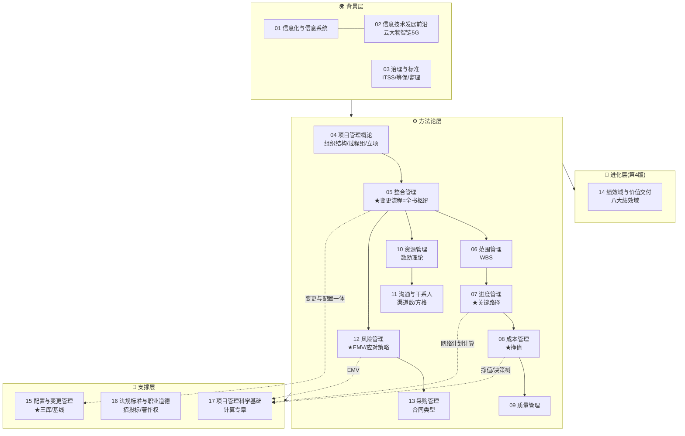
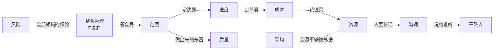
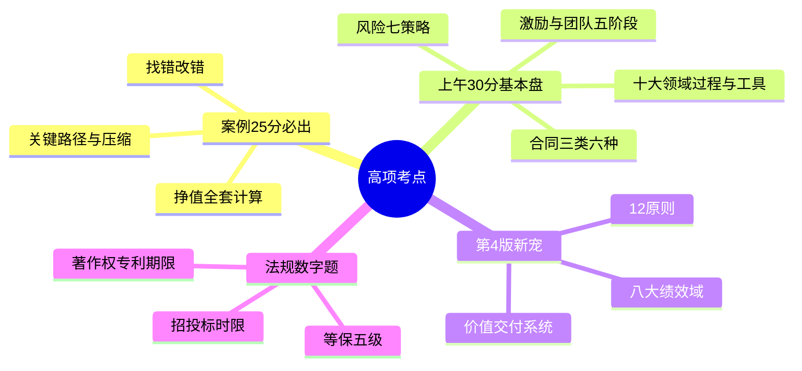

> **摘要**：
> 项管知识像一条流水线:**背景层**(01-03 项目从哪来)→ **方法论层**(04 概论+十大领域 05-13 管什么)→ **进化层**(14 绩效域:第 4 版新思维)+ **支撑层**(15-17 工具与规则)。

## 全景图

## 十大领域内部关系(案例分析的出题网)

## 高频考点热度图

## 一句话串联(检验逻辑链)

1. 立项(4 章)→ 章程授权(5 章)→ 收集需求定 WBS(6 章)→ 排进度(7 章)→ 估预算(8 章)→ 过程保质量(9 章)
2. 变更怎么来?干系人提需求(11 章)→ 走变更流程(5 章)→ 更新范围基准(6 章)→ 进度成本基准联动(7/8 章)→ 配置库记版本(15 章)
3. 风险哪里来?范围没定清(6 章)、资源不足(10 章)、外包失控(13 章)、新技术不确定(14 章)→ 识别定性定量应对(12 章)→ 挣值监控偏差(8 章)
4. 计算题一网打尽:渠道数(11 章)/三点估算(7 章)/关键路径(7 章)/挣值(8 章)/EMV 决策树(12/17 章)/NPV 盈亏平衡(17 章)

## 论文素材地图

| 论文主题 | 理论从哪来 | 案例细节从哪抄 |
|---|---|---|
| 进度/成本 | [07-项目进度管理](../02-信息系统项目管理师/项管-章节笔记/07-项目进度管理/) [08-项目成本管理](../02-信息系统项目管理师/项管-章节笔记/08-项目成本管理/) | 挣值例题+关键路径例题 |
| 质量 | [09-项目质量管理](../02-信息系统项目管理师/项管-章节笔记/09-项目质量管理/) | 七工具+质量成本 |
| 风险 | [12-项目风险管理](../02-信息系统项目管理师/项管-章节笔记/12-项目风险管理/) | EMV 例题+七策略 |
| 沟通/干系人 | [11-项目沟通与干系人管理](../02-信息系统项目管理师/项管-章节笔记/11-项目沟通与干系人管理/) | 方格+参与度矩阵 |
| 整合/变更 | [05-项目整合管理](../02-信息系统项目管理师/项管-章节笔记/05-项目整合管理/) [15-配置与变更管理](../02-信息系统项目管理师/项管-章节笔记/15-配置与变更管理/) | 变更八步流程 |
| 绩效域 | [14-绩效域与价值交付](../02-信息系统项目管理师/项管-章节笔记/14-绩效域与价值交付/) | 各域检查方法表 |
